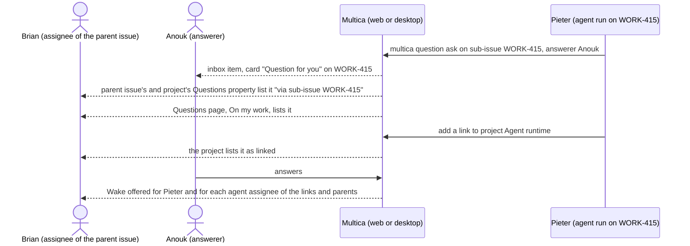
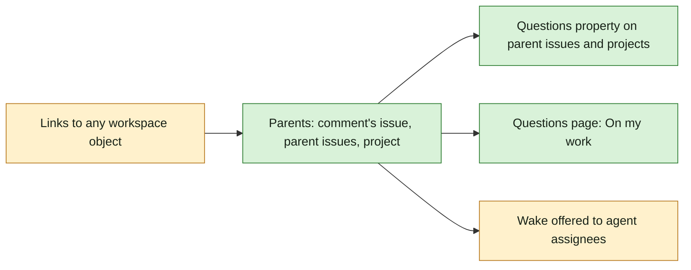

## At a glance

| Kind | Name | Change | Path |
|---|---|---|---|
| Model | Links to any workspace object; resolving parents | changed | `server/` |
| CLI | `multica question` links a question to more objects | changed | `server/cmd/multica/cmd_question.go` |
| Screen | Parent issue: Questions property lists questions below, "via ..." | changed | `packages/views/issues/components/issue-detail.tsx` |
| Screen | Project: Questions property | changed | `packages/views/projects/` |
| Screen | Questions page: On my work tab | changed | `packages/views/questions/` |

## Why

Whoever owns a piece of work needs to see the questions asked on anything below it, even when they are not asked to answer. Today a question on a sub-issue is invisible from its parent and its project. Showing every question on each parent, and to the assignees of its links and parents, lets the owner follow and act without being asked.

It is UJ-4 of [PRD: Questions in Multica](anytype://object?objectId=bafyreiaviofipcl3ymgld2skld4ij6hlarsm2ra55ygufsepgk5laxjf34) and builds on changes `answer-an-agents-question-and-wake-it` (UJ-1) and `answer-every-open-question-in-one-sitting` (UJ-3).

Success signal: Pieter asks Anouk a question on sub-issue WORK-415; Brian, the parent's assignee and no answerer, sees it on the parent issue's and the project's Questions property marked "via sub-issue WORK-415" and on his Questions page under **On my work**.

## What Changes

- A question can link to an issue, a sub-issue, a project, a comment, an agent run or another workspace object, and to more than one; the asker can add links after the first.
- Every object above a link is a parent: a comment's issue, an issue's parent issues, their project.
- A parent issue and a project list the questions of everything below them in their Questions property, each marked with the link it came from.
- The member assignees of a question's links and parents see it under **On my work** on the Questions page.
- **Wake** is offered for the asking agent and for the agent assignees of each link and parent.

## Capabilities

### New Capabilities

- `questions`: (adds to it) lets a question link to any workspace object and gain links after it is asked.
- `issue-questions`: (adds to it) lets parent issues and projects show the questions of everything below them.
- `questions-page`: (adds to it) lets members see the questions on work they are assigned to, under On my work.
- `agent-wake`: (adds to it) lets a member wake the agent assignees of a question's links and parents.

## Impact

- Server: link kinds, parent resolution, listing by parent and by indirect audience.
- CLI: adding links to a question.
- Web and desktop: Questions property on parent issues and projects; On my work tab.

## Constraints

- Builds on changes `answer-an-agents-question-and-wake-it` and `answer-every-open-question-in-one-sitting`; their requirements hold unchanged.
- The indirect audience follows and wakes; it does not answer unless it is an answerer.
- No foreign keys or cascades for links: links to deleted objects are cleaned up in application code (AGENTS.md).
- Web and desktop only; no new design token or colour.

## Non-goals

- Making the indirect audience answerers.
- People adding links: only the asking agent links its questions, since only agents ask.

## Sources

- [PRD: Questions in Multica](anytype://object?objectId=bafyreiaviofipcl3ymgld2skld4ij6hlarsm2ra55ygufsepgk5laxjf34): UJ-4; FR-2, FR-15, FR-16, FR-17 (On my work), FR-20 (agents offered).
- Design and UX spec: [appboypov/multica#6](https://github.com/appboypov/multica/pull/6), `designs/screens/issue-questions.md` "Concepts" (Link, Parents, Indirect audience) and "Where questions live" 2.
- Prototype: [appboypov/multica#8](https://github.com/appboypov/multica/pull/8), `prototypes/web/issue-questions/`.
- Brian's answers: the WORK-366 comments ("questions link to anything and are relevant to all parents"; "a question on an issue is indirectly a question for its assignee") and [Plannotator Review b8b3060eec0c8d52](https://ctas.de-appspecialist.nl/plannotator/session/b8b3060eec0c8d52/) (what a question can be asked on).
