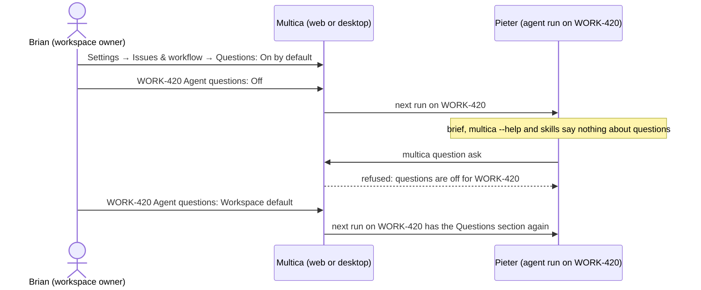
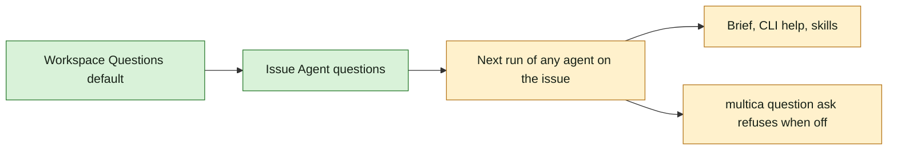

## At a glance

| Kind | Name | Change | Path |
|---|---|---|---|
| Setting | Workspace Questions default | new | `server/` |
| Property | Issue Agent questions: Workspace default, On, Off | new | `server/` |
| Screen | Settings → Issues & workflow → Questions | new | `packages/views/settings/components/questions-tab.tsx` |
| Screen | Issue detail: Agent questions row | changed | `packages/views/issues/components/issue-detail.tsx` |
| Agent brief | Questions section only while on | changed | `server/internal/daemon/execenv/runtime_config_sections.go` |
| CLI | `multica question` listed and usable only while on | changed | `server/cmd/multica/cmd_question.go` |
| Skill | Built-in `multica-platform` skill without questions while off | changed | `server/internal/service/builtin_skills/multica-platform/` |

## Why

On some work Brian wants an agent to run without stopping for answers. Whether agents may ask is a workspace default that each issue can change at any time, and an agent that may not ask is told nothing about questions, so it never wastes context on a tool it cannot use.

It is UJ-5 of [PRD: Questions in Multica](anytype://object?objectId=bafyreiaviofipcl3ymgld2skld4ij6hlarsm2ra55ygufsepgk5laxjf34) and builds on change `answer-an-agents-question-and-wake-it` (UJ-1), which holds the Questions section and `multica question`.

Success signal: with questions on by default, Brian sets WORK-420 to Off; the next run of Pieter on WORK-420 has no mention of questions in its brief, `multica --help` or skills, and `multica question ask` refuses; after Brian sets it back to Workspace default, the next run has the Questions section again.

## What Changes

- Owners and admins set the Questions default in **Settings → Issues & workflow → Questions**; its row counts the open issues with their own setting.
- Each issue has **Agent questions**: Workspace default (showing the default's current value), On or Off, changeable at any time; a change applies from the next run of any agent on that issue.
- A single run has no setting of its own.
- While questions are off for a run, its brief, `multica --help` and its skills say nothing about questions, and `multica question ask` refuses.

## Capabilities

### New Capabilities

- `agent-questions-setting`: lets owners and admins decide per workspace, and members who can edit an issue decide per issue, whether agents may ask questions; agents neither see nor change it.
- `agent-question-tooling`: (adds to it) tells an agent nothing about questions while they are off and refuses its asks.

## Impact

- Server: workspace setting, issue property, the setting resolved per run.
- Daemon: the brief's Questions section and the skills the run gets depend on the setting.
- CLI: `multica question` hidden from help and refusing asks while off.
- Web and desktop: the settings section and the issue's Agent questions row.

## Constraints

- Builds on change `answer-an-agents-question-and-wake-it`; its requirements hold unchanged.
- The setting covers agents asking; there is no per-run level.
- While off, not one word about questions reaches the agent: brief, CLI help and skills alike.
- Web and desktop only; no new design token or colour.

## Non-goals

- A setting per agent run.
- Turning off answering, Wake or the display of questions already asked.

## Sources

- [PRD: Questions in Multica](anytype://object?objectId=bafyreiaviofipcl3ymgld2skld4ij6hlarsm2ra55ygufsepgk5laxjf34): UJ-5; FR-21, FR-22 (while off).
- Design and UX spec: [appboypov/multica#6](https://github.com/appboypov/multica/pull/6), `designs/screens/issue-questions.md` "Questions setting" and "Where questions live" 3: screen 7 (settings).
- Prototype: [appboypov/multica#8](https://github.com/appboypov/multica/pull/8), `prototypes/web/issue-questions/`.
- Brian's answers: the WORK-366 comments ("a global setting decides whether questions are allowed; it is the default, overridable and changeable per task at any time"; "no information about it when disabled"), [Plannotator Review b8b3060eec0c8d52](https://ctas.de-appspecialist.nl/plannotator/session/b8b3060eec0c8d52/) ("per issue is enough") and WORK-378 (2026-10-13, relayed by Skuddy: the issue's setting is for members only).
