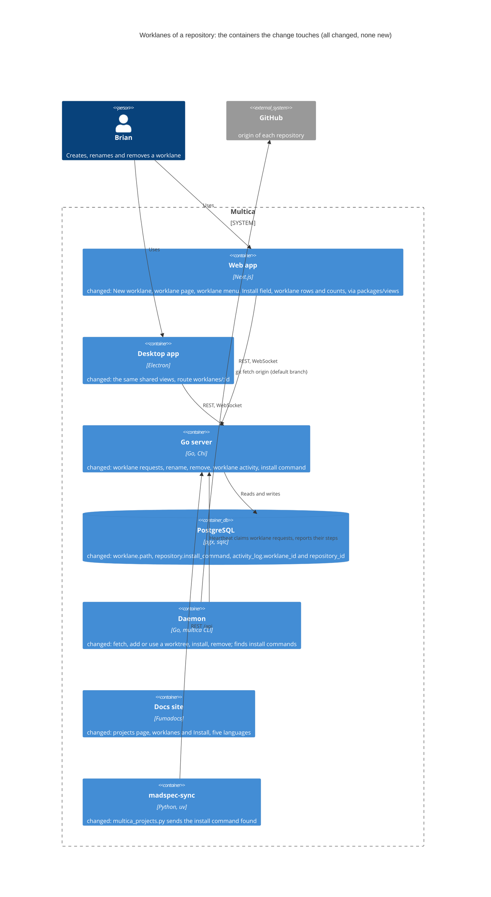
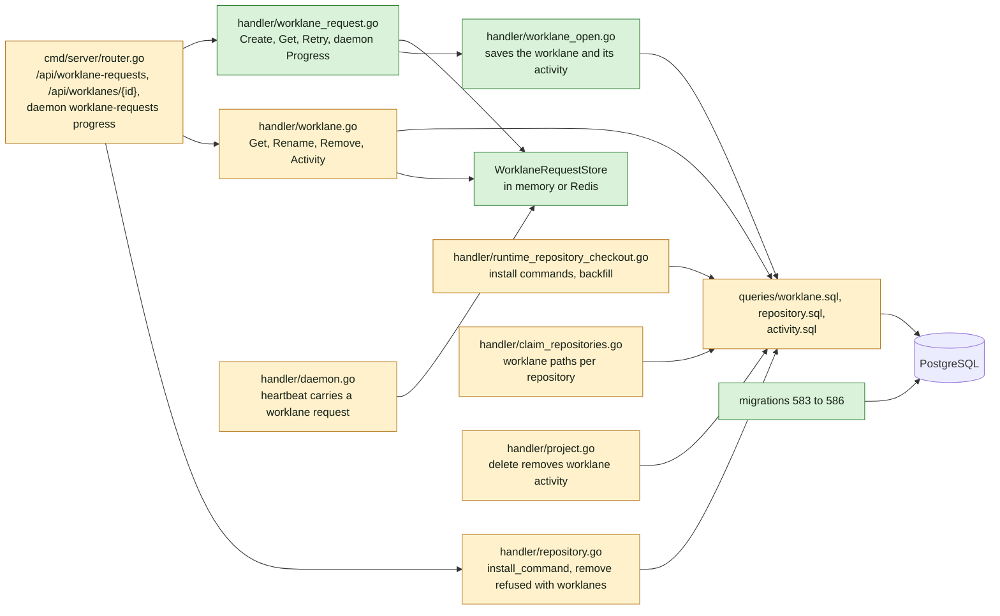
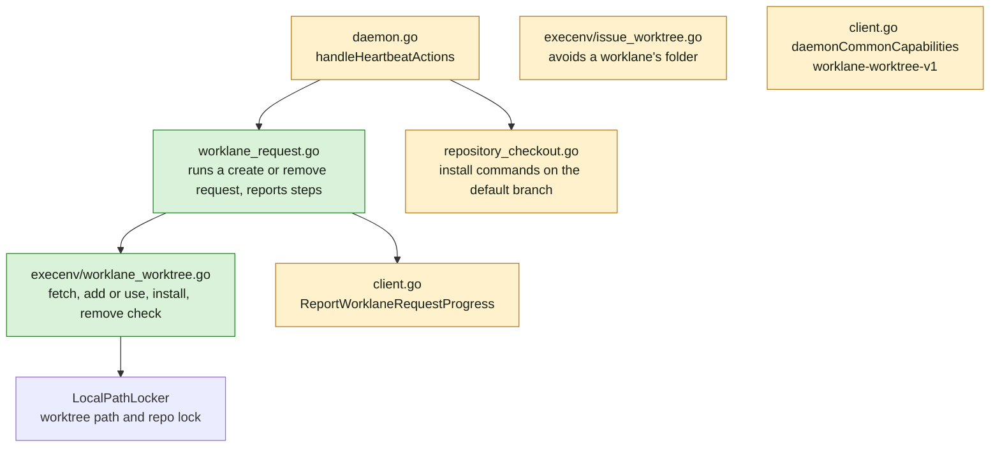
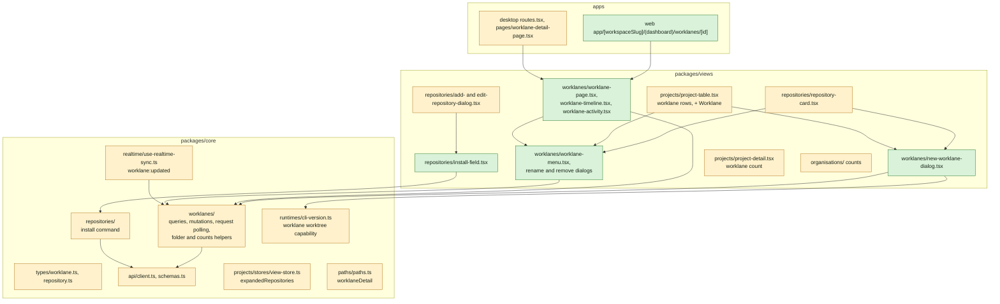
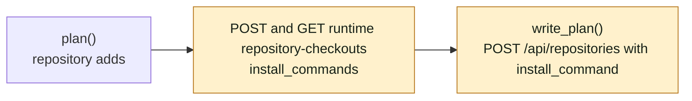
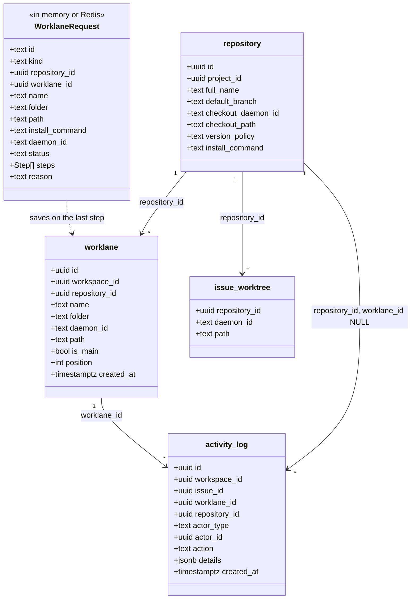
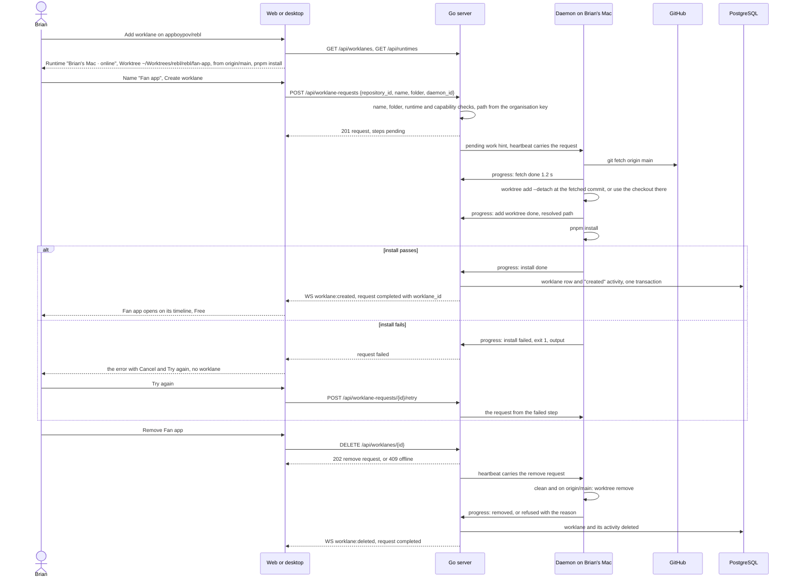

## At a glance

The delta of this change on the living system design, `specs/docs/system-design.md`, on top of UJ-2 `repositories-of-a-project` (DAS-451). Every container it touches already exists; the change adds no container. Mobile does not change: the API changes are additive and the PRD keeps mobile out of scope.

Go server component map, delta:

Daemon component map, delta:

Web and desktop component map, delta:

Brain sync, delta:

Models:

`install_command`, `worklane.path`, `activity_log.worklane_id` and `activity_log.repository_id` are new columns; `WorklaneRequest` is a new request record outside PostgreSQL.

Journey sequence and data flow:

| Kind | Name | Change | Path |
|---|---|---|---|
| Migration | `worklane.path`, `repository.install_command`, `activity_log.worklane_id` and `repository_id` | new | `server/migrations/583_worklane_worktrees.up.sql`, `.down.sql` |
| Migration | One folder per worklane of a repository | new | `server/migrations/584_worklane_folder_index.up.sql`, `.down.sql` |
| Migration | A worklane's activity | new | `server/migrations/585_activity_log_worklane_index.up.sql`, `.down.sql` |
| Migration | A repository's activity on its worklanes | new | `server/migrations/586_activity_log_repository_index.up.sql`, `.down.sql` |
| Migrator | Cleanups for the three concurrent indexes | changed | `server/cmd/migrate/main.go` |
| Queries | Worklane create, rename, get, delete, next position, paths per daemon | changed | `server/pkg/db/queries/worklane.sql` |
| Queries | Install command and its backfill | changed | `server/pkg/db/queries/repository.sql` |
| Queries | Worklane activity | changed | `server/pkg/db/queries/activity.sql` |
| Generated | sqlc output | changed | `server/pkg/db/generated/` |
| Handler | Worklane requests: create, get, retry, daemon progress, the store | new | `server/internal/handler/worklane_request.go` |
| Handler | Open the worklane: save it with its activity | new | `server/internal/handler/worklane_open.go` |
| Handler | Worklane get, rename, remove, activity | changed | `server/internal/handler/worklane.go` |
| Handler | Install command on create and update; remove refused with worklanes | changed | `server/internal/handler/repository.go` |
| Handler | Install commands in the check result and the backfill | changed | `server/internal/handler/runtime_repository_checkout.go` |
| Handler | Worklane paths in the claim | changed | `server/internal/handler/claim_repositories.go` |
| Handler | Heartbeat carries a worklane request | changed | `server/internal/handler/daemon.go`, `handler.go` |
| Handler | Project delete removes worklane activity | changed | `server/internal/handler/project.go` |
| Routes | Worklane requests, worklane routes, daemon progress | changed | `server/cmd/server/router.go` |
| Events | `worklane:updated` | changed | `server/pkg/protocol/events.go`, `server/cmd/server/listeners.go` |
| Protocol | Pending work kind, heartbeat request, capability, claim paths | changed | `server/pkg/protocol/messages.go` |
| Daemon | Worklane request runner | new | `server/internal/daemon/worklane_request.go` |
| Runtime | Worklane worktree steps and remove check | new | `server/internal/daemon/execenv/worklane_worktree.go` |
| Daemon | Install commands in the checkout check | changed | `server/internal/daemon/repository_checkout.go` |
| Runtime | Issue worktree avoids a worklane's folder | changed | `server/internal/daemon/execenv/issue_worktree.go`, `server/internal/daemon/issue_worktree.go` |
| Daemon | Heartbeat action, progress report, capability | changed | `server/internal/daemon/daemon.go`, `client.go`, `types.go` |
| Type | Worklane path, state, activity, request; repository install command | changed | `packages/core/types/worklane.ts`, `repository.ts` |
| Schema and client | Worklane request, worklane, activity, install command | changed | `packages/core/api/schemas.ts`, `client.ts` |
| Feature | Worklane queries, mutations, request polling, folder and count helpers | changed | `packages/core/worklanes/` |
| Feature | Install command on create and update | changed | `packages/core/repositories/` |
| Feature | Realtime, modals, view store, paths, capability | changed | `packages/core/realtime/use-realtime-sync.ts`, `packages/core/modals/store.ts`, `packages/core/projects/stores/view-store.ts`, `packages/core/paths/paths.ts`, `packages/core/runtimes/cli-version.ts` |
| Dialog | New worklane | new | `packages/views/worklanes/components/new-worklane-dialog.tsx` |
| Page | Worklane: timeline, state, activity | new | `packages/views/worklanes/components/worklane-page.tsx`, `worklane-timeline.tsx`, `worklane-activity.tsx` |
| Menu | Worklane: Rename, Remove | new | `packages/views/worklanes/components/worklane-menu.tsx`, `rename-worklane-dialog.tsx`, `remove-worklane-dialog.tsx` |
| Field | Install | new | `packages/views/repositories/components/install-field.tsx` |
| Dialog | Add and Edit repository: Install | changed | `packages/views/repositories/components/add-repository-dialog.tsx`, `edit-repository-dialog.tsx`, `checkout-field.tsx` |
| Section | Repository card: worklanes, count, Add worklane | changed | `packages/views/repositories/components/repository-card.tsx` |
| Page | Projects and an organisation's page: worklane rows, + Worklane, counts | changed | `packages/views/projects/components/project-table.tsx`, `packages/views/organisations/components/` |
| Section | Project header: worklane count | changed | `packages/views/projects/components/project-detail.tsx` |
| Registry | The three worklane dialogs | changed | `packages/views/modals/registry.tsx` |
| Route | Worklane page on web | new | `apps/web/app/[workspaceSlug]/(dashboard)/worklanes/[id]/page.tsx` |
| Route | Worklane page on desktop | changed | `apps/desktop/src/renderer/src/routes.tsx`, `pages/worklane-detail-page.tsx` |
| Copy | `worklanes` namespace, Install copy | new, changed | `packages/views/locales/{en,fr,ja,ko,zh-Hans}/` |
| Docs | Projects page: worklanes and Install | changed | `apps/docs/content/docs/projects*.mdx` |
| Tool | Brain sync sends the install command found | changed | `madspec-sync/multica_projects.py`, `madspec-sync/tests/test_multica_projects.py`, `madspec-sync/specs/multica-projects.md` |
| Component | Check/Skipped, Activity entry | new | `designs/systems/multica.lib.pen` |
| Design | Screens of this journey | changed | `designs/screens/steer-all-work.pen`, `designs/exports/`, `designs/creation-flows.md` |
| Prototype | Data-flow prototype | new | `prototypes/web/worklanes-of-a-repository/data-flow/` |
| Prototype | Live prototype | changed | `prototypes/web/src/components/generated/` |
| E2E | Journey acceptance test | new | `e2e/worklanes.spec.ts` |
| ADR | Worklane activity is kept in the activity log | new | `adr/0008-worklane-activity-is-kept-in-the-activity-log.md` |
| ADR | The server keeps worklane and issue worktree folders apart | new | `adr/0009-the-server-keeps-worklane-and-issue-worktree-folders-apart.md` |

## Context

Journey UJ-3 of [PRD: Multica: steer projects, repositories, worklanes and releases](anytype://object?objectId=bafyreiew63xw2dncss52jdx4qk4o6aktkklhqroclvs3cvjxcyztx7h5um), F3 with FR-20 to FR-28. It builds on UJ-2 `repositories-of-a-project` (DAS-451, branch `das-451-uj-2-brian-adds-a-repository-to-a-project`): ADR-0006 with `repository`, `worklane` (with `main`) and `issue_worktree`, ADR-0007, the checkout check round trip and migrations 575 to 582. UJ-2 builds on UJ-1 `projects-by-organisation` (DAS-450): `organisation.key`, migrations 572 to 574, `project-table.tsx` and the Organisations pages. This change's migrations start at 583. `release-line-of-a-repository` (UJ-4) adds releases to the worklane's timeline and repository-wide entries to its activity; `issues-from-templates` (UJ-5) and `worklane-board-and-list` (UJ-6) put issues in a worklane, make it Busy and switch its worktree; `worklanes-and-releases-pages` (UJ-7) lists worklanes; `release-ships` (UJ-8) adds shipping entries.

**Journey steps.** The investigation finds nothing for three steps, and no `Keep:` Request names them. Each gets its `Skip:` Request once the journey exists in the brain:

- `Skip: J1` Project structure: no new container, app or package. The new modules sit in existing packages: `packages/core/worklanes/` (made in UJ-2), `packages/views/worklanes/`, and files in `server/internal/handler/` and `server/internal/daemon/`.
- `Skip: J4` Design system: `designs/systems/multica.lib.pen` has the tokens the new states need: success, destructive, muted and the step colours of `Check/*`.
- `Skip: J10` Agent tooling for UI: no agent or CLI creates, renames or removes a worklane (proposal Non-goals). The brain sync is a tool, built in J8.

J2, J3, J5, J6, J7, J8, J9 and J11 have work. J5 has work because the library has no skipped step and no activity entry: it holds `Check/Done`, `/Running`, `/Pending` and `/Failed`, `Worklane row`, `Tree row/Repository`, `Menu`, `Menu item/Default` and `/Disabled`, `Dialog`, `Form field`, `Input/Error`, `Select`, `Readonly value` and `Note`, which cover the rest. J6 has work because screens 7, 7b and 7c show the superseded path `~/Worktrees/rebl/fan-app/rebl`, and no screen shows a worklane's activity, its menu, Rename, Remove, the Install field or the folder and runtime errors.

**Code map.**

- Round trips to copy, from UJ-2's design: `RepositoryCheckoutStore` (in memory or Redis), `PendingWorkKindRepositoryCheckout`, `requireRuntimeLocalSkillAccess` (`handler/runtime_local_skills.go` L572), and today's directory listing: `DirectoryListingStore` (`handler/runtime_directory_listing.go` L39), `requestDaemonPendingWork` (`handler/runtime_models.go` L446), the heartbeat ack that pops one pending item per runtime (`handler/daemon.go` L1464 to L1472, `resp["pending_directory_listing"]` L1197) and the daemon's dispatch in a goroutine (`daemon/daemon.go` L4594).
- Capabilities: `protocol/messages.go` lists them; the daemon advertises `daemonCommonCapabilities()` (`daemon/client.go` L204); `runtimeHasCapability` (`handler/daemon.go` L1615) reads them from the newest runtime row's metadata. UJ-2 removes `local-worktree-v1` and `runtimeAdvertisesLocalWorktree`; this change adds `worklane-worktree-v1` the same way.
- Activity: `activity_log` (`001_init.up.sql` L156) holds `workspace_id`, a nullable `issue_id`, `actor_type`, `actor_id`, `action`, `details`. Every query in `queries/activity.sql` filters by `issue_id` or by `action`; `workspace_delete.sql` L360 deletes by `workspace_id`. New nullable columns change no existing read.
- Git helpers: `execenv/git.go` (`fetchOrigin`, `runGitWorktreeAdd`), `execenv/local_worktree.go` `runGit*` (moved by UJ-2), UJ-2's `execenv/issue_worktree.go` (reuse of an existing worktree at a path) and its `origin` matcher in `repository_checkout.go`. `LocalPathLocker` (`daemon/local_directory.go` L480, moved by UJ-2 into `issue_worktree.go`).
- Routes and pages: `apps/desktop/src/renderer/src/routes.tsx` L146 (`projects/:id`), `apps/web/app/[workspaceSlug]/(dashboard)/projects/[id]/page.tsx`, `packages/core/paths/paths.ts` L33 (`projectDetail`).
- Prototype: `NewWorklaneDialog` (`creation.tsx` L433) with `StepState` `done | run | pend | fail` and `laneFolder` (`model.ts` L242).

**What must not change.** Brian's normal checkouts: creating a worklane only fetches into it and adds a worktree. Issue worktrees of UJ-2, except the rare folder a worklane already holds. Project delete keeps UJ-2's behaviour and also deletes the worklanes' activity.

**Living system design.** `specs/docs/system-design.md` matches `main` at `10a1307d1`: the commits since its last update in `f0b0534ca` are `bc03c19c3` (the CLI's agent copy) and `10a1307d1` (prototypes), which change no container, component or model. It changes when this change's code merges, as with UJ-1 and UJ-2.

## Goals / Non-Goals

**Goals:**

- New worklane on the repository card, on Projects and on an organisation's page, making the worktree on the checkout's runtime step by step and saving the worklane only after every step passed.
- The worklane page with its breadcrumb, state, empty timeline and activity; worklane rows and counts; Rename and Remove.
- A repository's install command, found by Multica, set in Add and Edit repository and sent by the brain sync.
- A worklane, its activity and its timeline that UJ-4 to UJ-8 extend without rework: the state is a response field, repository-wide activity has its place, and the timeline is its own component.

**Non-Goals:**

- Busy, a worklane's next issue, agents working in its worktree, switching after a merge (UJ-6); releases and their activity (UJ-4, UJ-8); issues on a worklane (UJ-5, UJ-6).
- Creating a worklane from the CLI or by an agent, reordering worklanes, changing a worklane's folder or runtime.
- Mobile, Squads, dark mode.

**Always:**

- No foreign keys or cascades. Each concurrent index is its own migration file.
- UI-consumed JSON goes through zod with `parseWithFallback`.
- Only the daemon touches a runtime's disk; the server records the absolute paths it resolved (ADR-0007).
- Create, rename and remove await the server.

**Never:**

- A worklane row without a worktree that every step made or found.
- Deleting anything on a runtime when creating, failing or cancelling a worklane.
- Removing a worktree that holds an uncommitted change or a commit missing from `origin/{default branch}`.
- The brain sync changing an install command set in Multica.

## Decisions

### 1. The model

Migration 583 adds, all nullable and without defaults, so the `ALTER`s are metadata-only:

- `repository.install_command text`: NULL means not found yet, `''` means None, anything else is the command.
- `worklane.path text`: the absolute worktree path the daemon resolved. NULL for `main`, which works in the checkout (ADR-0006: a path is stored when its worktree is made, so a later key change moves nothing).
- `activity_log.worklane_id uuid` and `activity_log.repository_id uuid` (ADR-0008).

Indexes, each its own file: `UNIQUE (repository_id, folder) WHERE folder IS NOT NULL` (584); `(worklane_id, created_at DESC, id DESC) WHERE worklane_id IS NOT NULL` (585); `(repository_id, created_at DESC, id DESC) WHERE repository_id IS NOT NULL AND worklane_id IS NULL` (586). UJ-2's `(repository_id, LOWER(name))` already keeps names unique, `main` included.

A worklane's `daemon_id` is the machine its worktree lives on, the checkout's machine at creation. A later checkout move leaves existing worklanes where they are. `position` is the repository's highest plus one, taken inside the transaction that saves the worklane.

The worklane response is UJ-2's plus `path` and `state`. `state` is `free` for every worklane in this change, since no issue can be in one yet; the zod schema has `free` and `busy` with `free` as the fallback, so UJ-6 sets Busy without a schema change.

### 2. Endpoints

| Method and path | Body | Answer |
|---|---|---|
| `POST /api/worklane-requests` | `{repository_id, name, folder, daemon_id}` | 201 the request |
| `GET /api/worklane-requests/{id}` | none | the request |
| `POST /api/worklane-requests/{id}/retry` | none | the request, running again |
| `GET /api/worklanes/{id}` | none | the worklane |
| `PATCH /api/worklanes/{id}` | `{name}` | the worklane |
| `DELETE /api/worklanes/{id}` | none | 202 the remove request |
| `GET /api/worklanes/{id}/activity` | none | `{entries}`, oldest first, the newest 200 |
| `POST /api/daemon/runtimes/{runtimeId}/worklane-requests/{requestId}/progress` | `{steps, path?, outcome?, reason?}` | 204 |

A request is `{id, kind: create or remove, repository_id, worklane_id, name, folder, path, base, install_command, daemon_id, runtime_name, status: running, failed, completed or refused, steps: [{key, state, detail, output, duration_ms}], reason: {code, detail}, created_by}`. Step keys are `fetch`, `add_worktree`, `install` and `open`; states are `pending`, `running`, `done`, `skipped` and `failed`. Unknown keys, states and codes fall back to `unknown` in zod and show as a failed step with the server's detail.

Create refuses, before anything runs on the runtime:

| Check | Answer |
|---|---|
| Name empty | 400 `name_required` |
| Name taken in the repository, ignoring case, `main` included | 409 `name_taken` with the taken name |
| Folder not `^[a-z0-9][a-z0-9-]*$` | 400 `folder_invalid` |
| Folder used by a worklane of the repository | 409 `folder_taken` with that worklane's name |
| `daemon_id` is not the repository's `checkout_daemon_id` | 400 `runtime_no_checkout` |
| The machine is offline | 409 `runtime_offline` with the machine's name |
| Its newest runtime row lacks `worklane-worktree-v1` | 409 `runtime_cannot_make_worktrees` |
| `install_command` is NULL | 409 `install_command_unknown` |
| A running create request for the same repository and folder | 409 `request_running` |

The caller passes `requireRuntimeLocalSkillAccess` on the machine's runtime, as UJ-2's check and clone do, because the install command runs there. The server computes `path` as `~/Worktrees/{organisation key}/{repo}/{folder}`, or `~/Worktrees/{repo}/{folder}` without an organisation, with the key read now, and `base` as `origin/{default_branch}`.

`PATCH` refuses `main` (400 `main_fixed`) and a taken name (409 `name_taken`), saves the name in one transaction with a `worklane_renamed` entry, and publishes `worklane:updated`. `DELETE` refuses `main` (400 `main_fixed`) and an offline machine (409 `runtime_offline`) at once; otherwise it enqueues a remove request.

UJ-2's `DELETE /api/repositories/{id}` refuses while the repository has a worklane besides `main`: 409 `has_worklanes` with their names.

### 3. Creating a worklane runs as a request whose last step saves it

`WorklaneRequestStore` follows UJ-2's `RepositoryCheckoutStore`: in memory or Redis, keyed by request id, with a pending queue per runtime that the heartbeat pops (`PendingWorkKindWorklaneRequest`, `pending_worklane_request` in the ack). It keeps a finished request for 30 minutes. A running request with no progress for 15 minutes fails with `lost`: "Brian's Mac stopped answering", with Try again.

The heartbeat item carries `{id, kind, full_name, default_branch, checkout_path, path, install_command, from_step, issue_worktree_paths: [{path, issue_key}]}`. The daemon runs it in a goroutine and posts the whole step list after every step change:

1. `fetch`: `git -C {checkout} fetch origin {default_branch}`, then resolves `refs/remotes/origin/{default_branch}` to a commit. The detail is the time it took. A failure carries git's last error lines.
2. `add_worktree`, under the checkout's repo lock. `~` expands to the runtime user's home; the path is made absolute and clean.
   - A path in `issue_worktree_paths` fails with `path_issue_worktree`: "{path} is the worktree of {issue key}. Pick another folder."
   - A missing path or an empty folder: `mkdir -p` of the parent, then `git -C {checkout} worktree add --detach {path} {commit}`. The worktree is detached at the fetched commit. UJ-6 puts it on its issue's branch.
   - A path whose top level is itself and whose `origin` names the repository (UJ-2's matcher): used as it is, with the detail "Uses the worktree that is there".
   - Anything else fails with `path_not_checkout`: "{path} holds something that is not a checkout of {full_name}. Move it or pick another folder." Nothing in it is touched.
   - The resolved absolute path goes back as `path`.
3. `install`: `sh -c {install_command}` in the worktree, under the worktree path's lock, with the daemon's environment and a 20-minute limit, keeping the last 8 KB of output. A non-zero exit fails with "{command} exited with {code}" and the output. An empty command is `skipped`.
4. `open` runs on the server when the daemon reports `install` done or skipped. In one transaction it checks the name and folder again, inserts the worklane with the resolved `path`, the next `position` and the daemon, and inserts `worklane_created` with `actor_type` member, `actor_id` the request's `created_by` and `details {name, runtime_name}`. It then publishes `worklane:created` and completes the request with `worklane_id`. A unique violation fails `open` with `name_taken` or `folder_taken`.

Try again (`retry`) is allowed only on a failed request. It sets the failed step and the steps after it to pending and enqueues the request with `from_step`. A failed `open` reruns on the server alone; an offline machine is 409. Cancel only closes the dialog: the request stays failed until it expires, and what the steps made stays on disk. The next create with that folder uses it (step 2).

No worklane row and no activity entry exist before `open` passes. The spec's "No entry for a failed creation" follows from that.

### 4. Removing a worklane

The remove request runs on the worklane's daemon:

- If the worktree path's lock is held, it is refused with `busy`.
- A missing path is removed: nothing is there to lose.
- A non-empty `git status --porcelain` is refused with `uncommitted`: "Fan app's worktree holds uncommitted changes".
- Otherwise the daemon fetches `origin {default_branch}`, ignoring a failure, because a stale ref only refuses more. If `git rev-list --count HEAD --not refs/remotes/origin/{default_branch}` is above 0, the request is refused with `unpushed`: "Fan app's worktree holds commits that are not on origin/main".
- Otherwise a worktree of the checkout goes with `git -C {checkout} worktree remove {path}`. A standalone clone that was used as it is goes with `os.RemoveAll` only when `git stash list` is empty too, else it is refused with `stashed`. No branch is deleted.

On `removed`, the server deletes, in one transaction, the worklane and its activity rows (`worklane_id = $1`), publishes `worklane:deleted`, and completes the request. On a refusal it marks the request `refused` with the reason, and the remove dialog shows it.

### 5. Worklane and issue worktree folders stay apart (ADR-0009)

Both live in `~/Worktrees/{organisation key}/{repo}/`. The server knows both records and tells the daemon what is taken:

- A create request carries the repository's `issue_worktree_paths` on that daemon, so `add_worktree` never takes an issue's worktree as the worklane's (step 2).
- UJ-2's claim gains `worklane_paths` per repository: the paths of its worklanes on the claiming daemon. When an issue's default path is one of them, `execenv/issue_worktree.go` uses the folder `{issue key}-issue` instead, and records that path as UJ-2 does, so later tasks reuse it.

### 6. Worklane activity (ADR-0008)

Entries are `activity_log` rows with `worklane_id` set and `issue_id` NULL. `GET /api/worklanes/{id}/activity` reads `worklane_id = $1 OR (repository_id = $2 AND worklane_id IS NULL)`, the newest 200 in keyset order, then returns them oldest first, as `ListActivitiesForIssue` does. In this change only the first part matches. UJ-4 writes repository-wide release entries into the second part, and they show on every worklane of the repository without another query.

This change writes two actions: `worklane_created` `{name, runtime_name}` and `worklane_renamed` `{from, to}`. `runtime_name` is the machine name the Runtime field showed, kept so a renamed machine does not rewrite history. The client's zod action enum falls back to `unknown`, which it does not render, so an older desktop app ignores UJ-4's actions. Deleting a worklane, repository or project deletes its rows with `issue_id IS NULL`; workspace delete already deletes every row.

### 7. The install command

- UJ-2's checkout check result gains `install_commands: [{file, command}]`. They come from the files of the spec's table that exist on `refs/heads/{default_branch}`, read with `git cat-file -e` like the version files, in table order.
- `POST /api/repositories` takes `install_command`: a string, with `''` meaning None. When it is absent, the server uses the check's first found command, or `''`. `PUT` takes `install_command` too. The response carries `install_command`, null while not found yet.
- Backfill for repositories from before: when a check for a workspace's runtime passes, the server sets `install_command` to the first command found, or `''`, on the repository with that `full_name`, checkout machine and path whose command is still NULL. It then publishes `repository:updated`. Edit repository and New worklane start that check on open while the command is null and show "Finding the install command". New worklane keeps Create disabled until the command is known.
- `install-field.tsx` is a combobox: the found commands, the first one preselected, then None, then a free-text command. Edit repository shows the saved command.
- The brain sync posts `install_command` from the check it already runs for each repository it adds. It never sends `PUT` for a repository that exists.

### 8. Web and desktop

- `packages/core/worklanes/`:
  - `worklaneKeys.detail(wsId, id)`, `worklaneKeys.activity(wsId, id)` and `worklaneRequestKeys.detail(wsId, id)`.
  - `useCreateWorklaneRequest`, `useRetryWorklaneRequest`, `useRenameWorklane` and `useRemoveWorklane`, each awaiting the server.
  - `worklaneRequestOptions`, which polls every second while `running`.
  - `folderFromName(name)`, the prototype's `laneFolder`, and `folderProblem(folder, worklanes)`, which returns `invalid` or the name of the worklane that holds it.
  - `sortWorklanes`: `main` first, then `position`.
  - `countWorklanes(worklanes, repositories)`, per repository, project and organisation.
- `use-realtime-sync.ts`: `worklane:created`, `worklane:updated` and `worklane:deleted` invalidate the list, the detail and the activity of that worklane. `repository:updated` already invalidates repositories.
- `runtimeAdvertisesWorklaneWorktrees(runtimes, daemonId)` reads the newest row, like the helper UJ-2 removes. The server's 409 stays the gate.
- New worklane (`new-worklane` modal, opened with `repository_id`):
  - Name, and Folder filled in by `folderFromName` until Brian edits it.
  - Runtime: the machines of `buildRuntimeMachines`. The repository's checkout machine can be picked when it is online and capable; every other machine is a disabled item with its reason: "No checkout of {full_name}", "Offline" or "Cannot make worktrees".
  - Worktree: read only, from the same path rule as the server, with the organisation key from UJ-1's organisation query.
  - Create posts the request and swaps the fields for the steps, polled. Cancel, Create and closing are disabled while it runs.
  - Failed: the step's error, "No worklane is saved until every step passes.", Cancel and Try again.
  - Completed: closes and navigates to `worklaneDetail(worklane_id)`.
- Worklane page (`packages/views/worklanes/components/worklane-page.tsx`):
  - The breadcrumb through `BreadcrumbHeader`, with the project from `projectDetailOptions` and the repository from the repositories list.
  - A `Repository chip` with `owner/name`, and the state.
  - `worklane-timeline.tsx`, which says "No releases yet". UJ-4 renders the release line inside it.
  - `worklane-activity.tsx`, below the timeline, renders each entry with `ActorAvatar`, `useActorName`, the sentence of its action and its time.
  - The page's header and each worklane row other than `main` carry `worklane-menu.tsx`, with Rename and Remove. `main` shows no menu, because in this change it has no item.
- Remove opens a confirmation that names the folder it deletes on the machine, awaits the request and shows a refusal's reason in place. Rename is a dialog with the name and the taken-name error.
- Repository card: "{n} worklanes", Add worklane in the header, rows by `sortWorklanes` with the state, each linking to the worklane page.
- `project-table.tsx`, used by Projects and an organisation's page: a repository row folds open through the persisted `expandedRepositories` to worklane rows, and shows + Worklane. Project and organisation rows, the project header and the organisation's page add "{n} worklanes" from `countWorklanes`.
- Routes: web `apps/web/app/[workspaceSlug]/(dashboard)/worklanes/[id]/page.tsx`, and desktop `worklanes/:id` with the title "Worklane". `paths.ts` gains `worklaneDetail`. The root slug list does not change: the route lives under the workspace.

## Risks / Trade-offs

- **The install command runs a shell command on Brian's Mac.** Only the runtime's owner can start a create, and the dialog shows the command before Create. A member who edits the command can still change what the owner's next create runs. The edit is visible in Edit repository.
- **The daemon's `PATH`.** The install runs with the daemon's environment, which finds the agent CLIs. If the desktop-spawned daemon lacks `pnpm`, the step fails with "pnpm: not found" and Try again works after the fix.
- **In-memory requests.** A server restart mid-run loses the request. The worktree stays, the daemon's next progress post gets 404 and stops, and the next create with that folder uses the worktree. This is the same trade-off as UJ-2's check store.
- **A detached worktree.** A new worklane's worktree has no branch until UJ-6. Brian committing in it by hand makes Remove refuse with `unpushed`, which is safe.
- **Migration numbers.** 583 to 586 can be taken on `main` before J2. The builder then takes the next free numbers and renames the cleanup entries with them.
- **`madspec-git`'s Core Rule** still puts lane worktrees at `~/Worktrees/{team}/{lane folder}/{repo}`, as UJ-2 noted. The skill's text is outside this repository.

## Migration Plan

1. Release UJ-2 with its brain sync run (UJ-2 Migration Plan).
2. Apply the migrations 583 to 586. Existing repositories have a NULL install command, and existing worklanes are `main` with a NULL path.
3. Release with `make local-release`. The first check of each checkout, from Edit repository, New worklane or the brain sync, fills its install command.

Rollback is the down migrations. The worklanes made since go from the database; their worktrees stay on disk and a new create with the same folder uses them.
