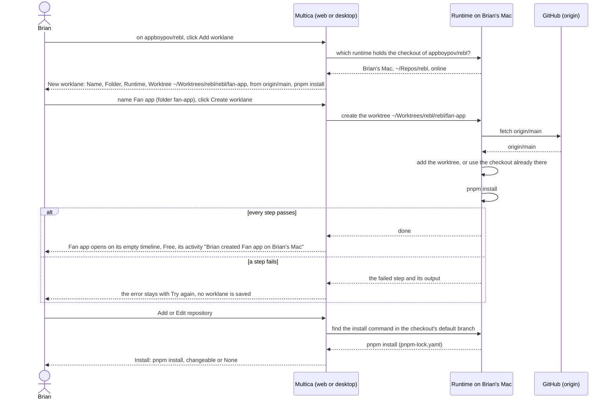

## At a glance

| Kind | Name | Change | Path |
|---|---|---|---|
| Dialog | New worklane: name, folder, runtime, worktree, its steps, Try again | new | `packages/views/projects/`, `designs/screens/steer-all-work.pen` (screens 7, 7b, 7c) |
| Concept | Worklane: name, folder, runtime, order, its worktree; Free | new | `packages/core/types/` |
| Runtime | Create a worklane's worktree step by step: fetch, add the worktree or use the checkout there, install | new | `server/internal/daemon/execenv/` |
| Field | Add and Edit repository: Install, the install command found, changeable or None | new | `packages/views/projects/` |
| Section | Project page: a repository card's worklanes after `main`, Add worklane, the worklane count in the header | changed | `packages/views/projects/components/project-detail.tsx` |
| Page | Projects and an organisation's page: worklane rows under a repository, + Worklane, worklane counts | changed | `packages/views/projects/components/projects-page.tsx`, `packages/views/organisations/` |
| Page | Worklane: its empty timeline, Free, its activity | new | `packages/views/projects/`, `designs/screens/steer-all-work.pen` (screen 3) |
| Menu | Worklane: Rename, Remove | new | `packages/views/projects/` |
| Tool | Brain sync: the install command found for each repository it adds | changed | `madspec-sync/multica_projects.py` |

Busy, what a worklane works on now or next, and an agent working in a worklane's worktree come with UJ-6, once issues are in a worklane. The worklane's releases come with UJ-4 and UJ-7; its activity entries for releases, issues and shipping come with UJ-4, UJ-6 and UJ-8.

## Why

A repository in Multica has only its worklane `main`, so every line of work in it shares the normal checkout, or an agent gets a throwaway worktree per issue. Brian runs several long-lived lines of work per repository, such as Fan accounts and push next to `main` in appboypov/rebl, and needs each in its own worktree on his Mac, listed under its repository, with what happens in it on one page. Releases, issues on a worklane and its Board come next (UJ-4 to UJ-6) and need the worklane to exist.

Success signal: on Rebl's page Brian clicks Add worklane on appboypov/rebl, names it "Fan app" and creates it; `~/Worktrees/rebl/rebl/fan-app` exists on his Mac at `origin/main` with `pnpm install` done, the worklane opens on its empty timeline, Free, its activity says Brian created it, and Rebl shows "3 worklanes" on Projects and on Rebl Records' page.

## What Changes

- New worklane, from a repository's Add worklane on its card and + Worklane on Projects and an organisation's page, asks for a name and a folder, offers only the runtime that holds the repository's checkout, and shows the worktree path, its base and the install command.
- Create worklane runs on the runtime step by step: fetch, add the worktree, install, open. A folder that already holds a checkout of the repository is used as it is. A failed step keeps its error with Try again, and no worklane is saved.
- A repository gets an install command: Multica finds it in the checkout's default branch, Add and Edit repository show it, and Brian changes it or sets None.
- A worklane's page opens on its timeline, empty until UJ-4, with its state and its activity.
- A repository card, Projects and an organisation's page list each repository's worklanes after `main`; the project header, the project and organisation rows on Projects and the organisation's page count them.
- A worklane's menu has Rename and Remove; `main` has neither. A repository with a worklane besides `main` cannot be removed.

## Capabilities

### New Capabilities

- `new-worklane`: lets Brian create a worklane on a repository with its worktree made on the runtime, step by step.
- `repository-install-command`: lets Brian see and set the command a repository's worktrees install their dependencies with.
- `repository-worklanes`: lets Brian see a repository's worklanes and their counts on a project's page, Projects and an organisation's page.
- `worklane-page`: lets Brian open a worklane on its timeline with its state and its activity.
- `manage-worklanes`: lets Brian rename and remove a worklane, and keeps a repository with worklanes from removal.

### Modified Capabilities

None in `specs/openspec/specs/`. This change builds on the unarchived changes `projects-by-organisation` (UJ-1: organisations and their keys) and `repositories-of-a-project` (UJ-2: repositories, their checkout and worklane `main`, Add and Edit repository, the brain sync's repositories). `repository-install-command` adds a field to UJ-2's Add and Edit repository and to its brain sync. `repository-worklanes` adds worklane rows and counts to UJ-1's tree and UJ-2's repository cards. `manage-worklanes` adds a rule to UJ-2's Remove repository.

## Impact

- Web and desktop: the project page's repository cards, Projects, an organisation's page, the New worklane dialog, the worklane page with its activity, the worklane menu with Rename and Remove, and the Install field in Add and Edit repository.
- Shared packages: worklane types, the API client and its schemas, project and worklane queries, the repository type's install command.
- Server: worklanes and their activity in the API and the database; creation that saves a worklane only after every step on the runtime passed.
- Daemon: fetch, add or use a worktree, install, and report each step; remove a worklane's worktree; find a repository's install command.
- `madspec-sync/`: `multica_projects.py`, its spec `madspec-sync/specs/multica-projects.md`, its tests and the README.
- Copy in every supported language and the project docs in `apps/docs`.

## Constraints

- A worklane without a worktree does not exist: a worklane is saved only after every step of its creation passed.
- A worklane's worktree lives on the runtime that holds its repository's checkout, at `~/Worktrees/{organisation key}/{repo}/{folder}`, or `~/Worktrees/{repo}/{folder}` for a project without an organisation, branched from `origin/{default branch}`.
- A worklane name is unique in its repository, `main` included, ignoring case; a folder is one name of lowercase letters, digits and dashes, unique among the repository's worklanes.
- Creating, failing or cancelling a worklane never deletes anything on the runtime; only Remove removes a worktree, and only when nothing in it would be lost.
- `main` cannot be renamed or removed.
- The brain sync never changes an install command set in Multica.
- AGENTS.md: no foreign keys or cascades, `CREATE INDEX CONCURRENTLY` in its own migration, zod schemas with `parseWithFallback` and malformed-response tests for the new responses, no compatibility shims, every check local.

## Non-goals

- Busy, what a worklane works on now or next, and an agent working in a worklane's worktree, switching branch after a merge (FR-69 to FR-71): UJ-6.
- Releases on the worklane's timeline and Plan release: UJ-4. Board and List: UJ-6.
- What keeps a worklane with open issues from removal, and closed issues of a removed worklane under "No worklane": UJ-5 and UJ-6.
- Activity entries for releases, issues and shipping: UJ-4, UJ-6 and UJ-8.
- Worklanes from the brain's lanes: the brain sync adds repositories with worklane `main` only (PRD FR-17).
- Creating a worklane from the CLI or by an agent, reordering worklanes, changing a worklane's folder or runtime.
- A worklane on a runtime without the repository's checkout.
- Squads, the mobile app and dark mode.

## Sources

- Intent: [Steer projects, repositories, worklanes and releases in Multica](anytype://object?objectId=bafyreib727ukptyvcfbkud627gjb3cu2lmwsh3u4cjbu4kisjofa25km3u) and its Requests.
- PRD: [Multica: steer projects, repositories, worklanes and releases](anytype://object?objectId=bafyreiew63xw2dncss52jdx4qk4o6aktkklhqroclvs3cvjxcyztx7h5um): UJ-3, F3 with FR-20 to FR-28, FR-2 to FR-4, the glossary, non-goals and the Addendum.
- Brief: [Multica: steer projects, repositories, worklanes and releases](anytype://object?objectId=bafyreicccdj6bucv5d65bxvkz4gy7jf7etplsswmwfggupqbakc6rudpmi).
- UJ-1 change: `specs/openspec/changes/projects-by-organisation/`. UJ-2 change: `specs/openspec/changes/repositories-of-a-project/`.
- Design: [Steer all work screens](anytype://object?objectId=bafyreiauxfhf7w74hwn5je7ljakzxfgo2qv4noid2oshvtqjwkos2v5oiq), screens 1 Projects, 2 Project, 3 Worklane timeline, 7, 7b and 7c New worklane in `designs/screens/steer-all-work.pen`, exports in `designs/exports/`, whose worktree path `~/Worktrees/rebl/fan-app/rebl` Brian's answer of 13 October 2026 supersedes; [component library](anytype://object?objectId=bafyreiamoqycfo735krrpmzn3ujhdardv6uixsrdzkadzlodwpr7aenwee); `designs/creation-flows.md` "The model", "Add repository" and "New worklane", aligned with this change on 13 October 2026.
- Prototype: [Steer all work prototype](anytype://object?objectId=bafyreieck7zsmzslnfe5asszexojznfbnsnwcg62eqbesqqeigkkzgoclm), revision 460535099583266816, `NewWorklaneDialog` in `prototypes/web/src/components/generated/creation.tsx` and `laneFolder` and `laneCount` in `model.ts`.
- Brian's answers in the P4 session of 13 October 2026, on the [UJ-3 Task](anytype://object?objectId=bafyreibfv7ebdi3qez732encnkbkqdndszvudxmj4hc247hvjsgi7kzuki): Multica finds the install command from the lockfile, changeable on the repository or None; only the checkout's runtime is offered; a folder already at the worklane's path is used; FR-69 to FR-71 move to UJ-6; the worklane page shows its activity, with what is planned and the progress of its work as later journeys bring them.
- Today's code: `server/internal/daemon/execenv/local_worktree.go`, `git.go` and `execenv.go` (a throwaway worktree per task), `server/internal/daemon/local_directory.go`, the runtime capability `local-worktree-v1` (`packages/core/runtimes/cli-version.ts`), `packages/views/projects/components/project-detail.tsx`.
