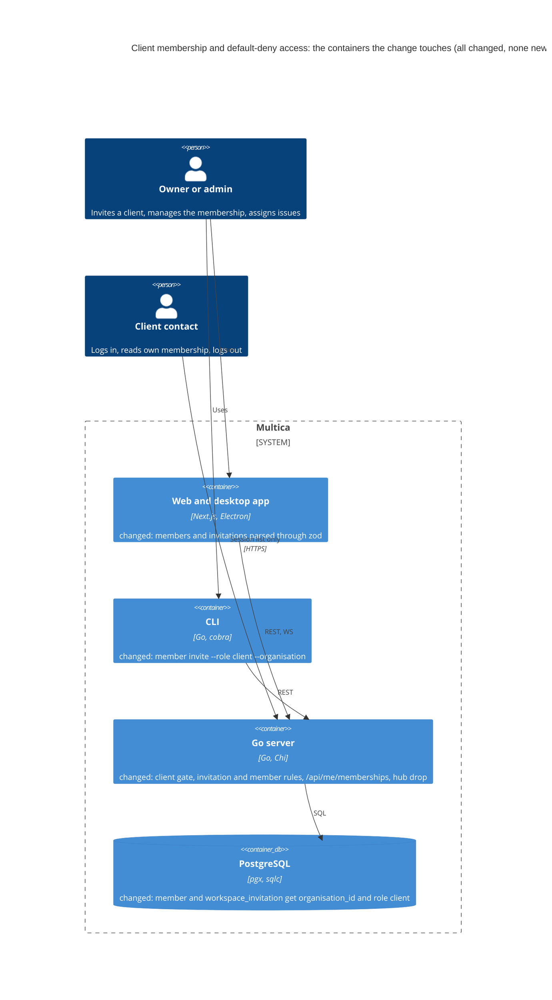
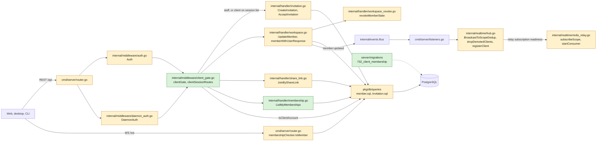
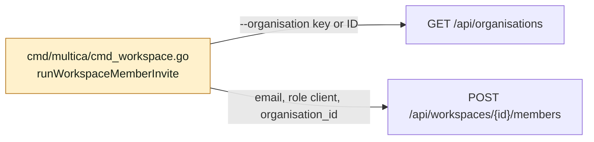
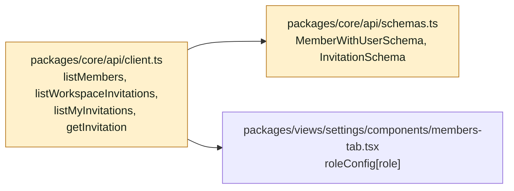
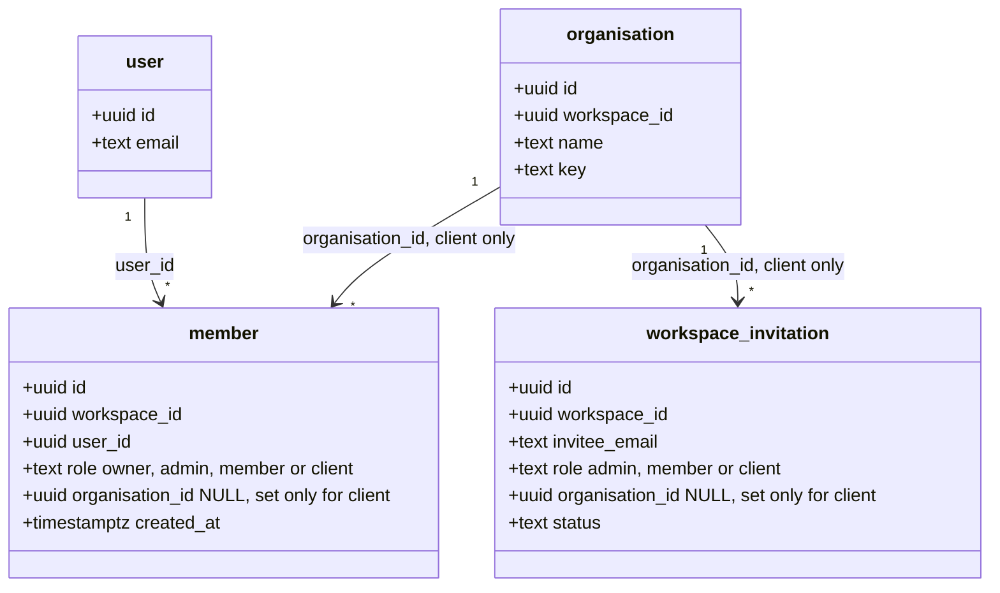
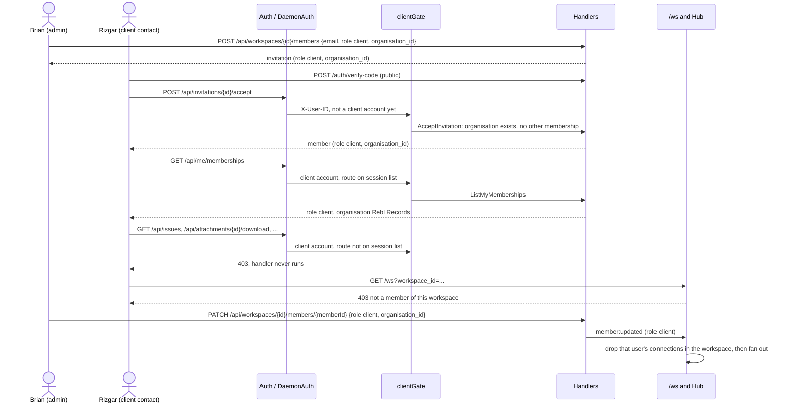

## At a glance

The delta of this change on the living system design, `specs/docs/system-design.md`. It adds no container. The Go server gets one new gate inside the two authentication middlewares, the CLI gets one flag, and the shared web and desktop API client parses member and invitation responses. Mobile already parses an unknown role as `member` (`apps/mobile/data/schemas.ts:587`) and does not change.



### Go server



### CLI



### Web and desktop



### Models



### Sequence



### Inventory

| Kind | Name | Change | Path |
|---|---|---|---|
| Migration | `732_client_membership`: role `client` and `organisation_id` on `member` and `workspace_invitation` | new | `server/migrations/732_client_membership.up.sql`, `server/migrations/732_client_membership.down.sql` |
| Queries | `CreateMember`, `UpdateMemberRole` with `organisation_id`; `IsClientAccount`, `CountMembershipsByUser`, `ListMyMemberships` | changed | `server/pkg/db/queries/member.sql`, `server/pkg/db/generated/` |
| Queries | `CreateInvitation` with `organisation_id` | changed | `server/pkg/db/queries/invitation.sql`, `server/pkg/db/generated/` |
| Middleware | `clientGate` and `clientSessionRoutes` | new | `server/internal/middleware/client_gate.go` |
| Middleware | `Auth` and `DaemonAuth` wrap their next handler in `clientGate` | changed | `server/internal/middleware/auth.go`, `server/internal/middleware/daemon_auth.go` |
| Endpoint | `GET /api/me/memberships` | new | `server/internal/handler/membership.go`, `server/cmd/server/router.go` |
| Endpoint | `POST /api/workspaces/{id}/members`: role `client` with `organisation_id` | changed | `server/internal/handler/invitation.go` |
| Endpoint | `POST /api/invitations/{id}/accept`: organisation and one-membership checks | changed | `server/internal/handler/invitation.go` |
| Endpoint | `PATCH /api/workspaces/{id}/members/{memberId}`: role `client` with `organisation_id`, staff state revoked | changed | `server/internal/handler/workspace.go`, `server/internal/handler/workspace_revoke.go` |
| Endpoint | `POST /api/share-links/join`: refused with a pending client invitation | changed | `server/internal/handler/share_link.go` |
| Response | `organisation_id` on member and invitation responses | changed | `server/internal/handler/workspace.go`, `server/internal/handler/invitation.go` |
| Realtime | `membershipChecker.IsMember` refuses a client; hub drops demoted connections and checks membership after relay readiness | changed | `server/cmd/server/router.go`, `server/internal/realtime/hub.go`, `server/internal/realtime/redis_relay.go` |
| CLI | `multica workspace member invite --role client --organisation` | changed | `server/cmd/multica/cmd_workspace.go` |
| Docs | CLI invite example | changed | `apps/docs/content/docs/cli.mdx` |
| API client | Member and invitation responses parsed with `parseWithFallback` | changed | `packages/core/api/client.ts`, `packages/core/api/schemas.ts` |
| ADR | ADR-0017: a client account is refused outside the session list | new | `adr/0017-a-client-account-is-refused-outside-the-session-list.md` |
| System design | Gate, membership endpoint and model fields | changed | `specs/docs/system-design.md` |

## Context

Story WORK-1069, the first of WORK-1059's six stories. It is own-project work on the line, at step L5. The change holds the work of one roster team: **Backend** (lead Joeri), as the issue says: "Joeri owns the server and CLI work". The CLI lives in the server module (`server/cmd/multica/`), and the `packages/core` parse is the API compatibility that AGENTS.md "API Compatibility" ties to changing an endpoint, so both stay in this change.

**Code map.** Paths are under `server/` unless they start with `packages/`, `apps/` or `adr/`.

- Routes: `cmd/server/router.go`. Public `/auth/send-code`, `/auth/verify-code`, `/auth/google`, `/auth/logout` (1509-1512) need no credential. `/api/daemon` mounts `middleware.DaemonAuth` (1557). The plugin bridge (1637) and the main group (1647) mount `middleware.Auth`; the main group holds `/api/me` (1650), `/api/cli-token`, `/api/auth/refresh`, `/api/attachments/{id}/download`, `/api/workspaces` (1702), `/api/tokens` (1924), `/api/invitations` and `/api/share-links/join` (~1912-1922), and the `RequireWorkspaceMember` group with every resource route (1993-2560). `/api/v1` (1626) takes plugin installation tokens only, never a user credential. `/ws` (1461) authenticates itself and checks `membershipChecker.IsMember` (2640), which today accepts any member row.
- `internal/middleware/auth.go` `Auth` and `internal/middleware/daemon_auth.go` `DaemonAuth` resolve user credentials (JWT cookie or bearer, `mul_` PAT, `mat_` task token, `mcn_` cloud PAT) to `X-User-ID`; each branch ends in `next.ServeHTTP`. Runtime-bound `mdt_` daemon tokens have no user principal and are revoked with their owner's staff state. `DaemonAuth` clears caller-supplied `X-User-ID`. Unit tests can call `Auth(nil, nil, nil, nil)`.
- Schema: `migrations/001_init.up.sql:26` `member.role` `CHECK (role IN ('owner','admin','member'))`, constraint `member_role_check`; `041_workspace_invitation.up.sql:7` `workspace_invitation.role` `CHECK (role IN ('admin','member'))`, constraint `workspace_invitation_role_check`; `327_workspace_share_link.up.sql:14` share links allow admin and member only. Latest migration on `main` is 731. `organisation` (572-574) is workspace-scoped; there is no delete handler for it, only workspace teardown (`pkg/db/queries/workspace_delete.sql:720`).
- Queries: `pkg/db/queries/member.sql` (`CreateMember`, `UpdateMemberRole`, `GetMemberByUserAndWorkspace`), `invitation.sql:1` `CreateInvitation`, `organisation.sql:9` `GetOrganisationInWorkspace`. `CreateMember` callers: `internal/handler/workspace.go:279` (create workspace), `invitation.go:543` (accept), `share_link.go:377` (join). `UpdateMemberRole` caller: `workspace.go:628`.
- Invitations: `internal/handler/invitation.go` `InvitationResponse` (24), `CreateInvitation` (61, role through `normalizeMemberRole` at `workspace.go:559`, owner refused), `AcceptInvitation` (455, tx with `qtx.AcceptInvitation` at 537 and `CreateMember` at 543). Share links: `share_link.go` `CreateShareLink` (68) already refuses any role other than member or admin (81-87); `JoinByShareLink` (264) settles a pending email invitation and creates the member with the link's role (341-377).
- Members: `internal/handler/workspace.go` `MemberWithUserResponse` (500), `CreateMemberRequest` (541), `UpdateMemberRequest` (573), `UpdateMember` (577; owner rules, `MembershipCache.Invalidate`, publishes `member:updated` with the member). `workspace_revoke.go:44` `revokeAndRemoveMember` converges a leaving member in one tx (archive agents, cancel tasks, force runtimes offline, delete daemon tokens, channel bindings, invocation targets, private quick actions and views, view preferences, subscriptions, autopilot subscribers) and then deletes the row; `publishRevocation` (254) runs the post-commit events.
- Assignee: `internal/handler/issue.go:4233` `validateAssigneePair` accepts any member row for `assignee_type: member`, so a client is assignable with no change.
- Realtime: `internal/realtime/hub.go` `HandleWebSocket` (775), `Hub.Run` auto-subscribes a connection to its workspace and user scopes, `BroadcastToScopeDedup` (498) is the one fan-out for workspace scopes on a single node (`BroadcastToScope`) and from the relays (`redis_relay.go:108` `deliverEnvelope`), `evictSlow` (619) closes clients. `cmd/server/listeners.go` sends every workspace event through `BroadcastToWorkspace`. No server-side path closes a removed member's socket today.
- CLI: `cmd/multica/cmd_workspace.go` `workspaceMemberInviteCmd` (64), its flags (186), `runWorkspaceMemberInvite` (827) with a client-side role switch. `multica login` uses `/api/cli-token` (web), `POST /api/tokens` and `GET /api/me` (`cmd_auth.go:329-343`).
- Web and desktop: `packages/core/api/client.ts` `listMembers` (3580) and the invitation reads (3611-3630) return raw JSON; `packages/views/settings/components/members-tab.tsx` indexes `roleConfig[member.role]` and `roleConfig[invitation.role]` (193, 313), which throws on an unknown role. The member list refetches on `member:*` events (`packages/core/realtime/use-realtime-sync.ts`), so parsing the reads covers live updates too. Precedent for parsing: `listOrganisations` (4407) with `ListOrganisationsResponseSchema` (`schemas.ts:1519`) and its test `packages/core/api/organisations-projects.test.ts`.
- Must not change: owner, admin and member routes, roles and responses; the public auth routes; share-link roles; plugin installation-token authentication on `/v1/*`.

## Goals / Non-Goals

**Goals:**

- A `client` membership with exactly one organisation of its workspace, made through the named invitation (API and CLI) and an owner's or admin's role change.
- Every authenticated route refuses a client account before its handler runs, except the session list; `/ws` refuses it; a member demoted to client loses their open connections.
- Owner, admin and member behaviour is unchanged.

**Always:**

- The gate runs inside `Auth` and `DaemonAuth`, so every route group and every credential that resolves to a user is covered, also a group or route added later.
- A client account holds exactly one membership. Every write that creates or changes a membership enforces it.
- Organisation checks use `GetOrganisationInWorkspace` with the membership's workspace.

**Never:**

- No client data read, no client or staff screen, no new UI copy; mobile does not change.
- No foreign key, cascade or index; no edit of an applied migration.
- No per-route client checks in handlers: the session list is the one place a route opens to a client.
- The share-link roles do not change.

**Non-Goals:** as the proposal says: client data reads (WORK-1071), screens (WORK-1070, WORK-1072 to WORK-1074), real client accounts, client share links, client writes.

## Decisions

### 1. A client account and the gate (ADR-0017)

A user is a **client account** when they hold a `member` row with role `client`. `clientGate` runs after a credential resolves to `X-User-ID`: for a client account it serves only the routes in `clientSessionRoutes` and answers every other request `403 {"error":"client accounts can only use the session routes"}`; for everyone else it passes through. The check is one indexed query per authenticated request, `IsClientAccount`: `SELECT EXISTS (SELECT 1 FROM member WHERE user_id = $1 AND role = 'client')`, served by `idx_member_user_workspace` (106).

`Auth` and `DaemonAuth` wrap their `next` once, before their credential branches: `next = clientGate(queries, next)`. With `queries == nil`, only in unit tests, they skip the wrap; the router always passes queries, and the router test in decision 8 proves the gate is on every route.

The session list, matched on method and `path.Match` pattern of `r.URL.Path`:

| Method | Path | Why |
|---|---|---|
| `GET` | `/api/me` | Own profile; the web app and `multica login` read it after login |
| `POST` | `/api/auth/refresh` | Refresh the browser session |
| `POST` | `/api/cli-token` | Web hand-off of a browser login to `multica login` |
| `POST` | `/api/tokens` | `multica login` mints its personal access token |
| `GET` | `/api/me/memberships` | Current membership (decision 6) |
| `GET` | `/api/invitations` | Own pending invitations |
| `GET` | `/api/invitations/*` | One own invitation |
| `POST` | `/api/invitations/*/accept` | Accept an own invitation |
| `POST` | `/api/invitations/*/decline` | Decline an own invitation |

Logging in (`/auth/send-code`, `/auth/verify-code`, `/auth/google`) and out (`/auth/logout`) are public routes and never reach the gate. Story 2 opens its client reads by adding rows to this table.

The account, not the workspace, is the unit because user-scoped routes such as `/api/attachments/{id}/download`, `/api/share-links/join` or the inbox name no workspace at the gate. Brian's settled answer on WORK-1059 is a separate account per client contact, so the one-membership rule (decision 2) costs nothing and keeps the gate exact.

### 2. One membership for a client account

| Write | Refused when | Answer |
|---|---|---|
| `CreateInvitation` with role `client` | the invitee's user exists and `CountMembershipsByUser > 0` | 409 `a client needs an account without other workspace memberships` |
| `CreateInvitation` with a staff role | the invitee's user is a client account | 409 `this account is a client account` |
| `AcceptInvitation` of a client invitation | `CountMembershipsByUser > 0`, read in the accept tx | 409, invitation stays pending |
| `AcceptInvitation` of a staff invitation | the user is a client account | 409, invitation stays pending |
| `UpdateMember` to `client` | the target user has a membership of another workspace | 409 |
| `JoinByShareLink` | the user is a client account (already refused by the gate), or the user has a pending client invitation for the workspace | 409 `accept your client invitation instead`, nothing settled |

The last row closes the one fallback that turns an invited client into a member: today the join settles a pending invitation and creates the member with the link's role (`share_link.go:341-377`).

`LockUserForMembership` locks the existing user row in the transaction before checking and writing memberships. Invitation acceptance, role changes, share-link joins and workspace creation share this lock, so concurrent writes cannot create a client with another membership.

### 3. Invitation

`CreateMemberRequest` gains `organisation_id`. Role `client` needs an `organisation_id` that `GetOrganisationInWorkspace` finds in the workspace, else 400 `a client invitation needs an organisation of this workspace`; a staff role with an `organisation_id` is 400. `normalizeMemberRole` accepts `client`; the owner refusals stay. `CreateInvitation` (query) stores `organisation_id`. `InvitationResponse` gains `organisation_id` (`*string`, `null` for staff). The route group already limits invitations to owners and admins (`router.go:1742`).

`AcceptInvitation`, for a client invitation, reads the organisation with `GetOrganisationInWorkspace` inside the tx before `qtx.AcceptInvitation`; a missing one answers 409 `the organisation of this invitation no longer exists` and the tx rolls back, so the invitation stays pending and no member exists. `CreateMember` copies the invitation's role and `organisation_id`.

### 4. Member management

`UpdateMemberRequest` gains `organisation_id`. Owner and last-owner rules stay as they are.

- To `client`: `organisation_id` required and found with `GetOrganisationInWorkspace`, else 400 and nothing changes. From a staff role, one tx runs `revokeMemberState` and `UpdateMemberRole`; after commit `member:updated` publishes before `publishRevocation`, so sockets close before revocation payloads. Client to client changes only the organisation.
- To a staff role: `organisation_id` must be absent (400 otherwise); `UpdateMemberRole` writes `organisation_id = NULL`.
- `revokeMemberState(ctx, qtx, workspaceID, userID, archivedBy)` is `revokeAndRemoveMember` up to and without the seat release and `DeleteMember`; `revokeAndRemoveMember` keeps its tx and calls it, then releases the seat and deletes the row. A client owns no agent, runtime, view or subscription template, so the next task can never start on their behalf.
- `MembershipCache.Invalidate` and the `member:updated` publish stay; the payload's member carries the new role and `organisation_id`.

Removing a client is the existing `DeleteMember`. An organisation is never deleted outside workspace teardown today; a client whose organisation is gone keeps the role `client`, so the gate still refuses everything, and `/api/me/memberships` shows `organisation: null`.

### 5. Live updates

- `membershipChecker.IsMember` returns false for a `client` row, so `/ws` refuses a client with the existing 403 `not a member of this workspace`, on both the cookie and the first-message token path. A client therefore has no connection, and no personal (`user` scope) event reaches them either.
- `Hub.BroadcastToScopeDedup` calls `h.dropDemotedClients(scopeType, scopeID, message)` first. For a `workspace` scope frame that contains `"type":"member:updated"`, it decodes `payload.member.user_id` and `payload.member.role`; when the role is `client`, it removes and closes that user's clients in that workspace, as `evictSlow` does, before the frame fans out. The frame reaches every node with a subscriber, single-node through `BroadcastToScope` and multi-node through `deliverEnvelope`, so the drop works on every node.
- Registration establishes workspace and user relay subscriptions, then rechecks membership under the hub lock before starting socket pumps. Legacy Redis consumer groups are prepared synchronously with the existing two-second context; failure closes affected connections. The handler waits for registration's result. The final membership check has the existing `writeWait` deadline and serializes with demotion eviction.

### 6. Current membership

`GET /api/me/memberships` (`internal/handler/membership.go` `ListMyMemberships`), for every account:

```json
{"memberships": [{"workspace_id": "…", "workspace_name": "Rebl", "workspace_slug": "rebl",
  "role": "client", "organisation": {"id": "…", "name": "Rebl Records"}}]}
```

`ListMyMemberships`: `member m JOIN workspace w ON w.id = m.workspace_id LEFT JOIN organisation o ON o.id = m.organisation_id AND o.workspace_id = m.workspace_id WHERE m.user_id = $1 ORDER BY m.created_at`. `organisation` is `null` for staff and for a missing organisation.

### 7. CLI

`multica workspace member invite <email> --role client --organisation <key-or-id>`. The client-side role switch accepts `client`; `--role client` without `--organisation` fails before any request with `a client invitation needs --organisation`, and `--organisation` with another role fails too. A UUID is sent as is; otherwise the CLI reads `GET /api/organisations` for the resolved workspace and matches `key` case-insensitively, failing with `organisation <x> not found` when none matches. The body gains `organisation_id`; the table output adds the organisation. The flag help and `apps/docs/content/docs/cli.mdx` show the client example.

### 8. Tests

- `internal/middleware/client_gate_test.go`: the matcher table (every session row matches, `/api/invitations/x/y` and other paths do not), refusal body and status, staff pass-through.
- `cmd/server/client_gate_test.go` (DB-backed, router from `NewRouterWithOptions`): walks every route with `chi.Walk`, fills URL params with random UUIDs, and substitutes a terminal handler to avoid writes. A route that answers 401 without a credential gives client JWTs/PATs the gate's 403 unless it is on the session list. Installation-token-only `/v1/*` routes instead reject both user credentials with 401. This keeps routes added later closed without changing plugin authentication.
- Handler tests in `invitation_test.go`, `workspace_test.go`, `share_link_test.go` for decisions 2-4 and the assignee scenario; `internal/realtime/hub_test.go` for decision 5; `cmd/multica` tests for the flag rules.
- `packages/core/api/members-invitations.test.ts`: a `client` row parses with the role fallback and the list keeps its other rows.

### 9. Web and desktop parse

`MemberWithUserSchema` and `InvitationSchema` in `packages/core/api/schemas.ts` parse `role` with `z.enum(["owner","admin","member"]).catch("member")`, as mobile does, with defaults for the other fields; `listMembers`, `listWorkspaceInvitations`, `listMyInvitations` and `getInvitation` go through `parseWithFallback`. `MemberRole` and the views stay as they are: until the staff screens show clients, a client reads as Member in the members tab.

## Risks / Trade-offs

- [One extra query per authenticated request] -> `IsClientAccount` is an index-only `EXISTS` on `idx_member_user_workspace`; caching it would add an invalidation path on every role change for no measured need.
- [A staff account can never also be a client] -> a client contact needs their own account, as Brian settled; the refusals in decision 2 name it.
- [A client reads as Member in the staff members tab] -> no client account exists until real accounts are created (a non-goal); the staff screens stories show the role. An owner or admin who changes that row's role makes an explicit role change, which the spec allows.
- [Final WebSocket authorization holds the hub lock] -> one bounded database read per connection closes registration/demotion races; relay readiness precedes that read, and no socket pump sends queued payloads until it succeeds.
- [The hub reads one event type from the frame] -> the alternative, a direct `Handler.Hub` call, only reaches the node that handled the request.
- [CloudFront cookies on the session routes] -> `RefreshCloudFrontCookies` still runs for a client on the session list; the fork runs without a CloudFront signer, and a client never receives a storage key.

## Migration Plan

`732_client_membership.up.sql`, one implicit tx with `SET LOCAL lock_timeout = '2s'` as `572_organisation.up.sql` does:

```sql
ALTER TABLE member ADD COLUMN organisation_id UUID;
ALTER TABLE member DROP CONSTRAINT member_role_check,
  ADD CONSTRAINT member_role_check CHECK (role IN ('owner', 'admin', 'member', 'client')),
  ADD CONSTRAINT member_client_organisation_check CHECK ((role = 'client') = (organisation_id IS NOT NULL));
-- the same three changes on workspace_invitation, with ('admin', 'member', 'client')
```

No backfill: every existing row is staff with `organisation_id` NULL. The down file deletes `client` rows of both tables, drops the two new constraints and columns, and restores the old checks. `make local-release` deploys server and CLI together.
