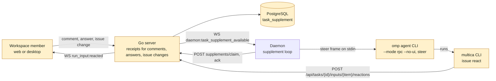
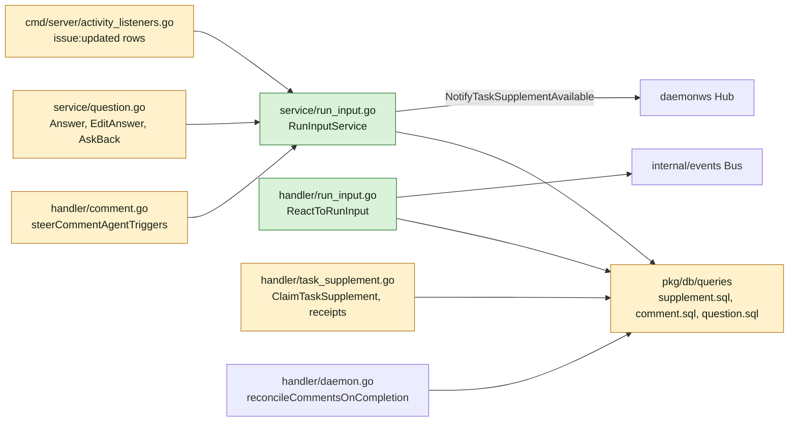
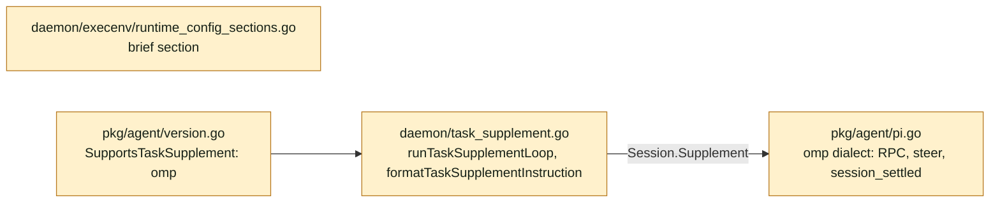
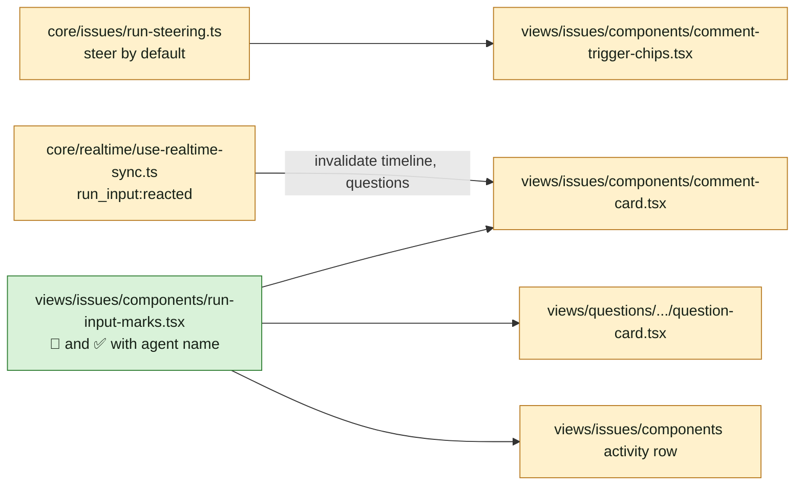
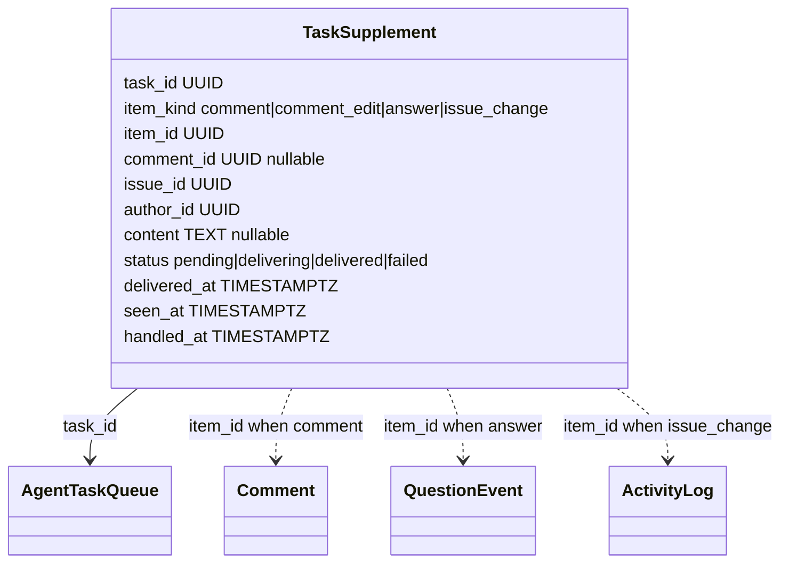
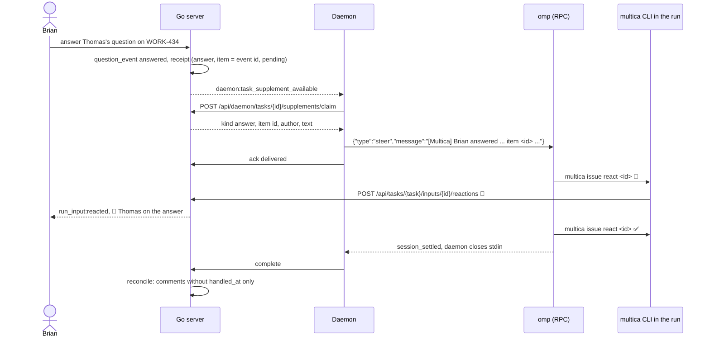
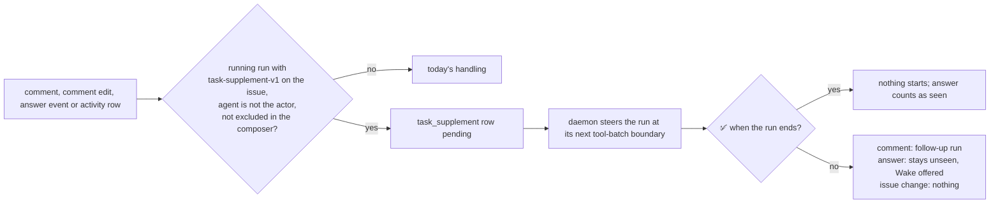

## At a glance

### Containers

### Go server

### Daemon and agent package

### Web and desktop

### Model

### Sequence

### Data flow

### Inventory

| Kind | Name | Change | Path |
|---|---|---|---|
| Migration | `task_supplement` items, content, 👀 and ✅ times | new | `server/migrations/740_task_supplement_items.up.sql`, `.down.sql` |
| Migration | Unique index on `(item_id, task_id)` | new | `server/migrations/741_task_supplement_item_task_index.up.sql`, `.down.sql` |
| Migration | Primary key on `(item_id, task_id)` | new | `server/migrations/742_task_supplement_item_task_primary_key.up.sql`, `.down.sql` |
| Migrator | Index cleanup entry | changed | `server/cmd/migrate/main.go` |
| Queries | Receipt create per kind, claim with kind and item, react, reconcile reads ✅, unseen answers leave out ✅ | changed | `server/pkg/db/queries/supplement.sql`, `comment.sql`, `question.sql` |
| Service | `RunInputService`: receipts for comments, answers and issue changes | new | `server/internal/service/run_input.go` |
| Handler | Comment steering by default for every author | changed | `server/internal/handler/task_supplement.go`, `comment.go` |
| Handler | `ReactToRunInput` | new | `server/internal/handler/run_input.go`, `server/cmd/server/router.go` |
| Service | Answers and ask-backs hand receipts to `RunInputService` | changed | `server/internal/service/question.go` |
| Listener | Issue-change rows, new rows for labels, files and sub-issues, and receipts through `RunInputService` | changed | `server/cmd/server/activity_listeners.go` |
| Handler | Label, file and parent-change events carry what changed | changed | `server/internal/handler/label.go`, `file.go`, `issue.go` |
| Protocol | Claim response kind and item id; `run_input:reacted` event | changed | `server/pkg/protocol/messages.go`, `events.go` |
| Agent backend | omp on RPC with steer and `session_settled` | changed | `server/pkg/agent/pi.go`, `version.go` |
| Daemon | Delivered text names kind, item id and the react command | changed | `server/internal/daemon/task_supplement.go`, `client.go` |
| Brief | "While you run" section for runs with mid-run input | changed | `server/internal/daemon/execenv/runtime_config_sections.go` |
| Skill | `multica issue react` | changed | `server/internal/service/builtin_skills/multica-platform/` |
| CLI | `multica issue react` | new | `server/cmd/multica/cmd_issue.go` |
| Core | Steer by default; receipt fields; reactions in answers and activity entries; realtime event | changed | `packages/core/issues/run-steering.ts`, `packages/core/types/`, `packages/core/api/schemas.ts`, `packages/core/realtime/use-realtime-sync.ts` |
| Component | `RunInputMarks` | new | `packages/views/issues/components/run-input-marks.tsx` |
| Views | Comment card, question card, activity row show the marks; activity texts for labels, files and sub-issues; composer steers with files | changed | `packages/views/issues/components/comment-card.tsx`, `packages/views/questions/question-card.tsx`, `packages/views/issues/components/issue-detail.tsx`, `packages/views/issues/components/comment-input.tsx` |
| Docs | Comments and CLI pages | changed | `apps/docs/content/docs/comments.mdx`, `cli.mdx` |
| Living view | Server, daemon and web maps | changed | `specs/docs/system-design.md` |
| ADR | Input reaches a running run as a receipt; ✅ decides the run's end | new | `adr/0019-input-reaches-a-running-run-as-a-receipt.md` |
| ADR | Only Wake turns answers into a run; ✅ counts as seen | new | `adr/0020-only-wake-turns-answers-into-a-run-and-a-checked-answer-is-seen.md` |

## Context

Team: Backend (`uv run .../roster.py`), led by Joeri. Skuddy's hand-off on WORK-438 keeps the frontend part (marks, composer default) in this change because it shows the same behaviour; groups 7 and 8 are frontend work.

Every agent in Brian's workspace runs on the Oh-My-Pi runtime (`omp/18.10.1`). Upstream already delivers member comments into running Claude Code, Codex and Grok runs ("task supplements", MUL-7565, MUL-7631); omp is not one of them, which is the cause of what Brian sees.

What exists and is reused:

- Receipts: `task_supplement` (`server/migrations/538_task_supplement.up.sql`; primary key `(comment_id, task_id)` from `549`), capability row `task_supplement_capability` written at task start (`supplement.sql` `StartAgentTaskWithSupplement`). Claim, ack, retry, terminal settlement: `server/pkg/db/queries/supplement.sql`; handlers `server/internal/handler/task_supplement.go` (`CreateTaskSupplement`, `ClaimTaskSupplement`, `AckTaskSupplement`, `publishCommentSupplementUpdate`).
- Steering a comment: `steerCommentAgentTriggers` (`task_supplement.go:140-184`), called from `triggerTasksForComment` (`comment.go:2049`). It steers only `member` authors and only the exact turns the composer sent in `steer_task_ids` (`comment.go:1494-1498`, `1774`).
- Run end: `reconcileCommentsOnCompletion` (`handler/daemon.go:4510-4694`) replays planned comments through `comment.sql:375-400`, whose `NOT EXISTS (... task_supplement ...)` drops every steered comment, delivered or not.
- Daemon: `runTaskSupplementLoop` (`daemon/task_supplement.go:132-182`) claims one receipt at a time, calls `Session.Supplement` once `SupplementReady`, acks. `formatTaskSupplementInstruction` (`:90`) builds the text. Negotiation: `agent.SupportsTaskSupplement` (`pkg/agent/version.go:114-134`) at `StartTask` (`daemon.go:8050-8065`).
- omp backend: `piBackend.Execute` (`pkg/agent/pi.go:352-755`) runs `omp -p --mode json --session <path>` and writes the prompt then EOF (`:406-428`, `buildPiArgs` `:995-1030`); no `Supplement`. omp's RPC mode (`omp --mode rpc --no-ui`) takes `prompt`, `steer` and reports `prompt_result` and `session_settled`; closing stdin shuts it down (omp docs `rpc.md` "Yield vs settled", "Transport and Framing").
- Questions: `QuestionService.Answer` (`service/question.go:597-634`) writes `question_answer` and a `question_event` (`answered`, `answer_edited`, `ask_back`) and starts no run (ADR-0003). Unseen answers: `CountUnseenQuestionAnswers` (`question.sql:200-223`); woken claim input: `loadClaimQuestionAnswers` (`daemon.go:3727-3799`).
- Issue changes: `activity_listeners.go:63-280` writes one `activity_log` row per changed field of `issue:updated` (`status_changed`, `priority_changed`, `assignee_changed`, `start_date_changed`, `due_date_changed`, `title_changed`, `description_updated`).
- Reactions: `comment_reaction` and `issue_reaction` (migrations 026, 027) are people-and-agent emoji reactions with no notion of a run; they stay as they are.
- CLI: `issue comment` commands at `cmd_issue.go:321-376`; agent auth through `MULTICA_TOKEN` and `MULTICA_TASK_ID` (`daemon.go:178-198`). Brief: `execenv.InjectRuntimeConfig` (`runtime_config.go:140-147`, `runtime_config_sections.go`); built-in skill `server/internal/service/builtin_skills/multica-platform/`.
- Frontend: `packages/core/issues/run-steering.ts` (`resolveRecipientAction`, `steerByDefault`), `comment-trigger-chips.tsx:340`, receipts on `comment-card.tsx:680`, `1063`; question cards `question-card.tsx:134-149`; realtime `use-realtime-sync.ts:1088-1345`.

## Goals / Non-Goals

**Goals:**

- Always: an item reaches only runs in `running` with `task-supplement-v1`; never the actor's own agent's run; a queued or starting run gets comments at claim as today.
- Always: an item reaches every running run on its issue, as a notice at the run's next tool-batch boundary; only an explicit composer choice other than **Add to current run** keeps it out of a recipient's run.
- Always: one receipt row per item and run, the only record of what a run received and of its 👀 and ✅.
- Always: run-end handling reads only ✅ (`handled_at`), and only for items the agent would have been started for without the run.
- Never: an answer starts a run (ADR-0003, restated in ADR-0020).
- Never: a person's reaction counts as an agent's ✅.

**Non-Goals:**

- Mid-run input for pi and the other runtimes without it today.
- Marks on a run's own starting input.
- Reactions and subscribers as delivered issue changes.

## Decisions

1. **Receipts for every kind live in `task_supplement`.** The table gains `item_kind` (`comment`, `comment_edit`, `answer`, `issue_change`), `item_id` (the comment id, a new id per comment edit, the `question_event` id or the `activity_log` id), `content` (the text of edits, answers and changes, rendered at creation), `seen_at` and `handled_at`; `comment_id` becomes nullable and stays set for comments and comment edits, so upstream's comment queries keep working. The primary key moves to `(item_id, task_id)`, built `CONCURRENTLY` and swapped as `549` did. New kinds set `client_request_id = item_id`, which keeps `(task_id, client_request_id)` unique. Alternative: a fork-owned `run_input` table beside `task_supplement`. Rejected: two receipt stores, two claim paths in the daemon and two places to read ✅. Upstream merges touching `task_supplement` may conflict; the columns are additive to keep them small.
2. **One service creates receipts, for every running run on the issue.** `RunInputService.Deliver(ctx, issueIDs, actor, item, choice)` finds, in one read, the tasks in `running` with `task-supplement-v1` on those issues whose agent is not the actor and that the `RunInputChoice` allows (an agent in `choice.AgentIDs` only in its tasks in `choice.TaskIDs`), inserts one `pending` receipt per task in the task-row lock order `CreateTaskSupplement` uses, calls `NotifyTaskSupplementAvailable`, and returns the reached tasks with their agents. Callers: comments through `steerCommentAgentTriggers` on create and on a text-changing edit (`comment.go:3603`, kind `comment_edit`); `QuestionService` after `answered`, `answer_edited` and `ask_back` events commit, for every issue the question links to; the activity listener after each issue-change row. Brian decided every running agent gets every item as a notice (plan gate answer 1).
3. **A comment for a running recipient joins its run.** `steerCommentAgentTriggers` takes the triggered recipients whose running task got a receipt out of the enqueue list, so no follow-up is queued while they run; it reads the agents from the tasks `Deliver` reached. Without `steer_task_ids` (the CLI, agents, older clients), every triggered running recipient is steered, for any author type. With `steer_task_ids`, also an empty list, the triggered recipients and the list form the choice, so a triggered recipient is reached only in a listed task. Any other running task of it, also one that started after the composer choice, is the composer's explicit other choice and keeps today's after-run, restart or suppress handling. The composer always sends the list, every running recipient at **Add to current run** by default (`steerByDefault: true`), also with files (`canSteer` no longer depends on files).
4. **omp runs on its RPC dialect, in wait mode.** For the `omp` identity only, `piBackend` starts `omp --mode rpc --no-ui --session <path>`, writes `{"type":"set_interrupt_mode","mode":"wait"}` and then one `prompt` frame, ignores `response` and `prompt_result` frames in the event reader, closes stdin on `session_settled`, and sets `Session.Supplement` to write a `steer` frame and `SupplementReady` after `agent_start`. Wait mode lets the work in progress finish and injects the notice at the tool-batch boundary (omp `rpc.md` "Mode semantics"): notified, not interrupted. `SupportsTaskSupplement("omp", v)` returns true from `18.10.1`, the version on Brian's Mac. pi keeps print mode.
5. **Delivered text is a notice that names the item.** The claim response adds `item_kind`, `item_id` and `content`; `formatTaskSupplementInstruction` writes, for example: `[Multica notice] Brian replied in Skuddy's thread on WORK-434 (item 01a1…): <text>. If it is relevant to your work: multica issue react 01a1… 👀 now, ✅ once handled. Otherwise leave it.` A comment's files follow as `name (attachment <id>, multica attachment download <id>)`.
6. **React is a run-scoped endpoint.** `POST /api/tasks/{taskId}/inputs/{itemId}/reactions` with `{"emoji":"👀"|"✅"}` under agent auth; the task token's task must be `taskId` and a receipt `(itemId, taskId)` must exist with status `delivered`. It sets `seen_at` or `handled_at` once (`COALESCE`), then publishes `run_input:reacted` with the issue id, item kind and item id. `multica issue react <item> <emoji>` reads `MULTICA_TASK_ID` and fails outside a run with "react works only inside an agent's run".
7. **Run end reads ✅ of the newest receipt.** `ListReconcilableCommentsForIssueSince` (`comment.sql:351-407`) also takes comments that have a receipt of the completing task, so an edit of an older comment replays too, and drops a comment only when its newest receipt (`comment` or `comment_edit`) for a task of this agent has `handled_at`. The handler's existing per-agent routing recheck keeps replays to the agents the comment is for, so a notice that was not for the agent starts nothing. `failTask` runs the same reconciliation after its transition; an auto-retry it queued absorbs the replays through the existing merge into a queued task. Answers without ✅ stay unseen (decision 8, ADR-0020); issue changes start nothing.
8. **Unseen answers leave out ✅.** `CountUnseenQuestionAnswers` and `loadClaimQuestionAnswers` skip an answer whose latest `answered` or `answer_edited` event has a receipt with `handled_at` for a task of the same agent. Wake and the woken input stay one query each (ADR-0003, ADR-0020).
9. **Label, file and sub-issue changes are activity rows.** Brian counts them as issue changes (plan gate answer 3), and a mark needs a row to sit on, so the activity listener records `label_added`, `label_removed`, `attachment_added`, `attachment_removed`, `sub_issue_added` and `sub_issue_removed` (ADR-0008: activity lives in `activity_log`). The publishers add what changed: `issue_labels:changed` gets `label` and `change` (`added`/`removed`) in `label.go:487`, `559`; `issue_attachments:changed` gets `attachment_id`, `filename` and `change` for files on the issue itself (not on a comment) in `file.go:611`, `1499`; `issue:updated` gets `parent_changed` and `prev_parent_issue_id` in `issue.go:4144`; a create with a parent comes from `issue:created`. Sub-issue rows go on the parent. The description-embedded attachment event at `issue.go:4172` carries no file delta and stays as it is; its change reaches runs as `description_updated`.
10. **Marks render from receipts.** Comment receipts gain `seen_at`, `handled_at` and `item_kind`; question answers and activity entries gain `run_marks: [{agent_id, seen_at, handled_at}]`. One `RunInputMarks` component shows 👀 and ✅ with the agent's name, and on a comment an edit's marks with "edit". `run_input:reacted` invalidates the issue's timeline and question queries.
11. **The brief tells it only where it applies.** `runtime_config_sections.go` adds a "While you run" section when the task starts with `task-supplement-v1`: notices arrive with an item id, 👀 when it saw one and handles it, ✅ once handled, leave one that is not relevant; an item for it without ✅ is handled again after the run. The `multica-platform` skill documents `multica issue react`.

## Risks / Trade-offs

- [omp RPC pins neutral defaults (async jobs, bash auto-background, advisor) that print mode does not] -> the runtime's explicit `config.yml` stays authoritative per omp's RPC docs; the backend test compares the frames of a print-mode and an RPC-mode run of the same prompt.
- [A run that never yields keeps omp alive] -> the existing idle watchdog and cancel path in `executeAndDrain` still kill the process; RPC adds no new wait.
- [Agents that ignore the brief never ✅] -> every delivered comment for them then replays as today: no input is lost.
- [A busy issue floods every running run with notices] -> omp's wait mode injects them only at tool-batch boundaries, receipts are claimed one at a time, and the brief tells the agent to leave notices that are not relevant unmarked.
- [Upstream merges on `task_supplement`] -> additive columns; the primary-key swap follows upstream's own `549` pattern.

## Migration Plan

Migrations 740 to 742 run with `make migrate`; existing rows get `item_kind = 'comment'` and `item_id = comment_id`. The down migrations restore the `(comment_id, task_id)` key in the reverse of `548` and `549`, so every index is still built `CONCURRENTLY` in a single-statement file: 742 down deletes the rows that are not `comment` receipts, drops the item key and sets `comment_id NOT NULL`; 741 down rebuilds `task_supplement_comment_task_uidx` concurrently; 740 down attaches it as the primary key and drops the new columns. A daemon without the new claim fields still delivers comments; answers and changes need the daemon of this change. Release: `make local-release` after merge.
