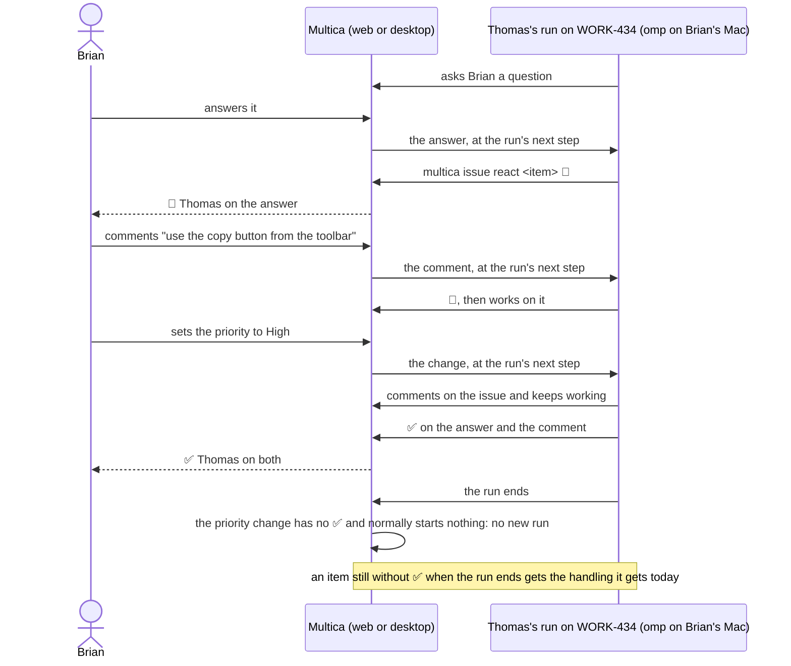

## At a glance

| Kind | Name | Change | Path |
|---|---|---|---|
| Behaviour | Every new or edited comment, answer and issue change reaches every running run on the issue as a notice at its next tool-batch boundary | new | `server/internal/handler/`, `server/internal/service/`, `server/internal/daemon/` |
| Runtime | omp runs take input while they run | changed | `server/pkg/agent/pi.go` |
| Command | `multica issue react <item> 👀` and `✅` for an item the run received | new | `server/cmd/multica/` |
| Behaviour | When a run ends, only its items without ✅ get their normal handling | changed | `server/internal/handler/daemon.go`, `server/pkg/db/queries/` |
| Activity | Label, file and sub-issue changes get their own rows in the issue's activity | new | `server/cmd/server/activity_listeners.go`, `packages/views/issues/components/issue-detail.tsx` |
| Display | 👀 and ✅ of an agent on comments, answers and issue changes | new | `packages/views/issues/`, `packages/views/questions/` |
| Display | Wake is not offered for an answer the agent marked ✅ | changed | `server/pkg/db/queries/question.sql` |
| Brief | The agent brief and the `multica-platform` skill tell agents to react 👀 and ✅ | changed | `server/internal/daemon/execenv/`, `server/internal/service/builtin_skills/multica-platform/` |

## Why

Brian answers an agent's question or comments on an issue while that agent works on it, and the agent does not hear it. Every agent in his workspace runs on omp, and Multica gives an omp run no input after it starts. An answer waits for Brian to press Wake after the run ends; a comment waits for the run to end and then starts a new run, which redoes the context and often finds the work already moved on. Brian also cannot see whether an agent saw his input or dealt with it.

Success signal: while Thomas runs on WORK-434, Brian answers Thomas's question and adds a comment; within the run's next step both show 👀 Thomas, later ✅ Thomas, and when the run ends no new run of Thomas starts. A comment Thomas leaves without ✅ starts the follow-up run it starts today.

## What Changes

- An omp run accepts new input while it runs, as Claude Code, Codex and Grok runs do today.
- Every new comment, edited comment, sent or changed answer, ask-back and issue change (status, priority, assignee, title, description, start date, due date, labels, files, sub-issues) reaches every running run on that issue as a notice: at the run's next tool-batch boundary, after the work in progress finishes, and also when it is not addressed to that agent.
- A comment for a running agent joins its run instead of queuing a follow-up run. In the comment composer, a running recipient defaults to **Add to current run** in every thread, also with files; **Start after this run**, **Stop and start over** and **Won't trigger** stay available. A comment's files arrive as names and ids the agent downloads.
- The agent marks an item 👀 when it saw it and handles it, and ✅ once it handled it, through `multica issue react`; an item that is not relevant to it stays unmarked. Brian sees both, with the agent's name, on the comment, the answer and the activity row.
- Label, file and sub-issue changes get rows in the issue's activity, so their marks have a place.
- When a run ends, an item for its agent without ✅ gets the handling it gets today: a comment or edit starts the agent's follow-up run, an answer stays unseen for Wake. An item with ✅, an item not for the agent and an issue change start nothing.
- An answer with ✅ counts as seen: **Wake** is not offered for it.
- The agent brief and the `multica-platform` skill tell agents that items arrive while they run and how to react to them.

## Capabilities

### New Capabilities

- `live-run-input`: comments, answers and issue changes reach an agent's running run on the issue while it runs.
- `run-input-reactions`: an agent marks each item its run received with 👀 and ✅; people see the marks; a run's end hands only items without ✅ to their normal handling.

### Modified Capabilities

- `agent-wake`: an answer the agent marked ✅ in a run counts as seen, so Wake is not offered for it.

## Impact

- Go server: comment creation, question answers and issue updates add delivery receipts; the run-end reconciliation reads ✅; the unseen-answers query excludes answers marked ✅.
- Database: delivery receipts cover answers and issue changes and hold the 👀 and ✅ times.
- Daemon and `server/pkg/agent`: omp starts in RPC mode and takes input with `steer`.
- `multica` CLI: a new `issue react` command.
- Web and desktop: 👀 and ✅ on comments, answers and the issue's activity rows; the composer's default for a running recipient.
- Docs: `apps/docs/content/docs/` pages on comments and the CLI.

## Constraints

- Only Wake turns answers into a run (ADR-0003, kept by ADR-0020): a delivered answer starts no run.
- Items reach only runs that are running: a queued or starting run gets them as its input at claim, as today.
- A run never receives its own agent's comments or changes.
- A runtime without mid-run input keeps today's behaviour: the item waits for the run to end.
- Only the agent of the run that received an item can set its 👀 and ✅.
- No foreign keys; every new index is its own `CONCURRENTLY` migration (AGENTS.md).

## Non-goals

- Mid-run input for pi, Cursor, OpenCode, Copilot, Hermes, Kimi and the other runtimes without it today.
- 👀 and ✅ on items a run did not receive while it ran, such as the comment that started it.
- Reactions by people that count as ✅.
- Reactions and subscribers as delivered issue changes.
- Changing what starts a run for an agent that is not running.

## Sources

- Multica issue WORK-438, "Deliver answers and comments to running agents immediately, with 👀/✅ reactions", with Brian's request and screenshot.
- Skuddy's hand-off comment on WORK-438: one change for all three points, mostly server, daemon and agent CLI, with a smaller frontend part.
- `adr/0003-only-wake-turns-answers-into-a-run.md`
