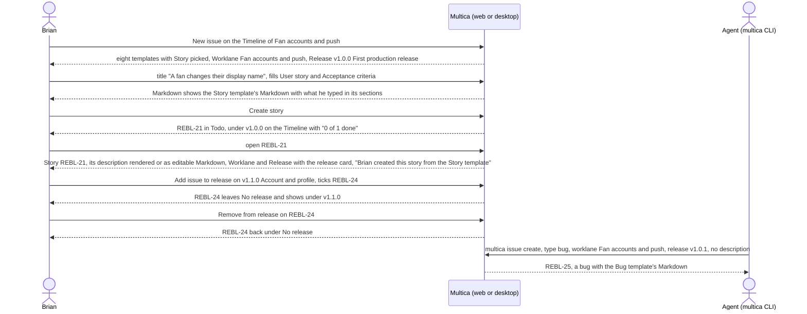

## At a glance

| Kind | Name | Change | Path |
|---|---|---|---|
| Concept | Issue type: Epic, Journey, Story, Bug, Enhancement, Refactor, Chore or Spike, or none | new | `packages/core/types/issue.ts` |
| Concept | Issue template: its sections, its fields and the one Markdown they fill | new | `packages/core/issues/` |
| Dialog | New issue: the eight templates, the fields with a Markdown toggle and a copy button, the Type, Worklane, Release and Priority chips next to Multica's other properties | changed | `packages/views/modals/create-issue.tsx`, `designs/screens/steer-all-work.pen` (screen 5) |
| Page | Issue page: type and ID, the description rendered with a Markdown toggle and a copy button, Type, Worklane and Release, the release card, the activity entries | changed | `packages/views/issues/components/issue-detail.tsx` |
| Icon | The eight type icons and No type, wherever an issue shows | new | `packages/views/issues/components/` |
| Section | Worklane Timeline: each release's issues of the worklane with their progress, No release, + Add issue to release, Remove from release | changed | `packages/views/projects/`, `designs/screens/steer-all-work.pen` (screen 3) |
| Dialog | Plan release: Issues, this worklane's issues in no release to tick | changed | `packages/views/projects/`, `designs/screens/steer-all-work.pen` (screen 8) |
| Menu | Release: Add issue to release | changed | `packages/views/projects/`, `designs/screens/steer-all-work.pen` (screen 3b) |
| Row | Worklane rows: the next release's progress and the planned releases that hold the worklane's issues | changed | `packages/views/projects/components/project-detail.tsx`, `packages/views/projects/components/projects-page.tsx`, `packages/views/organisations/` |
| Menu | Remove worklane: refused while the worklane has open issues | changed | `packages/views/projects/` |
| Command | `multica issue create` and `multica issue update`: `--type`, `--worklane`, `--release` | changed | `server/cmd/multica/cmd_issue.go` |

New issue from a Board column, the Board, List and the issue preview come with UJ-6, and a shipped release in New issue with UJ-8.

## Why

Brian wants every issue he makes to be one of his eight types, shaped by its template, with no room for implementation details (brief). Multica's New issue has a free title and description, no types, and no way to place an issue in a worklane or a release, so the release line UJ-4 builds holds no work and shows no progress. Agents create issues too, and must keep working without a template.

Success signal: from the Timeline of Fan accounts and push Brian creates the story "A fan changes their display name" from the Story template; it shows as REBL-21 in Todo under v1.0.0 First production release with "0 of 1 done", its page shows Story, its template's Markdown with what he typed, links to Fan accounts and push and v1.0.0, and "Brian created this story from the Story template"; an agent creates a bug with `multica issue create --type bug` and no description and it gets the Bug template's Markdown.

## What Changes

- New issue offers the eight templates, Story picked, each with its type icon and hint. The picked template sets the type, the fields and the button, such as "Create story". Its fields, each Required or Optional, fill the template's one Markdown description, which the Markdown toggle shows to edit by hand and a copy button copies; once edited by hand, that Markdown is the description and the fields lock. The issue keeps only that Markdown. No template has a field for implementation details. Create stays disabled until the title is filled and every required field is filled or the Markdown is edited by hand.
- New issue gets Type, Worklane, Release and Priority chips next to Multica's other properties. From a worklane, its worklane and the repository's next release are filled in; from a project, its first repository's `main`. Picking a worklane fills in the next release. The release offers the unshipped releases of the worklane's repository and "No release", or "Pick a worklane first" without a worklane. A new issue starts in Todo with a release and in Backlog without, unless Brian picks a status. An issue without a worklane is kept under "No worklane".
- Every issue shows its type icon, or the No type icon, wherever it shows. An issue without a type gets its type once on its page; its description stays as it is. A type never changes once set.
- The issue page shows the type and ID, the description rendered with a Markdown toggle that shows its Markdown to edit and a copy button, Type, Worklane and Release, where Worklane and Release are pickers with New issue's rules and links to the worklane's Timeline, and a release card with the release's state, title, description, worklane, repository and progress.
- The issue's activity says who created it from which template, which release it was planned in, when its type was set, when it was added to or removed from a release, when it moved to another worklane, and when its release was removed.
- A worklane's Timeline shows each release's issues of this worklane with "{done} of {total} done", "No issues of this worklane" for a release without them, and then "No release" with this worklane's issues in no release. The + at the bottom of a release opens New issue in that release. An issue in an unshipped release has Remove from release in its menu.
- Plan release lists this worklane's issues in no release, to tick. The release's menu gets Add issue to release, which lists the same issues to tick.
- Issues follow their release when it moves or renumbers; the issues of a removed release go back to "No release" on their worklanes.
- Worklane rows on a repository card, Projects and an organisation's page show the next release's progress for the worklane and up to two planned releases after it that hold the worklane's issues.
- Remove worklane is refused while the worklane has an open issue; its closed issues keep their release under "No worklane".
- `multica issue create` gets `--type`, one of the eight, `--worklane` and `--release`; `multica issue update` gets `--worklane` and `--release`. A description the CLI sends is kept as written and never refused for missing template headings. With a type and no description, the issue gets its template's Markdown; without a type, it has none.

## Capabilities

### New Capabilities

- `issue-templates`: lets Brian create an issue in New issue only from one of eight templates, filling its fields into the template's one Markdown description.
- `new-issue-placement`: lets Brian put a new issue in a worklane and one of its repository's unshipped releases, or in none, with the status that follows.
- `issue-types`: lets Brian tell an issue's type by its icon, see "No type" on an issue without one, and set that type once.
- `issue-page-worklane-and-release`: lets Brian see on an issue's page its description rendered or edit it as Markdown, change its worklane and release, follow them to the worklane's Timeline, and see the release card.
- `issue-activity-entries`: lets Brian see in an issue's activity how it was created, typed and placed in releases.
- `release-issues-on-timeline`: lets Brian see each release's issues of a worklane with their progress, the worklane's issues in no release, create an issue in a release and take an issue out of one.
- `plan-release-issues`: lets Brian tick this worklane's issues in no release when he plans a release.
- `add-issue-to-release`: lets Brian add this worklane's issues in no release to an unshipped release from its menu.
- `issues-follow-their-release`: keeps each issue in its release when the release moves, renumbers or is removed.
- `worklane-release-progress`: lets Brian see on worklane rows the next release's progress and the planned releases that hold the worklane's issues.
- `worklane-open-issues`: keeps a worklane with open issues from removal and keeps its closed issues under "No worklane".
- `cli-issue-type-and-placement`: lets an agent or the CLI create an issue with or without a type, in a worklane and a release, and move an issue to another worklane or release.

### Modified Capabilities

None in `specs/openspec/specs/`. This change builds on the unarchived changes `worklanes-of-a-repository` (UJ-3: the worklane page, its rows and Remove worklane, whose non-goals hand the open-issue refusal and "No worklane" to UJ-5) and `release-line-of-a-repository` (UJ-4: the release line, Plan release, the release menu, Remove release and the worklane rows' release chips, whose non-goals hand the issue parts to UJ-5). `release-issues-on-timeline` fills UJ-4's "No issues of this worklane" columns. `plan-release-issues` adds Issues to UJ-4's Plan release. `add-issue-to-release` adds an item to UJ-4's release menu. `issues-follow-their-release` adds what happens to issues to UJ-4's moves and removal. `worklane-release-progress` adds to UJ-4's worklane rows. `worklane-open-issues` adds a refusal to UJ-3's Remove worklane.

## Impact

- Web and desktop: New issue, the issue page, issue rows and cards on Issues, ⌘K search, the worklane's Timeline, Plan release, the release menu, the worklane rows on a repository card, Projects and an organisation's page, and Remove worklane.
- Shared packages: the issue type and its icons, the eight templates with their fields and Markdown, the issue's worklane and release in the API client and its schemas, queries and mutations for issues in releases.
- Server: an issue's type, worklane and release in the API and the database; the rules that a release belongs to the worklane's repository and is unshipped, and that a type is set once; the template's Markdown for an issue created with a type and no description; the issue activity entries; the refusal in Remove worklane.
- CLI: `multica issue create` and `multica issue update`, upstream's Go CLI, keep their names.
- Copy in every supported language and the project docs in `apps/docs`.

## Constraints

- New issue creates an issue only from one of the eight templates; the issue keeps only the one Markdown description its fields fill or Brian edits by hand.
- No template, issue view or creation flow has a field for implementation details; code and technical design go in the change.
- An issue's release is an unshipped release of its worklane's repository; an issue without a worklane has no release.
- An issue's type is one of the eight or none, and once set it never changes.
- Multica never refuses or rewrites a description an agent or the CLI sends.
- With a worklane, an issue belongs to the worklane's project.
- Light mode only.
- AGENTS.md: no foreign keys or cascades, `CREATE INDEX CONCURRENTLY` in its own migration, zod schemas with `parseWithFallback` and malformed-response tests for changed responses, no compatibility shims, every check local.

## Non-goals

- New issue from a Board column with its status, the Board, List and the issue preview: UJ-6.
- A shipped release in New issue, disabled as "Shipped", and Add issue to release disabled with "Shipped: add it to a later release": UJ-8.
- "Fill example" on screen 5, a prototype aid (Brian, 13 October 2026).
- Changing New issue's "Create with agent" mode: it stays as Multica has it, and its agent creates through the CLI with or without a type (Brian, 13 October 2026).
- Changing the status the CLI gives an issue created without `--status`.
- The worktree an agent works in once an issue is in a worklane: UJ-6.
- Rewriting the descriptions of issues already in Multica, or giving them a type in bulk.
- Changing a type once set, and setting a type from the CLI after creation.
- The visual design of Remove from release, Add issue to release's list and the issue page's Worklane and Release pickers, deferred to J6.
- Inbox, My Issues, Chat and the filters and views of Issues, which stay as Multica has them (PRD non-goals). Squads, the mobile app and dark mode.

## Sources

- Intent: [Steer projects, repositories, worklanes and releases in Multica](anytype://object?objectId=bafyreib727ukptyvcfbkud627gjb3cu2lmwsh3u4cjbu4kisjofa25km3u) and its Requests.
- PRD: [Multica: steer projects, repositories, worklanes and releases](anytype://object?objectId=bafyreiew63xw2dncss52jdx4qk4o6aktkklhqroclvs3cvjxcyztx7h5um): UJ-5 with "Issues in releases", F5 with FR-42 to FR-52, FR-76 to FR-78, FR-33 and FR-41, FR-2, FR-28, UJ-6, UJ-8's shipped edge case, the glossary and non-goals.
- Brief: [Multica: steer projects, repositories, worklanes and releases](anytype://object?objectId=bafyreicccdj6bucv5d65bxvkz4gy7jf7etplsswmwfggupqbakc6rudpmi).
- UJ-3 change: `specs/openspec/changes/worklanes-of-a-repository/`. UJ-4 change: `specs/openspec/changes/release-line-of-a-repository/`.
- Design: [Steer all work screens](anytype://object?objectId=bafyreiauxfhf7w74hwn5je7ljakzxfgo2qv4noid2oshvtqjwkos2v5oiq), screens 5 New issue from template, 3 Worklane timeline, 3b Release actions and 8 Plan release in `designs/screens/steer-all-work.pen`, exports in `designs/exports/`; [component library](anytype://object?objectId=bafyreiamoqycfo735krrpmzn3ujhdardv6uixsrdzkadzlodwpr7aenwee); `designs/creation-flows.md` "Plan release" step 4 and "Edit and move a release".
- Prototype: [Steer all work prototype](anytype://object?objectId=bafyreieck7zsmzslnfe5asszexojznfbnsnwcg62eqbesqqeigkkzgoclm), revision 460535099583266816: the eight templates with their sections, questions, fields and examples in `TEMPLATES`, and `templateInputs` and `templateMarkdown`, in `prototypes/web/src/components/generated/model.ts`; `NewIssueDialog`, `IssuePage`, `IssueDescription`, `ReleaseColumn`, `ReleaseActions`, `ReleaseChain` and `Palette` in `MulticaSteerAllWorkPrototype.tsx`; `ReleaseDialog`'s Issues in `creation.tsx`. Its `laneNextIdx`, a worklane's own next release, is superseded by the PRD's rule that only the repository's first unshipped release is next.
- Brian's design session of 12 October 2026 (`/tmp/brian-design-session-inputs.txt`): a new issue only starts from a template; the description is one Markdown field; the fields only fill the template's Markdown, with its emoji headings and question callouts.
- Brian's answers in the P4 session of 13 October 2026, on the [UJ-5 Task](anytype://object?objectId=bafyreihykrbd7aafrikccrai7sohlg4vgxj3l7aokw6hemeqhjit23pfdq): Worklane and Release pickers on the issue page and in `multica issue update`; Add issue to release picks, the column's + creates; New issue keeps Multica's other properties; Create with agent stays; Fill example is a prototype aid; the issue activity entries.
