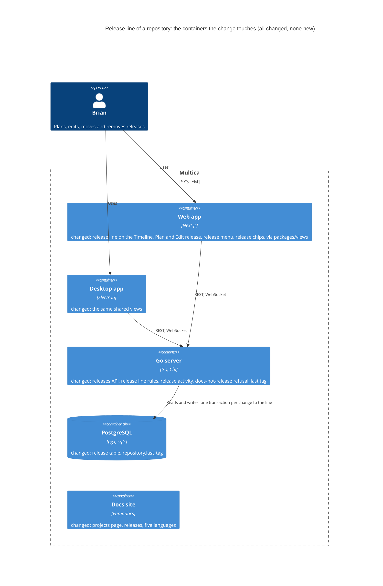
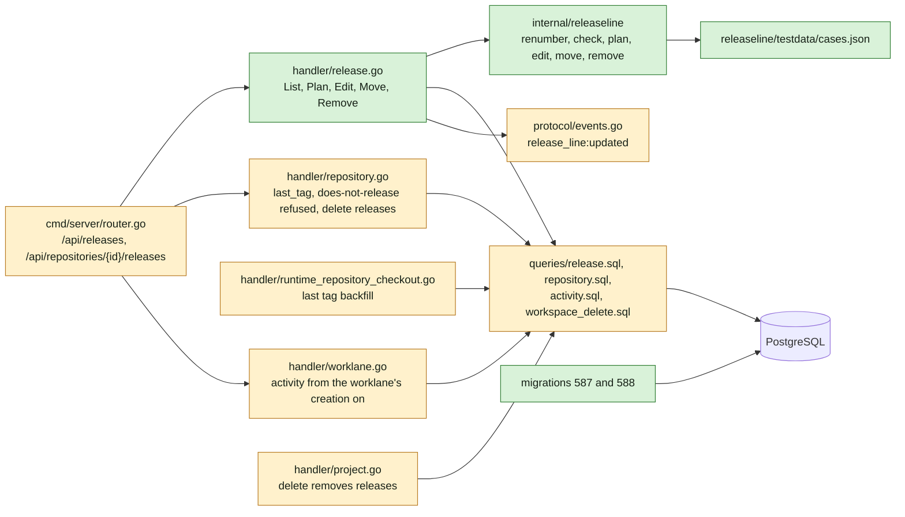
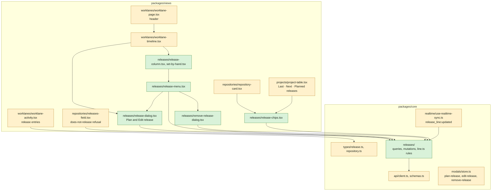
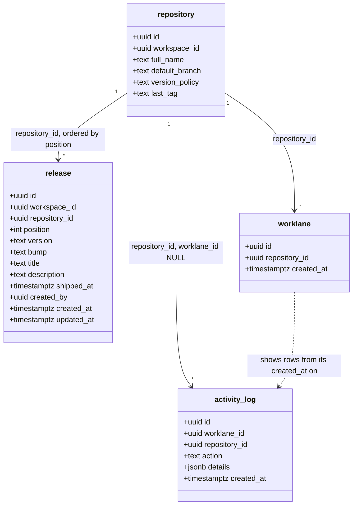
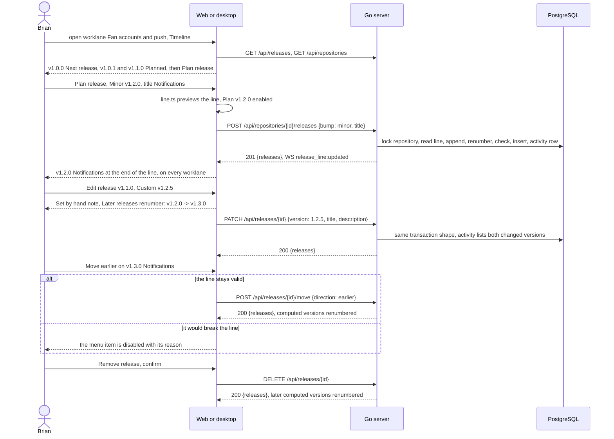

## At a glance

The delta of this change on the living system design, `specs/docs/system-design.md`, on top of UJ-3 `worklanes-of-a-repository` (DAS-452). Every container it touches already exists, and the change adds no container. The daemon does not change: the last tag comes from UJ-2's checkout check, which already reads it. Mobile does not change: the API changes are additive, and the PRD keeps mobile out of scope.



Go server component map, delta:



Web and desktop component map, delta:



Models:



`release` is a new table, and `repository.last_tag` is a new column. `bump` is NULL for a version set by hand. `shipped_at` stays NULL in this change; UJ-8 sets it.

Journey sequence and data flow:



| Kind | Name | Change | Path |
|---|---|---|---|
| Migration | `release` table, `repository.last_tag` | new | `server/migrations/587_release_line.up.sql`, `.down.sql` |
| Migration | A repository's line by position | new | `server/migrations/588_release_line_index.up.sql`, `.down.sql` |
| Migrator | Cleanup for the concurrent index | changed | `server/cmd/migrate/main.go` |
| Queries | Release list, line for update, insert, update, delete, positions and versions | new | `server/pkg/db/queries/release.sql` |
| Queries | `last_tag` on create, its backfill, policy update, lock | changed | `server/pkg/db/queries/repository.sql` |
| Queries | Worklane activity bounded by the worklane's creation | changed | `server/pkg/db/queries/activity.sql` |
| Queries | Workspace delete removes releases | changed | `server/pkg/db/queries/workspace_delete.sql` |
| Generated | sqlc output | changed | `server/pkg/db/generated/` |
| Package | Release line rules and their cases | new | `server/internal/releaseline/line.go`, `line_test.go`, `testdata/cases.json` |
| Handler | Releases: list, plan, edit, move, remove | new | `server/internal/handler/release.go` |
| Handler | `last_tag` on create, does-not-release refused, delete removes releases | changed | `server/internal/handler/repository.go` |
| Handler | Last tag backfill on a passing check | changed | `server/internal/handler/runtime_repository_checkout.go` |
| Handler | Worklane activity read | changed | `server/internal/handler/worklane.go` |
| Handler | Project delete removes its repositories' releases | changed | `server/internal/handler/project.go` |
| Routes | Release routes | changed | `server/cmd/server/router.go` |
| Events | `release_line:updated` | changed | `server/pkg/protocol/events.go`, `server/cmd/server/listeners.go` |
| Type | Release, release activity details, repository `last_tag` | changed | `packages/core/types/release.ts`, `repository.ts`, `worklane.ts`, `index.ts` |
| Schema and client | Release, release line response, `last_tag`, release actions | changed | `packages/core/api/schemas.ts`, `client.ts` |
| Feature | Release queries, mutations and line rules | new | `packages/core/releases/` |
| Feature | Realtime, modals | changed | `packages/core/realtime/use-realtime-sync.ts`, `packages/core/modals/store.ts` |
| Dialog | Plan release and Edit release | new | `packages/views/releases/components/release-dialog.tsx` |
| Dialog | Remove release | new | `packages/views/releases/components/remove-release-dialog.tsx` |
| Menu | Release: Edit, Move earlier, Move later, Remove | new | `packages/views/releases/components/release-menu.tsx` |
| Section | Release column, Set by hand | new | `packages/views/releases/components/release-column.tsx`, `set-by-hand.tsx` |
| Row | Release chips | new | `packages/views/releases/components/release-chips.tsx` |
| Section | Worklane Timeline: the line, Plan release, does not release | changed | `packages/views/worklanes/components/worklane-timeline.tsx` |
| Page | Worklane header, release in view | changed | `packages/views/worklanes/components/worklane-page.tsx` |
| Section | Worklane activity: release entries | changed | `packages/views/worklanes/components/worklane-activity.tsx` |
| Section | Repository card: release chips | changed | `packages/views/repositories/components/repository-card.tsx` |
| Field | Releases: does-not-release refusal | changed | `packages/views/repositories/components/releases-field.tsx`, `edit-repository-dialog.tsx` |
| Page | Projects and an organisation's page: release column | changed | `packages/views/projects/components/project-table.tsx`, `packages/views/organisations/components/` |
| Registry | The three release dialogs | changed | `packages/views/modals/registry.tsx` |
| Copy | `releases` namespace, worklane and repository copy | new, changed | `packages/views/locales/{en,fr,ja,ko,zh-Hans}/` |
| Docs | Projects page: releases | changed | `apps/docs/content/docs/projects*.mdx` |
| Component | Activity entry with changed versions | new | `designs/systems/multica.lib.pen` |
| Design | Screens of this journey | changed | `designs/screens/steer-all-work.pen`, `designs/exports/`, `designs/creation-flows.md` |
| Prototype | Data-flow prototype | new | `prototypes/web/release-line-of-a-repository/data-flow/` |
| Prototype | Live prototype | changed | `prototypes/web/src/components/generated/` |
| E2E | Journey acceptance test | new | `e2e/releases.spec.ts` |
| ADR | The server keeps each repository's release line | new | `adr/0010-the-server-keeps-each-repositorys-release-line.md` |
| ADR | A worklane shows repository activity from its creation on | new | `adr/0011-a-worklane-shows-repository-activity-from-its-creation-on.md` |

## Context

Journey UJ-4 of [PRD: Multica: steer projects, repositories, worklanes and releases](anytype://object?objectId=bafyreiew63xw2dncss52jdx4qk4o6aktkklhqroclvs3cvjxcyztx7h5um), F4 with FR-29 to FR-41, FR-2 and FR-14. It builds on UJ-3 `worklanes-of-a-repository` (DAS-452, branch `das-452-uj-3-brian-creates-a-worklane`):

- the worklane page with `worklane-timeline.tsx`, which says "No releases yet" until this change;
- worklane activity in `activity_log` with repository-wide rows (ADR-0008), whose index 586 serves this change's entries;
- worklane rows on a repository card, on Projects and on an organisation's page;
- migrations 583 to 586.

UJ-3 builds on UJ-2 `repositories-of-a-project` (DAS-451): `repository` with `version_policy` (`none` is "This repository does not release"), the checkout check that reports `last_tag`, the Releases field, ADR-0006 and ADR-0007, and migrations 575 to 582. UJ-2 builds on UJ-1 `projects-by-organisation` (DAS-450), with migrations 572 to 574. This change's migrations start at 587.

The later changes build on this one:

- `issues-from-templates` (UJ-5) adds `issue.release_id` and puts issues in releases. Issues follow their release when it moves, and return to "No release" when it is removed.
- `worklane-board-and-list` (UJ-6) reads a release's issues per worklane.
- `worklanes-and-releases-pages` (UJ-7) lists every repository's line from `GET /api/releases`.
- `release-ships` (UJ-8) sets `shipped_at`, fixes the version and refuses moves past a shipped release.

**Journey steps.** The investigation finds nothing for three steps, and no `Keep:` Request names them. Each gets its `Skip:` Request once the journey exists in the brain:

- `Skip: J1` Project structure: no new container, app or workspace package. The new folders sit in existing ones: `server/internal/releaseline/`, `packages/core/releases/` and `packages/views/releases/`.
- `Skip: J4` Design system: `designs/systems/multica.lib.pen` has the tokens the release states need: the `Release/Shipped`, `/Next` and `/Planned` chips, `Timeline node/*`, `Set by hand`, and the destructive and muted colours.
- `Skip: J10` Agent tooling for UI: no agent or CLI plans or changes a release (proposal Non-goals).

J2, J3, J5, J6, J7, J8, J9 and J11 have work:

- J5 has work because UJ-3's `Activity entry` shows one sentence, and a release entry also lists the versions it changed. The library holds every other part: `Release column`, `Release step`, `Release connector`, `Timeline node/*`, `Set by hand`, `Bump option/*`, `Menu`, `Menu item/Disabled`, `Dialog`, `Form field`, `Input/Error`, `Note`, `Readonly value`, `Worklane row` and `Release/*`.
- J6 has work for three reasons. Screens 8, 8b and 8c say that a release "asks you to pass it", which the proposal supersedes. No screen shows Remove release, whose visual design the PRD Addendum leaves to J6. And no screen shows release entries in a worklane's activity or the does-not-release refusal in Edit repository.
- J7 has work for the same reasons. The prototype's `ReleaseDialog` (`creation.tsx` L711) still says "asks you to pass it", and `ReleaseActions` has no Remove release.

**Code map.**

- The rules to port are in the prototype, `prototypes/web/src/components/generated/model.ts` L159 to L240: `parseVersion`, `cmpVersion`, `bumpFrom`, `bumpBetween`, `versionBefore`, `renumber`, `lineProblem`, `placeRelease` and `moveRelease`. In the prototype, `pinned` marks a version set by hand, and every worklane holds a copy of the line. The server keeps one line per repository instead.
- The UI to port: `ReleaseDialog` (`creation.tsx` L543) and, in `MulticaSteerAllWorkPrototype.tsx`, `ReleaseChain` L566, `LanePage` L1417 with the header line L1480, `SetByHand` L1609, `ReleaseActions` L1623 and `ReleaseColumn` L1692. The screenshots of the release rules are in `prototypes/web/release-version/`.
- Actor: `resolveActor` (`handler/handler.go` L866) gives `actor_type` and `actor_id` for the activity row, as issue activity does.
- Row locks: `queries/agent.sql` `... FOR UPDATE` is the pattern for `LockRepositoryForLine`.
- A small pure package beside the handlers: `server/internal/issueposition/position.go`.
- Deletes: `workspace_delete.sql` L360 deletes `activity_log` by workspace. Releases join that list. UJ-3's repository and project deletes remove their activity, and this change adds their releases.

**What must not change.** Issue activity and its reads; UJ-2's checkout check, which already reports `last_tag`; worklanes and their worktrees. A repository's version files and tags: nothing in this change writes to GitHub or to a checkout.

**Living system design.** `specs/docs/system-design.md` matches `main` at `10a1307d1`. It changes when this change's code merges, as with UJ-1 to UJ-3.

## Goals / Non-Goals

**Goals:**

- One release line per repository, on the Timeline of every worklane of the repository, with Next release, Planned, the version, the title, the description and Set by hand.
- Plan release, Edit release, Move earlier, Move later and Remove release, each refused with its reason when it would break the line.
- Every change to the line as one entry in the activity of every worklane of the repository, naming the versions it changed.
- Release chips on worklane rows; "Does not release" refused while unshipped releases exist.
- A release model that UJ-5 to UJ-8 extend without rework: an id that issues point to, a position, a version that renumbers, `shipped_at`, and a workspace-wide list.

**Non-Goals:**

- Issues in releases, a release's progress, "No release", Add issue to release (UJ-5).
- Shipping, shipped releases, editing a shipped release, and refusals past a shipped release (UJ-8).
- Board and List (UJ-6); the Worklanes and Releases pages (UJ-7).
- Planning or changing releases from the CLI or by an agent.
- Finding the last tag again after Add repository or a backfill found it.
- Mobile, Squads, dark mode.

**Always:**

- No foreign keys or cascades. The concurrent index is its own migration file.
- UI-consumed JSON goes through zod with `parseWithFallback`, with malformed-response tests.
- Every change to a line runs in one transaction that locks its repository row and leaves the line strictly increasing.
- Plan, edit, move and remove await the server.

**Never:**

- A saved line where a version is not higher than the release before it, or the first is not higher than the last tag.
- A goal or a date on a release before it ships.
- A release on a repository that does not release.
- A pass for a release, in copy or in behaviour.

## Decisions

### 1. The model (ADR-0010)

Migration 587:

```sql
ALTER TABLE repository ADD COLUMN last_tag text;

CREATE TABLE release (
  id uuid PRIMARY KEY DEFAULT gen_random_uuid(),
  workspace_id uuid NOT NULL,
  repository_id uuid NOT NULL,
  position integer NOT NULL,
  version text NOT NULL CHECK (version ~ '^[0-9]+\.[0-9]+\.[0-9]+$'),
  bump text CHECK (bump IN ('patch', 'minor', 'major')),
  title text NOT NULL CHECK (btrim(title) <> ''),
  description text NOT NULL DEFAULT '',
  shipped_at timestamptz,
  created_by uuid,
  created_at timestamptz NOT NULL DEFAULT now(),
  updated_at timestamptz NOT NULL DEFAULT now()
);
```

Migration 588, its own file: `CREATE INDEX CONCURRENTLY idx_release_line ON release (workspace_id, repository_id, position)`. Every read filters by workspace. The line reads by repository, and the workspace list reads by workspace. There is no unique index on `position`, because a move swaps two positions inside one transaction, and Postgres checks a unique index row by row. The repository lock keeps positions unique. There is none on `version` either: the strictly-increasing check implies it.

- `version` is stored without the `v`, and the tag is `v{version}`. The API sends it the same way, and the UI adds the `v`.
- `bump` NULL means set by hand. A computed release keeps its bump, and its version follows its place.
- `position` runs 0 to n-1 along the line. Every write rewrites the positions of the line, so a gap never stays.
- `repository.last_tag`: NULL means not known yet, `''` means no tag, and anything else is a version like `0.4.2`.

The release response is `{id, repository_id, position, version, bump, title, description, shipped_at, created_at, updated_at}`. In zod, an unknown `bump` falls back to `null` (set by hand), `shipped_at` defaults to `null`, and `description` defaults to `''`. The repository response gains `last_tag`, a nullable string defaulting to `null`.

Next release and Planned are not stored. A release is shipped when `shipped_at` is set, the first unshipped release is next, and the rest are planned. UJ-8 only sets `shipped_at`.

### 2. Endpoints

| Method and path | Body | Answer |
|---|---|---|
| `GET /api/releases` | none | `{releases}` of the workspace, by repository and position |
| `POST /api/repositories/{id}/releases` | `{title, description, bump}` or `{title, description, version}` | 201 `{releases}`, the repository's line |
| `PATCH /api/releases/{id}` | `{title, description, bump}` or `{title, description, version}` | 200 `{releases}` |
| `POST /api/releases/{id}/move` | `{direction: earlier or later}` | 200 `{releases}` |
| `DELETE /api/releases/{id}` | none | 200 `{releases}` |

Each write answers with the repository's whole line after the change, so the client replaces that repository's releases in its cache without a second read. It then publishes `release_line:updated` `{repository_id}` to the workspace.

Refusals, checked in this order inside the transaction:

| Check | Answer |
|---|---|
| Repository or release not in the workspace | 404 |
| `title` empty after trim | 400 `title_required` |
| Both `bump` and `version`, or neither | 400 `version_or_bump` |
| `version` not `v1.4.0` or `1.4.0` | 400 `version_invalid` |
| `version_policy` is `none` | 409 `does_not_release` |
| `last_tag` is NULL | 409 `last_tag_unknown` |
| Move earlier on the first release | 409 `first_release` |
| Move later on the last release | 409 `last_release` |
| The line after the change is not strictly increasing | 409 `line_not_increasing` `{release_id, version, title, before: {version, title} or {last_tag}}` |

The server trims a leading `v` from `version`. Every refusal answers before anything is written. The client shows each code in its own words: "Use the form v1.4.0.", "Must be higher than v1.1.0 Account and profile, the release before it.", "Must be higher than v0.4.2, the last tag." and "Then v1.2.5 Notifications is not higher than v1.3.0 Account and profile, the release before it. Set a different version."

UJ-2's `PUT /api/repositories/{id}` gains one refusal. Under the same repository lock, `version_policy: none` while the line holds an unshipped release is 409 `has_unshipped_releases` `{releases: [{version, title}]}`.

### 3. The release line rules (ADR-0010)

`server/internal/releaseline` is pure. It takes `Line{LastTag string, Releases []Release}`, where each `Release` is `{ID, Version, Bump, Title, Shipped bool}`, and returns the new line and the versions that changed, or a `Problem`:

- `Renumber(line)`: walks the line and gives each unshipped release with a bump the version its bump gives after the version before it. The version before the first release is the last tag, or 0.0.0 when there is none. A release set by hand, and every shipped release, keeps its version.
- `Check(line)`: the first release whose version is not higher than the one before it, compared as three integers. Before the first release stands the last tag. When the last tag is `''`, the first release has no lower bound, as in the prototype's `versionBefore`.
- `Plan(line, release)`: adds at the end, then renumbers and checks.
- `Edit(line, id, release)`: replaces in place, then renumbers and checks. A new bump drops the version set by hand.
- `Move(line, id, direction)`: swaps with the neighbour, then renumbers and checks. It refuses `first_release` and `last_release` first.
- `Remove(line, id)`: takes the release out, then renumbers. Removing a release cannot make a version too low, because every version it held up stays where it was or renumbers from a lower one. The check runs anyway.
- `Changes(before, after)`: `[{release_id, title, from, to}]` for every release whose version changed.

The rules match the prototype's `renumber`, `lineProblem`, `placeRelease` and `moveRelease`, and the spec scenarios. Every scenario of `plan-release`, `edit-release`, `move-release` and `remove-release` is one case in `testdata/cases.json` (`{name, last_tag, line, op, want_line, want_problem}`). The Go test and the TypeScript test in `packages/core/releases/` both run every case.

`handler/release.go` runs each write as:

1. `BEGIN`; `LockRepositoryForLine` (`SELECT ... FROM repository WHERE id = $1 AND workspace_id = $2 FOR UPDATE`).
2. The refusals of decision 2 for the repository.
3. `ListReleaseLine` by position, then the `releaseline` operation.
4. Insert, update or delete the release; then `UpdateReleasePositionAndVersion` for each release whose position or version changed, setting `updated_at`.
5. One `activity_log` row (decision 4).
6. `COMMIT`; publish `release_line:updated`; answer with the line.

### 4. Release activity (ADR-0008, ADR-0011)

Each write adds one `activity_log` row, with `repository_id` set and `worklane_id` and `issue_id` NULL. Its actor comes from `resolveActor`. Its action is one of:

| Action | Details | Sentence |
|---|---|---|
| `release_planned` | `{release_id, version, title}` | "Brian planned v1.0.1 Membership hardening" |
| `release_edited` | `{release_id, version, title, changes}` | "Brian edited v1.2.5 Account and profile" |
| `release_moved` | `{release_id, version, title, direction, changes}` | "Brian moved v1.1.0 Notifications earlier" |
| `release_removed` | `{release_id, version, title, changes}` | "Brian removed v1.2.0 Notifications" |

`version` and `title` are the release's after the change, or before it for a removal. `changes` is `releaseline.Changes`, and it includes the release itself when its version changed. The activity lists each change as "Notifications v1.2.0 -> v1.1.0". An edit that changes no version has an empty `changes`. Details keep the versions and titles as they were, so later renumbering does not rewrite the entry.

`ListActivitiesForWorklane` (UJ-3) gains a bound on its repository part: `worklane_id = $1 OR (repository_id = $2 AND worklane_id IS NULL AND created_at >= $3)`, where `$3` is the worklane's `created_at` (ADR-0011). `main` is made with its repository, so it shows every entry. The zod action enum adds the four actions; unknown actions still fall back to `unknown` and are not rendered.

### 5. The last tag

- UJ-2's `POST /api/repositories` stores the passed check's `last_tag` without the `v`, or `''` when the check found no tag.
- Backfill: when a check passes for a repository's checkout machine and path, and its `last_tag` is NULL, the server stores the found tag and publishes `repository:updated`. This is the same hook as UJ-3's install-command backfill, in `runtime_repository_checkout.go`.
- While `last_tag` is null, the Plan and Edit release dialogs start that check on open and show "Finding the last tag" with Plan disabled. The release menu's moves and Remove are disabled with "Finding the last tag". The server's 409 `last_tag_unknown` stays the gate.

### 6. Repositories that do not release

- `releases-field.tsx` in Edit repository: picking "This repository does not release" while the cached line has an unshipped release shows "Remove its unshipped releases first: v1.0.0 First production release, v1.0.1 Membership hardening." and disables Save. The server refuses the same (decision 2).
- The Timeline of a worklane of a repository with `version_policy: none` shows "{owner/name} does not release, so its worklanes plan no releases." in place of Plan release, and its header says "does not release".
- Switching back to a policy that releases needs nothing more. Plan release offers its bumps after `last_tag`.

### 7. Web and desktop

- `packages/core/releases/`:
  - `releaseKeys.list(wsId)` with `releaseListOptions(wsId)`, one query for the whole workspace. `selectLine(releases, repositoryId)` sorts by position, behind a memoised selector so the reference stays stable.
  - `usePlanRelease`, `useEditRelease`, `useMoveRelease` and `useRemoveRelease` await the server. On success, each replaces that repository's releases in the list cache with the answered line, then invalidates the activity of the worklanes.
  - `line.ts` holds the TypeScript port of `releaseline`, built on the prototype's functions with versions without `v`: `bumpOptions(line, lastTag, index)`, `previewPlan`, `previewEdit`, `previewMove`, `previewRemove`, `lineStates(line)` (shipped, next or planned) and `formatVersion(v)`. `line.test.ts` runs `server/internal/releaseline/testdata/cases.json`.
- `use-realtime-sync.ts`: `release_line:updated` invalidates `releaseKeys.list(wsId)` and the worklane activity queries of the workspace.
- `worklane-timeline.tsx`:
  - The line from `selectLine`, left to right. A column holds `Timeline node/Next` or `/Planned`, the version, the title, the description when it has one, `Set by hand` when `bump` is null, "No issues of this worklane", and `release-menu.tsx`.
  - Then a Plan release column, or the does-not-release note.
  - The page's `?release={id}` scrolls that column into view, for the chips.
- `worklane-page.tsx` header: "{state} · nothing shipped yet", "{state} · last shipped v{version}" or "{state} · does not release". No goal and no date are shown.
- `release-dialog.tsx` (modals `plan-release` `{repository_id}` and `edit-release` `{release_id}`):
  - Version: `Bump option/*` for Patch, Minor and Major, each with its version from `bumpOptions`, then Custom with a text field. Plan picks Patch. Edit picks the release's bump, or Custom with its version when it is set by hand.
  - The hint under Version: "Follows v1.1.0 Account and profile. Moving it renumbers it.", "Follows v0.4.2, the last tag. Moving it renumbers it." or "The first release of this repository.".
  - Custom set by hand adds "Set by hand: it keeps this number when the release moves, and must stay higher than the release before it." In Edit, a preview that renumbers later releases adds "Later releases renumber: v1.2.0 -> v1.3.0.".
  - Title (required) and Description (optional).
  - Ships (`Readonly value`): "When its issues are done and merged, Multica tags v{version} on {default branch}, writes the release note and publishes the GitHub release. It gets its date when it ships."
  - Buttons: "Plan v{version}" or "Save release". They are disabled without a title, or with an invalid version or a `previewPlan` or `previewEdit` problem, whose message shows under the field. A 409 from the server shows the same message in place.
- `release-menu.tsx`: Edit release, Move earlier, Move later, Remove release. Each move is disabled with the reason from `previewMove`: "It is the first release", "It is the last release" or "Then v1.0.1 Membership hardening is not higher than v1.1.0 Account and profile, the release before it".
- `remove-release-dialog.tsx`: names the release and the versions that renumber, then removes on confirm, awaiting the server. J6 designs its look.
- `worklane-activity.tsx`: renders the four actions with the actor, the sentence, the time, and one line per entry in `changes`.
- `release-chips.tsx`, `{repositoryId}`: "Does not release" or "No releases planned". Otherwise the last shipped `Release/Shipped` chip or "nothing shipped", then the next release's `Release/Next` chip. A chip opens `worklaneDetail(worklane id)` with `?release={id}`. The repository card's worklane rows and `project-table.tsx`'s worklane rows show it. Projects and an organisation's page head the column "Last · Next · Planned releases".
- No route is added. The modals join `ModalType` and `modals/registry.tsx`.

## Risks / Trade-offs

- **The rules live in Go and TypeScript.** The client only previews, so drift shows as a disabled button the server would allow, or a 409 the dialog then shows. The shared case file runs in both test suites.
- **The last tag is read once.** Tags pushed outside Multica after Add repository are not seen, so a planned version can collide with an existing tag. UJ-8 tags from the line itself, and the proposal keeps finding the tag again out of scope.
- **One lock per repository.** Two members changing the same line wait on each other for one short transaction. Different repositories never wait.
- **Release entries and new worklanes.** A worklane shows no release entry from before it was created (ADR-0011). Its Timeline still shows the whole line.
- **Migration numbers.** 587 and 588 can be taken on `main` before J2. The builder then takes the next free numbers and renames the cleanup entry with them.

## Migration Plan

1. Release UJ-3 (UJ-3 Migration Plan).
2. Apply migrations 587 and 588. Existing repositories have a NULL `last_tag`, and no releases exist.
3. Release with `make local-release`. The first passing check of each checkout fills its last tag. Until then, Plan release finds it on open.

Rollback is the down migrations: 588 drops the index, and 587 drops `release` and `repository.last_tag`. The planned releases and their activity rows go; the activity rows are removed by action in 587's down migration.
