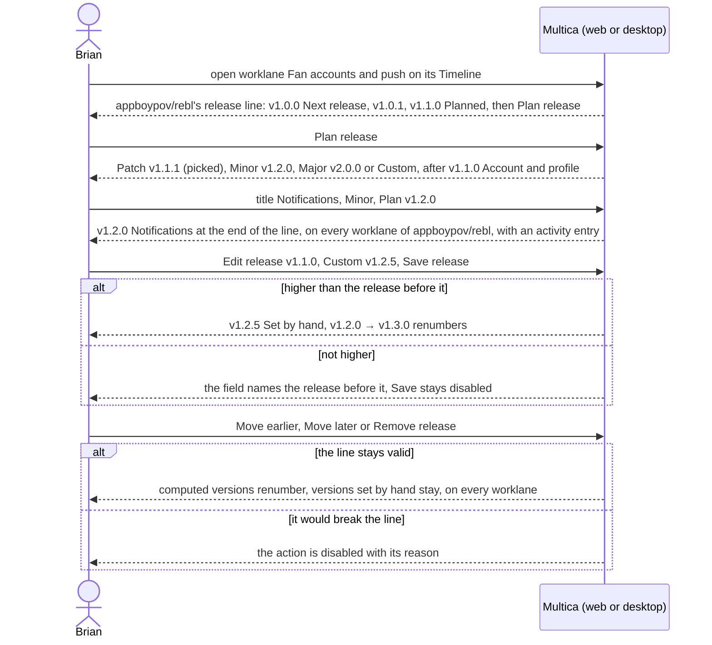

## At a glance

| Kind | Name | Change | Path |
|---|---|---|---|
| Concept | Release: version computed from its bump or set by hand, title, description, its place on its repository's line | new | `packages/core/types/` |
| Section | Worklane page: the Timeline with the repository's release line, Plan release, "nothing shipped yet" | changed | `packages/views/projects/`, `designs/screens/steer-all-work.pen` (screen 3) |
| Dialog | Plan release and Edit release: Version (Patch, Minor, Major, Custom), Title, Description, the Ships line | new | `packages/views/projects/`, `designs/screens/steer-all-work.pen` (screens 8, 8b, 8c) |
| Menu | Release: Edit release, Move earlier, Move later, Remove release | new | `packages/views/projects/`, `designs/screens/steer-all-work.pen` (screen 3b) |
| Section | Worklane activity: entries for planned, edited, moved and removed releases | changed | `packages/views/projects/` |
| Row | Worklane rows on a repository card, Projects and an organisation's page: last and next release chips | changed | `packages/views/projects/components/project-detail.tsx`, `packages/views/projects/components/projects-page.tsx`, `packages/views/organisations/` |
| Field | Edit repository: "This repository does not release" refused while unshipped releases exist | changed | `packages/views/projects/` |

Issues in releases come with UJ-5, the Board and List with UJ-6, the Worklanes and Releases pages with UJ-7, and shipping with UJ-8.

## Why

Brian plans what each repository ships next in steady releases instead of cycles (brief), and Multica has no releases. Each repository needs one release line that every worklane of it shows, which Brian plans, renumbers and reorders without breaking the version order. Issues in releases (UJ-5) and shipping (UJ-8) need that line to exist.

Success signal: on the Timeline of Fan accounts and push Brian plans v1.0.0 First production release, v1.0.1 Membership hardening, v1.1.0 Account and profile and v1.2.0 Notifications on appboypov/rebl, moves Notifications earlier so it becomes v1.1.0 and Account and profile v1.2.0, and sets Account and profile by hand to v1.2.5; `main` and Agenda and publication show the same four releases in that order, and every worklane's activity records each change.

## What Changes

- A worklane's Timeline shows its repository's release line from left to right: the first release as Next release, the others as Planned, each with its version, title and description, then Plan release.
- Plan release offers Patch (picked), Minor and Major, each with the version it gives after the last release on the line, the last tag or v0.0.0, or Custom, typed by hand; a required title and an optional description. The release joins the end of the line on every worklane of the repository.
- A release's menu has Edit release, Move earlier, Move later and Remove release. Edit release reopens the dialog filled in. A version set by hand is marked "Set by hand" and keeps its number; computed versions renumber to their place.
- No plan, edit, move or removal saves a line where a version is not higher than the one before it; the dialog or the menu says why.
- Every change to the line adds an entry to the activity of every worklane of the repository.
- Worklane rows on a repository card, Projects and an organisation's page show the last shipped release, or "nothing shipped", and the repository's next release, or "No releases planned" or "Does not release".
- A repository that does not release shows that in place of Plan release, and Edit repository refuses "This repository does not release" while the repository has unshipped releases.
- The Ships line says what shipping does without a pass, superseding "and asks you to pass it" on screens 8 to 8c and in the prototype's `ReleaseDialog`.

## Capabilities

### New Capabilities

- `worklane-release-line`: lets Brian see his repository's release line on a worklane's Timeline, and that a repository does not release.
- `plan-release`: lets Brian plan a release with a version, a title and a description at the end of its repository's line.
- `edit-release`: lets Brian change a release's version, title and description, and set its version by hand or let it follow its place again.
- `move-release`: lets Brian move a release earlier or later on its line with the versions renumbered.
- `remove-release`: lets Brian remove an unshipped release from its line.
- `release-line-activity`: lets Brian see each change to the release line in the activity of every worklane of the repository.
- `worklane-release-chips`: lets Brian see each worklane's last and next release on a repository card, Projects and an organisation's page.
- `repository-stops-releasing`: keeps a repository with unshipped releases from being switched to "This repository does not release".

### Modified Capabilities

None in `specs/openspec/specs/`. This change builds on the unarchived changes `repositories-of-a-project` (UJ-2: the version policy, the last tag and "This repository does not release" in Add and Edit repository) and `worklanes-of-a-repository` (UJ-3: worklanes, the worklane page with its Timeline and activity, the worklane rows). `worklane-release-line` fills UJ-3's Timeline, which says it has no releases until one is planned. `release-line-activity` adds entries to UJ-3's worklane activity. `worklane-release-chips` adds the release chips to UJ-3's worklane rows. `repository-stops-releasing` adds a rule to UJ-2's Edit repository.

## Impact

- Web and desktop: the worklane page's Timeline and header, the Plan release and Edit release dialog, the release menu, the worklane activity, the worklane rows on a repository card, Projects and an organisation's page, and Edit repository.
- Shared packages: release types, the API client and its schemas, release queries and mutations that renumber the line.
- Server: releases per repository in the API and the database; one check that keeps the line's versions increasing for plan, edit, move and remove; the activity entries on every worklane of the repository; the refusal in Edit repository.
- Copy in every supported language and the project docs in `apps/docs`.

## Constraints

- A repository has one release line; every worklane of the repository shows the same releases in the same order.
- Each version on the line is higher than the one before it, and the first is higher than the repository's last tag; Multica saves no plan, edit, move or removal that breaks this.
- A computed version follows its bump from the release before it, the last tag or v0.0.0; a version set by hand keeps its number until Brian changes it.
- A release has a version, a title and a description, and no goal, no date until it ships and no pass.
- A repository that does not release has no unshipped releases and plans none.
- Plan, edit, move and remove happen only on a worklane's Timeline.
- Light mode only.
- AGENTS.md: no foreign keys or cascades, `CREATE INDEX CONCURRENTLY` in its own migration, zod schemas with `parseWithFallback` and malformed-response tests for the new responses, no compatibility shims, every check local.

## Non-goals

- Issues in releases (Brian, 13 October 2026): a release's issues and progress on the Timeline and on worklane rows, "No release", the Issues list in Plan release, Add issue to release, Remove from release, issues following their release when it moves, and the issues of a removed release returning to "No release" (FR-29, FR-30, FR-33, FR-35, FR-40, FR-41): UJ-5.
- Shipped releases (Brian, 13 October 2026): a shipped release with its date, its read-only version, title and description edits that reach its GitHub release, and the refusals "Shipped: its tag is fixed", "The release before it has shipped" and "Shipped: add it to a later release" (FR-37): UJ-8.
- Board and List: UJ-6. The Worklanes and Releases pages: UJ-7. Shipping a release: UJ-8.
- The visual design of Remove release, deferred to J6 (PRD Addendum); this change sets its behaviour.
- Planning or changing releases from the CLI or by an agent, and on the Worklanes and Releases pages.
- Finding the last tag again after Add or Edit repository found it.
- Squads, the mobile app and dark mode.

## Sources

- Intent: [Steer projects, repositories, worklanes and releases in Multica](anytype://object?objectId=bafyreib727ukptyvcfbkud627gjb3cu2lmwsh3u4cjbu4kisjofa25km3u) and its Requests.
- PRD: [Multica: steer projects, repositories, worklanes and releases](anytype://object?objectId=bafyreiew63xw2dncss52jdx4qk4o6aktkklhqroclvs3cvjxcyztx7h5um): UJ-4, F4 with FR-29 to FR-41, FR-2, FR-14, UJ-8, the glossary (Release), non-goals and the Addendum.
- Brief: [Multica: steer projects, repositories, worklanes and releases](anytype://object?objectId=bafyreicccdj6bucv5d65bxvkz4gy7jf7etplsswmwfggupqbakc6rudpmi).
- UJ-2 change: `specs/openspec/changes/repositories-of-a-project/`. UJ-3 change: `specs/openspec/changes/worklanes-of-a-repository/`.
- Design: [Steer all work screens](anytype://object?objectId=bafyreiauxfhf7w74hwn5je7ljakzxfgo2qv4noid2oshvtqjwkos2v5oiq), screens 1 Projects, 2 Project, 3 Worklane timeline, 3b Release actions, 8 Plan release, 8b Edit release set by hand and 8c Edit release version too low in `designs/screens/steer-all-work.pen`, exports in `designs/exports/`, whose "and asks you to pass it" is superseded: a release ships without a pass (PRD non-goals); [component library](anytype://object?objectId=bafyreiamoqycfo735krrpmzn3ujhdardv6uixsrdzkadzlodwpr7aenwee); `designs/creation-flows.md` "Plan release", "Edit and move a release" and "Decisions", aligned with this change on 13 October 2026.
- Prototype: [Steer all work prototype](anytype://object?objectId=bafyreieck7zsmzslnfe5asszexojznfbnsnwcg62eqbesqqeigkkzgoclm), revision 460535099583266816: `ReleaseDialog` in `prototypes/web/src/components/generated/creation.tsx`; `bumpFrom`, `versionBefore`, `renumber`, `lineProblem`, `placeRelease` and `moveRelease` in `model.ts`; `LanePage`, `ReleaseActions`, `ReleaseColumn` and `ReleaseChain` in `MulticaSteerAllWorkPrototype.tsx`.
- Brian's design session of 12 October 2026: releases belong to the repository, a version numbers from its place, a version can be set by hand and must stay higher than the release before it, no goal, a title and a description.
- Brian's answers in the P4 session of 13 October 2026, on the [UJ-4 Task](anytype://object?objectId=bafyreibz7mmjdtpqzcfomixgmowswontm7sdfmkc4tqomachheoeo3lwte): issue parts move to UJ-5 and shipped parts to UJ-8; a change to the line shows in the activity of every worklane of the repository; "This repository does not release" is refused while unshipped releases exist.
