## At a glance

```mermaid
flowchart LR
  classDef work fill:#d9f2d9,stroke:#2e7d32,color:#172117
  classDef skip fill:#eeeeee,stroke:#9e9e9e,color:#424242
  P5[P5 Technical design] --> J1
  J1[J1 Project structure<br/>Skip: J1]:::skip --> J2
  J2[J2 Data models<br/>groups 1-3]:::work --> J3
  J3[J3 Data-flow prototype<br/>group 4]:::work --> J4
  J4[J4 Design system<br/>Skip: J4]:::skip --> J5
  J5[J5 Components<br/>group 5]:::work --> J6
  J6[J6 Screens<br/>group 6]:::work --> J7
  J7[J7 Live prototype<br/>group 7]:::work --> J8
  J8[J8 Backend and agent tooling<br/>groups 8-9]:::work --> J9
  J9[J9 Frontend<br/>groups 10-12]:::work --> J10
  J10[J10 Agent tooling for UI<br/>Skip: J10]:::skip --> J11
  J11[J11 Acceptance test and archive<br/>group 13]:::work
```

| Step | Groups | Builder |
|---|---|---|
| J1 Project structure | none: `Skip: J1` | - |
| J2 Data models | 1 model change, 2 model change, 3 action names | `madspec-model-builder`, `madspec-dto-builder` |
| J3 Data-flow prototype | 4 | `madspec-prototype-builder` |
| J4 Design system | none: `Skip: J4` | - |
| J5 Components | 5 | `madspec-design-system-designer` |
| J6 Screens | 6 | `madspec-screen-designer` |
| J7 Live prototype | 7 | `madspec-prototype-builder` |
| J8 Backend and agent tooling | 8 util, 9 endpoint | `madspec-util-builder`, `madspec-api-builder` |
| J9 Frontend | 10 flow, 11 component, 12 screen | `madspec-api-builder`, `madspec-component-builder`, `madspec-view-builder` |
| J10 Agent tooling for UI | none: `Skip: J10` | - |
| J11 Acceptance test and archive | 13 | Sarkout |

This change builds on UJ-3 (`worklanes-of-a-repository`, DAS-452), which builds on UJ-2 (`repositories-of-a-project`, DAS-451). It uses:

- from UJ-3: the worklane page with `worklane-timeline.tsx` and `worklane-activity.tsx`, `activity_log.repository_id` with index 586, `ListActivitiesForWorklane`, the worklane rows on the card and in `project-table.tsx`, and the install-command backfill hook;
- from UJ-2: `repository.version_policy`, the checkout check's `last_tag`, and `releases-field.tsx`.

Its J2 starts once UJ-3's J2 is merged.

## 1. J2 Data models: model change

- [x] 1.1 `server/migrations/587_release_line.up.sql`, `.down.sql` -- `repository.last_tag text` (nullable, no default) and the `release` table with its checks, without foreign keys -- design.md decision 1. The down migration deletes the `activity_log` rows with the four release actions, then drops `release` and `repository.last_tag`.
- [x] 1.2 `server/migrations/588_release_line_index.up.sql`, `.down.sql` -- `CREATE INDEX CONCURRENTLY idx_release_line ON release (workspace_id, repository_id, position)`.
- [x] 1.3 `server/cmd/migrate/main.go` -- add 588 to the concurrent index cleanups -- `TestEveryConcurrentUpBuildHasCleanup` requires it. When `main` has taken 587 or 588, take the next free numbers and rename every reference.
- [x] 1.4 `server/pkg/db/queries/release.sql` -- `ListReleasesInWorkspace` (by repository and position), `ListReleaseLine` (by workspace and repository, by position), `GetReleaseInWorkspace`, `CreateRelease`, `UpdateReleaseFields` (title, description, version, bump), `UpdateReleasePositionAndVersion`, `DeleteRelease`, `DeleteReleasesByRepository`, `DeleteReleasesByProject` (through `repository`), `ListUnshippedReleaseHeads` (version and title, `shipped_at IS NULL`), each filtered by `workspace_id`.
- [x] 1.5 `server/pkg/db/queries/repository.sql` -- `LockRepositoryForLine` (`FOR UPDATE`, by id and workspace); `last_tag` in `CreateRepository`; `BackfillRepositoryLastTag` (workspace, `LOWER(full_name)`, checkout daemon and path, `last_tag IS NULL`).
- [x] 1.6 `server/pkg/db/queries/activity.sql` -- `CreateRepositoryActivity` (`repository_id` set, `worklane_id` and `issue_id` NULL); `ListActivitiesForWorklane` gains `created_at >= $3` on its repository part -- ADR-0011.
- [x] 1.7 `server/pkg/db/queries/workspace_delete.sql` -- `deleted_releases AS (DELETE FROM release WHERE workspace_id = $1)` beside `deleted_activity`.
- [x] 1.8 `server/pkg/db/generated/` -- run `make sqlc` and commit the output.

## 2. J2 Data models: model change

- [x] 2.1 `packages/core/types/release.ts`, `index.ts` -- `Release`, `ReleaseBump`, `ListReleasesResponse`, `ReleaseLineResponse`, `PlanReleaseRequest`, `EditReleaseRequest`, `MoveReleaseRequest`, `ReleaseVersionChange {release_id, title, from, to}` and `ReleaseRefusalCode` -- design.md decisions 1 and 2.
- [x] 2.2 `packages/core/types/repository.ts` -- `Repository.last_tag: string | null`; `has_unshipped_releases` refusal with `{version, title}[]`.
- [x] 2.3 `packages/core/types/worklane.ts` -- `WorklaneActivityAction` gains `release_planned`, `release_edited`, `release_moved` and `release_removed`, with their details -- design.md decision 4.
- [x] 2.4 `packages/core/api/schemas.ts` -- `ReleaseSchema` with `bump` unknown falling back to `null`, `description` defaulting to `''` and `shipped_at` to `null`; `ReleasesResponseSchema` and `ReleaseLineResponseSchema` with `releases` defaulting to `[]`; the release refusal body with an unknown code kept as `unknown`; `last_tag` nullable with default null; the four activity actions with `changes` defaulting to `[]` -- AGENTS.md "API Compatibility".
- [ ] 2.5 `packages/core/api/schemas.test.ts` -- malformed-response cases: a release without `bump`, with an unknown `bump`, without `shipped_at`; a list without `releases`; a repository without `last_tag`; a release entry without `changes`; a refusal with an unknown code.

## 3. J2 Data models: action names

- [x] 3.1 `server/pkg/protocol/events.go` -- `EventReleaseLineUpdated = "release_line:updated"` with the repository's id.
- [x] 3.2 `server/internal/handler/release.go` -- the constants `releaseActionPlanned`, `releaseActionEdited`, `releaseActionMoved` and `releaseActionRemoved`.
- [x] 3.3 `packages/core/modals/store.ts` -- `"plan-release"`, `"edit-release"` and `"remove-release"` in `ModalType`.

## 4. J3 Data-flow prototype: data-flow prototype

- [ ] 4.1 `prototypes/web/release-line-of-a-repository/data-flow/` -- an interactive prototype without UI that runs design.md "Journey sequence and data flow". It covers:
  - Plan release: Patch, Minor, Major and Custom after the last release, after the last tag on an empty line, and without a tag; "Use the form v1.4.0."; too low after the last release and after the last tag; no title.
  - Edit release: a new title and description; Custom set by hand with "Later releases renumber"; too low; back to a bump; an edit that leaves a later release set by hand too low.
  - Move earlier and later with renumbering; a release set by hand keeping its number; first, last and a move that breaks the line.
  - Remove release: the first, one set by hand, the last.
  - The activity entry each change writes and the worklanes that show it, with a worklane created later showing none from before.
  - The release chips for a line, an empty line and a repository that does not release; Edit repository refused while unshipped releases exist; releasing again after the last tag.
  - The repository lock serialising two writes to one line.
  - Each step shows its input, output and store -- J3's contract.
- [ ] 4.2 `prototypes/web/release-line-of-a-repository/data-flow/README.md`, PNG exports -- how to run it, and one PNG per step -- J3's contract.

## 5. J5 Components: component design

- [ ] 5.1 `designs/systems/multica.lib.pen` -- `Activity entry/With changes`: UJ-3's `Activity entry` with one muted line per changed version ("Notifications v1.2.0 -> v1.1.0"). Built from the library's existing tokens -- J5's contract.
- [ ] 5.2 `designs/exports/library-components.png` -- the refreshed components export.

## 6. J6 Screens: screen design

- [ ] 6.1 `designs/screens/steer-all-work.pen` -- the screens of the journey's states, built from the library's components and tokens -- J6's contract:
  - Screens 8, 8b and 8c Plan release and Edit release with the Ships line without a pass (node `drIZb` and its copies), and the hints "Follows ...", "Follows v0.4.2, the last tag." and "The first release of this repository.".
  - Plan release's states: Custom "Use the form v1.4.0.", too low after the last tag, no title; Edit release with "Later releases renumber" and an edit that leaves a later release too low.
  - Screen 3b the release menu with Remove release, and each move's disabled reason.
  - Remove release with its confirmation, naming the versions that renumber -- the PRD Addendum leaves its visual design to this step.
  - Screen 3 Worklane timeline with "Next release", "Planned", "Set by hand", descriptions, the header "nothing shipped yet", and release entries in the activity with their changed versions; the does-not-release Timeline.
  - Screen 6 Edit repository refusing "This repository does not release" with the unshipped releases named.
  - Screens 1, 2 and 4b worklane rows with the release chips, "No releases planned" and "Does not release", and the column "Last · Next · Planned releases".
- [ ] 6.2 `designs/creation-flows.md` -- "Plan release" and "Edit and move a release" brought in line with the spec deltas and the screens: Remove release, the activity, the does-not-release refusal, and no goal or date before shipping. Add an At a glance flowchart where each arrow names its action -- J6's contract.
- [ ] 6.3 `designs/exports/` -- one PNG per new or changed screen -- J6's contract.

## 7. J7 Live prototype: prototype change

- [ ] 7.1 `prototypes/web/src/components/generated/` -- bring the release line in line with group 6's screens, as the live prototype of the journey:
  - `ReleaseDialog`'s Ships note without a pass (`creation.tsx` L711), and its hints.
  - Remove release in `ReleaseActions`, with its confirmation.
  - The release entries in the worklane's activity, and a worklane created later showing none from before.
  - The does-not-release Timeline and header.
  - The Edit repository refusal while unshipped releases exist.
- [ ] 7.2 `prototypes/web/` -- one PNG per changed prototype screen, beside the existing exports -- J7's contract.

## 8. J8 Backend and agent tooling: util

- [x] 8.1 `server/internal/releaseline/line.go` -- `Line`, `Release`, `Problem`, `Renumber`, `Check`, `Plan`, `Edit`, `Move`, `Remove`, `Changes`, and `ParseVersion` (accepting `v1.4.0` and `1.4.0`) -- design.md decision 3. The package has no database or HTTP imports.
- [ ] 8.2 `server/internal/releaseline/testdata/cases.json` -- one case per scenario of the `plan-release`, `edit-release`, `move-release` and `remove-release` spec deltas, with `last_tag`, the line, the operation and the wanted line or problem, written without the `v`.
- [ ] 8.3 `server/internal/releaseline/line_test.go` -- runs every case in `cases.json`, plus the `Changes` lists of the `release-line-activity` scenarios.

## 9. J8 Backend and agent tooling: endpoint

- [x] 9.1 `server/internal/handler/release.go` -- `ListReleases`, `PlanRelease`, `EditRelease`, `MoveRelease` and `RemoveRelease`, as design.md decisions 2 to 4 set out:
  - One transaction: `LockRepositoryForLine`, the refusals in table order, `ListReleaseLine`, the `releaseline` operation, the writes of changed positions and versions, and one `CreateRepositoryActivity` row with the actor from `resolveActor`.
  - After commit, publish `release_line:updated` and answer with the line.
  - `line_not_increasing` carries `{release_id, version, title, before}`.
- [x] 9.2 `server/cmd/server/router.go` -- `GET /api/releases`, `POST /api/repositories/{id}/releases`, `PATCH /api/releases/{id}`, `POST /api/releases/{id}/move`, `DELETE /api/releases/{id}` behind the workspace member gate.
- [x] 9.3 `server/internal/handler/repository.go` -- store `last_tag` from the passed check on create; in `UpdateRepository`, under `LockRepositoryForLine`, refuse `version_policy: none` while `ListUnshippedReleaseHeads` is not empty with 409 `has_unshipped_releases`; `DeleteRepository` deletes its releases in its transaction -- the `repository-stops-releasing` spec delta, design.md decision 6.
- [x] 9.4 `server/internal/handler/runtime_repository_checkout.go` -- on a passed check, run `BackfillRepositoryLastTag` beside the install-command backfill, and publish `repository:updated` when a row changed -- design.md decision 5.
- [x] 9.5 `server/internal/handler/worklane.go` -- `ListWorklaneActivity` passes the worklane's `created_at` -- ADR-0011.
- [x] 9.6 `server/internal/handler/project.go` -- project delete deletes the releases of its repositories in its transaction.
- [x] 9.7 `server/cmd/server/listeners.go` -- forward `release_line:updated` to the workspace.
- [ ] 9.8 Handler tests beside the code, with `testutil` fixtures and `testutil.Call`:
  - Each refusal code.
  - Plan, edit, move and remove answering the renumbered line and writing one entry with its `changes`.
  - `does_not_release` and `last_tag_unknown`; Edit repository refused and allowed.
  - A worklane created after an entry not listing it; repository, project and workspace delete removing releases.
  - Two concurrent plans on one line both landing in order.

## 10. J9 Frontend: flow

- [x] 10.1 `packages/core/api/client.ts` -- `listReleases`, `planRelease`, `editRelease`, `moveRelease` and `removeRelease`, and `last_tag` on the repository calls, each through `parseWithFallback`.
- [x] 10.2 `packages/core/releases/` (`queries.ts`, `mutations.ts`, `line.ts`, `index.ts`) -- design.md decision 7:
  - `releaseKeys.list(wsId)`, `releaseListOptions` and a memoised `selectLine`.
  - The four mutations, each awaiting the server, replacing the repository's releases in the list cache with the answered line and invalidating the worklane activity.
  - `line.ts`: `parseVersion`, `formatVersion`, `bumpOptions`, `previewPlan`, `previewEdit`, `previewMove`, `previewRemove` and `lineStates`.
- [ ] 10.3 `packages/core/releases/line.test.ts` (`// @vitest-environment node`) -- runs every case of `server/internal/releaseline/testdata/cases.json`.
- [x] 10.4 `packages/core/realtime/use-realtime-sync.ts` -- `release_line:updated` invalidates `releaseKeys.list(wsId)` and the worklane activity of the workspace.

## 11. J9 Frontend: component

- [x] 11.1 `packages/views/releases/components/release-dialog.tsx` -- the `plan-release` and `edit-release` spec deltas: the title "Plan release · {owner/name}" or "Edit release · {owner/name}", the Version options with their versions, Custom with its errors, the hint, Set by hand and Later releases renumber, Title and Description, the read-only Ships line, "Plan v{version}" and "Save release" with their disabled states, Finding the last tag, and a server refusal shown in place.
- [x] 11.2 `packages/views/releases/components/release-menu.tsx`, `remove-release-dialog.tsx` -- Edit release, Move earlier, Move later and Remove release with each disabled reason; Remove's confirmation as group 6 designs it -- the `edit-release`, `move-release` and `remove-release` spec deltas.
- [x] 11.3 `packages/views/releases/components/release-column.tsx`, `set-by-hand.tsx` -- the timeline node, version, title, description, Set by hand, "No issues of this worklane" and the menu.
- [x] 11.4 `packages/views/releases/components/release-chips.tsx` -- last shipped or "nothing shipped", the next release, "No releases planned" and "Does not release", each chip opening the worklane's Timeline at that release -- the `worklane-release-chips` spec delta.
- [x] 11.5 `packages/views/repositories/components/releases-field.tsx`, `edit-repository-dialog.tsx` -- the does-not-release refusal naming the unshipped releases, with Save disabled; the server's `has_unshipped_releases` shown the same.
- [x] 11.6 `packages/views/modals/registry.tsx` -- register the three release dialogs.
- [ ] 11.7 Component tests beside them:
  - Plan release's options, hints, errors and button label.
  - Edit release filled in, with Set by hand, Later releases renumber and the too-low refusal.
  - The menu's disabled reasons and Remove's confirmation.
  - The chips' four states; the Releases field's refusal.

## 12. J9 Frontend: screen

- [x] 12.1 `packages/views/worklanes/components/worklane-timeline.tsx` -- the line from `selectLine`, Next release and Planned, Plan release at the end, the does-not-release note, and `?release={id}` scrolled into view -- the `worklane-release-line` spec delta.
- [x] 12.2 `packages/views/worklanes/components/worklane-page.tsx` -- the header "nothing shipped yet", "last shipped v{version}" or "does not release".
- [x] 12.3 `packages/views/worklanes/components/worklane-activity.tsx` -- the four release sentences and one line per changed version -- the `release-line-activity` spec delta.
- [x] 12.4 `packages/views/repositories/components/repository-card.tsx`, `packages/views/projects/components/project-table.tsx`, `packages/views/organisations/components/` -- the release chips on worklane rows, and the column "Last · Next · Planned releases" on Projects and an organisation's page.
- [x] 12.5 `packages/views/locales/{en,zh-Hans,ko,ja,fr}/` -- a `releases` namespace for the dialogs, hints, errors, menu, chips and activity sentences, and the does-not-release copy in `repositories` and `worklanes` -- `locales/parity.test.ts` stays green.
- [ ] 12.6 `packages/views/worklanes/components/worklane-page.test.tsx`, `packages/views/projects/components/projects-page.test.tsx`, `packages/views/organisations/components/*.test.tsx` -- the `worklane-release-line`, `release-line-activity` and `worklane-release-chips` scenarios that belong to pages:
  - three releases in order on two worklanes;
  - a description;
  - no date or goal;
  - does not release;
  - a moved line's entry;
  - the chips on Rebl's page and on Projects.
- [x] 12.7 `apps/docs/content/docs/projects.mdx`, `projects.zh.mdx`, `projects.ko.mdx`, `projects.ja.mdx`, `projects.fr.mdx` -- releases: the release line, Plan release, versions by bump or set by hand, Edit, Move and Remove, and repositories that do not release.

## 13. J11 Acceptance test and archive: acceptance test and archive

- [ ] 13.1 `e2e/releases.spec.ts` -- the journey's acceptance test through `TestApiClient`, on appboypov/rebl with worklanes `main`, Fan accounts and push, and Agenda and publication:
  - On Fan accounts and push, Brian plans Major v1.0.0 First production release, Patch v1.0.1 Membership hardening, Minor v1.1.0 Account and profile and Minor v1.2.0 Notifications.
  - He moves Notifications earlier, so it becomes v1.1.0, and Account and profile becomes v1.2.0. He then sets Account and profile by hand to v1.2.5.
  - `main` and Agenda and publication show the same four releases in that order.
  - Each worklane's activity records each change.
  - A too-low Custom version keeps Plan disabled, and a move that breaks the line is disabled with its reason.
  - Remove release renumbers; Edit repository refuses "This repository does not release" while releases remain.
- [x] 13.2 The release line on Brian's Mac -- on the local release, plan the four releases on appboypov/rebl and move Notifications earlier, then record the Timeline of two worklanes and their activity in the J11 pull request -- the PRD's success signal.
- [x] 13.3 `specs/openspec/changes/release-line-of-a-repository/` -- run `openspec validate release-line-of-a-repository --type change --strict`, sync the specs and archive the change -- the journey closes on its J11 pull request.

## Implementation Notes

## Plan Change Log

- 2026-10-15, J11: the change is archived with open tasks. 2.5, 8.2, 8.3, 9.8, 10.3, 11.7 and 12.6 stay unticked, because Brian's rule shipped the lanes layer pull requests #29, #31 and #32 without tests. Groups 4, 5, 6 and 7 stay unticked, because the Gate Request dropped J3, J5, J6 and J7. Task 13.2 ran on Brian's Mac with a worklane made for it and removed afterwards, as Decision `bafyreiacuj4r4zvetjzhuc5h7xpbg6tyaluy5rhvu2o7xey3szn7dnf4gq` says. Task 13.1 ran on the Mac against the worktree's test stack instead of Crabbox, as Decision `bafyreia2mmt7l55ohjewhquapxii7r5qq3kno3i7qsk5ycmueeefttdecm` says. Task 13.1 stays unticked: the e2e tests of UJ-2 to UJ-4 are removed, because e2e tests are made only on an explicit request of the user.
