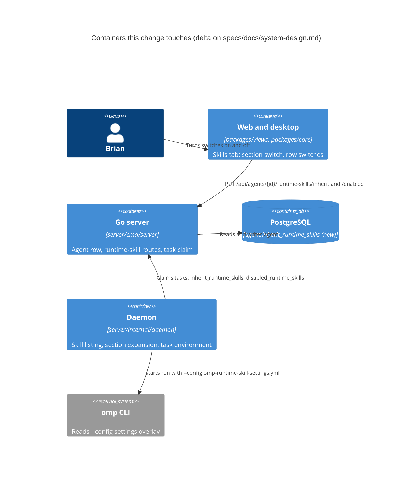
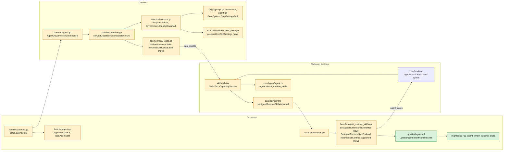
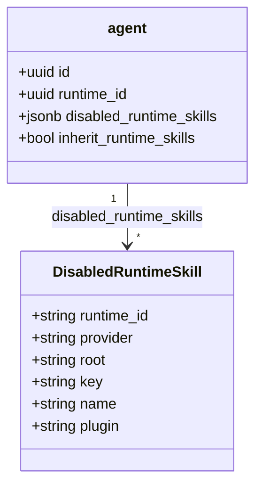

## At a glance

No new container. The change touches three existing ones: the Go server, the daemon on the runtime machine and the shared web/desktop views.







`inherit_runtime_skills` is new (`BOOLEAN NOT NULL DEFAULT true`); `disabled_runtime_skills` exists and keeps its shape.

```mermaid
sequenceDiagram
  participant T as Skills tab
  participant S as Server
  participant D as Daemon
  participant E as execenv (helper process)
  participant A as Claude, Codex or omp
  T->>S: PUT /api/agents/{id}/runtime-skills/inherit {enabled:false}
  S->>S: canManageAgent, runtime local and claude/codex/omp
  S->>S: UpdateAgentInheritRuntimeSkills
  S-->>T: 204, agent:status to every client
  D->>S: claim task
  S-->>D: agent {inherit_runtime_skills:false, disabled_runtime_skills:[scoped]}
  D->>D: convertDisabledRuntimeSkillsForEnv: listRuntimeLocalSkills(provider)
  alt listing fails
    D-->>S: task fails, agent never starts
  else listed
    D->>E: Prepare / Reuse with DisabledRuntimeSkills = every listed skill
    E->>E: claude: --settings file / codex: config.toml / omp: settings yml
    E-->>D: Environment (ClaudeSettingsPath, CodexHome, OmpSettingsPath)
    D->>A: start; omp gets --config <OmpSettingsPath> last
  end
```

| Kind | Name | Change | Path |
|---|---|---|---|
| Migration | `711_agent_inherit_runtime_skills` up and down | new | `server/migrations/711_agent_inherit_runtime_skills.up.sql`, `.down.sql` |
| Query | `UpdateAgentInheritRuntimeSkills` | new | `server/pkg/db/queries/agent.sql` |
| Generated | `Agent.InheritRuntimeSkills`, query method | changed | `server/pkg/db/generated/` |
| Handler | `SetAgentRuntimeSkillsInherited`, `runtimeSkillControlsSupported`, `broadcastAgentRuntimeSkills` | new | `server/internal/handler/agent_runtime_skills.go` |
| Handler | `SetAgentRuntimeSkillEnabled` accepts omp | changed | `server/internal/handler/agent_runtime_skills.go` |
| Route | `PUT /api/agents/{id}/runtime-skills/inherit` | new | `server/cmd/server/router.go` |
| Response | `AgentResponse.InheritRuntimeSkills`, `TaskAgentData.InheritRuntimeSkills` | changed | `server/internal/handler/agent.go` |
| Claim | agent data carries the section setting | changed | `server/internal/handler/daemon.go` |
| Daemon type | `AgentData.InheritRuntimeSkills *bool` | changed | `server/internal/daemon/types.go` |
| Daemon | `runtimeSkillsCanDisable`, `CanDisable` for omp | changed | `server/internal/daemon/local_skills.go` |
| Daemon | `convertDisabledRuntimeSkillsForEnv` expands the section, returns an error | changed | `server/internal/daemon/daemon.go` |
| Task environment | `prepareOmpSkillSettings`, `escapeOmpSkillGlob` | new | `server/internal/daemon/execenv/runtime_skill_policy.go` |
| Task environment | `Environment.OmpSettingsPath`, omp step in `Prepare` and `Reuse` | changed | `server/internal/daemon/execenv/execenv.go` |
| Agent launch | `ExecOptions.OmpSettingsPath`, `--config` in `buildPiArgs` | changed | `server/pkg/agent/agent.go`, `server/pkg/agent/pi.go`, `server/internal/daemon/daemon.go` |
| Shared type | `Agent.inherit_runtime_skills?` | changed | `packages/core/types/agent.ts` |
| Shared client | `setAgentRuntimeSkillsInherited` | new | `packages/core/api/client.ts` |
| UI | section switch, rows off and unchangeable while off | changed | `packages/views/agents/components/tabs/skills-tab.tsx` |
| Copy | `runtime_inherit_aria`, `runtime_inherit_failed_toast` | changed | `packages/views/locales/{en,fr,ja,ko,zh-Hans}/agents.json` |
| Docs | runtime skills paragraph | changed | `apps/docs/content/docs/skills{,.fr,.ja,.ko,.zh}.mdx` |
| ADR | ADR-0017 | new | `adr/0017-runtime-skill-switches-exist-only-where-the-run-enforces-them.md` |
| Living view | agent class gains both runtime-skill columns | changed | `specs/docs/system-design.md` |

## Context

- **Work.** Own work of De App Specialist on "The line", step L5. Input: [proposal.md](proposal.md) and [the spec delta](specs/runtime-skill-inheritance/spec.md); the passed Approach (Anytype `bafyreibcmdmxhszv47kud47o3iovihpsei3fj4ldyjlb56ltreet4k343y`). No journey, so no pass or journey steps.
- **Team.** Each task group goes to the lead of the team that owns its work: Joeri builds groups 1-4 (server, daemon, task environment) in one pull request; Thomas builds groups 5-6 (client, Skills tab, copy and docs) in a second pull request stacked on it. One spec, one change.
- **Database today.** `agent.disabled_runtime_skills JSONB NOT NULL DEFAULT '[]'` (`server/migrations/206_agent_disabled_runtime_skills.up.sql`). The highest migration is `710_question_link_types`; this change takes `711`. Every agent query in `server/pkg/db/queries/agent.sql` reads and returns `*`, so the new column reaches `db.Agent` and every `RETURNING *` without other query edits. `UpdateAgentDisabledRuntimeSkills` (line 195) is the pattern for the new update. No index, no foreign key, nothing for `concurrentIndexCleanups`.
- **Per-skill route today** (`server/internal/handler/agent_runtime_skills.go:84` `SetAgentRuntimeSkillEnabled`): `loadAgentForUser` -> `canManageAgent` -> decode `{runtime_id, root, key, name, plugin, enabled *bool}` -> runtime must be the agent's (409 otherwise) -> `getAgentRuntime(..., obsmetrics.RuntimeLookupSourceRuntimeAPI, runtimeID)` -> line 119 rejects anything but local `codex`/`claude` with 400 -> `normalizeRuntimeSkillIdentity`, plugin root only for `claude` -> tx with `GetAgentForUpdate` (read-modify-write of the JSON list) -> commit -> lines 193-208 build the response (`agentToResponse`, `enrichAgentResponseWithTargets`, `attachAgentSkills`) and publish `protocol.EventAgentStatus` with `broadcastAgentResponse(resp)` -> 204. Route: `server/cmd/server/router.go:2337`.
- **Agent response and claim.** `AgentResponse.DisabledRuntimeSkills` (`server/internal/handler/agent.go:127`, mapped at 229). `TaskAgentData` (agent.go:773) is filled in `server/internal/handler/daemon.go:2618-2631`, with `disabledRuntimeSkillsFor(agent.DisabledRuntimeSkills, runtimeID, runtime.Provider)`.
- **Daemon today.** `AgentData` (`server/internal/daemon/types.go:205`) carries `DisabledRuntimeSkills`. `runTask` (`daemon.go:7470`) builds `execenv.TaskContextForEnv` at 7583, with `DisabledRuntimeSkills: convertDisabledRuntimeSkillsForEnv(task.Agent, task.RuntimeID, provider)` at 7600 (`provider` is the runtime's provider, `omp` for omp). An error returned from `runTask` before the agent starts fails the task, as `expandInstructionSelection` at 7575 does. `convertDisabledRuntimeSkillsForEnv` is at 9853. `ExecOptions.ClaudeSettingsPath: env.ClaudeSettingsPath` is set at 8340.
- **Listing.** `listRuntimeLocalSkills(provider) ([]runtimeLocalSkillSummary, bool, error)` (`local_skills.go:478`) walks `localSkillRootsForProvider(provider)` (line 128; omp: `~/.omp/agent/skills` from its built-in descriptor, then `~/.agents/skills`), dedupes by key and sorts. Each summary carries `Key`, `Name`, `Root`, `Plugin`, `Provider`; `CanDisable: provider == "codex" || provider == "claude"` at line 619. The tab reads the same function through the runtime capabilities request, so "what the tab lists" and the expansion are one walk on the same machine (ADR-0001).
- **Task environment.** Preparation runs in a helper process (`execenv.PrepareIsolated`); `TaskContextForEnv` and `Environment` cross it as JSON, so new exported fields cross without extra code. In `Prepare` (`execenv.go:387`) codex hydrates at 567-577 and claude writes its settings at 579-585 (error fails the prepare); omp only gets `prepareOmpMcpConfig` at 543. In `Reuse` (744) omp mcp failure returns `nil` (forces a fresh prepare, 842-845), claude refresh only warns (870-877). `Environment.ClaudeSettingsPath` is at line 273.
- **Policy functions** (`execenv/runtime_skill_policy.go`): `prepareClaudeSkillSettings(envRoot, disabled, workspaceSkills)` (line 32) is the pattern: clean the key with `cleanRuntimeSkillKey`, name = `Name` or the key's basename, skip names `workspaceClaimsRuntimeSkill` (line 151) matches, remove the file when nothing is left, write `0o600`, return the path.
- **omp launch.** omp and pi share `piBackend`; `buildPiArgs(sessionPath, opts, logger)` (`server/pkg/agent/pi.go:995`) builds `-p --mode json [--session] [--model] [--thinking]` and appends `filterPiCustomArgs(opts.CustomArgs, logger)` last. `--config` is not in `piCustomArgModes`. `ExecOptions.ClaudeSettingsPath` is at `agent.go:135`.
- **omp itself (v18.10.1 installed).** `--config <path>` is repeatable and adds a settings overlay over global and project settings (`cli/flag-tables.ts:122`, `main.ts:1885`). `skills.ignoredSkills` entries are `Bun.Glob` patterns matched on the raw skill name across every skill source, project `.omp/skills` included (`extensibility/skills.ts:356-375`). Foreign user sources (`~/.claude`, `~/.codex`) are opt-in and off by default (`capability/index.ts:363`), so an omp run's runtime skills come from the same two roots the daemon lists. Overlays merge objects deeply and replace arrays (`config/settings.ts:3923`). Brian's `~/.omp/agent/config.yml` sets no `ignoredSkills`.
- **UI today** (`packages/views/agents/components/tabs/skills-tab.tsx`): the inherited `CapabilitySection` (235-347) has a single `action` slot holding Refresh (240-257). Rows render a `Switch` when `canEdit && skill.can_disable === true && skill.root` (325-341), `checked={!disabled}` from `isRuntimeSkillDisabled` (364), calling `handleRuntimeToggle` (117-143) with `busyId`, `refreshAgent` and a toast on failure. `CapabilitySection` (380) renders `{action}` beside the title block.
- **Realtime.** Clients invalidate `workspaceKeys.agents` on `agent:status`; the per-skill route already relies on it, so the section route publishes the same event.
- **Client contract.** `api.getAgent` / `listAgents` return the agent without a zod schema today (`packages/core/api/client.ts:1951-1960`); `disabled_runtime_skills?` is an optional typed field. The section setting follows the same optional-field contract: absent counts as on.
- **Tests to extend.** Server: `server/internal/handler/agent_runtime_skills_broadcast_test.go` (`TestSetAgentRuntimeSkillEnabledBroadcastsAgentStatus`), `server/internal/handler/skill_list_test.go` (`TestSetAgentRuntimeSkillEnabledPersistsScopedOverride`). Daemon: `daemon_test.go:6330` `TestConvertDisabledRuntimeSkillsForEnvScopesToClaimedRuntime`; `local_skills_test.go` (`TestListRuntimeLocalSkills_Claude` for the `HOME` fixture pattern); `execenv/runtime_skill_policy_test.go` (`TestPrepareClaudeSkillSettings`, `TestRuntimeSkillPoliciesYieldToWorkspaceSkills`); `pkg/agent/pi_test.go` (`TestBuildPiArgsBasicFlags`). UI: `skills-tab.test.tsx` (`renderSkillsTab`, `mockSetAgentRuntimeSkillEnabled`, "turns a controllable inherited skill off for this agent").
- **Docs.** `apps/docs/content/docs/skills.mdx:96` and the same line 96 in `skills.fr.mdx`, `skills.ja.mdx`, `skills.ko.mdx`, `skills.zh.mdx` name "Claude Code and Codex".
- **Living system design.** `specs/docs/system-design.md` draws the agent class without either runtime-skill column and the daemon's `execenv` and `local_skills.go` nodes; the build adds both columns to the class. No component or relation changes.
- **ADRs in force.** ADR-0001 (the daemon reads the runtime machine): the expansion runs in the daemon, so it fits. ADR-0005 (a run's question setting is decided at claim): the section setting also travels on the claim; the daemon resolves it at run start. New: ADR-0017, see [adr.md](adr.md).

## Goals / Non-Goals

**Goals:**

- One rule for Claude, Codex and omp: what the inherited section lists is what its switches control, at the section and per skill.
- A run never starts with a runtime skill that is turned off.
- The per-skill choices are never written by the section switch.

**Non-Goals:**

- Everything under the proposal's Non-goals.
- Project skills that a repository carries itself (`.claude/skills`, `.agents/skills` in the checkout): the tab does not list them, so the switches do not touch them.
- A zod schema for the agent response: the agent is not schema-parsed today, and adding one is its own change.

**Always:**

- The provider set `claude`, `codex`, `omp` lives in one function on each side: `runtimeSkillControlsSupported` in the handler package and `runtimeSkillsCanDisable` in the daemon package.
- Assigned skills win over runtime skills of the same name in every provider path (`workspaceClaimsRuntimeSkill`).

**Never:**

- No stored copy of "all skills"; the section is expanded at each run.
- No change to `disabled_runtime_skills` from the section route; no copying of either field on agent create, update, duplicate or copy.
- No `--no-skills` for omp: it would also drop the assigned skills in `.omp/skills`.

## Decisions

### 1. The daemon expands the section at run start

`convertDisabledRuntimeSkillsForEnv(agentData, runtimeID, provider) ([]execenv.RuntimeSkillRefForEnv, error)`:

- `agentData == nil`, or `InheritRuntimeSkills` nil or true, or `!runtimeSkillsCanDisable(provider)`: the scoped stored list, as today, and `nil` error.
- Otherwise: `listRuntimeLocalSkills(provider)`; an error, or `supported == false`, returns an error (`list runtime skills for disabled section: ...`); every summary becomes `{Root, Key, Name, Plugin}`.

`runTask` assigns it before building `TaskContextForEnv` and returns the error, so the task fails before preparation and before the agent starts. Alternative considered: storing the full list when the switch goes off. Rejected: it goes stale when a skill is installed later, and the spec requires later skills to follow the switch.

### 2. The section route is a single-column update

`PUT /api/agents/{id}/runtime-skills/inherit` with `{"enabled": bool}` (400 when missing): `loadAgentForUser` -> `canManageAgent` -> the agent must have a runtime (400 `agent has no runtime`) -> `getAgentRuntime` in the agent's workspace (404) -> local and `runtimeSkillControlsSupported(rt.Provider)` (400, the same message as the per-skill route) -> `UpdateAgentInheritRuntimeSkills(id, enabled)` `RETURNING *` -> broadcast -> 204. No transaction and no row lock: one column is written whole, with no read-modify-write and no runtime scope to race on. The response building and `agent:status` publish of lines 193-208 move into one helper, `broadcastAgentRuntimeSkills(r, agent db.Agent)`, used by both routes.

### 3. One provider set per side

```go
// handler
func runtimeSkillControlsSupported(provider string) bool {
	return provider == "claude" || provider == "codex" || provider == "omp"
}
```

The per-skill route uses it at line 119 and its message becomes `runtime skill controls are only supported for claude, codex and omp`. Plugin roots stay Claude-only. The daemon's `runtimeSkillsCanDisable(provider)` holds the same set and feeds `CanDisable` and Decision 1. Two copies, one per Go package boundary, both covered by tests; a shared package for one three-name check is not worth it.

### 4. omp settings overlay

`prepareOmpSkillSettings(envRoot, disabled, workspaceSkills) (string, error)` in `runtime_skill_policy.go`, beside `prepareClaudeSkillSettings` and built the same way: file `omp-runtime-skill-settings.yml` in `envRoot`; name = `Name`, else the cleaned key's basename; skip invalid keys and names `workspaceClaimsRuntimeSkill` matches; dedupe; remove the file and return `""` when nothing is left; write `0o600`. Content is JSON, which YAML 1.2 reads:

```json
{"skills":{"ignoredSkills":["review","my\\*skill"]}}
```

Each name goes through `escapeOmpSkillGlob`, which puts a backslash before `\ * ? [ ] { } !`, so a name matches only itself. `Prepare` calls it for `omp` after `prepareOmpMcpConfig` and returns an error on failure (as Claude does). `Reuse` calls it for `omp` and returns `nil` on failure, forcing a fresh prepare, as the omp MCP refresh does. The path goes to `Environment.OmpSettingsPath`, then `ExecOptions.OmpSettingsPath` next to `ClaudeSettingsPath` at `daemon.go:8340`, and `buildPiArgs` appends `--config <path>` after the filtered custom args when it is set. Only omp environments set it, so pi never gets the flag.

### 5. UI state

- Section on = `agent.inherit_runtime_skills !== false`.
- The header switch shows when `canEdit`, the runtime listing succeeded, and some listed skill has `can_disable === true` and a `root`. It sits in the section's `action` slot in a `flex items-center gap-2` group before Refresh, with busy key `runtime:inherit`, `api.setAgentRuntimeSkillsInherited(agent.id, checked)`, `refreshAgent()`, and `runtime_inherit_failed_toast` on failure, as `handleRuntimeToggle` does.
- Row switches keep their render condition. While the section is off they get `checked={false}` and `disabled`, and the row is dimmed as a disabled row is today; when it is on they show `!isRuntimeSkillDisabled(...)` again.

## Risks / Trade-offs

- [The omp overlay replaces any `skills.ignoredSkills` in the user's own omp config for that run] -> Accepted in the proposal's Non-goals; the file exists only while a run keeps skills out.
- [`ignoredSkills` matches across sources, so a project skill in the checkout with the same name as a turned-off runtime skill is also kept out] -> Same reach as Claude's `skillOverrides`; assigned skills are protected by `workspaceClaimsRuntimeSkill`.
- [A daemon older than this change ignores `inherit_runtime_skills` and runs with the runtime's skills] -> The flag is server-stored; the daemon on this Mac updates with `make local-release`. The UI cannot tell a daemon's version, so this is a release-order note, not code.
- [Listing failure now fails a section-off task] -> Required by the spec; the error names the listing so the task's failure explains itself.
- [The Claude refresh in `Reuse` only warns on failure, so a reused Claude env can keep a stale settings file] -> Existing behaviour, outside this change; the omp path does not copy it.

## Migration Plan

- `711_agent_inherit_runtime_skills.up.sql`: `ALTER TABLE agent ADD COLUMN inherit_runtime_skills BOOLEAN NOT NULL DEFAULT true;`. Down: `ALTER TABLE agent DROP COLUMN inherit_runtime_skills;`.
- Order on this Mac: the server and daemon ship together with `make local-release`. Rollback: the down migration; older daemons and clients ignore the field.

## Open Questions

None.
