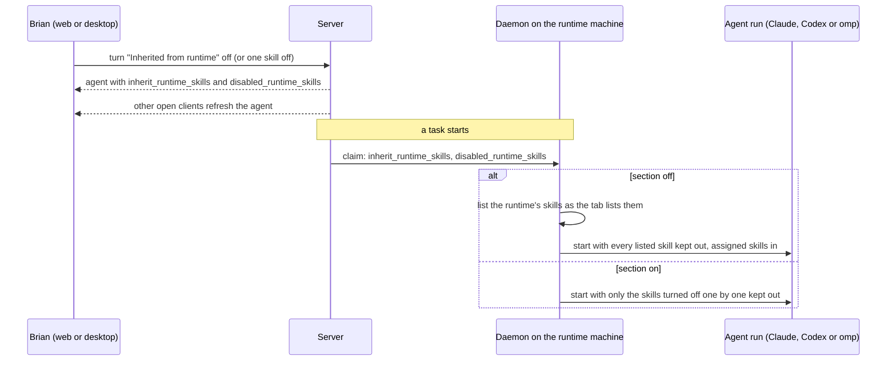
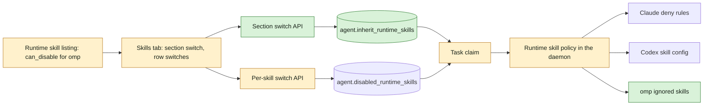

## At a glance

| Kind | Name | Change | Path |
|---|---|---|---|
| Database column | `agent.inherit_runtime_skills`, default on | new | `server/migrations/` |
| Queries | update the section setting | new | `server/pkg/db/queries/agent.sql` |
| API | `PUT /api/agents/{id}/runtime-skills/inherit` | new | `server/internal/handler/agent_runtime_skills.go`, `server/cmd/server/router.go` |
| API | per-skill switch accepts omp | changed | `server/internal/handler/agent_runtime_skills.go` |
| API | agent response carries `inherit_runtime_skills` | changed | `server/internal/handler/agent.go` |
| Task claim | agent data carries the section setting | changed | `server/internal/handler/daemon.go`, `server/internal/daemon/types.go` |
| Daemon | runtime skill listing reports `can_disable` for omp | changed | `server/internal/daemon/local_skills.go` |
| Daemon | section off keeps every listed skill out | changed | `server/internal/daemon/daemon.go` |
| Task environment | omp keeps turned-off skills out | new | `server/internal/daemon/execenv/runtime_skill_policy.go`, `server/internal/daemon/execenv/execenv.go` |
| omp launch | task settings passed to omp | changed | `server/pkg/agent/pi.go`, `server/pkg/agent/agent.go` |
| Shared client | agent type and section switch call | changed | `packages/core/types/agent.ts`, `packages/core/api/client.ts` |
| UI | section switch, rows off while the section is off | changed | `packages/views/agents/components/tabs/skills-tab.tsx` |
| Copy | switch label and failure toast | changed | `packages/views/locales/{en,fr,ja,ko,zh-Hans}/agents.json` |
| Docs | runtime skills can be turned off for omp and as a section | changed | `apps/docs/content/docs/skills.mdx` and its `fr`, `ja`, `ko`, `zh` translations |

## Why

An agent's runs get every skill installed on its runtime machine, and Brian can keep them out only one at a time, only for Claude and Codex agents. An omp agent such as Thomas shows no switches at all, so Brian cannot give it a run with only its assigned skills. Brian chose both levels on 2026-10-14: one switch for the whole "Inherited from runtime" section and one per skill, for Claude, Codex and omp.

Success signal: Brian turns the section off on Thomas, runs a task, and the run has only Thomas's assigned skills; he turns the section on again and the one skill he had turned off before is still off while every other runtime skill is back.

## What Changes

- The "Inherited from runtime" section on an agent's Capabilities > Skills tab gets one switch. Off: the agent's runs get none of the skills the section lists, only its assigned skills. On: they come in again. It is on for every existing and new agent.
- The per-skill switches keep their choices while the section is off; they show off and cannot be changed then, and show their own state again once the section is on.
- A runtime skill that appears later follows the section switch: in while it is on, out while it is off.
- omp agents get the section switch and the per-skill switches, and their runs keep turned-off skills out, as Claude and Codex runs do today.
- Switches show only for Claude, Codex and omp, the providers whose runs keep a turned-off skill out.
- The skills docs name omp and the section switch.

## Capabilities

### New Capabilities

- `runtime-skill-inheritance`: lets a person who can edit an agent turn the runtime's skills off for that agent's runs, as a whole section and one skill at a time, on Claude, Codex and omp agents.

### Modified Capabilities

None: no existing spec covers runtime skills.

## Impact

- Database: one new column on `agent`; no index, no foreign key.
- HTTP API: a new route for the section setting; the per-skill route accepts omp; the agent response carries the section setting.
- Daemon protocol: the task claim carries the section setting.
- omp runs get a task settings file that lists the skills kept out.
- Web and desktop through the shared Skills tab; five locales; the skills docs in five languages.

## Constraints

- A switch shows only for a provider whose runs keep the skill out: Claude, Codex and omp. No switch claims something the run does not do.
- An assigned skill with the same name as a turned-off runtime skill still reaches the run.
- The section setting never changes the stored per-skill choices.
- A run never starts with skills that are turned off: when the daemon cannot list the runtime's skills while the section is off, the task fails before the agent starts.
- A claim or an agent from an older server without the section setting counts as on.
- AGENTS.md: no foreign keys, zod schemas with `parseWithFallback` at the API boundary, no compatibility shims, every check local.

## Non-goals

- Switches for providers other than Claude, Codex and omp.
- Mobile: it shows no runtime skills.
- A CLI command for the switches; `multica agent get` shows the new field as it is.
- Copying runtime skill choices when an agent is created, updated, duplicated or copied.
- Merging the `skills.ignoredSkills` of the user's own omp configuration with the run's list: while a run keeps skills out, the run's list replaces it. Brian's omp configuration sets none.
- A description text under the section title.

## Sources

- Issue: Multica WORK-448, "Turn inheriting runtime skills on and off per agent", and its comments, with Brian's screenshot of Thomas's Skills tab.
- L3 Task, with the goal and settled decisions: [Turn inheriting runtime skills on and off per agent](anytype://object?objectId=bafyreig3qdul3opktkey77xd6epc2m3ynaj32iijj2ix4ueh3kpcx44jou).
- Approach, passed by Brian on 2026-10-15: [Turn inheriting runtime skills on and off per agent](anytype://object?objectId=bafyreibcmdmxhszv47kud47o3iovihpsei3fj4ldyjlb56ltreet4k343y); its "Per area" section holds the code map and "How each result is checked" the checks, for the design.
- L4 Task: [Proposal: turn inheriting runtime skills on and off per agent](anytype://object?objectId=bafyreicdieery3wqdw2oahpo336tfamcfja7umaojy2vr4nyb6mv7usnbu).
