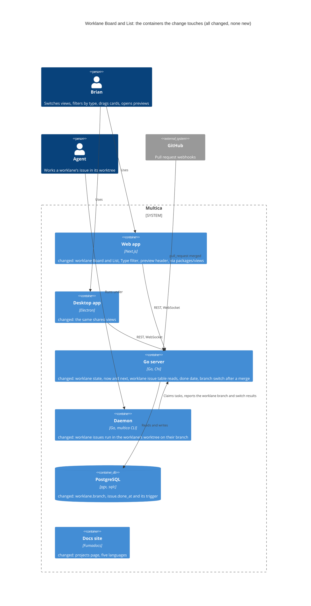
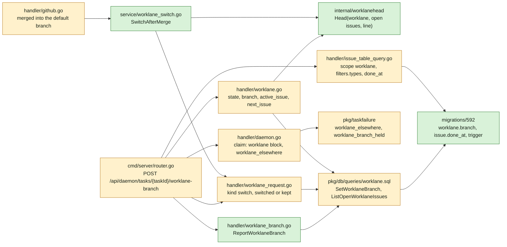
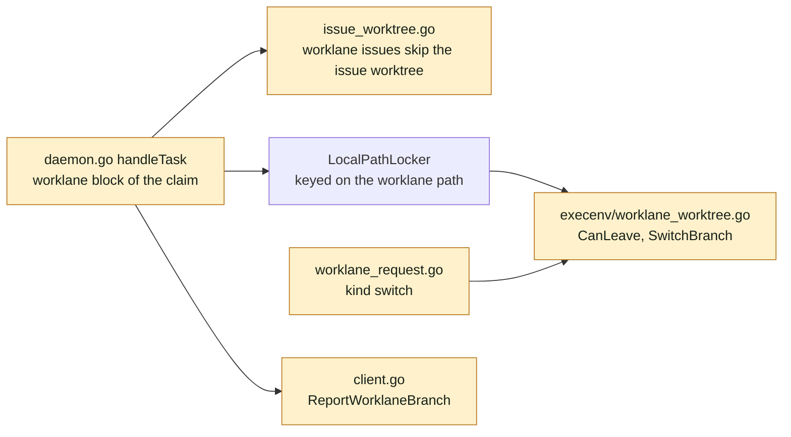
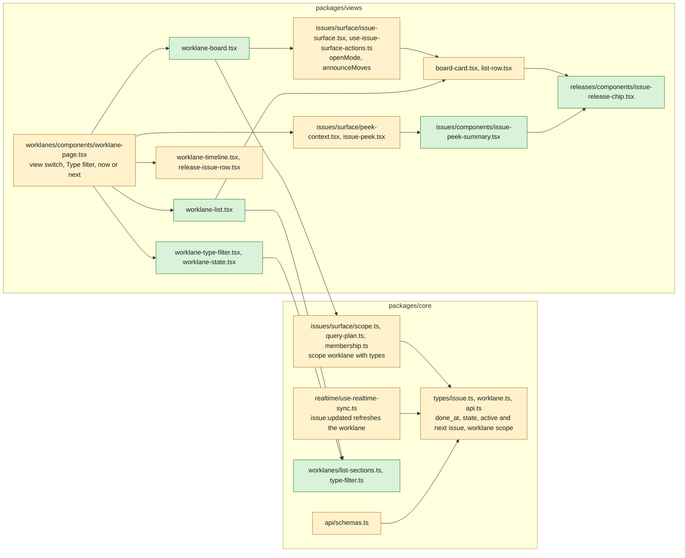
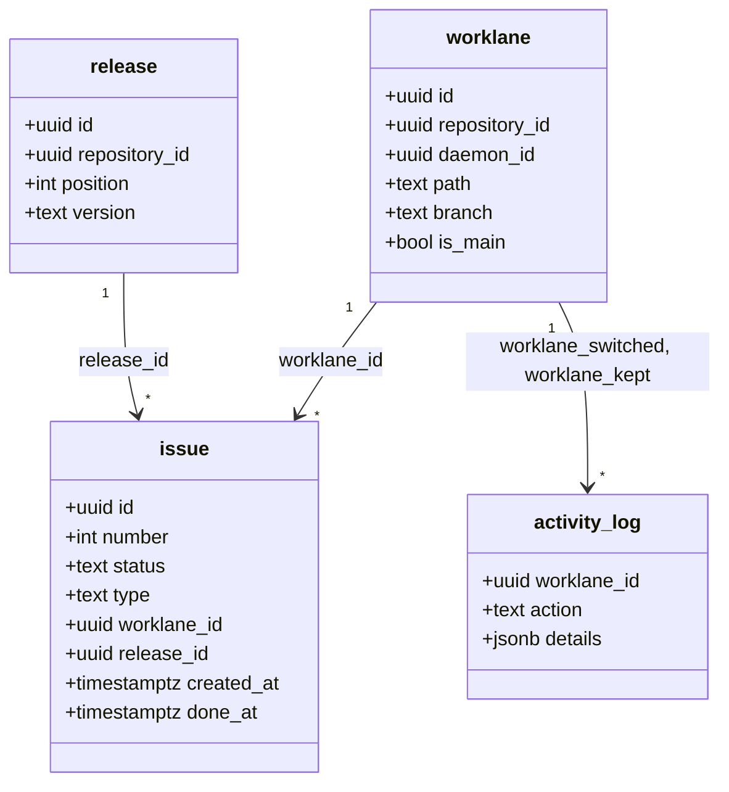
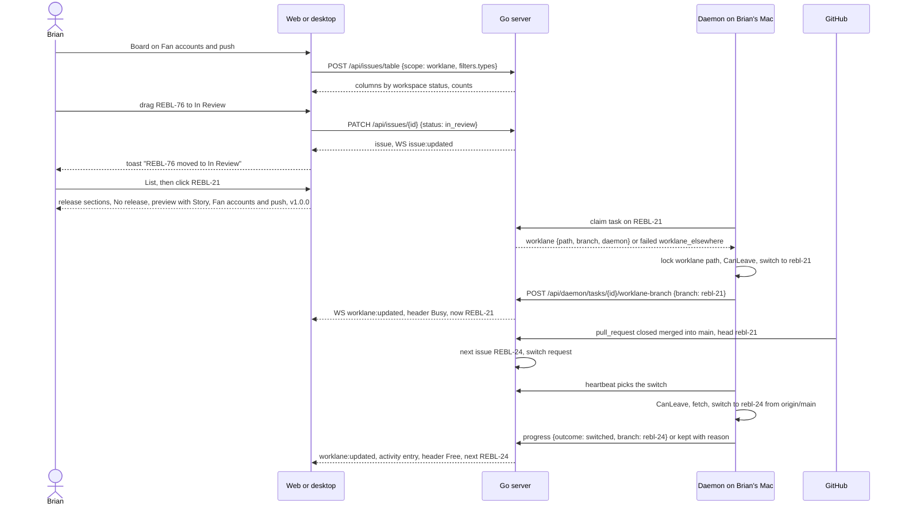
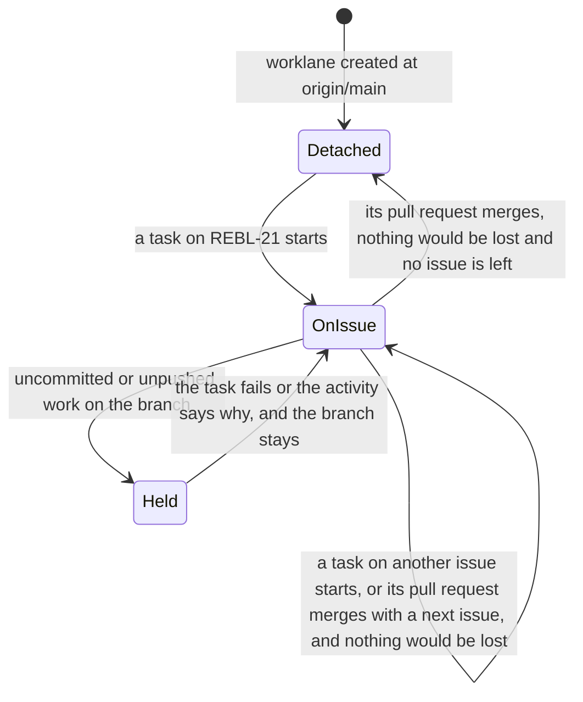

## At a glance

The delta of this change on the living system design, `specs/docs/system-design.md`, on top of UJ-5 `issues-from-templates` (DAS-456). Every container it touches already exists, and the change adds no container. The CLI is untouched: `multica issue get` prints the issue response as JSON by default, so `done_at` reaches agents as is. Mobile does not change.



Go server component map, delta:



Daemon component map, delta:



Web and desktop component map, delta:



Models:



`worklane.branch` and `issue.done_at` are new nullable columns. `branch` is the branch the worklane's worktree is on as the daemon last reported it, NULL while detached. State, the active issue and the next issue are not stored: the server computes them from `branch` and the worklane's open issues on every read.

Journey sequence and data flow:



The worklane's worktree and its branch:



| Kind | Name | Change | Path |
|---|---|---|---|
| Migration | `worklane.branch`, `issue.done_at`, its backfill and trigger | new | `server/migrations/592_worklane_branch_and_issue_done_at.up.sql`, `.down.sql` |
| Queries | `SetWorklaneBranch`, `ListOpenWorklaneIssues` | changed | `server/pkg/db/queries/worklane.sql` |
| Generated | sqlc output | changed | `server/pkg/db/generated/` |
| Package | The state, the active and the next issue of a worklane | new | `server/internal/worklanehead/` |
| Endpoint | Worklane responses with `state`, `branch`, `active_issue`, `next_issue` | changed | `server/internal/handler/worklane.go` |
| Endpoint | Issue table reads: scope `worklane`, `filters.types`, `done_at` | changed | `server/internal/handler/issue_table_query.go` |
| Endpoint | `POST /api/daemon/tasks/{taskId}/worklane-branch` | new | `server/internal/handler/worklane_branch.go`, `server/cmd/server/router.go` |
| Endpoint | Claim with the worklane block, the refusal from another runtime | changed | `server/internal/handler/daemon.go` |
| Endpoint | Worklane request kind `switch` | changed | `server/internal/handler/worklane_request.go` |
| Integration | Merged pull request switches the worklane | changed | `server/internal/handler/github.go`, `server/internal/service/worklane_switch.go` |
| Failure reasons | `worklane_elsewhere`, `worklane_branch_held` | changed | `server/pkg/taskfailure/failure.go` |
| Protocol | Claim worklane block, switch request fields | changed | `server/pkg/protocol/messages.go`, `server/internal/daemon/types.go` |
| Daemon | Worklane issues in the worklane's worktree, the switch | changed | `server/internal/daemon/daemon.go`, `issue_worktree.go`, `worklane_request.go`, `client.go`, `execenv/worklane_worktree.go` |
| Types | `done_at`, worklane state, worklane scope, `filters.types` | changed | `packages/core/types/issue.ts`, `worklane.ts`, `api.ts` |
| Schemas | The new fields with fallbacks | changed | `packages/core/api/schemas.ts`, `schemas.test.ts` |
| Scope | `{type: worklane, worklaneId, issueTypes}` | changed | `packages/core/issues/surface/scope.ts`, `query-plan.ts`, `membership.ts` |
| Helpers | List sections, Type filter | new | `packages/core/worklanes/list-sections.ts`, `type-filter.ts` |
| Realtime | Issue changes refresh the worklane | changed | `packages/core/realtime/use-realtime-sync.ts` |
| Component | Release chip on cards and rows | new | `packages/views/releases/components/issue-release-chip.tsx` |
| Component | Card and row with the release chip | changed | `packages/views/issues/components/board-card.tsx`, `list-row.tsx` |
| Component | The preview's header | new | `packages/views/issues/components/issue-peek-summary.tsx` |
| Component | Peek open mode, "Open issue" | changed | `packages/views/issues/surface/peek-context.tsx`, `packages/views/issues/components/issue-peek.tsx`, `issue-detail.tsx` |
| Component | Issue surface open mode and move toast | changed | `packages/views/issues/surface/issue-surface.tsx`, `types.ts`, `use-issue-surface-actions.ts` |
| Component | Type filter, worklane state | new | `packages/views/worklanes/components/worklane-type-filter.tsx`, `worklane-state.tsx` |
| Screen | Worklane page with Timeline, Board and List | changed | `packages/views/worklanes/components/worklane-page.tsx`, `worklane-timeline.tsx` |
| Screen | Board and List of a worklane | new | `packages/views/worklanes/components/worklane-board.tsx`, `worklane-list.tsx` |
| Copy | Five languages | changed | `packages/views/locales/{en,zh-Hans,ko,ja,fr}/` |
| Docs | Worklane views and agent worktree | changed | `apps/docs/content/docs/projects.mdx` and its four translations |
| ADR | ADR-0014: A worklane's issues work in its worktree on their own branch | new | `adr/0014-a-worklanes-issues-work-in-its-worktree-on-their-own-branch.md` |
| ADR | ADR-0015: The database keeps an issue's done date | new | `adr/0015-the-database-keeps-an-issues-done-date.md` |

## Context

Journey UJ-6 of [PRD: Multica: steer projects, repositories, worklanes and releases](anytype://object?objectId=bafyreiew63xw2dncss52jdx4qk4o6aktkklhqroclvs3cvjxcyztx7h5um), F6 with FR-53 to FR-59 and FR-69 to FR-71. FR-70's pick of the next issue is superseded by Brian's answer of 13 October 2026: a worklane works its issues one at a time in their order, with no exception logic in Multica. It builds on UJ-5 `issues-from-templates` (DAS-456, branch `das-456-uj-5-brian-creates-an-issue-from-a-template`):

- `issue.type`, `issue.worklane_id` and `issue.release_id`, nullable, set through `PUT /api/issues/{id}/type` and `PUT /api/issues/{id}/placement` under the repository's lock (ADR-0012, ADR-0013), with the index `idx_issue_worklane` (590);
- `GET /api/worklanes/{id}/issues` (every issue of the worklane, by `created_at`) and `GET /api/release-progress`, read through `packages/core/issues/placement/` with `worklaneIssueKeys` and `releaseProgressKeys`, and `ListOpenIssuesOfWorklane`, whose open issues have a status category that is neither done nor closed;
- `type-icon.tsx` beside the identifier on `list-row.tsx` and `board-card.tsx`, `release-issue-row.tsx` and `no-release-column.tsx` on the Timeline, and `openedFrom` and `defaultStatus` in `defaults.ts`;
- migrations 589 to 591. This change's migrations start at 592 and its ADRs at 0014.

UJ-5 builds on UJ-4 `release-line-of-a-repository` (DAS-455): the `release` table with `position`, `GET /api/releases` and `lineStates` in `packages/core/releases/`, `release-column.tsx`, `release-menu.tsx` and `release_line:updated` (ADR-0010). UJ-4 builds on UJ-3 `worklanes-of-a-repository` (DAS-452): the `worklane` table with `daemon_id` and `path`, the response's `state` that is `free` for every worklane until this change, with `free` and `busy` already in its zod schema, the worklane page and its header, worklane activity in `activity_log` (ADR-0008), `WorklaneRequestStore` with its heartbeat kind `PendingWorkKindWorklaneRequest` and progress endpoint, `execenv/worklane_worktree.go`, and the worklane's worktree made detached at `origin/{default_branch}`. UJ-3 builds on UJ-2 `repositories-of-a-project` (DAS-451): worklane `main`, whose worktree is the repository's checkout, the issue worktree per repository at `~/Worktrees/{organisation key}/{repo}/{issue key}` on the branch `{issue key}` with `issue_worktree` rows (ADR-0007), the claim's `repositories` block, and `LocalPathLocker` keyed on the worktree path. UJ-2 builds on UJ-1 `projects-by-organisation` (DAS-450).

The later changes build on this one without reworking it:

- `worklanes-and-releases-pages` (UJ-7) shows `active_issue` or `next_issue` on worklane rows from the same worklane response, and a status change on Releases through the same issue update.
- `release-ships` (UJ-8) reads `issue.done_at` for the ship date, and shows shipped releases on Board and List through the same release chip and List section.

**Current code.**

- Multica's board and list mount through `IssueSurface` (`packages/views/issues/surface/issue-surface.tsx`) with an `IssueScope`, whose `issueScopeKey` names the persisted display state and whose query plan sends `POST /api/issues/table` (`server/internal/handler/issue_table_query.go`, scope kinds `workspace`, `my`, `project`, `actor`, `team`). The board's columns come from the workspace's status catalogue, with `DEFAULT_HIDDEN_STATUSES` = `cancelled` and the hidden-columns panel. A drag calls `moveIssue` in `use-issue-surface-actions.ts`, which shows "Failed to move issue" on failure and nothing on success.
- `ListView` groups by status. `ListRow` needs a `ViewStoreProvider`; `BoardCardContent` reads card properties from the same store.
- The preview is `IssuePeekHost` and `IssuePeekPanel` (`issue-peek.tsx`) rendering `IssueDetail` with `variant="peek"` and its sidebar closed. A click opens it only when the device's open mode (`issue-opening-store.ts`, default `page`) is `peek`. The peek's open button says "Open full page".
- An issue has no done date: `issue` holds `created_at`, `updated_at`, `start_date` and `due_date`. Status is written by `UpdateIssue`, `UpdateIssueStatus`, the batch update, PR auto-complete (`maybeAutoCompleteIssue` in `handler/github.go`) and other queries in `issue.sql`. The `status_changed` activity entry has `details.to`. A custom status maps to a lifecycle category through `issue_status`, and `issue_effective_status(workspace_id, status)` (migration 469) returns `done` for every status of the done category.
- A task runs on its agent's runtime (`agent.RuntimeID`). A claim that cannot run is failed before launch with `failClaimedTaskBeforeLaunch`, a user message and a `taskfailure` reason, which the issue's execution log shows. The daemon's helpers `worktreeIsDirty` and `countUnpushedCommits` read uncommitted and unpushed work.
- A GitHub `pull_request` webhook reaches `mirrorPullRequestForWorkspace`, which links issues and auto-completes them on merge. `ghPullRequestPayload` reads `head.ref` and not `base.ref`.

**Design and prototype.** Screen 3 Worklane timeline of `designs/screens/steer-all-work.pen` has the header with the Type filter, New issue and the Timeline, Board and List switch, and no Board or List screen. The prototype's `LanePage`, `StatusBoard`, `BoardCard`, `StatusMenu`, `IssueRow` and `IssuePeek` (`prototypes/web/src/components/generated/MulticaSteerAllWorkPrototype.tsx`) and `laneNow`, `laneNextIdx` and `releaseStates` (`model.ts`) show the views. Its five fixed columns, its own preview and its pick of the next issue are superseded by Brian's answers in the P4 session: Board, List rows and the preview are Multica's, with the type icon and the release chip added.

**Journey steps.** The investigation finds nothing for three steps, and no `Keep:` Request names them. Each gets its `Skip:` Request once the journey exists in the brain:

- `Skip: J1` Project structure: no new container, app or workspace package. The new folder `server/internal/worklanehead/` sits in an existing module, and the new files sit in `packages/core/worklanes/` and `packages/views/worklanes/` from UJ-3.
- `Skip: J4` Design system: no new token. The type colours come from UJ-5, the release states from UJ-4, and the Board, List and preview from Multica's components.
- `Skip: J10` Agent tooling for UI: no command changes. `multica issue get` prints the issue response as JSON by default, so `done_at` reaches agents without a change, and the worktree an agent works in is set by the daemon, not by a command.

The steps with work are J2, J3, J5, J6, J7, J8, J9 and J11.

**What must not change.** Multica's Issues, My Issues and project boards, lists and filters, apart from the release chip on cards and rows of issues in a release, and the preview's header wherever it opens. The open mode Brian sets for those pages. Tasks on issues without a worklane, which keep UJ-2's issue worktree. Tasks without an issue. The issue `PATCH` and its SQL.

**Living system design.** `specs/docs/system-design.md` matches `main` at `10a1307d1`. It changes when this change's code merges, as with UJ-1 to UJ-5.

## Goals / Non-Goals

**Goals:**

- Timeline, Board and List of one worklane, with a Type filter that holds across them, as the `worklane-views` spec delta says.
- Busy or Free, and "now" or "next" in the header, computed by the server in one place that UJ-7 reuses.
- The Board as Multica's board scoped to the worklane, with the release chip, + per column and the move toast.
- The List as one section per release of the line and "No release".
- The preview with type, ID, title, status, worklane, release and assignee at its top, opening from all three views.
- The done date of every issue, written wherever the status changes.
- An agent's task on a worklane's issue in the worklane's worktree on the issue's branch, one at a time, refused from another runtime, and the switch after a merge.

**Non-Goals:**

- "last shipped" in the header, the ship date and shipped releases on Board and List: UJ-8.
- A status change on Releases, and now or next on Worklanes: UJ-7.
- Picking the issue a worklane takes next, or a dedicated worklane for an issue that does not fit one.
- Moving an issue between releases by dragging on List.
- A task from an agent on another runtime run in a worktree there.
- Showing the done date in the UI. UJ-8 reads it.
- Changes to Multica's Issues board, list, filters and views. Squads, dark mode and the mobile app.

**Always:**

- No foreign keys or cascades. A migration's concurrent index in its own file; this change adds no index.
- UI JSON through zod with `parseWithFallback`, with malformed-response tests.
- Shared logic in `packages/core` and `packages/views`, wired into web and desktop through the worklane page they already route to.
- A worklane's worktree changes branch only when it holds nothing uncommitted and no commit missing from its remote.

**Never:**

- Store Busy or Free, or the next issue.
- Run a worklane's issue in a worktree other than its worklane's.
- Change the status, worklane or release of an issue from the daemon.

## Decisions

### 1. The model

Migration 592:

```sql
ALTER TABLE worklane ADD COLUMN branch text;
ALTER TABLE issue ADD COLUMN done_at timestamptz;
```

- `worklane.branch` is written only from the daemon's reports (decisions 6 and 7). NULL means detached, as UJ-3 makes a worklane's worktree. `main` keeps the branch of the repository's checkout.
- `issue.done_at` is kept by a trigger (decision 4). The backfill sets it on issues whose `issue_effective_status` is `done`: the `created_at` of their latest `status_changed` entry whose `details.to` is their status, else `updated_at`.
- The down migration drops the trigger, its function and both columns, and deletes the `worklane_switched` and `worklane_kept` entries.

### 2. State, now and next (`server/internal/worklanehead`)

`Head(branch, prefix, issues)` takes the worklane's open issues, each with identifier, status, status category, release position and `created_at`, and returns `{state, active, next}`:

- The active issue is the open issue whose identifier in lowercase is `branch` and whose status category is `started`, except `blocked`. That is In Progress, In Review and a workspace's own started status such as "Ready for test". With one, `state` is `busy`.
- Otherwise `state` is `free`, and `next` is the first open issue in release order: issues in a release by the release's `position` on the line, then issues in no release, and within each by `created_at`, then `id`.
- No open issue: `free`, without `active` or `next`.

`ListOpenWorklaneIssues(workspace_id, worklane_ids)` returns the open issues of the given worklanes with `release.position` through a join on `release_id`, the status category from `issue_status` (built-ins by their fixed category), and the workspace's issue prefix. `GET /api/worklanes`, `GET /api/worklanes/{id}` and the worklane in `worklane:updated` carry `branch`, `state`, `active_issue` and `next_issue`, each issue `{id, identifier, title}` or null. Every worklane response comes through one function, so UJ-7's rows read the same values.

The header shows "now: {ID} {title}" while Busy and "next: {ID} {title}" while Free, with the state chip in front, as screen 3 has it.

### 3. Board and List

- The Board is `IssueSurface` with the scope `{type: "worklane", worklaneId, issueTypes}`, `modes: ["board"]` and `surfaceKey` `worklane:{id}`. `issueScopeKey` is `worklane:{id}`, so the column options and card properties are the worklane's own, with Cancelled hidden by `DEFAULT_HIDDEN_STATUSES`. `issueTypes` stays out of the key and goes into the query plan.
- `POST /api/issues/table` gains scope kind `worklane` with `worklane_id`, filtering `i.worklane_id = $n`, and `filters.types`: the picked types, with `none` for `i.type IS NULL`, as `include_no_project` does for projects. It returns `type`, `worklane_id`, `release_id` and `done_at` like the other columns.
- `membership.ts` places an issue in the scope when its `worklane_id` is the worklane and its type is picked, so a WebSocket update adds or drops the card.
- `createDefaults` is `openedFrom({worklane})` of UJ-5, so a column's + opens New issue with the column's status, the worklane and its next release.
- The List is `worklane-list.tsx`, from `worklaneIssueKeys` (UJ-5) and the line from `releaseKeys.list(wsId)`. `listSections(line, issues)` in `packages/core/worklanes/list-sections.ts` returns, per release in line order, `{release, state, setByHand, done, total, issues}`, then "No release" with its issues while there are any. Each section has UJ-4's release menu and its description. Rows are `ListRow` inside a `ViewStoreProvider` of the same `worklane:{id}` store, so List and Board share the card properties. Without releases and without issues the List says "No releases planned for this worklane yet.", or "{repository} does not release, so its worklanes plan no releases." for a repository that does not release.
- `typeFilter(types)` in `packages/core/worklanes/type-filter.ts` filters the issues of Timeline and List with the same rule the server applies.
- The view and the picked types are local state of `worklane-page.tsx`: the page opens on Timeline, and switching views keeps the types.

### 4. The done date is kept by the database (ADR-0015)

```sql
CREATE FUNCTION issue_done_at() RETURNS trigger LANGUAGE plpgsql AS $$
BEGIN
  IF issue_effective_status(NEW.workspace_id, NEW.status) = 'done' THEN
    IF TG_OP = 'UPDATE' AND issue_effective_status(OLD.workspace_id, OLD.status) = 'done' THEN
      NEW.done_at := OLD.done_at;
    ELSE
      NEW.done_at := now();
    END IF;
  ELSE
    NEW.done_at := NULL;
  END IF;
  RETURN NEW;
END $$;
CREATE TRIGGER trg_issue_done_at BEFORE INSERT OR UPDATE OF status ON issue
  FOR EACH ROW EXECUTE FUNCTION issue_done_at();
```

Every status writer goes through it: `UpdateIssue`, the batch update, PR auto-complete and the queries upstream adds later. A move from one done status to another keeps the date. A status renamed or recategorised in the catalogue does not rewrite dates.

### 5. The release chip, the move toast and the preview

- `issue-release-chip.tsx` shows the release's version with its state's colour from `lineStates` (next, planned, shipped), read from `releaseKeys.list(wsId)`. `board-card.tsx` and `list-row.tsx` show it after the type icon when `release_id` is set, on every surface.
- `IssueSurface` gains `announceMoves`. With it, `moveIssue` shows "{ID} moved to {status}" after the server accepts a status change. The worklane Board sets it. The failure toast stays "Failed to move issue", and the mutation's rollback puts the card back.
- `IssuePeekHost` and `IssueSurface` gain `openMode`. The worklane page sets `peek`, so a click on Timeline, Board or List opens the preview there. Multica's other pages keep the device's open mode.
- `issue-peek-summary.tsx` sits at the top of `IssueDetail` with `variant="peek"`, above the title: the type icon and type, the ID, a status menu (`StatusPicker`), the worklane as an `AppLink` to its Timeline or "No worklane", the release chip, and the assignee. The description and comments follow as today. The peek's open button is labelled "Open issue".
- Timeline rows (`release-issue-row.tsx`) open the preview through `useIssuePeekLinkProps`.

### 6. A worklane's issue runs in its worktree (ADR-0014)

The claim's `repositories` block (UJ-2) gains `worklane` for the repository of the issue's worklane: `{id, name, path, daemon_id, daemon_name, branch, default_branch}`. For `main`, `path` and `daemon_id` are the repository's checkout path and machine.

Claim refusal: when the claiming runtime's `daemon_id` is not the worklane's, `failClaimedTaskBeforeLaunch` fails the task with reason `worklane_elsewhere` and "{agent} runs on {agent's machine}; {worklane} lives on {worklane's machine}". Machine names are the newest runtime row's, as UJ-3's `runtime_name`.

On the daemon, for an issue task with a `worklane`:

1. `LocalPathLocker` on the worklane's path. A second task on any issue of the worklane waits as `waiting_local_directory`, so the worklane runs one task at a time.
2. The branch is the issue key in lowercase, as UJ-2 names it. When the worktree is on it, the task starts there.
3. Otherwise `CanLeave(path)`: `git status --porcelain` is empty and `git rev-list --count HEAD --not --remotes` is 0 on a branch (a detached worktree has nothing to lose). If not, the task fails with reason `worklane_branch_held` and "{worklane} holds uncommitted changes on {branch}" or "{worklane} holds {n} commits on {branch} that are not pushed".
4. Under the checkout's repo lock: `git fetch origin {default_branch}`, then `git switch {branch}` when it exists, else `git switch -c {branch} origin/{default_branch}`.
5. `POST /api/daemon/tasks/{taskId}/worklane-branch` `{branch}`. The server checks the task's issue is in that worklane, sets `worklane.branch`, writes `worklane_switched` `{from, to, issue_id}` when it changed, and publishes `worklane:updated`.

No `issue_worktree` row is made for a worklane's issue. Issues without a worklane keep UJ-2's issue worktree.

### 7. The switch after a merge

- `ghPullRequestPayload` gains `base.ref`. When a pull request is merged into its repository's default branch, `SwitchAfterMerge` runs after `maybeAutoCompleteIssue`, for each linked issue whose worklane's `branch` is the pull request's `head.ref`.
- It computes the worklane's next issue with `worklanehead.Head`, skipping the merged issue, and enqueues a worklane request of kind `switch` (UJ-3's store and heartbeat kind) with `{worklane_id, path, from_branch, to_branch, default_branch}`. With no next issue, `to_branch` is empty and the worktree is detached at `origin/{default_branch}`.
- The daemon runs the steps `check`, `fetch` and `switch` with `CanLeave` and the switch of decision 6, and reports through UJ-3's progress endpoint: `completed` with `branch`, or `refused` with `{code: uncommitted | unpushed, count}`.
- Completed sets `worklane.branch` and writes `worklane_switched` `{from, to, issue_id}`. Refused writes `worklane_kept` `{branch, reason, count}`, shown as "The worktree stayed on {branch} because it holds uncommitted changes" or "... {n} commits that are not pushed". Both publish `worklane:updated`.
- A switch request lost with the machine or a server restart fails as UJ-3's `lost`. The next task on the worklane switches anyway (decision 6).

### 8. Realtime

- `worklane:updated` (UJ-3) carries the worklane with its state, and invalidates `worklaneKeys.detail` and `worklaneKeys.list`.
- `issue:updated`, `issue:created` and `issue:deleted` of an issue with a `worklane_id` also invalidate that worklane's detail and the list, so now and next follow status changes made anywhere. UJ-5 already invalidates the worklane issues and the release progress on them, so Timeline, List and the progress follow a drag on the Board.

### 9. Copy and docs

- `issues`: "{identifier} moved to {status}", "Open issue", "No worklane". `worklanes`: Timeline, Board, List, Type, No type, Busy, Free, "now", "next", the List's empty states, and the two activity sentences. `agents` task failure labels for `worklane_elsewhere` and `worklane_branch_held`, as actionable. Five languages.
- `projects.mdx` and its translations: a worklane's views, the Type filter, Busy and Free with now and next, and how agents work a worklane's issues in its worktree.

## Risks / Trade-offs

- **The trigger is the one place outside Go that writes an issue field.** It keeps every status writer, upstream's included, from forgetting the date. The ADR names it, and a Go test covers the writers.
- **A branch checked out in another worktree.** An issue moved from one worklane to another while the first is on its branch makes `git switch` fail in the second. The task fails with git's message, which names the other worktree. Moving the issue back, or a task on the first worklane's next issue, frees it.
- **The default branch's checkout for `main`.** Issues of `main` switch the repository's checkout under `~/Repos`, as the spec says. Planning work left uncommitted there holds the branch, and the task says so.
- **An older daemon.** A daemon without this change ignores the `worklane` block and makes UJ-2's issue worktree. `make local-release` builds both from one checkout, so the fork has no older daemon to meet.
- **Read cost.** Worklane responses read the open issues of their worklanes on every read, through `idx_issue_worklane`. A worklane is one line of work.
- **Migration numbers.** 592 can be taken on `main` before J2. The builder then takes the next free number.

## Migration Plan

1. Release UJ-5 (UJ-5 Migration Plan).
2. Apply migration 592. Every worklane is detached and Free with its next issue, and done issues get their date from the backfill.
3. Release with `make local-release`. Rollback is the down migration.

## Open Questions

None. Brian's answers in the P4 session settle the next issue, the Board, List and preview, and the refusal from another runtime.
