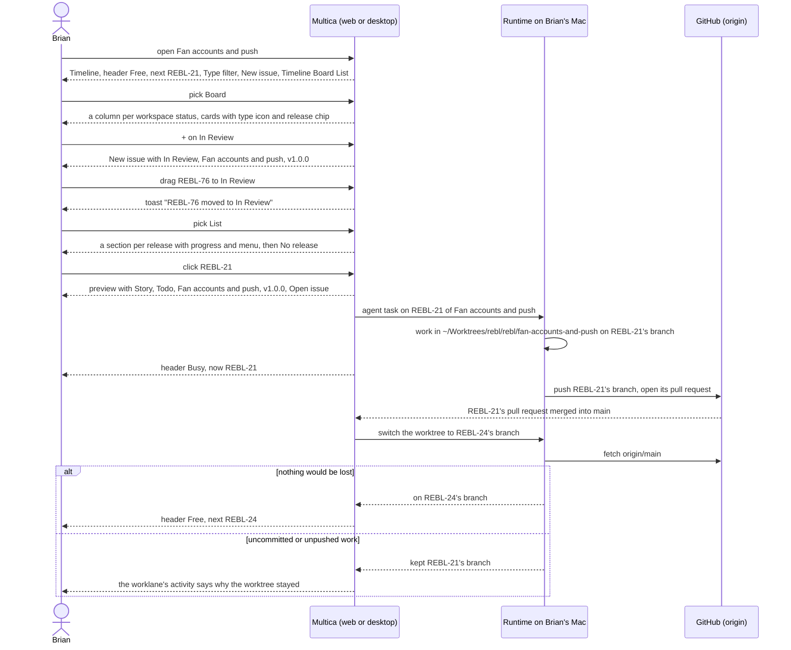

## At a glance

| Kind | Name | Change | Path |
|---|---|---|---|
| Section | Worklane header: Type filter, New issue, repository, Free or Busy, now or next, Timeline Board List | changed | `packages/views/projects/`, `designs/screens/steer-all-work.pen` (screen 3) |
| Page | Worklane Board: a column per workspace status with its count and +, drag to change the status, cards with type icon and release chip | new | `packages/views/issues/components/board-view.tsx`, `board-column.tsx`, `board-card.tsx` |
| Page | Worklane List: a section per release with its state, title, Set by hand, progress, menu and description, then No release | new | `packages/views/issues/components/list-view.tsx`, `list-row.tsx` |
| Panel | Issue preview: type, ID, title, status menu, worklane link, release chip and assignee at the top, on every page that opens it | changed | `packages/views/issues/components/issue-peek.tsx` |
| Concept | Worklane: Busy with its active issue, or Free; what it works on now or takes next | changed | `packages/core/types/` |
| Concept | Issue: its done date | changed | `packages/core/types/issue.ts` |
| Runtime | Run a worklane issue's task in that worklane's worktree on the issue's branch, one task at a time, refused from another runtime; switch to the next issue's branch after a merge | changed | `server/internal/daemon/execenv/local_worktree.go` |
| Integration | GitHub pull request merged: switch the worklane's worktree | changed | `server/internal/handler/github.go` |

## Why

Brian wants to see and move the work of one worklane the way he moves issues in Multica today, without losing which release each issue is in. UJ-3 to UJ-5 give a worklane its Timeline, its releases and its issues, but only by release: there is no way to see the worklane's issues by status, move them, or see whether the worklane is working and on what. Agents work an issue in a throwaway worktree, not in the worklane that holds it.

Success signal: on the Board of Fan accounts and push Brian drags REBL-76 to In Review and sees "REBL-76 moved to In Review", its List shows v1.0.0 First production release with "1 of 2 done" and then "No release", clicking REBL-21 opens its preview with Fan accounts and push and v1.0.0, and while an agent works REBL-21 in `~/Worktrees/rebl/rebl/fan-accounts-and-push` on REBL-21's branch the header shows Busy with "now: REBL-21 A fan changes their display name".

## What Changes

- A worklane's header gets the Type filter, with the eight types and No type, applied to Timeline, Board and List alike, and the switch between them.
- A worklane is Busy while its active issue, In Progress or In Review, holds its worktree's branch, and Free otherwise. The header shows "now: {ID} {title}" for the active issue, or "next: {ID} {title}" for the worklane's first issue that is not Done or Cancelled, by release order and then creation order.
- Board shows every issue of the worklane in one column per workspace status with its count, as Multica's Issues board shows them, with Cancelled hidden until shown. A card is Multica's card plus the type icon and the release chip. Each column's + opens New issue in that status, with the worklane and its next release.
- Dragging a card changes its status with the toast "{ID} moved to {status}", or puts it back with "Failed to move issue". An issue that reaches Done records its done date and drops it when it leaves Done.
- List shows one section per release of the line, in order, with its state, title, "Set by hand", progress, menu and description, then its rows of this worklane; then "No release". Without releases or issues it says why.
- Clicking an issue on Timeline, Board or List opens Multica's preview, which shows type, ID, title, a status menu, the worklane as a link to its Timeline, the release chip and the assignee at its top, wherever it opens.
- An agent's task on an issue of a worklane runs in the worklane's worktree on the issue's branch, `main` in the repository's checkout; a worklane runs one task at a time; a task from an agent on another runtime is refused with the reason. After the active issue's pull request merges, the worktree switches to the next issue's branch, cut from the fetched default branch, only when nothing would be lost.

## Capabilities

### New Capabilities

- `worklane-views`: lets Brian switch a worklane between Timeline, Board and List and filter all three by type.
- `worklane-state`: lets Brian see whether a worklane is Busy or Free and what it works on now or takes next.
- `worklane-board`: lets Brian see the worklane's issues by status, create one in a status and move one by dragging.
- `worklane-list`: lets Brian see the worklane's issues by release, then those in no release.
- `issue-preview`: lets Brian open an issue's preview from a worklane's views and see and change its status, worklane and release there.
- `worklane-agent-worktree`: lets an agent work a worklane's issue in that worklane's worktree on the issue's branch, one at a time.

### Modified Capabilities

None in `specs/openspec/specs/`. This change builds on the unarchived changes `worklanes-of-a-repository` (UJ-3: the worklane page that opens on its Timeline with its state; FR-69 to FR-71 moved from it to here), `release-line-of-a-repository` (UJ-4: the Timeline, the release menu, "nothing shipped yet" and "does not release" in the header) and `issues-from-templates` (UJ-5: New issue from a worklane, the type icons, a release's issues and progress, "No release"; its non-goals hand New issue from a Board column, the Board, List and the preview to this change). `worklane-agent-worktree` takes a worklane's issues out of `repositories-of-a-project`'s worktree per issue, which stays for issues without a worklane.

## Impact

- Web and desktop: the worklane page's header and its Board and List views, Multica's issue preview on every page that opens it.
- Shared packages: the worklane's state and what it works on now or takes next, the issue's done date, in the API client, its schemas and queries.
- Server: Busy or Free, now or next and the done date in the API; the GitHub pull request merge that switches the worktree; the worklane's activity entry when it stays.
- Daemon: running a worklane issue's task in the worklane's worktree on its branch, one at a time, and refusing a task from another runtime.
- Copy in every supported language.

## Constraints

- Board, List rows and the preview are Multica's components, with the type icon and the release chip added: no second board, list or preview.
- A worklane works one issue at a time, in its order; Multica gives no other path for an issue that does not fit a worklane.
- A worklane's worktree changes branch only when nothing in it would be lost.
- An agent's task on a worklane's issue never runs outside that worklane's worktree, or the checkout for `main`.
- Light mode only.
- AGENTS.md: no foreign keys or cascades, `CREATE INDEX CONCURRENTLY` in its own migration, zod schemas with `parseWithFallback` and malformed-response tests for changed responses, no compatibility shims, every check local.

## Non-goals

- "last shipped v1.0.0" in the header, the ship date and a shipped release on Board and List: UJ-8.
- A status change showing on Releases, and now or next on Worklanes: UJ-7.
- Picking the issue a worklane takes next: next follows from the worklane's order (Brian, 13 October 2026).
- Moving an issue between releases on List by dragging; Add issue to release and Remove from release do that (UJ-4, UJ-5).
- A dedicated worklane for an issue that does not fit one: a person or an agent decides it and asks permission, outside Multica (Brian, 13 October 2026).
- Running a worklane's issue from an agent on another runtime in a worktree there.
- The Issues page's board, list, filters and views, which stay as Multica has them (PRD non-goals).
- Squads, dark mode and the mobile app.

## Sources

- Intent: [Steer projects, repositories, worklanes and releases in Multica](anytype://object?objectId=bafyreib727ukptyvcfbkud627gjb3cu2lmwsh3u4cjbu4kisjofa25km3u) and its Requests.
- PRD: [Multica: steer projects, repositories, worklanes and releases](anytype://object?objectId=bafyreiew63xw2dncss52jdx4qk4o6aktkklhqroclvs3cvjxcyztx7h5um): UJ-6, F6 with FR-53 to FR-59 and FR-69 to FR-71, UJ-7 and UJ-8 for what goes there, the glossary and the non-goals. FR-70's "the issue picked for the worklane" is superseded by Brian's answer: there is no pick.
- Brief: [Multica: steer projects, repositories, worklanes and releases](anytype://object?objectId=bafyreicccdj6bucv5d65bxvkz4gy7jf7etplsswmwfggupqbakc6rudpmi).
- Earlier changes: `specs/openspec/changes/repositories-of-a-project/`, `worklanes-of-a-repository/`, `release-line-of-a-repository/`, `issues-from-templates/`.
- Design: [Steer all work screens](anytype://object?objectId=bafyreiauxfhf7w74hwn5je7ljakzxfgo2qv4noid2oshvtqjwkos2v5oiq), screen 3 Worklane timeline in `designs/screens/steer-all-work.pen`, exports in `designs/exports/`; [component library](anytype://object?objectId=bafyreiamoqycfo735krrpmzn3ujhdardv6uixsrdzkadzlodwpr7aenwee); `designs/creation-flows.md` "Lanes in MadSpec" and "The model".
- Prototype: [Steer all work prototype](anytype://object?objectId=bafyreieck7zsmzslnfe5asszexojznfbnsnwcg62eqbesqqeigkkzgoclm), revision 460535099583266816: `LanePage`, `StatusBoard`, `BoardCard`, `StatusMenu`, `IssueRow`, `IssuePeek` in `prototypes/web/src/components/generated/MulticaSteerAllWorkPrototype.tsx`; `laneNow` and `releaseStates` in `model.ts`. Its fixed five columns and its own preview are superseded by Brian's answers.
- Current code: Multica's Issues board, list and preview in `packages/views/issues/components/`, the default hidden Cancelled column in `packages/core/issues/stores/view-store.ts`, the daemon's worktrees in `server/internal/daemon/execenv/local_worktree.go`.
- Brian's design session of 12 October 2026 (`/tmp/brian-design-session-inputs.txt`), screens 3 and 4: the team board became the worklane's Board.
- Brian's answers in the P4 session of 13 October 2026, on the [UJ-6 Task](anytype://object?objectId=bafyreicoxc4uq64pjkso6nrruquotbgohpk4kd63kxrbgl6n4wavn3ceju): UJ-6 has UI; no pick for next; a worklane works its issues one at a time in their order, with no exception logic in Multica; an agent on another runtime is refused with the reason; Board, List and the preview are Multica's plus type and release.
