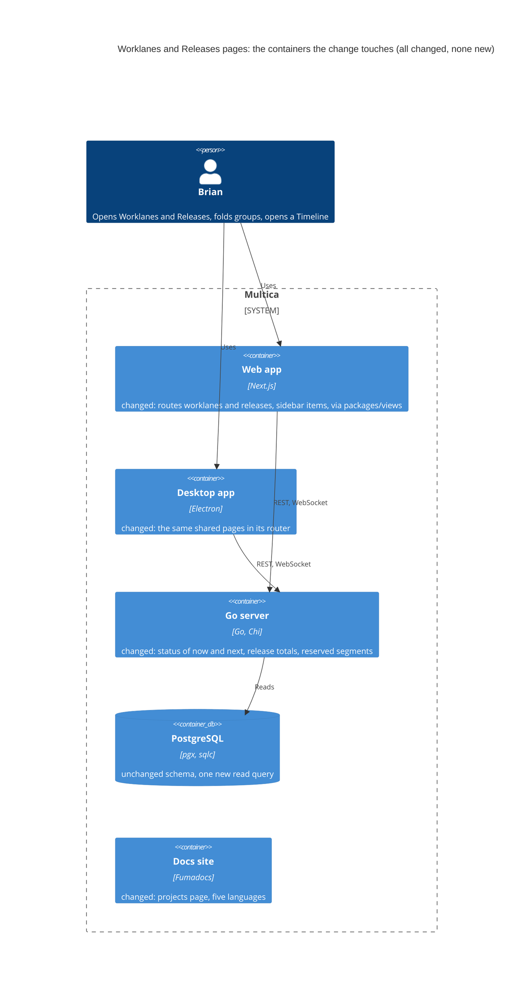
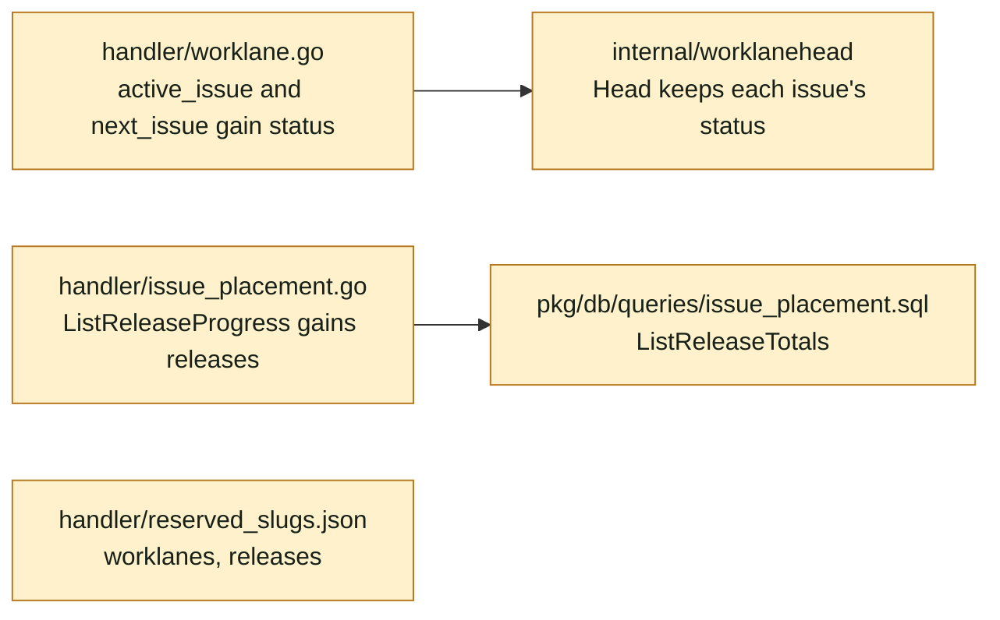
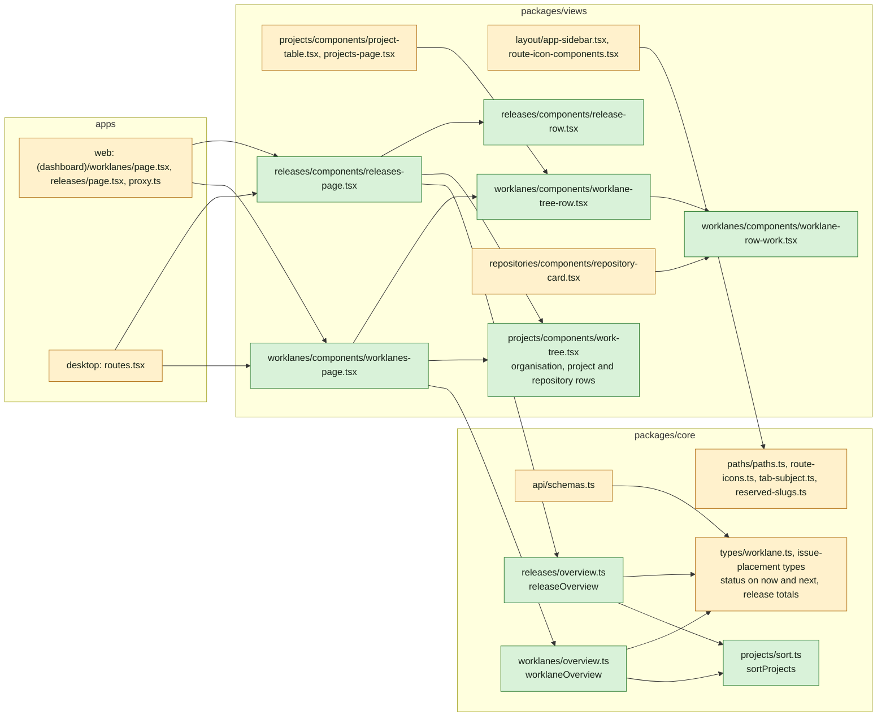
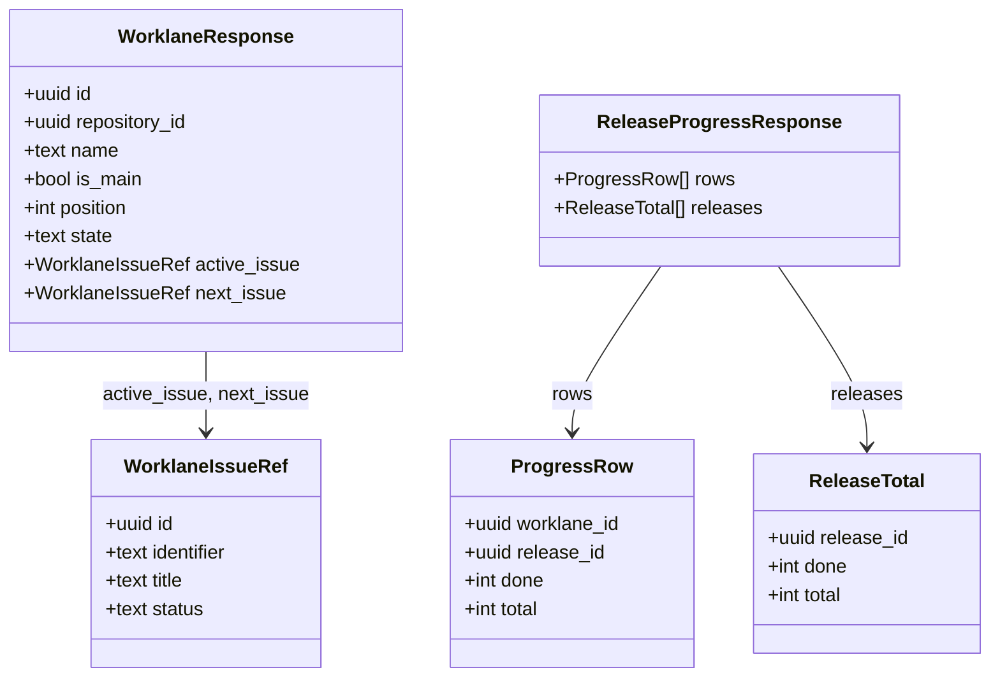
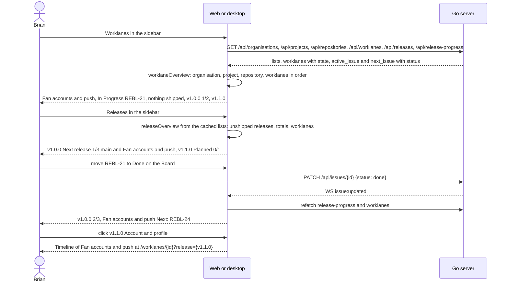

## At a glance

The delta of this change on the living system design, `specs/docs/system-design.md`, on top of UJ-6 `worklane-board-and-list` (DAS-459). Every container it touches already exists, and the change adds no container, table, column or migration. The daemon, the CLI and the mobile app do not change.

Go server component map, delta:

Web and desktop component map, delta:

Models: no table changes. The two response shapes the pages read gain fields:

`WorklaneIssueRef.status` and `ReleaseProgressResponse.releases` are new. `rows` stays per worklane and release, as UJ-5 made it for the Timeline and the worklane rows. `releases` counts every issue in a release, also a closed issue whose worklane was removed.

Journey sequence and data flow:

| Kind | Name | Change | Path |
|---|---|---|---|
| Queries | `ListReleaseTotals` | changed | `server/pkg/db/queries/issue_placement.sql` |
| Generated | sqlc output | changed | `server/pkg/db/generated/` |
| Package | `Head` keeps each issue's status for the refs | changed | `server/internal/worklanehead/` |
| Endpoint | Worklane responses: `status` on `active_issue` and `next_issue` | changed | `server/internal/handler/worklane.go` |
| Endpoint | `GET /api/release-progress` gains `releases` | changed | `server/internal/handler/issue_placement.go` |
| Config | Reserved workspace segments `worklanes` and `releases` | changed | `server/internal/handler/reserved_slugs.json`, `packages/core/paths/reserved-slugs.ts` |
| Types | `WorklaneIssueRef.status`, `ReleaseTotal` | changed | `packages/core/types/worklane.ts`, the release progress type of `packages/core/issues/placement/` |
| Schemas | The new fields with fallbacks | changed | `packages/core/api/schemas.ts`, `schemas.test.ts` |
| Navigation | `paths.worklanes()`, `paths.releases()`, `WORKSPACE_PAGES`, tab subjects, link handler | changed | `packages/core/paths/`, `packages/views/editor/utils/link-handler.ts` |
| Helpers | Projects order, the two overviews | new | `packages/core/projects/sort.ts`, `packages/core/worklanes/overview.ts`, `packages/core/releases/overview.ts` |
| Component | The tree's organisation, project and repository rows | new | `packages/views/projects/components/work-tree.tsx` |
| Component | Worklane row and its now or next line | new | `packages/views/worklanes/components/worklane-tree-row.tsx`, `worklane-row-work.tsx` |
| Component | Release row | new | `packages/views/releases/components/release-row.tsx` |
| Component | Projects tree and repository card with now or next | changed | `packages/views/projects/components/project-table.tsx`, `projects-page.tsx`, `packages/views/repositories/components/repository-card.tsx` |
| Screen | Worklanes, Releases | new | `packages/views/worklanes/components/worklanes-page.tsx`, `packages/views/releases/components/releases-page.tsx` |
| Menu | Worklanes and Releases under Work | changed | `packages/views/layout/app-sidebar.tsx`, `route-icon-components.tsx` |
| Routes | Web and desktop | changed | `apps/web/app/[workspaceSlug]/(dashboard)/worklanes/page.tsx`, `releases/page.tsx`, `apps/web/proxy.ts`, `apps/desktop/src/renderer/src/routes.tsx` |
| Copy | Five languages | changed | `packages/views/locales/{en,zh-Hans,ko,ja,fr}/` |
| Docs | Worklanes and Releases pages | changed | `apps/docs/content/docs/projects.mdx` and its four translations |
| ADR | ADR-0016: The Worklanes and Releases pages are built from the workspace's lists | new | `adr/0016-the-worklanes-and-releases-pages-are-built-from-the-workspaces-lists.md` |

## Context

Journey UJ-7 of [PRD: Multica: steer projects, repositories, worklanes and releases](anytype://object?objectId=bafyreiew63xw2dncss52jdx4qk4o6aktkklhqroclvs3cvjxcyztx7h5um), F7 with FR-60, FR-61 and FR-64. FR-70's pick of the next issue is superseded by Brian's answer of 13 October 2026: a worklane takes its issues in order, by release and then creation. It builds on UJ-6 `worklane-board-and-list` (DAS-459, branch `das-459-uj-6-brian-works-a-worklanes-issues-on-board-and-list`):

- `worklane.branch` and `server/internal/worklanehead`, whose `Head(branch, prefix, issues)` gives `state`, the active issue and the next issue from `ListOpenWorklaneIssues`, filled into every worklane response by one function in `handler/worklane.go`, with `active_issue` and `next_issue` as `{id, identifier, title}` (ADR-0014);
- `issue.done_at` and `trg_issue_done_at` (ADR-0015), which UJ-8 reads and this change does not;
- `worklane-state.tsx` with "now" and "next" in the worklane page's header;
- `use-realtime-sync.ts`: `issue:created` and `issue:updated` of an issue with a worklane invalidate that worklane and `worklaneKeys.list`, `worklane:updated` invalidates both;
- migration 592. This change adds no migration, and its ADRs start at 0016.

UJ-6 builds on UJ-5 `issues-from-templates` (DAS-456): `issue.worklane_id` and `issue.release_id`, `GET /api/release-progress` with `{rows: [{worklane_id, release_id, done, total}]}` from `ListReleaseProgress` in `handler/issue_placement.go`, which groups the issues that have both a worklane and a release and counts `done` over terminal statuses, `releaseProgressKeys`, and the realtime invalidation of `releaseProgressKeys` on every issue event (ADR-0013). UJ-5 builds on UJ-4 `release-line-of-a-repository` (DAS-455): `GET /api/releases` with `position`, `bump` (NULL when set by hand) and `shipped_at`, `releaseKeys.list(wsId)`, `selectLine` and `lineStates` in `packages/core/releases/`, `release-chips.tsx` on worklane rows with "Last · Next · Planned releases" on Projects, `?release={id}` on the worklane page scrolling that release into view (ADR-0010). UJ-4 builds on UJ-3 `worklanes-of-a-repository` (DAS-452): `GET /api/worklanes`, `worklaneKeys.list(wsId)`, `sortWorklanes` (`main` first, then `position`) and `countWorklanes` in `packages/core/worklanes/`, `paths.worklaneDetail(id)`, `worklane-page.tsx`, worklane rows on `repository-card.tsx` and in `project-table.tsx` folding through the persisted `expandedRepositories`, and the `new-worklane` modal. UJ-3 builds on UJ-2 `repositories-of-a-project` (DAS-451): `GET /api/repositories` by `full_name` with `version_policy`, where `none` is "This repository does not release", repository rows in `project-table.tsx` through `expandedProjects`. UJ-2 builds on UJ-1 `projects-by-organisation` (DAS-450): `GET /api/organisations`, `groupProjectsByOrganisation` in `packages/core/projects/group.ts` (organisations by name, "No organisation" last), `project-table.tsx` with organisation rows folding through `collapsedOrganisations`, and the Organisations pages. Each journey's change sits only on its own branch, in its worktree under `/Users/codaveto/Worktrees/das/multica/`.

The later change builds on this one without reworking it:

- `release-ships` (UJ-8) adds the last shipped release with Shipped and its ship date, and the older shipped releases behind "Show {N} shipped", by widening which rows `releaseOverview` keeps per repository and giving `release-row.tsx` a shipped state with the date. The counts come from the rows the overview keeps, so they follow.

**Current code.**

- The sidebar's `workNav` in `packages/views/layout/app-sidebar.tsx` (L153) lists Issues, Projects and Autopilot; UJ-1 adds Organisations after Projects. Each item is a `NavKey` from `WORKSPACE_PAGES` in `packages/core/paths/route-icons.ts` (segment, icon name, nav key), drawn by `route-icon-components.tsx`.
- A workspace page is wired in `packages/core/paths/paths.ts`, `tab-subject.ts` and `consistency.test.ts`, `packages/views/editor/utils/link-handler.ts`, `apps/web/proxy.ts`, a thin `apps/web/app/[workspaceSlug]/(dashboard)/<segment>/page.tsx` and `apps/desktop/src/renderer/src/routes.tsx`, as squads is. UJ-3 adds the `worklanes/[id]` route but neither a `worklanes` index nor the reserved segment.
- The Projects page sorts in `projects-page.tsx` (L884) by `sortField` and `sortDirection` of the persisted project view store, default `created`.

**Design and prototype.** Screens 4c Worklanes and 4d Releases of `designs/screens/steer-all-work.pen` show the pages. 4c's worklane rows are the library's `Worklane row` with its now row and the release track. 4d's release rows are loose frames of `Release/Next` or `Release/Planned`, a title, `Progress bar` and `Worklane chip`, and 4d has no "Set by hand", "No issues yet", "This repository does not release" or empty state. The prototype's `WorklanesPage`, `ReleasesPage`, `ReleaseRow`, `LaneRow`, `ReleaseChain`, `ProjectTree`, `TreeHead` and `OrgHeader` (`prototypes/web/src/components/generated/MulticaSteerAllWorkPrototype.tsx`, revision 460535099583266816) and `releaseStates`, `laneNow` and `laneNextIdx` (`model.ts`) behave as the spec deltas say; its pick of the next issue is replaced by UJ-6's group 7.

**Journey steps.** The investigation finds nothing for four steps, and no `Keep:` Request names them. Each gets its `Skip:` Request once the journey exists in the brain:

- `Skip: J1` Project structure: no new container, app or workspace package. The new files sit in `packages/core/worklanes/`, `packages/core/releases/`, `packages/core/projects/`, `packages/views/worklanes/`, `packages/views/releases/` and `packages/views/projects/` from UJ-1 to UJ-4.
- `Skip: J4` Design system: no new token. The release states come from UJ-4, the status icons from Multica, and the rows from the library's existing tokens.
- `Skip: J7` Live prototype: the prototype already has both pages, the release rows with their target worklane, the worklane rows with now or next, and the empty states, and UJ-6's group 7 brings its next issue in line. Nothing is left for it to show.
- `Skip: J10` Agent tooling for UI: no command lists worklanes or releases, and the pages only read lists the API serves.

The steps with work are J2, J3, J5, J6, J8, J9 and J11.

**What must not change.** Projects' columns, sorts, filters and persisted fold state, apart from the now or next line on its worklane rows. The repository card's menu and actions. The worklane page and its Timeline, Board and List. Release planning, editing and moving, which stay on the Timeline. The `rows` of `GET /api/release-progress` and the existing fields of the worklane response.

**Living system design.** `specs/docs/system-design.md` matches `main` at `10a1307d1`. It changes when this change's code merges, as with UJ-1 to UJ-6.

## Goals / Non-Goals

**Goals:**

- Worklanes: every worklane under its repository, project and organisation, with its now or next line and its releases, as the `worklanes-page` spec delta says.
- Releases: every repository's unshipped releases in line order, with state, title, "Set by hand", progress over every issue in the release and the worklanes that hold its issues, as the `releases-page` spec delta says.
- The now or next line on every worklane row: repository card, Projects, an organisation's page and Worklanes, as the `worklane-row-work` spec delta says.
- Both pages in the sidebar after Organisations, on web and desktop, with their reserved segments.

**Non-Goals:**

- Shipped releases on Releases, their ship date and "Show {N} shipped": UJ-8.
- Plan release, Edit release, Move earlier, Move later, Remove release and Add issue to release on either page.
- Filters, sorting and search on Worklanes and Releases.
- A new overview endpoint, or stored counts, state or next issue.
- Squads, dark mode and the mobile app.

**Always:**

- No foreign keys or cascades. This change adds no migration and no index.
- UI JSON through zod with `parseWithFallback`, with malformed-response tests.
- Shared logic in `packages/core` and `packages/views`, wired into the web routes and the desktop router.
- New workspace segments in `reserved_slugs.json`, then `pnpm generate:reserved-slugs`.
- The same worklane row, with the same now or next line and release chips, wherever a worklane row shows.

**Never:**

- Write anything from either page.
- Compute now or next in the client.
- Persist the fold state of Worklanes or Releases: both open with every group open.

## Decisions

### 1. The pages are built in the client from the workspace's lists (ADR-0016)

Both pages read queries the app already holds: `organisationKeys.list`, the projects list, `repositoryKeys.list`, `worklaneKeys.list`, `releaseKeys.list` and `releaseProgressKeys`, each one request for the workspace. Two pure functions turn them into the tree:

- `worklaneOverview({organisations, projects, repositories, worklanes, order})` in `packages/core/worklanes/overview.ts`.
- `releaseOverview({organisations, projects, repositories, worklanes, releases, progress, order})` in `packages/core/releases/overview.ts`.

Each returns `{groups: [{organisation | null, count, projects: [{project, repositoryCount, count, repositories: [{repository, ...rows}]}]}], total}`:

- Organisations come from `groupProjectsByOrganisation`, so they are by name with "No organisation" last, as on Projects.
- Projects keep the Projects page's order through `sortProjects(projects, sortField, sortDirection)` in `packages/core/projects/sort.ts`, the comparator moved out of `projects-page.tsx`, with the project view store's sort. Projects' search and filters do not apply.
- Repositories by `full_name`, as a project's page shows them. Worklanes by `sortWorklanes`.
- A repository, project or organisation with nothing to list is left out. On Worklanes that is a repository without worklanes. On Releases it is a repository whose `version_policy` is not `none` and whose line has no unshipped release; a repository with `none` is kept with `doesNotRelease: true` and no rows.
- `count` and `total` count the rows kept: worklanes on Worklanes, releases on Releases. `repositoryCount` counts the repositories kept.

Release rows per repository come from `selectLine` and `lineStates`, kept when not shipped, each with:

- `state` (`next` or `planned`), `setByHand` (`bump` is null), `done` and `total` from the `releases` totals of `GET /api/release-progress`, `0/0` when absent;
- `worklanes`: the repository's worklanes in `sortWorklanes` order with a `rows` entry of `total > 0` for the release;
- `target`: the first of those worklanes, else the repository's `main`.

Alternatives that were rejected:

- One overview endpoint that returns the tree. It would duplicate the grouping, order and counts that Projects already computes in the client, and need its own realtime invalidation.
- Summing `rows` in the client for a release's progress. It misses a closed issue whose worklane was removed, which keeps its release (UJ-5 decision 8), so "every issue in the release" would not hold.

### 2. Now or next carries the issue's status

`WorklaneIssueRef` gains `status`, the issue's status key, filled by the one response function of `handler/worklane.go` from the issue `Head` returns; `Head` keeps the status it already reads. The row shows it with Multica's `StatusIcon`, resolving a workspace's own status through the status catalogue as the issue rows do.

`worklane-row-work.tsx` takes the worklane and renders the line under its name:

- `busy` with `active_issue`: the status icon, then "{identifier} {title}".
- `free` with `next_issue`: the status icon, then "Next: {identifier} {title}".
- Otherwise "Nothing queued", muted.

The line truncates to one row. It is the line under the name in `worklane-tree-row.tsx` (Projects, an organisation's page and Worklanes) and in the rows of `repository-card.tsx`. The worklane page's header keeps `worklane-state.tsx`.

The realtime invalidation of UJ-6 already refreshes `worklaneKeys.list` on every issue change of a worklane, so a row follows a status change without new wiring. UJ-5's invalidation of `releaseProgressKeys` does the same for the progress on Releases.

### 3. Release totals over every issue of a release

`ListReleaseTotals(workspace_id)` in `issue_placement.sql` groups the workspace's issues with a `release_id` by `release_id`, with `total` every issue and `done` by the same terminal status rule as `ListReleaseProgress`. `GET /api/release-progress` answers `{rows, releases: [{release_id, done, total}]}`. In zod, `releases` defaults to `[]`, so an older server leaves progress at `0/0` rather than breaking the page, and an older client ignores the field.

### 4. One tree, two kinds of rows

The prototype's `ProjectTree`, `OrgHeader` and `TreeHead` become `work-tree.tsx` in `packages/views/projects/components/`:

- A header row with the page's column labels.
- An organisation row: chevron, icon, the name as an `AppLink` to the organisation's page (the `null` group as "No organisation", without a link), and its meta.
- A project row: chevron, project icon, the name as an `AppLink` to the project's page, its meta and the lead's avatar.
- A repository row: chevron, `owner/name`, the default branch, and an optional action.
- Under each open repository, the page's rows through `renderRepository(repository)`.

The fold state is the page's own `useState` of closed keys (`org:{id|none}`, `project:{id}`, `repository:{id}`), empty on open, so every group starts open and a folded group keeps its own row. It is not persisted, because the spec opens both pages fully every time.

- **Worklanes** (`worklanes-page.tsx`): header "Worklanes" with the total, columns Name and "Last · Next · Planned releases". Organisation meta "{n} worklanes", project meta "{r} repositories · {n} worklanes". The repository row's action is "+ Worklane", opening UJ-3's `new-worklane` modal for that repository. Rows are `worklane-tree-row.tsx`. Empty: "No worklanes yet."
- **Releases** (`releases-page.tsx`): header "Releases" with the total, columns Name, Issues and Worklanes. Organisation meta "{n} releases", project meta "{r} repositories · {n} releases". No repository action. Rows are `release-row.tsx`, or "This repository does not release" for `doesNotRelease`. Empty: "No releases yet."

`worklane-tree-row.tsx` is the worklane row moved out of `project-table.tsx`: the worklane's name with the branch icon, `worklane-row-work.tsx` under it, `release-chips.tsx` in the second column, and the row opening `paths.worklaneDetail(id)`. `project-table.tsx` renders it, so Projects, an organisation's page and Worklanes show one row.

`release-row.tsx` takes a row of `releaseOverview`: the version as `Release/Next` or `Release/Planned` chip, the title, "Set by hand" when `setByHand`, a progress bar with "{done}/{total}", the worklane chips or "No issues yet", and a chevron. The whole row is a link to `paths.worklaneDetail(target.id)` with `?release={id}`, with Enter on focus. It has no menu. UJ-8 adds a shipped state with the ship date to it.

### 5. Navigation

- `paths.worklanes()` and `paths.releases()`.
- `WORKSPACE_PAGES.worklanes` (`GitBranch`) and `WORKSPACE_PAGES.releases` (`Tag`). `route-icon-components.tsx` maps both icons.
- `tab-subject.ts`: `worklanes` without an id is the page `worklanes`, with an id stays UJ-3's worklane subject. `releases` is the page `releases`.
- `link-handler.ts` and `consistency.test.ts` gain both segments.
- `workNav` lists Worklanes and Releases after Organisations.
- Web: `(dashboard)/worklanes/page.tsx` and `(dashboard)/releases/page.tsx`, thin routes to the shared pages, and both segments in `proxy.ts`. Desktop: `worklanes` and `releases` routes with the titles "Worklanes" and "Releases" beside UJ-3's `worklanes/:id`.
- `worklanes` and `releases` join the workspace route segments in `reserved_slugs.json`, then `pnpm generate:reserved-slugs`.

## Risks / Trade-offs

- [Six lists load for a page] -> Each is one request per workspace that Projects and the worklane pages already cache, so opening Worklanes after Projects is mostly cache hits.
- [A large workspace renders every row at once] -> The page shows what the workspace holds, about forty worklanes in Brian's; no virtualisation until a workspace needs it.
- [The Projects sort applies to the two pages] -> That is the spec's order. A sort change on Projects reorders projects on both pages, which is the intended single order.
- [Moving the worklane row out of `project-table.tsx`] -> One component for one spec rule; the Projects and organisation page tests keep covering it.

## Migration Plan

1. Release UJ-6.
2. Release this change with `make local-release`. No migration runs.
3. Rollback is the previous release: the pages and fields disappear, and no data changes.
