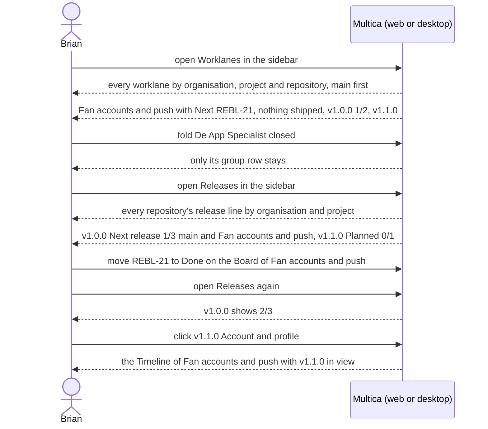

## At a glance

| Kind | Name | Change | Path |
|---|---|---|---|
| Menu | Sidebar: Worklanes and Releases under Work after Organisations | changed | `packages/views/layout/app-sidebar.tsx`, `packages/core/paths/route-icons.ts` |
| Page | Worklanes: every worklane by organisation, project and repository, with what it works on now or takes next and its releases | new | `designs/screens/steer-all-work.pen` (screen 4c) |
| Page | Releases: every repository's unshipped releases by organisation and project, with their progress and worklanes | new | `designs/screens/steer-all-work.pen` (screen 4d) |
| Section | Worklane row: what it works on now, takes next, or "Nothing queued", on a repository card, Projects, an organisation's page and Worklanes | changed | `packages/views/projects/` |
| Config | Reserved workspace segments `worklanes` and `releases` | changed | `server/internal/handler/reserved_slugs.json`, `packages/core/paths/reserved-slugs.ts` |

## Why

Brian wants one overview of what every worklane does and what every repository ships next, across his organisations, without opening each project (brief). UJ-3 to UJ-6 give each worklane its releases, issues and what it works on, but only inside one project's page or one worklane: there is no page across projects, and a worklane row does not say what the worklane is working on.

Success signal: on Worklanes Brian sees under Rebl Records, Rebl and appboypov/rebl the row Fan accounts and push with "Next: REBL-21 A fan changes their display name", "nothing shipped", v1.0.0 with "1/2" and v1.1.0; on Releases he sees v1.0.0 First production release as Next release with "1/3" and the worklanes `main` and Fan accounts and push, and clicking v1.1.0 Account and profile opens the Timeline of Fan accounts and push with v1.1.0 in view.

## What Changes

- The sidebar gets Worklanes and Releases under Work, after Organisations.
- Worklanes lists every worklane, grouped as Projects groups them, by organisation and project, then by repository with its default branch and + Worklane, `main` first. The header counts the worklanes, each organisation shows its worklane count and each project its repository and worklane counts. Each worklane row shows its releases as on Projects, under the heading "Last · Next · Planned releases", and opens the worklane's Timeline.
- Releases lists every repository's unshipped releases in their order on the line, grouped by organisation and project, then by repository with its default branch, under the headings Name, Issues and Worklanes. The header counts the releases, each organisation shows its release count and each project its repository and release counts. Each release row shows its version with Next release or Planned, its title, "Set by hand" when its version was set by hand, a progress bar with "{done}/{total}" over its issues, and the worklanes whose issues are in it, or "No issues yet". A release row opens the Timeline of the first worklane with issues in it, else `main`, with that release in view.
- Both pages show only the organisations, projects and repositories that have something to list, start with every group open, fold organisations, projects and repositories, and open an organisation's or project's page from its name. A repository that does not release shows "This repository does not release" on Releases. With nothing to list they say "No worklanes yet." and "No releases yet."
- Neither page plans, edits or moves a release.
- Every worklane row, on a repository card, Projects, an organisation's page and Worklanes, shows under its name the active issue with its status while the worklane is Busy, "Next: {ID} {title}" for the issue it takes next while it is Free, or "Nothing queued".

## Capabilities

### New Capabilities

- `worklanes-page`: lets Brian see every worklane across organisations with what it works on and its releases, and open its Timeline.
- `releases-page`: lets Brian see every repository's unshipped releases across organisations with their progress and worklanes, and open a worklane's Timeline at a release.
- `worklane-row-work`: lets Brian see on each worklane row what the worklane works on now or takes next.

### Modified Capabilities

None in `specs/openspec/specs/`. This change builds on the unarchived changes `projects-by-organisation` (UJ-1: the Projects tree, its grouping and folding, the Organisations item in the sidebar; its non-goals hand the tree's rows and counts to the journeys that make them, UJ-7 among them), `worklanes-of-a-repository` (UJ-3: worklane rows, + Worklane, worklane counts), `release-line-of-a-repository` (UJ-4: the release line, Next release and Planned, Set by hand, the last and next release on worklane rows), `issues-from-templates` (UJ-5: a release's issues, the next release's progress and the planned releases on worklane rows) and `worklane-board-and-list` (UJ-6: Busy or Free and what a worklane works on now or takes next; its non-goals hand a status change showing on Releases and now or next on Worklanes to this change). `worklane-row-work` adds to the worklane rows of `repository-worklanes` without changing what they already show.

## Impact

- Web and desktop: the sidebar's Work items, the routes and pages Worklanes and Releases, the worklane row on a repository card, Projects and an organisation's page.
- Shared packages: the paths and route icons for Worklanes and Releases; the queries, API client and zod schemas for both overviews; the reserved workspace segments.
- Server: the endpoints that list every worklane with what it works on now or takes next and its releases, and every repository's release line with each release's progress and worklanes.
- Copy in every supported language.

## Constraints

- Worklanes and Releases only list: planning, editing and moving releases, and adding issues to them, stay on the worklane's Timeline (PRD FR-64).
- A worklane row shows the same on a repository card, Projects, an organisation's page and Worklanes.
- What a worklane takes next follows its order, by release and then creation; there is no pick (Brian, 13 October 2026).
- Light mode only.
- AGENTS.md: each new page is wired into both the web routes and the desktop router, reserved segments are regenerated, responses pass zod schemas with `parseWithFallback` and malformed-response tests, no foreign keys or cascades, no compatibility shims, every check local.

## Non-goals

- Shipped releases on Releases: the last shipped release first with Shipped and its ship date, and older shipped releases behind "Show N shipped": UJ-8, which ships a release and so makes them checkable (PRD FR-68).
- Plan release, Edit release, Move earlier, Move later, Remove release and Add issue to release on either page: the Timeline does that (UJ-4, UJ-5).
- Filters, sorting and search on Worklanes and Releases.
- Squads, dark mode and the mobile app.

## Sources

- Intent: [Steer projects, repositories, worklanes and releases in Multica](anytype://object?objectId=bafyreib727ukptyvcfbkud627gjb3cu2lmwsh3u4cjbu4kisjofa25km3u) and its Requests.
- PRD: [Multica: steer projects, repositories, worklanes and releases](anytype://object?objectId=bafyreiew63xw2dncss52jdx4qk4o6aktkklhqroclvs3cvjxcyztx7h5um): UJ-7, F7 with FR-60 to FR-64, FR-70 for now or next, FR-68 and UJ-8 for the shipped parts, the glossary and the non-goals.
- Brief: [Multica: steer projects, repositories, worklanes and releases](anytype://object?objectId=bafyreicccdj6bucv5d65bxvkz4gy7jf7etplsswmwfggupqbakc6rudpmi).
- Earlier changes: `specs/openspec/changes/projects-by-organisation/`, `repositories-of-a-project/`, `worklanes-of-a-repository/`, `release-line-of-a-repository/`, `issues-from-templates/`, `worklane-board-and-list/`.
- Design: [Steer all work screens](anytype://object?objectId=bafyreiauxfhf7w74hwn5je7ljakzxfgo2qv4noid2oshvtqjwkos2v5oiq), screens 4c Worklanes, 4d Releases, 1 Projects and 2 Project in `designs/screens/steer-all-work.pen`, exports in `designs/exports/`; [component library](anytype://object?objectId=bafyreiamoqycfo735krrpmzn3ujhdardv6uixsrdzkadzlodwpr7aenwee); `designs/creation-flows.md` "The model".
- Prototype: [Steer all work prototype](anytype://object?objectId=bafyreieck7zsmzslnfe5asszexojznfbnsnwcg62eqbesqqeigkkzgoclm), revision 460535099583266816: `Sidebar`, `WorklanesPage`, `ReleasesPage`, `ReleaseRow`, `LaneRow`, `ReleaseChain`, `ProjectTree`, `TreeHead` and `OrgHeader` in `prototypes/web/src/components/generated/MulticaSteerAllWorkPrototype.tsx`; `releaseStates` and `laneNow` in `model.ts`. Its picked next issue is superseded by Brian's answer on the UJ-6 Task.
- Current code: Multica's sidebar in `packages/views/layout/app-sidebar.tsx` and `packages/core/paths/route-icons.ts`, its Projects page in `packages/views/projects/components/projects-page.tsx`, the reserved segments in `server/internal/handler/reserved_slugs.json`.
- Brian's design session of 12 October 2026 (`/tmp/brian-design-session-inputs.txt`).
