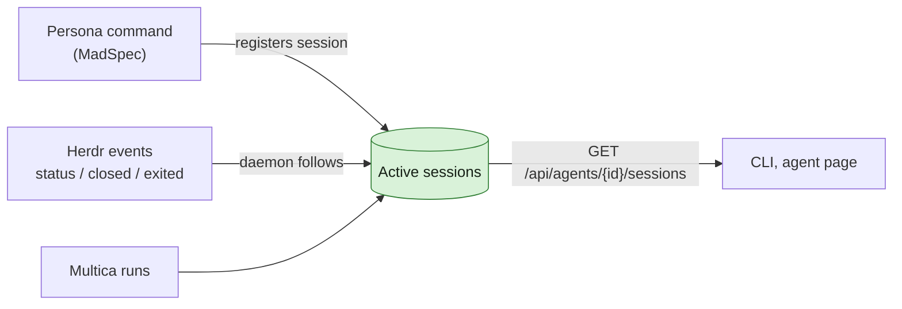

## At a glance

| Kind | Name | Change | Path |
|---|---|---|---|
| Server API | Active sessions of an agent | new | `server/internal/handler/` |
| Daemon | Session follower: register route, Herdr events, sweep | new | `server/internal/daemon/` |
| Spec | `agent-active-sessions` | new | `specs/openspec/specs/` |

This change is the Backend part of WORK-1057 in this repository. It builds on the model `agent-session-model` (WORK-1057). `agent-sessions-cli` (WORK-1088: `multica agent sessions`, `multica agent register-session` and the persona runtime profiles) and `agent-page-sessions` (WORK-1089: the agent page) build on it. The offices, persona commands, Herdr spaces and the agents' use of the list are the change `persona-offices` in `appboypov/madspec`, branch `work-1057`.

## Why

Every persona agent runs on the one shared omp runtime with its skills and model in `custom_args`, and nothing knows which sessions of an agent are active. Multica knows its own runs, Herdr knows its panes, but neither knows which persona a pane is, nor the folder and branch of a run. So two sessions of one agent can work on the same branch without knowing about each other.

Success signal: `GET /api/agents/{id}/sessions` for Mitchel lists every running Mitchel session, in Herdr and in Multica, each with its folder, repository and branch, and a closed pane drops out of that list.

## What Changes

- Multica holds the active sessions of each agent: sessions its persona command registers, and Multica's own runs.
- The daemon follows Herdr's events for those sessions: status, branch, and removal when the pane closes or exits, crashes included.
- The server lists them per agent, for the command line and the agent page that WORK-1088 and WORK-1089 build.

## Capabilities

### New Capabilities

- `agent-active-sessions`: Multica knows and lists which sessions of each agent are active, where they run and on what.

### Modified Capabilities

None.

## Impact

- Server: an API over the model of `agent-session-model`; runs are read from the task queue.
- Daemon: subscribes to Herdr's socket events (`pane.agent_status_changed`, `pane_closed`, `pane_exited`, `pane_moved`).
- The CLI, the agent page and the persona sync are WORK-1088 and WORK-1089.
- Check for the technical design, from Pieter's open points that Brian passed on: Multica runs inherit the daemon's `HERDR_*` variables, so a run must never be matched to the daemon's pane.

## Constraints

- Multica is the one source of which sessions of an agent are active; no log file holds them. This replaces the daily log in the issue description, which Brian dropped on 15 Oct.
- A tag of an agent stays a headless run.
- Tika gets no runtime profile and no runs: she is a member.
- Herdr, Astra, Fable and Haiku keep their runtimes.
- The fork's own rules hold: no foreign keys, zod schemas with `parseWithFallback` at the API boundary.

## Non-goals

- Starting agents in Herdr from Multica: that is the Herdr agent's work, in `persona-offices`.
- A history of ended sessions.
- Runtime profiles of a kind other than omp.

## Sources

- The Multica issue "Persona repos in ~/Repos/Agents" (WORK-1057): Pieter's discovery result (comment of 15 Oct 16:44), Brian's approval with active sessions on each agent's page (comment of 15 Oct 18:30) and Brian's addition of Paul (comment of 15 Oct 18:50).
- No Intent object in Anytype holds this work.
