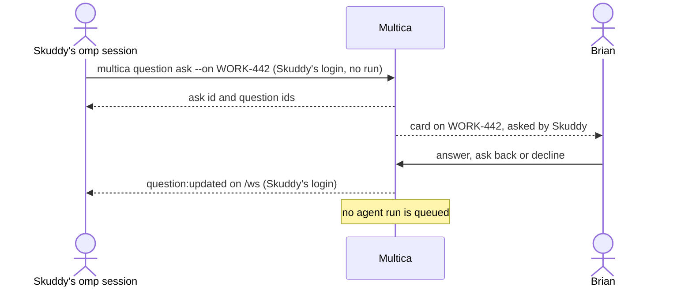

## At a glance

| Kind | Name | Change | Path |
|---|---|---|---|
| Spec delta | questions | changed | `specs/openspec/changes/archive/2026-10-16-ask-a-question-from-outside-a-run/specs/questions/spec.md` |
| Spec delta | agent-question-tooling | changed | `specs/openspec/changes/archive/2026-10-16-ask-a-question-from-outside-a-run/specs/agent-question-tooling/spec.md` |
| Spec delta | agent-wake | changed | `specs/openspec/changes/archive/2026-10-16-ask-a-question-from-outside-a-run/specs/agent-wake/spec.md` |

## Why

Brian's inbox moves from Anytype to Multica: everything he must pass, answer or do becomes a Multica question on the issue of the work. Agents in a Multica run can ask, but an omp session in a Herdr tab works under Skuddy's member login and has no run, so the server refuses its ask with "only agents ask, close or withdraw questions with a task token". This change is step 2 of the passed plan; the omp plugin that hears the answers (step 3) and the skill changes (step 4) build on it.

Success signal: a Herdr omp session runs `multica question ask --on <issue>` with Skuddy's login, the question shows on that issue for Brian with Skuddy as its asker, and Brian's answer reaches that login's `/ws` connection.

## What Changes

- A member login asks a question through `POST /api/questions` and `multica question ask` without a run, on the issue `--on` names.
- The question card, the question set card, the Questions page row, its asker filter and grouping, and Answer all name the member who asked, without a run number.
- The member's `/ws` connection receives `question:updated` for every answer, answer edit, ask back and decline of its questions.
- A question a member asked offers no Wake and queues no run.
- Questions asked in a run keep working as they do, including the wake on answer and on ask back.

## Capabilities

### New Capabilities

None.

### Modified Capabilities

- `questions`: members ask outside a run through the API and CLI, on an issue; the app still offers no way to ask; the card names the member asker; the asker's login hears answers live.
- `agent-question-tooling`: `multica question ask` works with a member login outside a run and needs `--on` with an issue there.
- `agent-wake`: a question a member asked offers no Wake and its answers and ask backs queue no run.

## Impact

- Go server: `server/internal/service/question.go` (ask, run input), `server/internal/handler/question.go` (who may ask), the `question` table (asker columns), `server/pkg/db/queries/question*.sql`, the question list service and handler.
- CLI: `server/cmd/multica/cmd_question.go` help text.
- Web and desktop: `packages/core` question types and schemas, `packages/views/questions` cards, rows, page filter and grouping, Answer all, issue timeline run labels.
- Docs: `apps/docs` question pages, `specs/docs/system-design.md`.

## Constraints

- A question asked in a run keeps its run link, its asking agent and every wake path of WORK-429 (pull request 34).
- The app offers members no way to create a question; only the API and CLI do.
- Machine credentials (`cloud_pat`) cannot ask; an agent asks only with its task token.
- AGENTS.md database rules: no foreign keys, dependents cleaned up in application code.

## Non-goals

- The omp plugin `omp-multica-listen` hearing answers (plan step 3).
- A member closing, withdrawing or adding links to a question it asked; those stay with the asking agent's run.
- Waking any agent from a member's question.
- MadSpec skill changes and the Anytype inbox removal (plan steps 4 to 6).

## Sources

- Issue WORK-442 "Multica fork: ask Brian a question from outside a run" and its parent WORK-435 "Replace Anytype inbox with Multica tasks and questions on Brian that wake the agent on reply".
- Plan Brian passed on WORK-435: [Plan in Plannotator](https://ctas.de-appspecialist.nl/plannotator/session/839bd0f0ab0448dd/), build step 2.
- [PRD: Questions in Multica](anytype://object?objectId=bafyreiaviofipcl3ymgld2skld4ij6hlarsm2ra55ygufsepgk5laxjf34).
