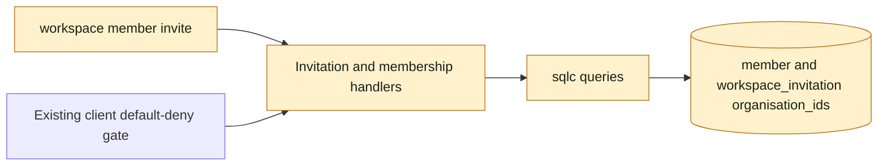
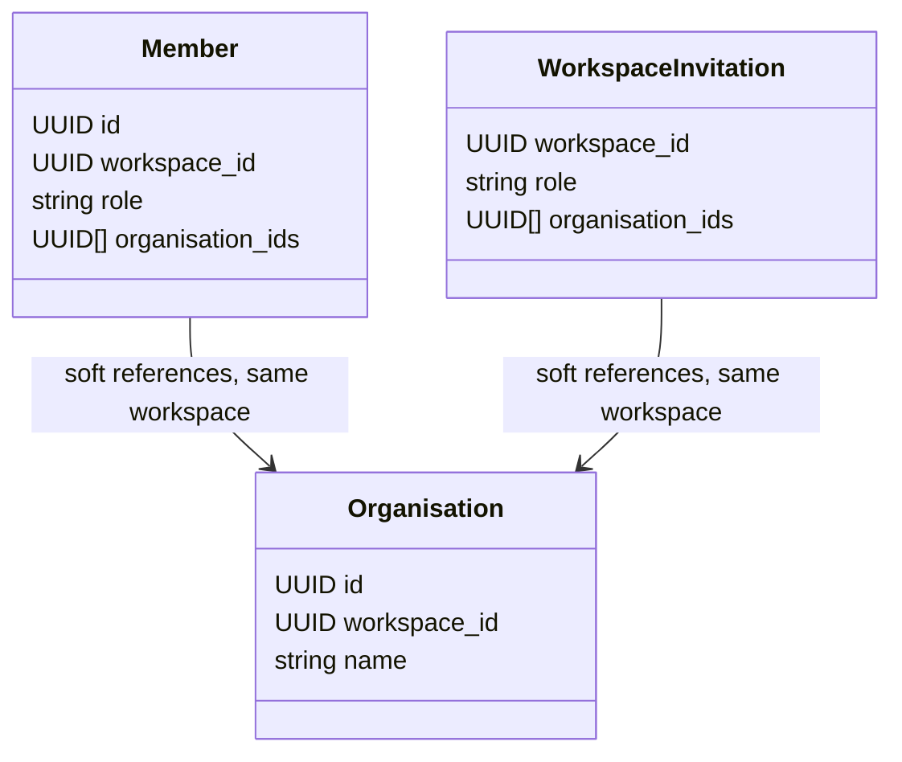

## At a glance

| Kind | Name | Change | Path |
|---|---|---|---|
| Storage | Organisation arrays | new | server/migrations/743_client_organisation_sets.up.sql |
| Queries | Member and invitation persistence | changed | server/pkg/db/queries/member.sql, server/pkg/db/queries/invitation.sql |
| API | Membership validation and responses | changed | server/internal/handler/membership.go, workspace.go, invitation.go |
| CLI | Repeatable organisation flag | changed | server/cmd/multica/cmd_workspace.go |

## Context

WORK-1139 is approved implementation of parent R1. Migration 732 stores one nullable UUID and enforces role/binding parity. `membershipOrganisation` validates writes; `UpdateMember` serializes account membership changes with `LockUserForMembership`. Invitation acceptance already uses a transaction and preserves capacity/onboarding/revocation behavior. `ListMyMemberships` currently joins one organisation. ADR-0017 keeps clients on session-only routes; opening client reads is not this change.

The checkout is the issue-provided lane main worktree on branch `work-1139`; pre-existing `AGENTS.md` and `.omp/` changes are runtime-owned and must be preserved.

## Goals / Non-Goals

Always retain every selected same-workspace organisation, refuse an empty client write, expose all organisations, and preserve one contact membership. Never open a client data route, change account admission, add UI, change assignment, or install/release this work.

## Decisions

### Storage

Use `organisation_ids UUID[] NOT NULL DEFAULT '{}'` on `member` and `workspace_invitation`. These small, row-owned sets are written atomically with their row; no reverse-organisation query is introduced, so a join table and indexes add no value here. Check constraints require at least one UUID for clients and empty arrays for staff; handlers validate UUIDs, deduplicate and enforce workspace ownership. No single-organisation columns remain. Existing nullable single UUIDs migrate to singleton arrays or empty staff arrays.

Organisation deletion keeps soft references, as it does for other organisation-bound resources. Read projections intersect the stored array with organisations of the same workspace. Thus deleting one organisation leaves the others visible, and deleting all yields no valid workspace binding. The existing default-deny gate remains closed regardless of cached membership existence. Current-membership discovery shows `organisations: []` when none remain, rather than fabricating access. Acceptance copies only surviving organisations and refuses when none survive.

### Published API contract

- `POST /api/workspaces/{id}/members`: `{ "email": "contact@example.test", "role": "client", "organisation_ids": ["A_UUID", "B_UUID"] }`.
- `PATCH /api/workspaces/{id}/members/{memberId}`: `{ "role": "client", "organisation_ids": ["B_UUID", "C_UUID"] }`. This replaces the complete set, providing add/remove through the existing endpoint. `[]`, missing/null for client writes, malformed UUIDs and foreign-workspace IDs return 400 without mutation. Staff writes omit the field or supply `[]`; non-empty staff sets return 400.
- Every member and invitation response carries `organisation_ids: string[]`, empty for staff. Responses project only still-valid same-workspace organisations. Membership-update and invitation-accept events use the same member shape.
- `GET /api/me/memberships`: each row has `organisations: [{ "id": "UUID", "name": "Name" }]`, empty for staff or no surviving organisation. Remove singular `organisation`.
- Accept with no surviving organisation returns 409 and leaves invitation pending with no membership. A partially surviving invitation creates one membership containing every survivor.
- Responses use deterministic UUID order. Input duplicates are one set entry.
- CLI: `multica workspace member invite contact@example.test --role client --organisation a --organisation b`. Each flag accepts a key or UUID. Resolve keys in one list request; deduplicate resolved IDs; send `organisation_ids`. JSON output is the API response; text output lists all organisation IDs. Staff flag usage remains refused.

These plural fields replace singular fields without aliases. Existing consumers not exposing organisation bindings keep their current behavior; changing client-role UI parsing belongs to WORK-1072.

## Migration plan

Apply migration 743 before starting the server. Copy bindings into arrays before dropping the old columns and their checks. Down migration restores the first UUID only and therefore loses additional bindings; rollback requires explicit acceptance of that loss. Keep migration test coverage for both memberships and pending invitations created before 743. Regenerate with `make sqlc`.

## Risks / Trade-offs

UUID arrays have no per-element foreign keys, consistent with repository rules. Every write stays behind handler validation and account locks. Organisation deletion can leave soft IDs in storage; responses and acceptance filter them, and default deny prevents access. Downgrade cannot represent multiple organisations. Existing installed clients ignore added arrays; staff management screens are delivered by WORK-1072.

## Verification

Run targeted handler, router/default-deny, middleware, realtime, migration and CLI tests with a disposable PostgreSQL database. Smoke the actual CLI and HTTP flow for A/B acceptance, C addition, A removal, empty refusal, deletion and all-deleted acceptance. Do not use production data or real agent executables.
