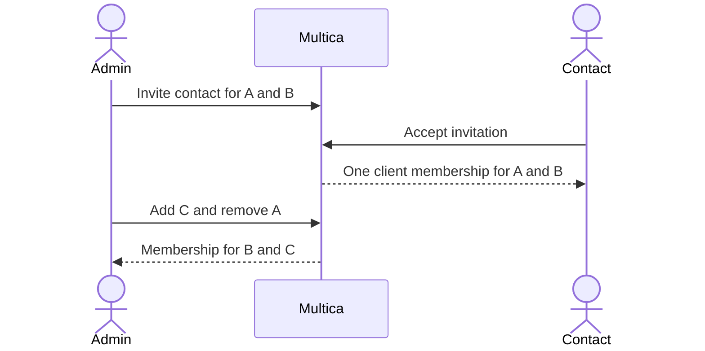

## At a glance

| Kind | Name | Change | Path |
|---|---|---|---|
| Capability | Client organisation sets | changed | specs/openspec/specs/client-membership/spec.md |

## Why

One client contact works for several organisations. Keeping one organisation per membership prevents that contact from using one account for their work. Success is one client membership that retains B and C after accepting A and B, adding C and removing A, without changing any default-deny rule.

## What Changes

- Memberships and invitations hold organisation sets; existing bindings become singleton sets.
- Owner/admin invitations accept one or more organisations through the API and repeatable CLI `--organisation` flags.
- Owners/admins replace the set to add or remove organisations, but cannot remove its last entry.
- Acceptance retains only invited organisations that still exist and refuses an empty result.
- Membership, member and invitation responses show the complete organisation set.
- **BREAKING**: single-organisation request/response fields and database columns are replaced by plural fields.

## Capabilities

### Modified Capabilities

- `client-membership`: one client contact belongs to one or more organisations of its workspace.

## Impact

PostgreSQL migration, sqlc queries and generated models; membership/invitation handlers and their callers; CLI invitation command and docs; client membership regression fixtures. Existing shared frontend schemas do not expose organisation bindings; staff screens and client reads remain separate stories.

## Constraints

- No foreign keys or cascading operations.
- Existing default deny, one-membership client account restriction, no-upgrade rules, assignment and revocation behavior remain intact.
- Staff memberships and invitations have no organisations.

## Non-goals

Client reads (WORK-1071), staff screens (WORK-1072), assignee filtering, new UI or production releases.

## Sources

- WORK-1139 description and verify scenarios.
- WORK-1059 updated plan approval, comment 01a144b8-e01d-7b17-a971-55e2e6d197b2.
- Existing `specs/openspec/specs/client-membership/spec.md`.
