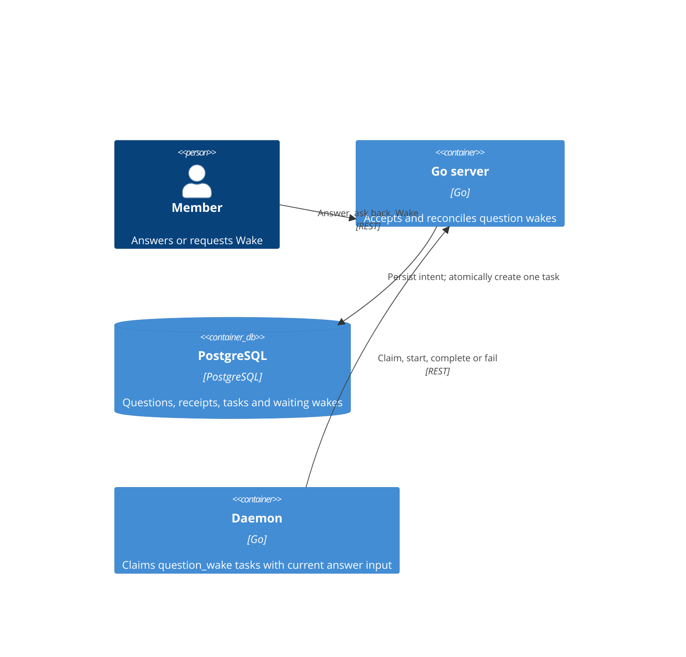
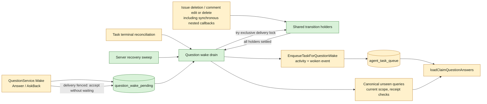
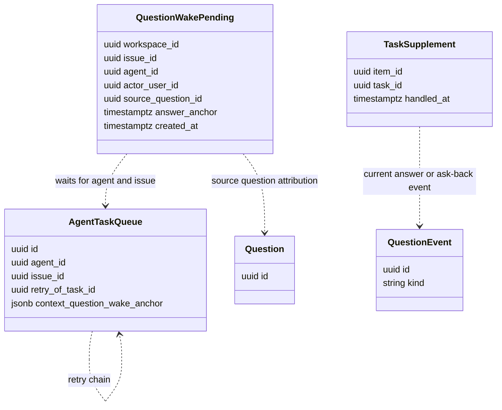

## At a glance

Delta against [the existing system view](../../../../docs/system-design.md). Web, desktop, mobile and daemon containers keep their entry points; scheduling changes inside the Go server.







```mermaid
sequenceDiagram
  actor Member
  participant Q as QuestionService
  participant DB as PostgreSQL
  participant T as Task lifecycle
  participant D as Daemon
  Member->>Q: Answer with Wake, Wake, or ask back
  Q->>DB: Lock issue; persist one waiting intent
  Q-->>Member: Accepted; no task queued yet
  T->>DB: End task and settle retry or successor
  T->>Q: Reconcile waiting wake after terminal side effects
  Q->>DB: Lock issue; no blockers; re-read unseen input
  alt Unseen input remains and agent is available
    Q->>DB: Insert task, activity and woken event; delete intent; commit
    Q->>D: Notify task queued
    D->>Q: Claim task
    Q->>DB: Load latest input using carried answer anchor
    Q-->>D: Answers and ask-backs still unseen
  else Every item was handled
    Q->>DB: Delete intent; commit without task
  end
```

| Kind | Name | Change | Path |
|---|---|---|---|
| Persistence | Waiting wake intent | new | `server/migrations/745_question_wake_pending.up.sql`, `server/migrations/745_question_wake_pending.down.sql` |
| Queries | Waiting intents | new | `server/pkg/db/queries/question_wake_pending.sql` |
| Queries | Unseen input and task/retry persistence | changed | `server/pkg/db/queries/question.sql`, `server/pkg/db/queries/question_reach.sql`, `server/pkg/db/queries/agent.sql` |
| Service | Wake acceptance and drain | changed | `server/internal/service/question.go`, `server/internal/service/question_audience.go`, `server/internal/service/task.go` |
| Service | Waiting-wake reconciliation and transition guards | new | `server/internal/service/question_wake_pending.go`, `server/internal/service/question_wake_transition.go` |
| Lifecycle | Terminal handling, enclosing deletion/replacement and claim input | changed | `server/internal/handler/daemon.go`, `server/internal/handler/issue.go`, `server/internal/handler/comment.go` |
| Composition | Task drainer wiring | changed | `server/internal/handler/handler.go` |
| Recovery | Waiting-wake sweep and composition | new | `server/cmd/server/question_wake_reconciler.go` |
| Composition | Recovery registration | changed | `server/cmd/server/main.go` |
| Client contract | Accepted wake without a queued task | changed | `packages/core/types/question.ts`, `packages/core/api/schemas.ts` |
| Documentation | Wake lifecycle and structure | changed | `CLI_AND_DAEMON.md`, `specs/docs/system-design.md` |

Generated SQL bindings and behavioral tests are included in the task groups below; they are not separate runtime components.

## Context

### Failure and evidence

The issue reports the same failure on 16 October 2026: WORK-997 answered around 14:35 and its run ended at 15:02 without reading it; WORK-456 and WORK-448 ended around the time of their answers without follow-up runs; WORK-1157 did not start from `wake: true`. These are reported reproductions, not newly executed experiments.

The code explains the loss: `QuestionService.Wake` locks the issue, then returns `ErrDuplicatePendingTask` when `HasActiveQuestionWakeTask` finds a queued, dispatched, running or waiting-local-directory task (`question.go:987-998`). `Answer` and `AskBack` commit their mutation, call Wake and only log its refusal (`question.go:729-735,758-760`). There is no persisted wake intent to revisit after the task ends. Live input delivery does not replace that intent.

### Code map and ownership

- Backend team, lead Joeri: all implementation groups. Internal persistence, services, terminal integration and the existing HTTP response parser form one bug-fix pull request. No new public model, screen or independent package capability is introduced.
- Reuse `WakeScope`, `countUnseenAnswers` and the queries in `question.sql`; scope follows the live question links and parent tree (`question_audience.go`, `question_reach.sql`).
- Reuse `TaskService.EnqueueTaskForQuestionWake` (`task.go:1448-1462`) and the task/activity/question-event transaction from Wake. Publish and notify only after commit.
- `loadClaimQuestionAnswers` (`handler/daemon.go:3727-3784`) fetches current answers, not enqueue-time snapshots; preserve that behavior.
- `CompleteTaskWithTransition`, `FailTaskWithTransition`, `CancelTaskWithResult` and `HandleFailedTasks` are the terminal paths. Daemon completion/failure reconciles comments before `NotifyTaskFinished`; failure may create a retry in the terminal transaction. Sweeper failures may decide retries after the terminal write.
- The pending-task unique index is per issue, agent and thread and does not cover running tasks or ordinary deferred retries (`452_agent_task_pending_thread_unique.up.sql`). It is a last insert arbiter, not the whole active-work invariant.
- Existing service, handler and SQL tests use real PostgreSQL fixtures. Extend those suites, not mock service echoes.

## Goals / Non-Goals

**Always:** persist an accepted waiting wake; coalesce by workspace, agent and issue; preserve explicit opt-in, the current question scope, fresh claim input, attribution and receipt-based handled checks. Start a wake only when there is no active task or pending retry for that agent on the issue. Apply one shared wake path to all three entry points.

**Never:** create a second agent task merely to represent the wait; treat delivered or seen as handled; emit a woken timeline entry before a task exists; enqueue for an answer with Wake unchecked; wake a member question; change comment or issue-change follow-up rules, card visibility, daemon protocol or agent prompt rendering.

## Decisions

### Persist intent, not a queued task

Add `question_wake_pending` with primary key `(workspace_id, issue_id, agent_id)`, the initiating member and source question, the pre-wait answer anchor and creation time. Use PostgreSQL transactions and the existing issue lock; no foreign keys, per repository convention. Repeated requests retain the earliest anchor and the first accepted member/source for deterministic attribution. The eventual run includes the whole current Wake scope, not just the triggering card. No answer payload is copied into this table.

Resolve the target before taking write locks, then use one lock order in immediate Wake and draining: issue, pending intent, source question. Re-read target eligibility under those locks. This avoids reversing Wake's source-question lock against the drain's issue lock.

Wake validates membership, target scope and initial agent availability as today. Under the issue lock, a blocked request upserts the intent and returns HTTP 202 with `task_id: ""` and the current `answer_count`; no task ID is fabricated. Immediate Wake keeps its existing nonempty task ID. The shared TypeScript schema accepts both string values, and the field comment states that empty means accepted but not queued. No extra UI state or response field is needed.

### One transactional drain

Under the same issue lock, re-read the intent and blockers. Keep the row while work blocks it. Once idle, recompute current scope, answer count and ask-backs, subtracting handled event receipts. If none remain, delete the row without a task. Otherwise call the existing enqueue path and write the attributed activity and `woken` event in the same transaction that deletes the intent. Preserve question status. Duplicate insert conflicts roll back the transaction and retain the intent for the next drain; unexpected database failures are logged and remain errors, not successful consumption.

An archived agent or one without a runtime starts no task. Keep the unanswered input and the intent; availability checks remain authoritative. A deleted target or source that cannot supply valid scope is retired without creating orphan tasks. Ordinary card availability rules are unchanged.

### Preserve accepted input through intervening claims

The canonical unseen queries use the latest started task's claim time and exclude the claiming wake task's retry chain. Reusing that moving cutoff alone loses an answer when an ordinary retry starts before the drain. At the first accepted waiting wake, store the current claim cutoff (`-infinity` when none) as `answer_anchor`. Coalescing never moves it forward. Carry it into the created task's existing JSONB `context.question_wake_anchor`; `CreateRetryTask` already copies context. No task column or wire field is added.

For an accepted waiting wake, the effective cutoff is the greater of that stored anchor and the latest claim time of a subsequently started `question_wake` task, excluding the task being hydrated and its retry ancestors. Such a task actually received question input; an ordinary retry did not. This prevents a second run when a question-wake task that was already queued received all the input at claim. Input after that claim remains unseen. Use one effective-cutoff calculation for card counts, drain counts and claim payloads. Non-waiting Wake keeps its current cutoff calculation. Handling and live question scope retain their existing definitions.

For ask-backs, exclude an event with an `answer`-kind receipt whose `handled_at` is set for this agent, just as answers exclude their current answer event. Editing an answer after handling still creates an unseen current event. The anchor carries selection history, not a snapshot of answer text.

### Terminal ordering and recovery

Wire a narrow `QuestionWakeDrainer` interface into the existing `TaskService` from `handler.New`, alongside the existing service composition. Invoke it from `NotifyTaskFinished` and its bulk counterpart `notifyTasksFinished`, once per agent/issue pair. Daemon completion/failure already calls those after `reconcileCommentsOnCompletion`; bulk orphan recovery calls them after `HandleFailedTasks` has made its retry decisions. Do not enqueue from inside `SettleTerminalTaskState`.

`QuestionService.BeginQuestionWakeTransition` brackets issue single/batch deletion and comment edit/delete cancellation, replacement and failure recovery. It holds shared transaction-scoped advisory locks without locking issue rows needed by the enclosing writes. Synchronous subscribers can enter nested lifecycle operations while every enclosing holder continues to fence delivery. Wake consumption tries the exclusive counterpart before issue, pending and question row locks; it never waits on a transition or another delivery. Explicit Wake persists or coalesces acceptance without consuming while fenced; terminal callbacks and recovery retain the intent. Each deferred finish releases its holder and drains affected waiting pairs; consumption succeeds only after every holder settles, even if a request context was cancelled. Deleted targets are retired; replacement tasks keep the wait blocked. Connection loss releases the holder so the durable recovery sweep can resume.

Queued, dispatched, running and waiting-local-directory tasks block. Deferred retry children also block; do not widen unrelated comment dedup queries. Before draining, settle any failed tail task belonging to this wait whose retry decision could still be outstanding: it completed after the intent was accepted, passes the existing `retryEligible` policy, has no retry child, and has no later successor in its thread in any state. Reuse `MaybeRetryFailedTask`, not a second retry policy. Serialize its parent-row read and child check in the retry transaction, including the existing failure path, so concurrent recovery cannot create duplicate deferred retries. Then re-read blockers under the wake's issue lock. Historical failures and superseded tasks are never retried by the wake drainer.

At server startup and every 30 seconds, use the existing `runPeriodicSweep` lifecycle to visit bounded batches of durable waiting rows and call the same drain. This covers restart and a crash between terminal commit and notification. A recovery drain first runs the same tail-retry settlement above, so it cannot mistake the post-commit orphan-retry gap for an idle agent. Retain the intent on settlement or enqueue errors.

## Risks / Trade-offs

- A moving claim cutoff silently defeats the retry acceptance scenario. The stored anchor is required; the existing task context carries it through retries.
- A callback before retry settlement can steal the retry's slot. Block unresolved retries and drain after settlement, including orphan/sweeper paths.
- PostgreSQL's pending-task index does not protect against every running-task race. Recheck under the issue lock; preserve existing task enqueue arbitration and keep the intent on a collision.
- The existing ADR directory reuses IDs 0004, 0005, 0006, 0007 and 0021. Review refers to full paths as well as IDs; renumbering accepted ADRs is outside this bug.

## Migration Plan

Apply migration 745 before code that reads waiting wakes. It creates no backfill: only accepted requests create intents. Regenerate sqlc bindings. Existing tasks have no context anchor and use the existing claim rules. Roll back application code before dropping the table; outstanding waiting intents would be discarded by a database rollback. No runtime flag or deployment task is added.
