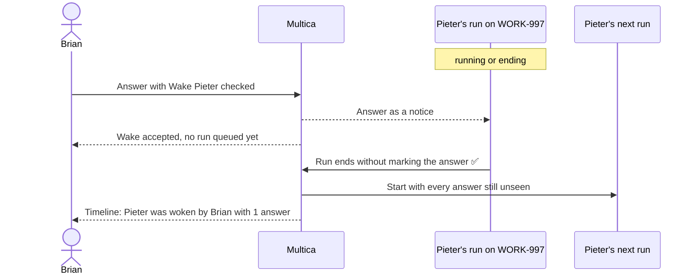

## At a glance

| Kind | Name | Change | Path |
|---|---|---|---|
| Capability | Agent wake | changed | specs/openspec/specs/agent-wake/spec.md |
| Capability | Live run input | changed | specs/openspec/specs/live-run-input/spec.md |

## Why

A Wake that arrives while the agent still has a task on the question's issue is refused with 409 "agent already has a pending task on this issue", and an answer sent with `wake: true` drops that refusal into a log. When the agent's run is already ending, it never reads the answer and no later run starts, so the agent blocks again on a question Brian already answered. On 16 October 2026 this stalled WORK-997 (Pieter), WORK-456 and WORK-448 (Sarkout) and WORK-1157 (Mitchel) until someone pressed Wake by hand.

Success signal: Brian answers Pieter's question on WORK-997 with **Wake Pieter** checked while Pieter's run there is ending; that run ends without marking the answer ✅, and a new run of Pieter on WORK-997 starts with the answer, with nobody pressing Wake.

## What Changes

- A Wake, an answer sent with Wake, and an ask back no longer fail while the woken agent has a queued, dispatched or running task on the issue: the wake waits until the agent has none left there.
- When the agent has no task left on the issue, one woken run starts with every answer and ask-back that agent has still not seen; with nothing unseen, no run starts.
- `wake: true` on an answer and `POST /api/questions/{id}/wake` behave the same.

## Capabilities

### Modified Capabilities

- `agent-wake`: a wake that arrives while the agent works on the issue starts its run once that work ends, instead of being refused.
- `live-run-input`: an answer given to a running run queues no run while that run runs, leaving the waiting wake its start after the run.

## Impact

`server/internal/service/question.go` (`Answer`, `AskBack`, `Wake`), the place where a task on an issue ends, the question wake queries and tests in `server/internal/service` and `server/internal/handler`. The `POST /api/questions/{id}/wake` response while the agent has an active task changes from 409 to accepted.

## Constraints

- An answer sent without Wake still starts no run, also after the agent's active run ends.
- The agent never has the waiting woken run and another task on the same issue at the same time: one task per agent per issue.
- A waiting wake survives a server restart until the agent's tasks on the issue end.
- Unseen keeps its current meaning: given since the claim of the agent's latest started run on the question's links, minus answers it marked ✅ in a run that received them.
- A member's question still wakes no agent.

## Non-goals

- Where and when the cards and Answer all offer **Wake** while the agent runs.
- How a running run receives answers and ask-backs as notices.
- Follow-up runs for comments and issue changes.

## Assumptions

- An ask back gets the same waiting wake as an answer: it runs through the same wake and stalls the same way.
- When the agent can no longer be woken once its tasks end, such as when it is archived or has no runtime, no run starts and **Wake** stays available.

## Sources

- WORK-1177 description: the 16 October 2026 cases and the acceptance.
- WORK-1177 comment 01a1455b-1bb7-7dd3-b5e4-dc098fca97a4 (Joeri): the refusal at `server/internal/service/question.go:993-998` and the logged failure at `question.go:729-735`.
- Existing `specs/openspec/specs/agent-wake/spec.md` and `specs/openspec/specs/live-run-input/spec.md`.
