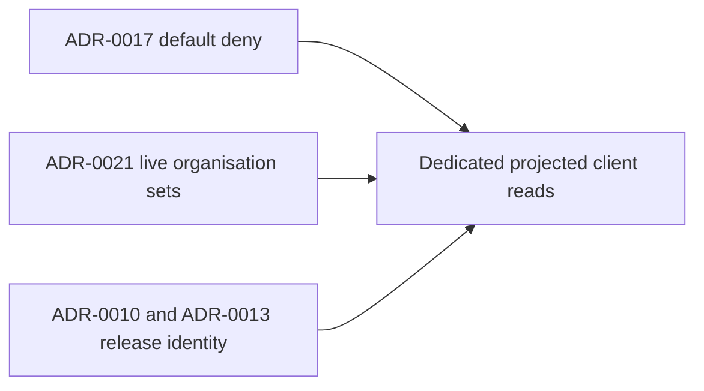

# ADR Review Manifest

- Status: completed
- Review date: 2026-10-16

## At a glance

| Kind | Name | Change | Path |
|---|---|---|---|
| Review | Client read architectural constraints | new | `specs/openspec/changes/organisation-scoped-client-reads/adr.md` |

## Review Summary

ADR review completed for this change. Every repository ADR was read. The highest sequence is 0021. The supersession links are ADR-0006 (repositories) to ADR-0004 (organisations), and ADR-0020 to ADR-0003; ADR-0011 amends ADR-0008's read. Reused numeric prefixes are disambiguated by file name and subject, not silently applied to the unrelated question records.

The design applies existing boundaries: a route opens only by explicit session-list entry; organisation scope is the live membership set intersected with same-workspace rows; release context is reached through the issue's release ID and repository/project chain. ADR-0016 concerns staff overview pages, not authority to let clients download full workspace lists. The new DTOs and exact route names are this change's implementation contract, not a replacement architecture or a new stored model. Accepted ADRs remain unchanged.

## In-Force ADRs Reviewed

Constraints directly relevant to the design:

- `adr/0006-repositories-hold-worklanes.md`: workspace/organisation/project/repository ownership and soft references.
- `adr/0010-the-server-keeps-each-repositorys-release-line.md`: release version, line and shipped state.
- `adr/0012-the-server-holds-the-issue-templates-and-a-type-is-set-once.md`: `chore` type identity.
- `adr/0013-an-issue-is-placed-in-a-worklane-and-a-release-under-the-repositorys-lock.md`: live release IDs, including closed work whose worklane was removed.
- `adr/0014-a-worklanes-issues-work-in-its-worktree-on-their-own-branch.md`: existing main-lane issue branch and lane-order ownership.
- `adr/0015-the-database-keeps-an-issues-done-date.md`: custom status categories; this change writes neither status nor done dates.
- `adr/0016-the-worklanes-and-releases-pages-are-built-from-the-workspaces-lists.md`: staff overview scope remains unchanged.
- `adr/0017-a-client-account-is-refused-outside-the-session-list.md`: default deny and the sole membership of a client account.
- `adr/0021-client-memberships-hold-organisation-sets.md`: live plural organisation bindings and survivor-only projection.

Other in-force records reviewed and unaffected: runtime-machine reads (0001), question aggregate (0002), question sets (0004), stored-but-unseen project fields (0005), claim-time questions permission (0005), viewer-scoped questions (0006), read-time question parents (0007), daemon-recorded worktrees (0007), activity log (0008), worktree folder separation (0009), worklane activity time bounds (0011), run-input receipts (0019), and unseen answers/Wake (0020).

## New Durable ADRs Created

None. No major durable architectural decisions were introduced and no new repository-level ADR files were created. The design extends ADR-0017's intended narrow-read path and ADR-0021's organisation-set contract without superseding either.
