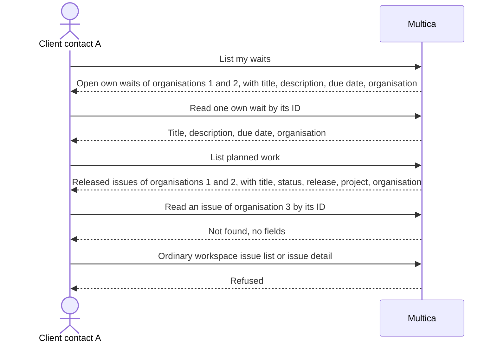

## At a glance

| Kind | Name | Change | Path |
|---|---|---|---|
| Capability | Client reads | new | specs/openspec/specs/client-reads/spec.md |
| Capability | Client default deny | changed | specs/openspec/specs/client-default-deny/spec.md |

## Why

A client contact still sees nothing after login: the default-deny session list (WORK-1069) serves no workspace data, so the waits on their name and the plan of their organisations stay out of their reach. WORK-1139 lets one contact belong to several organisations, so the reads must cover each of them and say which organisation a row belongs to. The client screens (WORK-1073) and their approved mock wait on this server contract.

Success: contact A of organisations 1 and 2 logs in and the API returns A's open waits with their details and the released work of both organisations, each row naming its organisation, while organisation 3's work, another contact's wait details and every private field stay out of every list, count and direct-ID response.

## What Changes

- New client read routes: list own waits, read one own wait, list planned work. They return only the approved fields.
- An own wait is an open `chore` labelled `Client wait`, assigned to the contact, in a project of one of the contact's organisations; it needs no release.
- Planned work is every issue on a release in a project of one of the contact's organisations.
- Every row names its organisation; planned work also names its project and release, so the client groups rows without workspace project, release or member records.
- Visibility is decided on the server at read time, before pagination and counts; caller-supplied identifiers and filters cannot widen it.
- The session list of `client-default-deny` gains exactly these read routes. Every ordinary workspace issue, project and release route stays refused for clients.

## Capabilities

### New Capabilities

- `client-reads`: a client contact reads their own open waits and the planned work of every organisation they belong to, with only the approved fields.

### Modified Capabilities

- `client-default-deny`: the session list includes the client read routes; ordinary workspace reads and direct-ID routes stay refused.

## Impact

Server: client read handlers and their sqlc queries, the client session-list allow-list in the router, client read regression tests. API: new client read responses, separate from `IssueResponse`, published for the frontend story. Unchanged: staff issue, project and release handlers and their response shapes; live updates; shared frontend packages (WORK-1073 consumes the contract).

## Constraints

- The server decides record and field visibility; no endpoint returns a full record for the browser to hide.
- Client responses have their own shape; the ordinary issue response does not carry empty or nulled private fields for clients.
- No comments, Points or custom properties, agent runs, attachments, source context, metadata, issue key, assignee or member records in any client response.
- Visibility follows the current membership, assignee, labels, type, status and release placement on each read; nothing is cached per client.
- Default deny stays: a route reaches a client only when it is on the session list (ADR 0017).
- Staff routes, permissions and response shapes stay as they are.
- No foreign keys, no cascades, concurrent indexes in their own migration (AGENTS.md).

## Non-goals

Client writes, comments or live updates; client screens and navigation (WORK-1073); staff invitation, organisation and assignee-picker controls (WORK-1072); Brian's wait overview (WORK-1074); a client view of work without a release; the mobile app.

## Sources

- WORK-1071 description, Verify and Packet.
- WORK-1059 plan (R2, R3, R4, Boundaries) and its approvals: Pit's Settled comment 01a14060-6be5-7f06-8e2b-67e039b0a243 and the updated plan approval 01a144b8-e01d-7b17-a971-55e2e6d197b2.
- Approved mock: `designs/screens/client-access.md`, screens 5, 6, 7a, 7b and 8.
- `specs/openspec/specs/client-default-deny/spec.md`, `specs/openspec/specs/client-membership/spec.md`, `adr/0017-a-client-account-is-refused-outside-the-session-list.md`, `adr/0021-client-memberships-hold-organisation-sets.md`.
