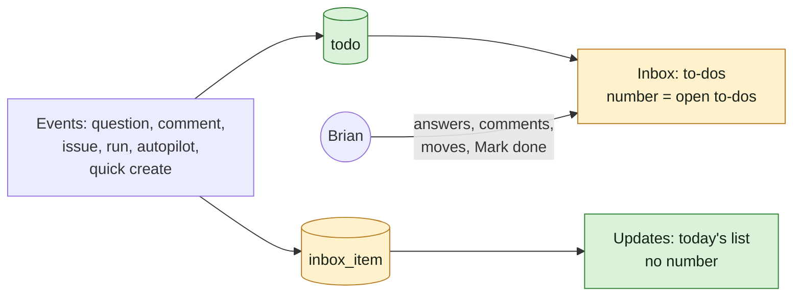

## At a glance

| Kind | Name | Change | Path |
|---|---|---|---|
| Table | `todo`: one row per to-do of a member | new | `server/migrations/` |
| API | `GET /api/todos`, `GET /api/todos/summary`, `POST /api/todos/{id}/done` | new | `server/internal/handler/todo.go` |
| Events | `todo:opened`, `todo:closed` to the member | new | `server/pkg/protocol/events.go` |
| Logic | Opens and closes to-dos from events | new | `server/internal/todo/`, `server/cmd/server/todo_listeners.go` |
| Notices | Question, mention, failed run, autopilot, quota and quick create notices become to-dos | changed | `server/cmd/server/notification_listeners.go`, `server/internal/service/` |
| Creator | An agent's issue in a run or quick create gets the member the run works for as creator | changed | `server/internal/handler/issue.go` |
| Page | Inbox lists to-dos; Updates holds today's list | changed | `packages/views/inbox/` |

## Why

The inbox lists every update on the issues Brian follows, and an item stays until he archives it. The few items that ask something of him drown in the rest, and stay after he handled them. Brian wants an inbox of only what waits for him, that empties itself as he acts (WORK-449).

Success signal: Brian opens Inbox and sees only what waits for him, with overdue rows first. He answers a question, comments on a mention, and moves an issue out of In Review; each row leaves at once and the Inbox number drops. Status changes and new comments on issues he follows show under Updates, as today's inbox does.

## What Changes

- A to-do is something that waits for a member to act. It shows only while it does, and leaves by itself once handled. The member can also mark it done.
- Kinds: a question or approval asked of the member; a comment that @mentions them; an issue assigned to them in Todo, Blocked or In Review; an agent blocked or a failed run on work done for them; a paused autopilot, a reached quota limit or a failed quick create; an issue they created that is In Review.
- One row per to-do, also when several are on the same issue. An In Review issue with an open question for the member shows only the question. Order: overdue first, then newest.
- The Inbox number counts the open to-dos. The workspace switcher dot and the desktop badge follow it.
- Updates is today's inbox list, without the notices that became to-dos, and with no number.
- An issue an agent creates in a run or a quick create gets the member the run works for as its creator. The issues made that way before get that member too.

## Capabilities

### New Capabilities

- `todo-inbox`: the to-dos of a member, when each opens and leaves, Mark done, order and count.
- `issue-creator`: who becomes the creator of an issue an agent makes for a member.

### Modified Capabilities

- `question-inbox`: a question reaches its answerer as a to-do, no longer as an inbox notice.

## Impact

- Server: new `todo` table and queries, `internal/todo`, a listener file, three endpoints and two events. Notice creation for the moved types stops. Migrations open the current to-dos, archive the moved notices and fix the creator of existing agent-made issues.
- Clients: web and desktop Inbox and a new Updates page, on the new endpoints and events. The phone app is out of scope.
- Brian follows the agent-made issues as their creator, so his creator notification settings apply to them instead of the delegated ones.
