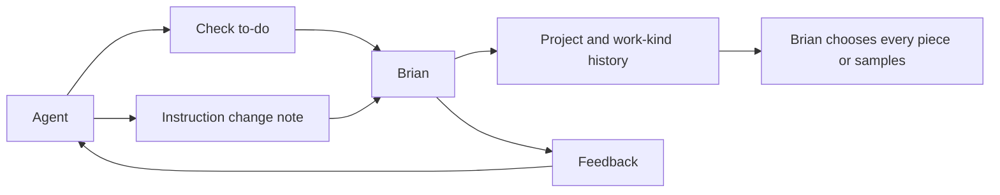

# Work checks and project records

## At a glance

## Why

Brian checks work in his to-do inbox. The record helps him decide which kinds of work need every piece checked and which need samples. Only Brian changes that choice.

## What

- Agents open checks through the API and CLI with an issue, project, work link and kind.
- Brian answers pass or feedback. The answer reaches the opening agent.
- Keep the passed and feedback record, including history, per project and kind.
- Brian switches a kind to samples or back to every piece from its record in the app. Every fifth piece is sampled. Answers never change the mode.
- Feedback asks the opening agent to fix the piece and change the instruction that caused it. The agent posts an instruction change note with the file, summary and commit link. Brian can Keep it or ask that agent to Undo it and report back.
- Releases always need Brian's check.

## Scope

Backend and CLI on `todo-inbox`. Shared web and desktop UI on `todo-inbox-frontend`, with the backend branch as a dependency. No issue status or live workspace changes.
