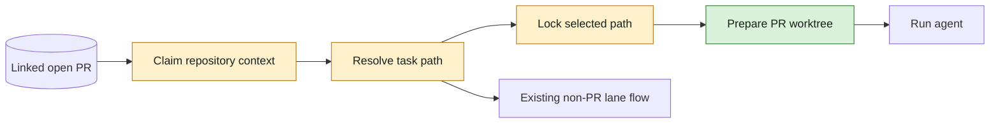
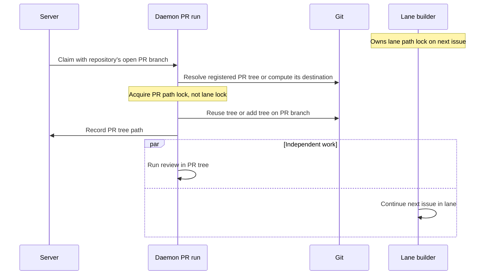

## At a glance

| Kind | Name | Change | Path |
|---|---|---|---|
| Contract | ClaimWorklane open PR branch | changed | server/pkg/protocol/messages.go |
| Handler | claimWorklane | changed | server/internal/handler/worklane_branch.go |
| Handler tests | Repository-scoped PR claim | new | server/internal/handler/worklane_branch_test.go |
| Daemon | worklaneTaskPath / prepareWorklaneTask | changed | server/internal/daemon/worklane_task.go |
| Locking | acquireIssueWorktreeLocks | changed | server/internal/daemon/issue_worktree.go |
| Git helper | PR branch worktree preparation | new | server/internal/daemon/execenv/pull_request_worktree.go |
| Regression tests | Concurrent lane and PR tasks | changed | server/internal/daemon/worklane_task_test.go |
| Documentation | Issue worktree behavior | changed | CLI_AND_DAEMON.md |
| System map | Daemon worktree node and edges | changed | specs/docs/system-design.md |

## Context

WORK-1201 reports a verifier on WORK-1016 waiting behind the builder of WORK-1027 in the Asset dashboard lane, plus seven AMD issues waiting for verification. This is the supplied failure evidence, not a locally repeated production incident.

The code establishes the missing case:

- `worklane_task.go:24-40` asks Git for the issue branch's registered worktree. Only a path named `.pull-requests/<issue branch>` wins; otherwise it returns the lane path. It neither knows that a PR is open nor makes a missing PR worktree.
- `issue_worktree.go:89-129` takes that path's lock before preparation. A missing PR tree therefore queues behind the lane even when the issue branch is free.
- `daemon.go:5797-5805` correctly orders selection/locking before preparation and execution. Preserve this order.
- `ClaimRepository` and `ClaimWorklane` in `protocol/messages.go:546-567` do not carry open PR context. `handler/worklane_branch.go:184-251` attaches the lane and enforces its daemon gate.
- `ListPullRequestsByIssue` in `pkg/db/queries/github.sql` already returns workspace, repository, state and branch, ordered newest first. No new query or migration is needed.
- `execenv/issue_worktree.go` supplies checkout/common-directory validation, the Git-root lock and safe reuse patterns. Its missing-worktree path starts from the default branch; that is not correct for a PR branch existing only on origin.
- `worklane_task_test.go:28-83` already proves isolation with a pre-created PR tree. Extend this canonical layer with the missing-tree case and real simultaneous lock ownership rather than duplicating it in app tests.
- `specs/docs/system-design.md`, System context, Backend and Daemon diagrams, maps the server/daemon boundary and `worktrees` node. The delta above adds open-PR context and missing-tree preparation to that node; the existing product map stays in place.

This is a non-journey backend bugfix, owned by Joeri's backend team. No UI, data-model migration, pass or journey sub-issue is required. ADR applicability is recorded in `adr.md`.

## Goals / Non-Goals

**Goals:** resolve PR routing before path locking; make and reuse the PR's worktree; preserve branch history and the active lane; retain exclusion between two runs in the same PR tree.

**Non-goals:** automatic lane advancement at PR open, merge changes, moving or discarding another worktree, alternate clones, forced multi-checkout of one branch, rescheduling existing waits, deployment, UI changes or a full-system prototype.

## Decisions

### 1. Carry the repository's open PR branch at claim

Add an optional `pull_request_branch` string to `ClaimWorklane`. In `claimWorklane`, use the existing linked-PR query after workspace/repository/runtime resolution. Accept only an open PR with the same workspace and repository and a nonempty branch. Multiple historical rows are reduced by the query's newest-first order; closed or merged rows do not activate PR routing. Use the actual linked PR branch; normal issue branches remain the lowercase issue key.

Load failures use the existing `loadFailed` claim-redelivery path, not a silent non-PR claim. Keep the existing worklane daemon authorization. Apply the field both when the repository is already in the claim and when `claimWorklane` appends it.

This uses authoritative PR linkage rather than an agent name, issue status, the existence of a remote branch, or a GitHub lookup from the daemon. An absent optional field preserves the current lane/registered-worktree behavior for claims without this context.

### 2. Select the PR path before any task path lock

`worklaneTaskPath` first honors a suitable recorded or Git-registered PR worktree for the selected branch, validating repository ownership and branch during preparation. For a linked open PR without one, compute `~/Worktrees/{organisation key}/{repo}/.pull-requests/{branch}`; omit the organisation segment when it is absent, as existing issue paths do. Validate the branch using Git and ensure the computed destination remains under `.pull-requests`; preserve spaces in filesystem paths and support valid branch subdirectories without path traversal.

Store this selected path in `repo.WorktreePath` before `acquireIssueWorktreeLocks` builds its canonical, sorted lock list. The missing destination's existing parent symlinks must be resolved so first-run and subsequent-run locks use the same canonical key. Lock the PR destination even before it exists. Never acquire the active lane's task path lock to prepare a PR tree.

Keep ordinary lane tasks and non-lane issue worktree tasks on their current paths. Continue reusing an already registered PR tree even when a claim lacks the optional field; that is existing behavior, not a second creation path.

### 3. Prepare the selected branch under the PR lock

Add `execenv/pull_request_worktree.go` for the small Git operation, reusing the existing Git-root lock and worktree validation conventions. `prepareWorklaneTask` dispatches a selected PR path to it instead of calling `WorklaneBranch` on a directory that may not exist.

- Existing valid tree: verify common Git directory and selected branch, then reuse it without fetching, resetting, rebasing or changing files.
- Missing tree with local branch: `git worktree add <path> <branch>` preserves its history.
- Missing tree with remote-only branch: fetch that exact branch into its remote-tracking ref and create the local branch from it, not from `origin/<default>`.
- Recheck existence under the Git-root lock. A second task on the same PR is already serialized by the task path lock.
- An occupied destination, failed fetch, wrong repository/branch or Git refusal is an environment-preparation error through the existing reporting path. Never fall back to the lane or use force to work the branch in two trees.

After successful preparation, report the resolved path and branch through the existing `RecordIssueWorktree` endpoint so later claims and existing safe issue-worktree cleanup know the PR tree. This does not create the ordinary `<issue key>` worktree for lane issues. Return before `ReportWorklaneBranch`: a PR run does not report a lane switch or create lane activity.

### 4. Prove the concurrency boundary with real Git

Extend `worklane_task_test.go` using temporary repositories and a local bare origin, no installed agent CLI and no external GitHub/network access. Cover both PR-tree-present and PR-tree-missing rows with the lane lock held throughout selection, preparation and observation of the verifier's working directory. Keep dirty and unpushed next-issue work in the lane. Observe unchanged branch, HEAD, file bytes and absence of lane-branch reporting. Assert the PR lock is held while the lane lock is independently held. Bound waits with context deadlines/channels so regressions fail instead of hanging.

A separate same-PR contention case proves that the second run waits for the PR path and does not enter preparation until the first releases it. Put origin-only branch and reuse-with-review-fixes cases at this same layer. Handler fixture tests own open-PR selection and repository/workspace exclusion.

## Risks / Trade-offs

- A PR branch still checked out in another worktree cannot be checked out twice safely. Preserve Git's refusal with the holding path; do not detach or move a live lane. The requested blocked-builder regression uses a lane already on its next issue, as the reported incident does.
- PR state is a claim snapshot, like other claim context. No new live polling or retry mechanism is introduced.
- A task already parked by an older daemon has already selected its lock. This plan changes new claims; it does not promise to migrate in-flight tasks or release AMD without the normal merge/release and run recovery.
- The living system map is `specs/docs/system-design.md`; update only its affected daemon node and edges. A full product-prototype conversion is outside this repair.

## Migration Plan

No database or configuration migration. The build opens WORK-1201's PR from `work-1201`; normal verification and local release follow separately. Existing worktrees are reused without destructive Git operations. Code checks and a real-Git smoke run belong to the build, not this planning handoff.
