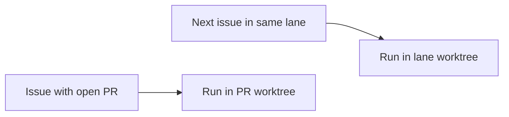

## At a glance

| Kind | Name | Change | Path |
|---|---|---|---|
| Capability | Worklane agent worktree | changed | specs/openspec/specs/worklane-agent-worktree/spec.md |

## Why

AMD verification is blocked behind the next builder's lane worktree. Selecting a registered PR worktree alone does not cover the first run when that worktree is missing. Success means a verifier starts in the earlier issue's PR worktree while the builder continues in the lane, without changing the builder's branch, commits, files or activity.

## What Changes

- Select the linked open PR's own worktree before acquiring any task path lock.
- Create that worktree on the PR branch when it is absent, and reuse it on later runs.
- Keep same-directory exclusion while allowing the lane builder and PR verifier to run together.

## Capabilities

### Modified Capabilities

- `worklane-agent-worktree`: lets builders and verifiers work an open PR independently of the lane, including when its PR worktree has not been made yet.

## Impact

Task claim repository context, daemon directory selection and Git worktree preparation. No database migration, new dependency, UI or new endpoint.

## Constraints

- Preserve the active lane's branch, commits, uncommitted files and activity during PR runs.
- Keep workspace, repository and runtime access boundaries.
- Keep the current non-PR lane flow and non-lane issue flow.

## Non-goals

Changing lane order, moving the lane to its next item, changing merge behavior, deploying a release, or replaying already-waiting runs.

## Sources

- WORK-1201, “Verifier runs on lane issues wait for the lane worktree”, including Skuddy's planning and Joeri handoff request in thread `01a1466e-ecde-736c-9613-27eea4a862cb`.
- `adr/0014-a-worklanes-issues-work-in-its-worktree-on-their-own-branch.md`.
- `~/.agents/skills/madspec-git/SKILL.md`, Core Rule and Required Checks.
