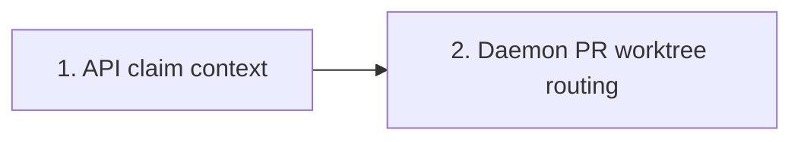

## At a glance

| Kind | Name | Change | Path |
|---|---|---|---|
| API group | Backend / madspec-api-builder | changed | server/pkg/protocol/messages.go; server/internal/handler/worklane_branch.go |
| Service group | Backend / madspec-service-builder | changed | server/internal/daemon/worklane_task.go; server/internal/daemon/issue_worktree.go |
| Git preparation | Branch-owned PR worktree | new | server/internal/daemon/execenv/pull_request_worktree.go |
| Tests | Claim selection | new | server/internal/handler/worklane_branch_test.go |
| Tests | Simultaneous tasks | changed | server/internal/daemon/worklane_task_test.go |
| Docs | PR worktree selection and waits | changed | CLI_AND_DAEMON.md |
| System map | Daemon worktree flow | changed | specs/docs/system-design.md |

## 1. API claim context

- [x] 1.1 `server/pkg/protocol/messages.go` - add optional `ClaimWorklane.pull_request_branch` for the repository's linked open PR; inspect symbol references before changing the exported contract and update affected consumers without adding another endpoint or database field.
- [x] 1.2 `server/internal/handler/worklane_branch.go` - populate the field from `ListPullRequestsByIssue` with matching workspace/repository and open state, using its newest-first order; cover existing and appended claim repositories and route query errors through `loadFailed`, preserving the daemon gate.
- [x] 1.3 `server/internal/handler/worklane_branch_test.go` - add fixture-backed claim tests for open versus closed/merged PRs and wrong-repository/workspace exclusion, asserting the selected branch and unchanged authorization; run the focused handler cases with the repository's isolated test setup.

## 2. Daemon worktree routing

- [x] 2.1 `server/internal/daemon/worklane_task.go`, `server/internal/daemon/issue_worktree.go` - select recorded/registered PR trees or compute the missing PR destination before locking; use the actual PR branch, canonicalize missing paths consistently with later existing paths, keep current non-PR behavior, and acquire only the PR path lock for a PR run.
- [x] 2.2 `server/internal/daemon/execenv/pull_request_worktree.go`, `server/internal/daemon/worklane_task.go` - prepare a missing worktree under the task and Git-root locks from the existing local branch or fetched origin PR branch, validate and reuse existing worktrees unchanged, record the resolved PR tree with `RecordIssueWorktree`, and return without reporting a lane branch switch; preserve normal Git/environment errors without falling back to the lane or forcing a shared branch checkout.
- [x] 2.3 `server/internal/daemon/worklane_task_test.go` - extend the canonical real-Git tests for present/missing PR trees while a dirty, unpushed next-issue builder still holds the lane lock; assert verifier progress before lane unlock, exact branch/HEAD/file preservation, no lane-branch report, same-PR exclusion, remote-only branch contents and reuse of review fixes. Bound contention with deadlines/channels. Run these focused cases and exercise the selection/preparation path in a disposable real-Git smoke harness without executing installed agent CLIs; retain the observed working directories and lock ownership as build evidence and remove the harness.
- [x] 2.4 `CLI_AND_DAEMON.md`, `specs/docs/system-design.md` - document the PR-owned directory and independent lane/PR waits beside Agent Daemon, and update the system map's affected daemon worktree node and edges to match the implementation; include first-run creation without release/recovery procedures or unrelated map changes.

## Implementation Notes

The source of truth for acceptance is `specs/worklane-agent-worktree/spec.md`. Joeri builds the two groups in dependency order using their named backend builders, runs the relevant Go checks/build, and opens the issue's single implementation PR. Planning does not release or manipulate the blocked AMD runs. The verifier owns full verification, archive and merge; strict OpenSpec validation runs again before archive under that workflow.

- Claim selection uses the newest eligible linked PR in the same workspace and repository, after the existing daemon-machine gate. The optional branch field applies to existing and appended claim repositories; query errors preserve claim redelivery.
- PR runs select and lock the branch-owned destination before Git preparation. Preparation preserves local history or fetches the exact origin branch, validates existing trees unchanged, records the PR path, and emits no lane-branch report. Missing and existing symlink aliases use the same canonical lock key.
- A repository checkout is a Git source only on the selected lane's daemon; otherwise the authorized local lane supplies the common Git directory. The first source creates a missing PR tree. An existing tree is found and reused when it belongs to the checkout or to a lane that is a standalone clone.
- Local verification passed: focused daemon worktree cases (present/missing concurrency, same-PR exclusion, origin-only history, review-fix reuse, path and preparation errors, and ordinary lane routing); four fixture-backed handler tests against the isolated worktree database; `go vet` for the affected daemon, execenv, handler and protocol packages; and Go builds of both server and CLI.
- The disposable real-Git smoke harness observed first creation and later reuse at `Worktrees/smoke-org/repo/.pull-requests/review/actual-pr`. Both runs held their PR lock while the lane remained owned by `builder`, on `work-next`, with unchanged dirty bytes and lane HEAD `c3444d26619bd2f4cec0ca3f332da61d6dc64e9a`. PR HEAD remained `8af5e53e92b077f23b1632494c53322dcc6e0c42`. No installed agent CLI ran; the harness was removed.
- No release or recovery of the parked AMD runs is part of this build. Full verification, archive and merge remain with the verifier.

## Plan Change Log

- 2026-10-16: Planned WORK-1201 from its issue and Skuddy's explicit request. Added first-run PR-worktree creation and simultaneous builder/verifier acceptance. Corrected the prior root lookup: OpenSpec commands run in `specs/`.
