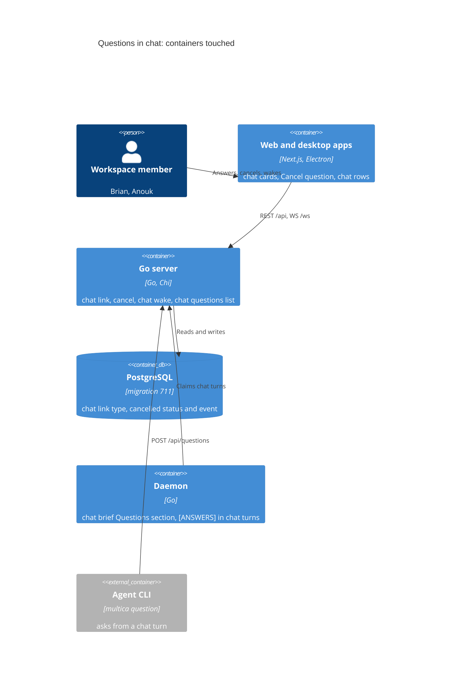
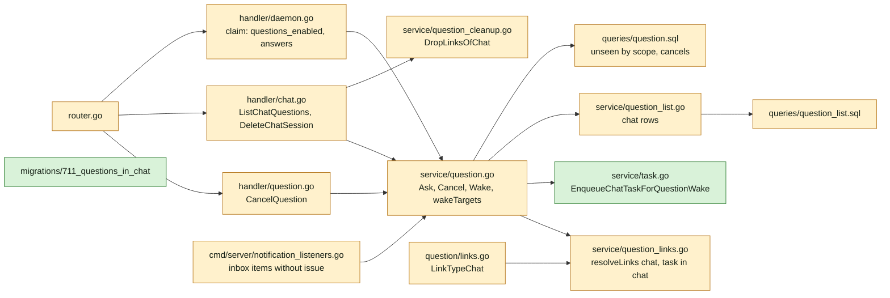
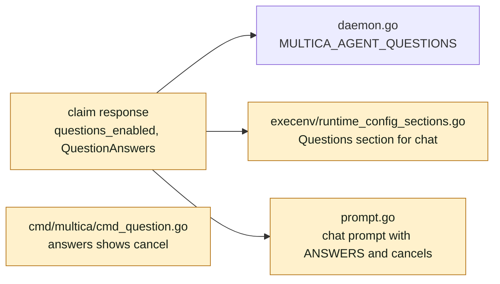
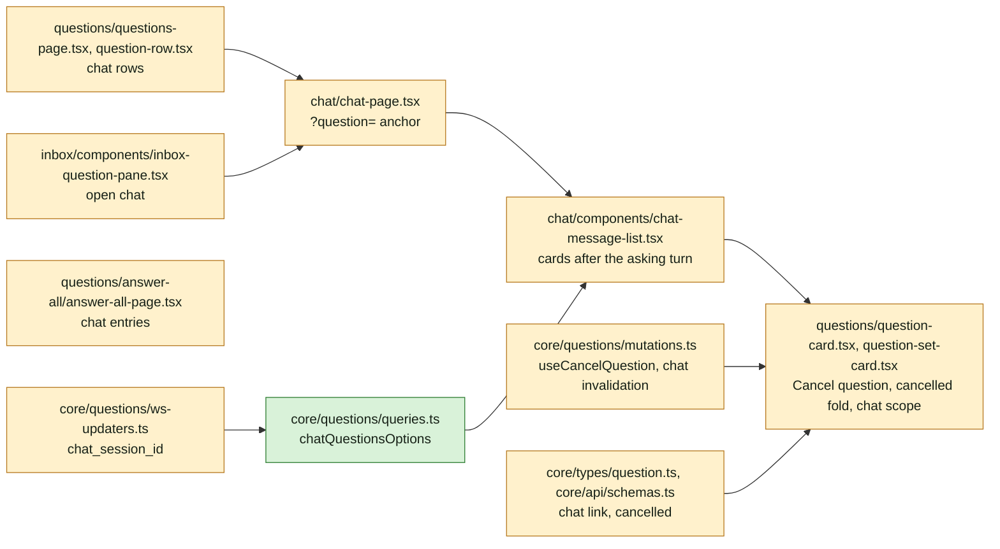
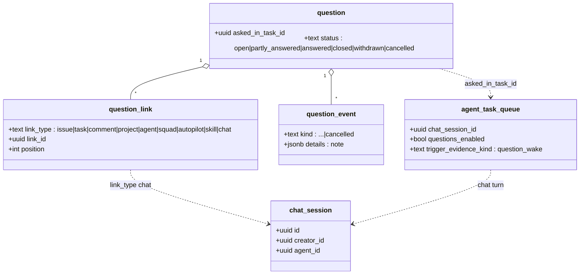
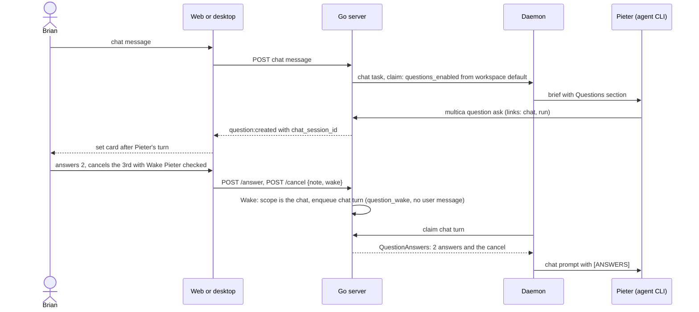
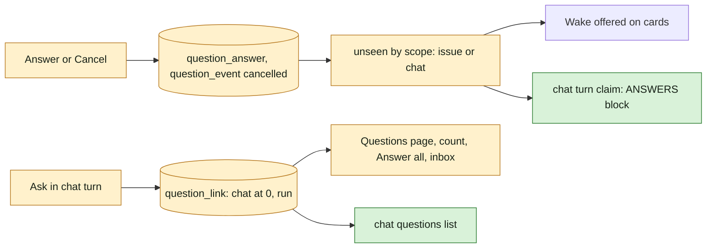

## At a glance

The delta on `specs/docs/system-design.md`: no new container; the Go server, the daemon and the web and desktop apps change. Green is new, amber is changed.

### Go server

### Daemon and CLI

### Web and desktop

### Models

### Journey

### Data flow

| Kind | Name | Change | Path |
|---|---|---|---|
| Migration | questions in chat | new | `server/migrations/711_questions_in_chat.up.sql`, `.down.sql` |
| Registry | `LinkTypeChat` | changed | `server/internal/question/links.go` |
| Query | unseen answers and events by scope, overdue sweep | changed | `server/pkg/db/queries/question.sql` |
| Query | chat questions, active chat wake task, chat run ids | new | `server/pkg/db/queries/question.sql`, `server/pkg/db/queries/chat.sql` |
| Query | row list with chat link | changed | `server/pkg/db/queries/question_list.sql` |
| Service | `Ask`, `Cancel`, `Wake`, `wakeTargets`, `WakeScope` | changed | `server/internal/service/question.go` |
| Service | chat links, `OpenChat` | changed | `server/internal/service/question_links.go` |
| Service | `DropLinksOfChat` | new | `server/internal/service/question_cleanup.go` |
| Service | `EnqueueChatTaskForQuestionWake` | new | `server/internal/service/task.go` |
| Service | chat rows | changed | `server/internal/service/question_list.go` |
| Endpoint | `POST /api/questions/{id}/cancel` | new | `server/internal/handler/question.go`, `server/cmd/server/router.go` |
| Endpoint | `GET /api/chat/sessions/{sessionId}/questions` | new | `server/internal/handler/chat.go`, `server/cmd/server/router.go` |
| Endpoint | chat delete drops question links | changed | `server/internal/handler/chat.go` |
| Claim | chat `questions_enabled`, chat answers | changed | `server/internal/handler/daemon.go` |
| Listener | question inbox items without issue | changed | `server/cmd/server/notification_listeners.go` |
| Event | `chat_session_id` on question events | changed | `server/pkg/protocol/events.go` |
| Brief | Questions section in chat | changed | `server/internal/daemon/execenv/runtime_config_sections.go` |
| Prompt | cancels in `[ANSWERS]` | changed | `server/internal/daemon/prompt.go` |
| CLI | `answers` shows the cancel | changed | `server/cmd/multica/cmd_question.go` |
| Type | chat link, `cancelled` | changed | `packages/core/types/question.ts`, `packages/core/types/events.ts`, `packages/core/api/schemas.ts` |
| Client | cancel, chat questions | changed | `packages/core/api/client.ts`, `packages/core/questions/` |
| Component | question cards | changed | `packages/views/questions/question-card.tsx`, `question-set-card.tsx`, `wake-button.tsx` |
| Screen | chat with question cards | changed | `packages/views/chat/components/chat-message-list.tsx`, `packages/views/chat/chat-page.tsx` |
| Screen | Questions page, Answer all, inbox | changed | `packages/views/questions/questions-page.tsx`, `question-row.tsx`, `answer-all/answer-all-page.tsx`, `packages/views/inbox/components/inbox-question-pane.tsx` |
| Copy | questions and chat strings | changed | `packages/views/locales/{en,fr,ja,ko,zh-Hans}/questions.json` |
| ADR | ADR-0017, ADR-0018 | new | `adr/0017-a-chat-turn-may-ask-by-the-workspace-default.md`, `adr/0018-a-wake-continues-where-the-question-was-asked.md` |

## Context

Today a chat agent cannot ask: the claim sets `questions_enabled` only for issue tasks (`server/internal/handler/daemon.go:2644-2655`), `QuestionService.Ask` refuses a task without an issue (`server/internal/service/question.go:362-363`), the brief writes the Questions section only for issue runs (`server/internal/daemon/execenv/runtime_config_sections.go:1110`), a run link must be an issue run (`server/internal/service/question_links.go:49-57`), and no link type names a chat (`server/internal/question/links.go:10-18`, CHECK in `server/migrations/710_question_link_types.up.sql`).

The branch is stacked on `ask-back-wakes-the-asker` (WORK-429, pull request 34): `AnswerQuestionInput.Wake` wakes after the answer commits (`question.go:647-649`), `AskBack` always wakes (`question.go:673-675`), and the card shows **Wake {agent}** beside Send on the last open question (`packages/views/questions/question-card.tsx` `offersWake`, `question-set-card.tsx` last-open rule). This change builds on those paths.

What the code offers to reuse:

- **Chat turns.** `TaskService.SendDirectChatMessage` (`server/internal/service/task.go:2362-2560`) locks the session, builds a `CreateChatTask` row (`server/pkg/db/queries/chat.sql:1135-1157`, `issue_id` NULL) and `SetChatTaskInputOwnerSelf`, then `NotifyTaskEnqueued` after commit. No path enqueues a chat turn without a user message; the claim already accepts an empty input for an intro chat (`daemon.go:3181-3187`, `3397-3411`). The chat prompt (`server/internal/daemon/prompt.go` `buildChatPrompt`) already appends the per-turn blocks, `[ANSWERS]` included, once the claim sets `QuestionAnswers` (`prompt.go:64-140`).
- **Unseen.** `CountUnseenQuestionAnswers`, `ListUnseenQuestionAnswers` and `ListUnseenQuestionAskBacks` (`server/pkg/db/queries/question.sql:200-285`) anchor on `issue_id` and `agent_id` and keep only `open`, `partly_answered` and `answered` questions. `loadClaimQuestionAnswers` (`daemon.go:3727-3799`) hydrates them only for `question_wake` tasks with an issue. `Wake` (`question.go:845-955`) locks the issue, refuses while `HasActiveQuestionWakeTask`, counts unseen answers and ask-backs and calls `EnqueueTaskForQuestionWake` (`task.go:1451-1511`).
- **Ending a question.** `end` (`question.go:713-727`) sets the status through `SetQuestionStatus` with `from_statuses` (`question.sql:142-150`); `mutate` (`question.go:531-578`) checks the member is a current answerer. Decline sends `{"declined":true}` with an optional note (`server/internal/question/validate.go:73-80`).
- **Deleting.** `DropLinksTo` and `DropLinksOfIssues` (`server/internal/service/question_cleanup.go:14-35`) drop links in the deleting transaction, and `WithdrawUnlinked` (`:53-72`) withdraws questions with no link left; issue and comment deletion call them (`server/internal/handler/issue.go:4556`, `comment.go:3897`). `DeleteChatSession` (`server/internal/handler/chat.go:672-776`) does not.
- **Lists.** `ListRows` errors on a row with no issue-bearing link (`server/internal/service/question_list.go:208-210`); the SQL already takes the position-0 link of any type (`question_list.sql:16-19`). The open count needs no issue (`question_list.sql:161-179`). The overdue sweep joins `link_type='issue'` (`question.sql:171-185`). Inbox items take `payload.IssueID` (`server/cmd/server/notification_listeners.go:1104-1107`) and keep `question_id` in details.
- **Chat access.** Only the session's creator opens a chat (`chat.go:252-273`, `gatePublicChatSessionForUser` `306-318`). The chat route is `paths.chatSession(sessionId)` (`?session=`, `packages/core/paths/paths.ts:64-68`); there is no message anchor yet. The message list renders an assistant message per `task_id` (`chat-message-list.tsx` `AssistantMessage`, quick actions at `656-669`), and every question carries `asked_in_task_id` (`packages/core/types/question.ts:298`).
- **Frontend questions.** Cards and mutations take an `issueId` as their cache scope (`packages/core/questions/mutations.ts`, `wake-button.tsx` `useWakeQuestionAgent(wsId, issueId)`); `handleQuestionEvent` needs `payload.issue_id` (`ws-updaters.ts:36-56`); Questions page rows open `paths.issueDetail(row.open_issue.identifier)` (`questions-page.tsx:107-109`); Answer all hydrates per `entry.issueId` (`answer-all-page.tsx:53-69`); the inbox pane loads one question by id (`inbox-question-pane.tsx`).

Builders: the Backend team, led by Joeri, takes groups 1 to 5; the Frontend team, led by Thomas, takes groups 6 to 8; Sarkout takes group 9. This follows Skuddy's hand-off on WORK-447; the spec is one behaviour across both teams, so it stays one change instead of one per team. No design step runs: the chat shows the existing cards, and **Cancel question** reuses the Decline control and its note.

## Goals / Non-Goals

**Goals:**

- Chat turns ask through the existing `multica question` and `POST /api/questions`, decided at claim (ADR-0017).
- One wake path with a scope, issue or chat, and one unseen definition per scope (ADR-0018).
- Cancel as a member action on every question, with the same Wake checkbox as an answer.
- Chat questions in every existing list, count and inbox, without showing a chat's title or messages to anyone but its member.

**Non-Goals:**

- Mobile, and chats connected from Slack, Lark/Feishu or WeCom: their turns keep questions off.
- A Questions setting per chat.
- A new design: the cards, rows and inbox pane stay as they are, plus the Cancel control and the cancelled fold.
- Guidance to agents on when to ask.

## Decisions

### 1. A chat is a link type

A question asked in a chat links to it as `question_link` type `chat`, id the `chat_session.id`. `Ask` puts the chat at position 0 when no `--on` is given, after the `--on` link otherwise, and always appends the run link. The run link accepts a chat turn of the same workspace. Alternative: a `chat_session_id` column on `question`; rejected, ADR-0002 keeps where a question lives in its links, and lists, counts and cleanup already work per link.

### 2. "Asked in a chat" is read from the asking run

A question was asked in a chat when its `asked_in_task_id` task has a `chat_session_id`. That decides its asker's wake scope, also when `--on WORK-412` put an issue first. Agent assignees of its other links keep their issue scope, as `wakeTargets` builds them today.

### 3. A chat wake is a chat turn without a user message

`TaskService.EnqueueChatTaskForQuestionWake(ctx, tx, session, agentID, actorID, questionID, count)` builds the same `CreateChatTask` row as `SendDirectChatMessage`, with `trigger_evidence_kind` `question_wake`, `trigger_evidence_ref_id` the question and the waking member as initiator, and no `chat_message`. `Wake` locks the chat session instead of the issue, refuses with `ErrDuplicatePendingTask` while the agent has a queued, dispatched or running task in that session, and writes no issue activity. The claim accepts its empty input as it does for an intro chat. Alternative: a hidden user message "answers arrived"; rejected, it would show in the chat and in the agent's transcript as Brian's words.

### 4. Unseen per scope, and every chat turn gets its answers

The unseen queries take `issue_id` or `chat_session_id` (`sqlc.narg`), with the same anchor: the latest started task of that agent in that scope, outside the retry chain. `ListUnseenQuestionAskBacks` becomes `ListUnseenQuestionEvents`, returning `ask_back` and `cancelled` events with their kind; the status filter adds `cancelled`. `loadClaimQuestionAnswers` hydrates a chat turn always, not only on `question_wake`: any started chat turn moves the chat's cutoff, so a turn started by a chat message must carry the answers it makes seen. Issue runs keep hydrating only on `question_wake`.

### 5. Cancelled is an end status with an event

`POST /api/questions/{id}/cancel` `{note?, wake?}` calls `QuestionService.Cancel`: through `mutate` as a current answerer, from `open` or `partly_answered` to `cancelled`, writes event `cancelled` with `{"note": ...}`, publishes `question:updated` reason `cancelled`, then wakes like `Answer` when `wake` is true. `Answer`, edits, ask back, `Close` and `Withdraw` refuse a cancelled question because their `from_statuses` leave it out. The DTO carries the cancel through its events; the card reads "Cancelled by {member}" and the note from the `cancelled` event. `[ANSWERS]` and `multica question answers` print "Cancelled by Brian: {note}". Alternative: a declined answer by each answerer; rejected, Brian chose that a cancel ends the question for everyone.

### 6. Chat questions in lists keep the chat private

A chat link's DTO is `{type: "chat", id, member_id}`: the chat's creator, never its title. The row list returns rows whose position-0 link is a chat, with `open_issue` null; the client opens `paths.chatSession(id)` with `&question={questionId}` when `member_id` is the viewer, else Answer all at that question. Rows group under "Chat with {member}". Answer all loads entries without an issue through `questionDetailOptions`. Inbox items of chat questions have no `issue_id`; the inbox pane opens the chat for its member and Answer all for others. The overdue sweep takes questions whose position-0 link is an issue or a chat.

### 7. The chat lists its own questions

`GET /api/chat/sessions/{sessionId}/questions`, behind `gatePublicChatSessionForUser`, returns the hydrated questions linked to the chat through the service list `ListForIssue` uses, generalised to a link. The message list groups them with `groupQuestionCards` and renders each group after the assistant message whose `task_id` is the group's `asked_in_task_id`, or after the live turn while it streams. `question:created` and `question:updated` carry `chat_session_id`, and the client invalidates the chat's questions with it. `?question=` scrolls the message list to that card and highlights it.

### 8. A deleted chat drops its question links

`DeleteChatSession` calls the new `DropLinksOfChat` in its transaction: it drops the `chat` links to the session and the `task` links to the session's tasks, then `WithdrawUnlinked`; questions are published after commit, as comment deletion does.

### 9. The brief and environment follow the claim

The Questions section is written for an issue run or a chat turn whose claim has `questions_enabled`; quick-create keeps none. `MULTICA_AGENT_QUESTIONS` already follows the claimed value (`daemon.go:196-197`). The section's text about where a question links says "the chat" in a chat turn and "the issue" in an issue run; it says nothing about when to ask.

## Risks / Trade-offs

- [Migration 711 may collide with another open branch] -> renumber on rebase; the migration has no data change, only CHECK constraints.
- [Pull request 34 may add its own ADR as 0017] -> renumber this change's ADRs on rebase; ADR-0018 already restates PR 34's wake paths.
- [A chat message turn now makes answers seen] -> intended: the turn carries them in `[ANSWERS]`; the Wake button disappears because the agent has them.
- [Unseen queries gain an OR on scope] -> each query filters `agent_id` and one scope column; `agent_task_queue` is already read by `chat_session_id` at claim.
- [A wake from Answer all starts a turn in a chat the waker cannot open] -> intended by Brian's answers; the waker never sees the chat's content.

## Migration Plan

`711_questions_in_chat.up.sql` replaces three CHECK constraints: `question_link.link_type` adds `chat`, `question.status` adds `cancelled`, `question_event.kind` adds `cancelled`. The down migration first withdraws cancelled questions, deletes `cancelled` events and `chat` links, then restores the constraints of migration 710. No backfill: chat tasks claimed before the deploy keep `questions_enabled` false.
