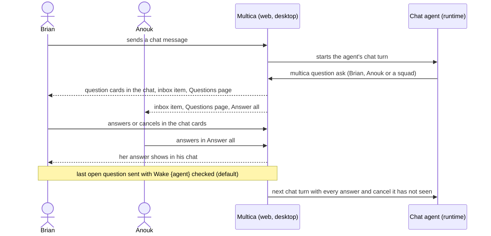

## At a glance

| Kind | Name | Change | Path |
|---|---|---|---|
| Spec | chat-questions | new | `specs/openspec/changes/questions-in-chat/specs/chat-questions/spec.md` |
| Spec | agent-question-tooling | changed | `specs/openspec/changes/questions-in-chat/specs/agent-question-tooling/spec.md` |
| Spec | agent-wake | changed | `specs/openspec/changes/questions-in-chat/specs/agent-wake/spec.md` |
| Spec | questions | changed | `specs/openspec/changes/questions-in-chat/specs/questions/spec.md` |
| Spec | question-answering | changed | `specs/openspec/changes/questions-in-chat/specs/question-answering/spec.md` |

## Why

An agent in a Multica chat cannot use `multica question`: a run without an issue has questions off (ADR-0005), and the chat brief leaves out the Questions section. So a chat agent asks Brian a/b/c as plain text, and Brian types the letter back, without the answer types, suggested answer, notes and ask back that questions on issues have. Brian also cannot cancel a question himself: only the asking agent can end one.

Success signal: in a chat on web or desktop, the agent asks Brian a question set with `multica question ask`, Brian answers it in cards inside that chat, and sending the last answer with Wake checked starts the agent's next chat turn with all his answers. On any question card, Brian can cancel a question with an optional note.

## What Changes

- An agent in a chat turn can ask with `multica question ask` while the workspace Questions default is On; its brief and `multica --help` show the Questions tool then.
- A question asked in a chat links to that chat and to the run it was asked in, and may ask any member or squad.
- The chat shows each question and question set as the same cards as on issues, at the place it was asked, with every answer, also those of other members.
- Every way to wake a chat question's asking agent (the **Wake {agent}** checkbox on the last open question, the **Wake** button, ask back) starts its next turn in that chat with every answer, ask back and cancel it has not seen. This builds on the Wake checkbox of WORK-429 (pull request 34), which this change is stacked on.
- A chat message sent while questions are open leaves them open.
- Chat questions show on the Questions page, in the sidebar count, in Answer all and in the inbox; opening one opens the chat for its member and Answer all for others. Nobody but the chat's member sees the chat's title or messages.
- Each current answerer can cancel a question, in chats and on issues, with an optional note. A cancel ends the question for every answerer and keeps the answers already sent. Cancelling the last open question follows the **Wake {agent}** checkbox like an answer, and a woken run gets the cancel with who cancelled and the note.

## Capabilities

### New Capabilities

- `chat-questions`: lets an agent in a chat ask members questions, lets the chat's member answer them in the chat and others on the Questions page, and continues the chat when the agent is woken.

### Modified Capabilities

- `agent-question-tooling`: `multica question ask` and the brief also serve chat turns; a run neither on an issue nor in a chat keeps questions off.
- `agent-wake`: a cancel follows the Wake checkbox and reaches the woken run like an answer.
- `questions`: a question asked in a chat links to the chat and the run; a current answerer can cancel a question.
- `question-answering`: cards offer **Cancel question** with an optional note.

## Impact

- Server: task claim (`server/internal/handler/daemon.go`), `QuestionService.Ask` and member actions (`server/internal/service/question.go`), question links (`server/internal/question/links.go`, `server/internal/service/question_links.go`), question lists (`server/internal/service/question_list.go`), chat deletion (`server/internal/handler/chat.go`), chat turn enqueue (`server/internal/service/task.go`).
- Daemon: chat brief (`server/internal/daemon/execenv/runtime_config_sections.go`), per-turn prompt (`server/internal/daemon/prompt.go`).
- Web and desktop: chat message list (`packages/views/chat/components/chat-message-list.tsx`), question cards (`packages/views/questions/`), Questions page and inbox routing.

## Constraints

- Questions stay their own aggregate with typed answers and links (ADR-0002); a chat question uses the same tables, answer types and cards.
- Whether a run may ask is decided once, at claim (ADR-0005).
- Open is per question and per answerer (ADR-0004); "the last question still open" uses that rule.
- Lists and counts per viewer come from the one server row list (ADR-0006).
- An agent is told only that the tool exists, never when or why to ask (FR-22 of "PRD: Questions in Multica").
- Only agents ask and only members answer (`questions` spec).
- Only a chat's member opens the chat (`server/internal/handler/chat.go` `loadChatSessionForUser`).

## Non-goals

- The mobile app: questions are on web and desktop only ("PRD: Questions in Multica" 6.2).
- Chats connected from Slack, Feishu/Lark or WeCom: the request is about the Multica chat UI, and Brian's workspace has no connected channel chat.
- A Questions setting per chat (Brian, 2026-10-15).
- Members asking questions.
- Guidance to agents on when to ask or when to end a turn.

## Decisions

Made without asking, each from a passed plan or the existing behaviour:

- Every way to wake a chat question's agent continues the chat, never a run elsewhere: the chat is where the agent asked, and a chat run has no issue to run on.
- A cancelled question cannot be closed or withdrawn by its agent: cancelled is an end status, like closed and withdrawn.
- Other members answer chat questions in Answer all: Brian chose "the others answer on their Questions page", and only the chat's member can open the chat.
- Deleting a chat withdraws its questions that link to nothing else: the existing rule withdraws a question whose links are all deleted (`server/internal/service/question_cleanup.go`).
- A question asked in a chat always links to the chat, also with `--on`: the asking run is always linked today, and the chat is where its answers continue.

## Sources

- [PRD: Questions in Multica](anytype://object?objectId=bafyreiaviofipcl3ymgld2skld4ij6hlarsm2ra55ygufsepgk5laxjf34)
- WORK-447 "Allow Multica chat to use questions in chat", with Brian's screenshot of a chat agent asking a/b/c as text
- Brian's answers to "Agent questions in a chat" and "Cancelling questions" on WORK-447, 2026-10-15
- Pull request 34 (WORK-429): Wake checkbox on the last open question, ask back wakes, decline to answer
- `adr/0002-questions-are-their-own-aggregate.md`, `adr/0003-only-wake-turns-answers-into-a-run.md`, `adr/0004-question-sets-group-questions-open-is-per-question.md`, `adr/0005-whether-a-run-may-ask-is-decided-at-claim.md`, `adr/0006-questions-are-listed-per-viewer-through-one-row-list.md`
