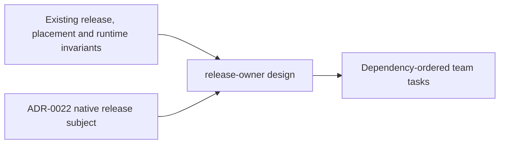

# ADR Review Manifest

- Status: completed
- Review date: 2026-10-16

## At a glance

| Kind | Name | Change | Path |
|---|---|---|---|
| Review | Release owner ADR manifest | new | `specs/openspec/changes/release-owner/adr.md` |
| Decision | Native release coordination boundary | new | `adr/0022-releases-coordinate-as-native-task-subjects.md` |

## Review Summary

ADR review completed for this change. Native release coordination is the new durable commitment across release writes, dispatch, daemon execution and tooling. No accepted ADR is edited or superseded by this change.

The walker inspected all 24 existing records and allocated 0022. Its existing duplicate numbers 0004-0007 make bare-number graph references ambiguous. The reviewed context below uses filenames; the organization/worklane and question records retain their separate meaning. The walker also reports existing missing Binds/Prevents/Rule fields and inconsistent supersession metadata. Those repository-wide corrections are outside this change; they do not prevent preserving the existing contracts here.

## In-Force ADRs Reviewed

| File under `adr/` | Application to this change |
|---|---|
| `0001-runtime-machine-files-are-read-by-the-daemon.md` | Selected instruction files remain daemon-owned reads. |
| `0002-questions-are-their-own-aggregate.md` | Release discussion stays comments, not a question aggregate. |
| `0004-question-sets-group-questions-open-is-per-question.md` | Existing question grouping/status semantics are untouched. |
| `0005-project-status-and-dates-stay-stored-but-unseen.md` | No project status/date UI is introduced. |
| `0005-whether-a-run-may-ask-is-decided-at-claim.md` | Non-issue release runs retain questions disabled at claim. |
| `0006-questions-are-listed-per-viewer-through-one-row-list.md` | No release-specific question list or count. |
| `0006-repositories-hold-worklanes.md` | Releases belong to repositories; workspace/project are resolved through that chain. |
| `0007-a-question-reaches-its-parents-at-read-time.md` | No question propagation or stored ancestry is added. |
| `0007-worktrees-are-made-by-the-daemon-and-recorded-by-the-server.md` | Existing isolated environment and daemon repository checkout; no server filesystem access. |
| `0009-the-server-keeps-worklane-and-issue-worktree-folders-apart.md` | Release coordination borrows neither kind of worktree. |
| `0010-the-server-keeps-each-repositorys-release-line.md` | Repository lock, whole-line writes and guarded explicit ship stay authoritative. |
| `0011-a-worklane-shows-repository-activity-from-its-creation-on.md` | Owner activity is repository-wide and respects each lane's creation boundary. |
| `0012-the-server-holds-the-issue-templates-and-a-type-is-set-once.md` | No proxy issue or issue template/type changes. |
| `0013-an-issue-is-placed-in-a-worklane-and-a-release-under-the-repositorys-lock.md` | Placement, removal and shipping retain the same lock. |
| `0014-a-worklanes-issues-work-in-its-worktree-on-their-own-branch.md` | Preserve lane-local issue order and branch ownership; do not dispatch issue work on the coordinator's environment. |
| `0015-the-database-keeps-an-issues-done-date.md` | Completion dates remain database-owned; terminal facts use the existing status classification. |
| `0016-the-worklanes-and-releases-pages-are-built-from-the-workspaces-lists.md` | Keep overview aggregation and first-holding-lane target; detail reads are not another overview endpoint. |
| `0017-a-client-account-is-refused-outside-the-session-list.md` | Release routes stay outside the client allowlist. |
| `0019-input-reaches-a-running-run-as-a-receipt.md` | Existing issue live-input receipts stay unchanged; release comments use pending coordination receipts. |
| `0020-only-wake-turns-answers-into-a-run-and-a-checked-answer-is-seen.md` | No question-answer-to-release-run trigger. |
| `0021-client-memberships-hold-organisation-sets.md` | Existing client membership and organisation projections are untouched. |

Historical context was also read: `0003-only-wake-turns-answers-into-a-run.md` is superseded by 0020; `0004-organisations-hold-projects.md` by the repository/worklane 0006 record; `0008-worklane-activity-is-kept-in-the-activity-log.md` has its read amended by 0011. The design follows their current successors, not the obsolete reads.

## New Durable ADRs Created

- [ADR-0022: Releases coordinate as native task subjects](../../../../adr/0022-releases-coordinate-as-native-task-subjects.md).

Implementation detail remains in [design.md](design.md); the ADR records only the cross-unit boundary. There are no unresolved ADR conflicts or technical-design approval gates.
