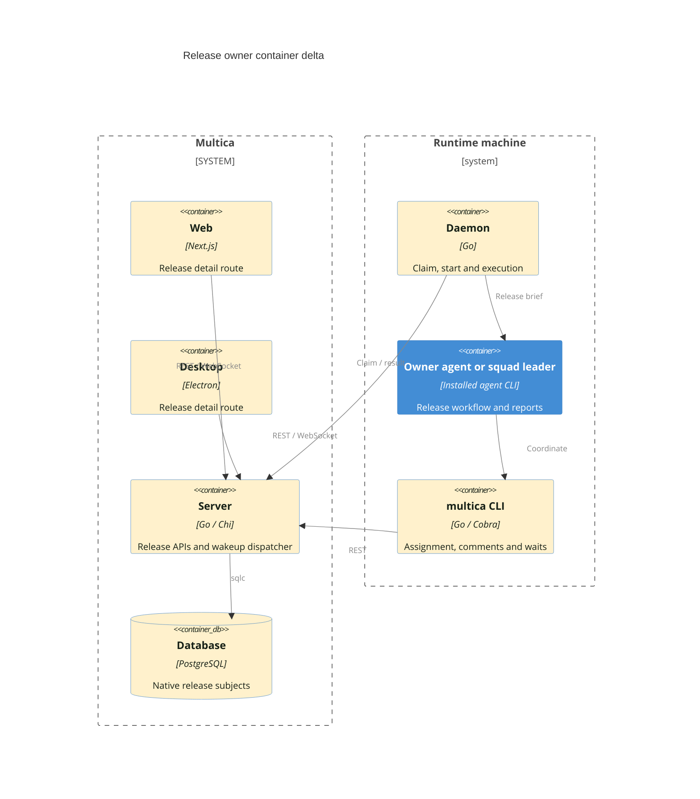
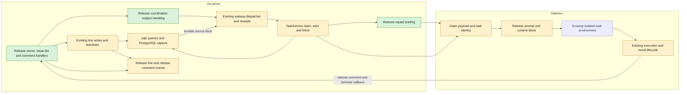
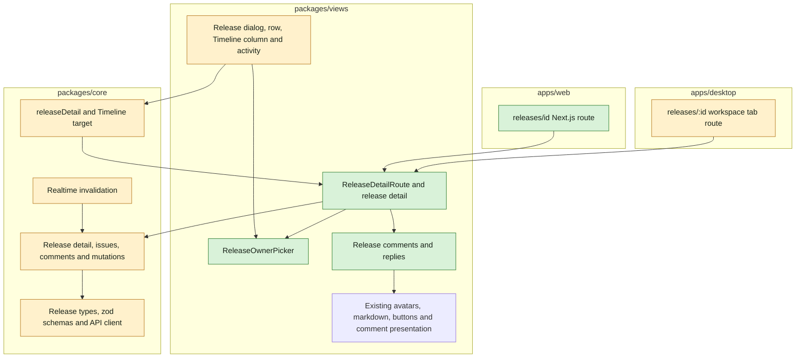
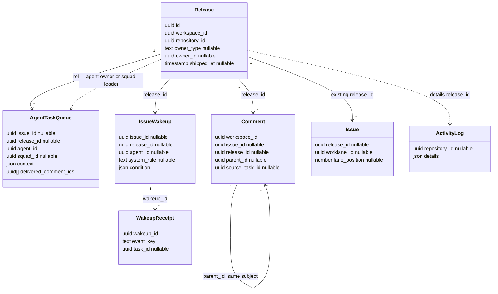
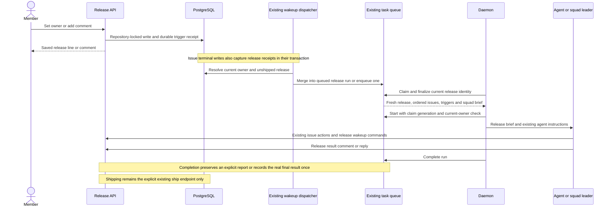

## At a glance

Delta against [Multica system design](../../../docs/system-design.md). Green adds a part; amber changes an existing part. The diagrams describe the planned implementation, not shipped code.

### Containers

### Server and daemon components

### Web and desktop components

### Models

Relationships are soft references. Existing task subjects such as chat and autopilot are unchanged.

### Coordination sequence and data flow

| Kind | Name | Change | Path |
|---|---|---|---|
| Model | Release owner and native release subjects | changed | `server/migrations/`, `server/pkg/db/queries/release.sql`, `server/pkg/db/queries/comment.sql`, `server/pkg/db/queries/wakeup.sql`, `server/pkg/db/queries/system_wakeup.sql`, `server/pkg/db/queries/agent.sql` |
| Data access | Generated models and queries | changed | `server/pkg/db/generated/` |
| API | Owner, detail, issues, comments and waits | new | `server/internal/handler/release_owner.go`, `server/internal/handler/release_detail.go`, `server/internal/handler/release_comment.go`, `server/internal/handler/release_wakeup.go` |
| API | Line writes, ship and teardown | changed | `server/internal/handler/release.go`, `server/internal/handler/release_ship.go`, `server/internal/handler/repository.go`, `server/internal/handler/project.go`, `server/pkg/db/queries/workspace_delete.sql` |
| Service | Native release coordination | new | `server/internal/service/release_coordination.go` |
| Service | Shared queue, wakeups and result delivery | changed | `server/internal/service/task.go`, `server/internal/service/issue_wakeup.go`, `server/internal/service/issue_wakeup_system.go`, `server/internal/service/issue_wakeup_condition.go` |
| Runtime | Release claim, squad brief and prompt | changed | `server/internal/handler/daemon.go`, `server/internal/handler/squad_briefing.go`, `server/internal/daemon/types.go`, `server/internal/daemon/prompt.go`, `server/internal/daemon/execenv/` |
| API contract | Release subject and events | changed | `server/pkg/protocol/`, `packages/core/types/`, `packages/core/api/` |
| Shared logic | Release reads, writes, navigation and realtime | changed | `packages/core/releases/`, `packages/core/paths/paths.ts`, `packages/core/realtime/use-realtime-sync.ts` |
| Screen | Release detail, owner picker and discussion | new | `packages/views/releases/components/release-detail-route.tsx`, `packages/views/releases/components/release-detail.tsx`, `packages/views/releases/components/release-owner-picker.tsx`, `packages/views/releases/components/release-comments.tsx` |
| Screen | Existing release entry points and history | changed | `packages/views/releases/components/`, `packages/views/worklanes/components/worklane-activity.tsx`, `packages/views/locales/` |
| Route | Web detail route | new | `apps/web/app/[workspaceSlug]/(dashboard)/releases/[id]/page.tsx` |
| Route | Desktop workspace tab | changed | `apps/desktop/src/renderer/src/routes.tsx` |
| Tool | Release commands and runtime instructions | changed | `server/cmd/multica/cmd_release.go`, `server/cmd/multica/cmd_issue_wakeup.go`, `server/internal/service/builtin_skills/multica-platform/`, `server/internal/daemon/execenv/runtime_config_sections.go` |
| Documentation | Command reference and living architecture | changed | `CLI_AND_DAEMON.md`, `apps/docs/content/docs/cli.mdx`, `apps/docs/content/docs/cli.zh.mdx`, `specs/docs/system-design.md` |
| Agent workflow | Release-owned coordination | changed | `madspec:skills/madspec-releases/SKILL.md`, `madspec:skills/madspec-multica/SKILL.md` |
| Decision | Native release coordination boundary | new | `adr/0022-releases-coordinate-as-native-task-subjects.md` |

## Context

This is a standalone own-work feature, not a journey. The approved [proposal](proposal.md) and four spec deltas own behavior. Brian approved optional assignment; the release-page answer fixes comments and replies as the reporting surface. The technical plan adds no approval gate.

### Code map and findings

- `release.go:49-99,140-146,458-570` holds release DTOs and plan/edit writes. `release.sql:76-87` fences workspace/project teardown and shipping. Reuse the repository transaction and whole-line response, rather than passing stale version/title through an inline owner edit.
- `issue.go:4235-4307` validates assignee access. `issue_trigger.go` and `task.go:1400` resolve readiness and squad leaders. Share their checks; a release has no issue status, triage or parent-stage gate to emulate.
- `agent.sql:1907-1995` merges only pre-claim comments and atomically replaces the complete attribution/MCP snapshot with the newest member's. A dispatched prompt is immutable. `task.go:3853,4251` separates finalized claim from start; both need release identity checks.
- `509_issue_wakeup.up.sql`, `555_wakeup_system_rule.up.sql`, `wakeup.sql` and `issue_wakeup_system.go:575-658` already provide dynamic targets, receipts, queued-run evidence merge and dispatched-run deferral. Extend these, not a release scheduler. The child_done stage barrier and self-acknowledgement suppression are not release terminal-event behavior.
- `comment.sql:19-59,165` already bounds chronological reads and closes reply ancestry within workspace and issue. Reuse the table and thread mechanics with an explicit release subject; do not copy the comment subsystem into a release_comment table.
- `issue_placement.sql:26-35` and `worklane.sql:118` hold lane order; no release-wide issue rank exists. `overview.ts:82-99` already selects the first holding worklane, else main, for Timeline navigation.
- `execenv/execenv.go:389-391` starts an isolated empty task directory with on-demand repository checkout. Release coordination uses that path, not an issue/worklane branch. It needs no new release worktree or durable conversation/session model.
- ADR-0005's question-claim decision leaves non-issue runs unable to use Multica questions. This change keeps that boundary. Brian's existing workflow gates remain in the owner's skills/inbox flow; a release comment is not a new question type. ADR-0019's issue mid-run receipts are unchanged: release member comments queue/coalesce a coordination turn as specified, without adding live steering or reaction UI.

### Teams and pull-request boundaries

Each team's groups form one pull request, stacked in this order. No team starts against an undefined contract.

| Task groups | Roster team / lead | Responsibility |
|---|---|---|
| 1 | data-models / Pieter | Persistent subject contracts, migrations and sqlc |
| 2-4 | backend / Joeri | HTTP services, wakeup lifecycle, claim/start/completion and daemon execution |
| 5 | shared-packages / Pieter | Headless API, query, event and navigation contracts |
| 6-7 | frontend / Thomas | Shared release components/page and web/desktop routing |
| 8 | agent-tools / Pieter | CLI, builtin platform skill and release runtime guidance |
| 9 | product / Mitchel | External MadSpec workflow integration |

Groups 1-8 are in Multica. Group 9 is in the existing MadSpec repository at `~/Repos/Ventures/madspec`, whose paths use the `madspec:` prefix above and in tasks. It consumes the finished CLI; it is part of the approved Impact, not a second platform implementation. Update the affected living-system view in the implementation PR that changes its layer. No pass/step issues are created by this non-journey plan.

## Goals / Non-Goals

**Always:** use the real release id, optional agent/squad ownership, current-owner routing, existing runtime permissions and one shared queue/wakeup engine. Keep the user's issue scope, lane order, assignees, parents, release version and line position. Expose the same owner and discussion on web, desktop and CLI. Leave shipping to its existing guarded endpoint after the workflow's applicable Brian gate.

**Never:** manufacture a parent issue, infer a dependency DAG, start issues from a platform scheduler, add members as owners, add release controls excluded by the page spec, or change mobile, issue questions, live steering, publication policy or existing unowned-release behavior.

## Decisions

### 1. Native subjects in existing stores

Add nullable `owner_type` (`agent` or `squad`) and `owner_id` to release, with an all-null or valid-pair check. Add nullable `release_id` to agent_task_queue, comment and issue_wakeup. Make comment.issue_id and issue_wakeup.issue_id nullable and require exactly one of issue_id/release_id there. A release task has release_id, no issue_id, chat_session_id or autopilot_run_id; existing non-release task variants retain their current rules.

Keep issue_wakeup's name to avoid an unrelated repository-wide rename. Release user waits have no fixed agent_id: resolve their current release owner at dispatch. Add `release_coordination` as a platform system_rule, one per owned unshipped release, covering owner changes, member comments and terminal issue events. The same receipt table carries their evidence. A removed owner leaves the rule dormant; deleting/shipping removes release rules and receipts. Existing releases migrate to no owner, with no backfill runs.

Create only the indexes used by release reads and dispatch: comment `(release_id, created_at DESC, id DESC)`; wakeup release lookup; unique release system rule; and unique pending release task. Give each index its own concurrent migration and cleanup entry. Repository activity keeps release_id in details, as today; filter release history by repository plus details.release_id rather than adding a second activity store.

**Alternative rejected:** separate release comment/wakeup tables would duplicate thread completion, expiry and dispatch semantics; a proxy issue would alter scope and parent/stage behavior.

### 2. Ownership writes and wire contract

Extend ReleaseResponse with nullable `owner_type`, `owner_id`, `owner_name` and `owner_avatar_url`. Resolve the name/avatar in bounded batch reads alongside milestones, scoped to the same workspace; CLI JSON exposes the same fields. Zod defaults missing/unknown or inconsistent owner data to an unowned projection without dropping the release. Persist only type/id, not a second owner snapshot.

Plan/Edit accept presence-aware owner_type/owner_id pairs: both omitted means no owner on plan and preserve on edit; both null clears; a valid pair replaces. Reject partial or member pairs. Add `PUT /api/releases/{id}/owner` with that pair for inline assignment and `release assign`; it returns the whole release line like other writes. This avoids resending or overwriting version/title from an older cached form. All paths call one owner-write helper and the existing assignee permission checks. An unchanged pair is a no-op for owner activity and runs.

Under the existing workspace/project owner fences and repository lock, re-read the release, refuse shipped owner changes with the specified message, validate the owner, write one repository-wide owner-change activity with before/after names, cancel unstarted old-owner tasks, and capture the new owner's trigger receipt. Commit before notifying clients/dispatcher. Initial owner selection records its owner-change activity as well as the existing plan activity. Preserve existing title/version validation on full Edit. A missing runtime does not roll back the owner; readiness produces no task, just as issue assignment does.

Owner activity uses one `release_owner_changed` action and named snapshots in details to render the spec's set/change/remove sentences. Existing worklane reads retain ADR-0011's creation-time bound; the release page reads its own owner history without a lane creation cutoff. Agent/squad deletion clears references and unstarted coordination through this same cleanup path; archiving or losing runtime follows existing readiness rules, not a new deletion policy.

### 3. One dispatch path, durable input and current-owner fencing

Capture source facts in their write transaction, using existing wakeup receipt uniqueness and bounded evidence merge. Member comments, including replies, wake the current owner. Agent/system result comments do not. Terminal issue capture covers single/batch updates, automatic PR completion and custom done/closed categories; it emits each real terminal transition once using issue id plus revision. It is not the parent-stage barrier. Do not suppress a release event just because the release owner made that issue transition.

The dispatcher reuses expiry, time/interval/cron parsing, condition polling, rate/loop limits and runtime readiness. Release conditions accept only the approved same-workspace other_issue predicates (done, ended, in_review) and schedules, with existing instruction/timeout/expiry options. Do not expose issue-only child/status/PR filters as release conditions. Owner-created release waits resolve the owner at firing, not their original creating agent. Without a current runnable owner, use the existing dynamic-target no-run handling; do not invent a retry service.

One pending unstarted coordination task per release is enforced by a partial unique index for queued/dispatched/waiting_local_directory states; queued facts merge across triggers and threads. A running task may have one queued follow-up. Preserve all merged trigger/comment ids and their actors. When a member comment becomes the latest deliberate trigger of a queued run, atomically recalculate the entire existing attribution result and connected-app overlay as issue comment coalescing does. System facts add evidence, not another person's authority. Claim authorization still revalidates that principal's workspace, agent/squad and runtime access.

A finalized/dispatched claim has immutable input. Facts that arrive after it stay as pending receipts for the next run, rather than being marked delivered or dropped. Include them once the next queued claim can take them. Wakeup joining must handle release tasks without requiring issue_id, while leaving issue joining unchanged.

Use workspace/project owner fences, then repository/release, then the existing agent/runtime ownership fence and wakeup/task locks for release mutations, dispatch, finalize and start. Lock multiple repository/owner rows in stable id order. Source issue status capture already holds its issue row: capture receipts under the selected rule's key-share lock without taking the repository lock, so it cannot invert shipping's repository-then-issue order. Ship/remove take issue placement locks before deleting their wakeups. Release processing reads scope before locking and rechecks under this order; it never locks a wakeup and then waits for the repository.

Owner change/removal cancels every not-started old-owner release task, including dispatched and waiting_local_directory; existing claim-generation/start CAS rejects a delayed daemon start. Claim finalize and both start endpoints recheck release existence, unshipped state and current owner/leader under the same repository boundary. Running tasks remain alive and may post their final report, but generate no future work for the previous owner. This closes owner A-to-B-to-A races without a new owner-generation column. A squad leader change invalidates a queued former leader at claim/start and re-resolves the pending facts for the current leader.

### 4. Fresh claim, execution and result delivery

Add an explicit release branch before quick-create/non-issue handling in task DTOs, daemon claim, prompt and runtime config. The claim includes release identity, repository/project context, the full ordered issue projection, trigger facts and exact delivered comment ids. It resolves squad leader status through the existing explicit leader-role fields and uses a release-specific squad briefing with roster, skills and instructions. It does not run issue evaluation/status-completion rules.

One release issue query serves page and claim. Project all issues with that release_id, including terminal issues whose lane was removed, with key/title/status, assignee, parent, worklane and both GitHub/VCS linked PRs. Flatten lanes in the existing repository worklane order (main first, then position/name/id), retaining lane_position then created_at/id within each; lane-less issues follow. This is a deterministic read of existing lane order, not a new cross-lane dependency rank or reorder API. Page rows use its subset; the brief retains parents/PRs. Compute remaining-open and all-successful from current status categories at claim. A cancelled issue is terminal but not successful; an empty release is not a last-issue completion event.

Use the existing isolated task directory and on-demand `multica repo checkout` for repository access. Pass the release's repository as context, without selecting an issue/worklane or borrowing its branch. Keep agent instruction selection, skill loading, task-scoped credentials, existing budgets, logging and failure handling. Release runs start fresh with claim context; this feature adds no durable release session reuse. Non-issue Multica questions stay off under ADR-0005; external workflow/inbox gates stay available through the existing owner's skills.

The runtime brief names its release, release comment read/reply commands and the current trigger thread when there is one. It tells the owner to preserve the specified scope and carry the existing release workflow/gates, not to mark the feature issue done or publish automatically. Replace only subject-specific issue workflow text for these runs; preserve the agent's selected instructions and generated runtime block handling.

A run reports through `release comment add`, using source_task_id and the real final result. Extend existing completion reconciliation so an explicit same-release source-task comment is retained and not duplicated; if none exists, persist the nonempty actual final result once, in the terminal transition transaction, analogous to existing result delivery. Preserve the trigger parent for a single comment-triggered reply. No canned success comment or mock fallback. An empty/failed result uses the existing task failure behavior, not a fabricated report. A shipped release still accepts its already-running run's final comment, without waking anyone.

### 5. Release page, comments and API boundaries

Add member-gated workspace endpoints:

| Method and path | Contract |
|---|---|
| `GET /api/releases/{id}` | `{release: ReleaseResponse}`; other-workspace/missing is 404 |
| `PUT /api/releases/{id}/owner` | Owner pair; existing whole-line response |
| `GET /api/releases/{id}/issues` | `{issues: ReleaseIssue[]}` in the canonical order above |
| `GET /api/releases/{id}/comments` | Existing bounded comment/thread list options and author/time data, scoped by workspace and release |
| `POST /api/releases/{id}/comments` | Existing content, parent and attachment conventions; parent must belong to this release/workspace |
| `GET /api/releases/{id}/activity` | This release's owner-change activity, oldest first with stable created_at/id order |
| `GET/POST /api/releases/{id}/wakeups` | Owner-created waits with shared schedule/condition DTOs; current target is projected on reads |
| `DELETE /api/releases/{id}/wakeups/{wakeupId}` | Shared rule authorization and unstarted-run/receipt cleanup; platform system rule is not user-deletable |

Reuse thread ancestor completion and cursor rules, with subject predicates at every recursive step. Reuse existing attachment storage and comment author rules; release comments require a release-scoped authorization path rather than assuming comment.issue_id exists. Thread-root lookup and comment fetch/update/delete/attachment access must distinguish release and issue subjects, so generic comment endpoints cannot bypass membership checks or cross-link an issue's comment. Existing issue comment behavior remains unchanged. No new mentions-to-run behavior is introduced on release comments.

The release page is `/{workspaceSlug}/releases/{releaseId}` on both platforms, using the shared NavigationAdapter/AppLink and dashboard guards. Derive state from the existing line; do not persist Next release. Show the ordered issue links and lane names, inline owner picker when unshipped, description and owner-change/comment timeline. Merge top-level owner activities with complete comment threads by created_at/id; replies stay under their root, each thread ordered oldest first. Use existing markdown/avatars/composer presentation without importing issue-owned stores or issue API mutations into the release page. The page exposes none of edit/move/remove/ship/add-issues.

Use workspace-scoped TanStack keys for release detail/issues/comments/activity. Keep release lists as the source for existing overview trees (ADR-0016). Extend release_line:updated invalidation to detail; issue/status/placement/PR events invalidate affected release issue projections. Add a release comment event with workspace/release/comment id for discussion invalidation, not issue:updated. Owner mutations await server success and settle its returned line. Comment sends keep visible pending and retry-on-error, as existing messages do. No new server-data Zustand store.

Use one agent/squad-only Owner picker in Plan/Edit/detail, with No owner and the existing assignability rules. Timeline version/title and Releases row link to detail; preserve org/project links and other row controls. Reuse the existing overview target calculation for Open on Timeline and its `?release=` focus contract. Keep English and Simplified Chinese copy together.

### 6. Shipping, removal and workflow integration

Ship keeps its existing blocker checks and repository lock. In that transaction delete release waits/receipts and cancel unstarted release tasks; finalized/start checks also reject shipped releases. Do not cancel the running publisher that calls ship. Removal cancels queued coordination and deletes release comments/attachments/waits/receipts in the same teardown transaction; a running callback cannot recreate a deleted release. Repository/project/workspace deletion uses the same release-dependent cleanup before removing parent rows, preserving existing task token/message teardown.

CLI assignment resolves agents/squads through the existing resolver, never members; list/get expose the owner. Add release comment list/add/reply with the existing file input and bounded thread flags. Share wakeup flag parsing/validation between issue/release commands without making one a fake issue. Only create/list/delete are required for the release wakeup subtree; retain issue-only commands as they are. Builtin platform skill routing and runtime help point to a release reference; one subject's instructions stay in one place.

The MadSpec integration supplies a release-owned coordination branch in the existing release workflow: read the fixed release, start/wake its existing issue assignees through their workflow, set waits, report on that release and carry applicable Brian gates. The fixed-scope branch takes precedence over the generic release workflow's collect/add-issues and version-selection behavior. Publication and explicit release ship remain the existing release skill's job. No release workflow, gates or dependency scheduler is copied into Go.

## Risks / Trade-offs

- Nullable issue_id in shared stores touches issue-centric loaders and capture functions. Subject-specific predicates plus regression cases for existing issue/chat/autopilot paths prevent treating a release as quick-create or leaking comments.
- A dispatched prompt cannot absorb a newer comment. Durable pending receipts provide the specified next coordination turn, rather than false delivered ids or duplicate pending runs.
- Lock-order errors can deadlock issue completion against shipping. DB-backed concurrent cases must cover owner change/start, source terminal capture/ship, remove/dispatch and teardown/enqueue.
- Lane positions are local, not a global release dependency order. The read-only lane linearization preserves existing order; the owner decides prerequisites through the existing workflow.
- Client accounts remain denied by ADR-0017. Release detail and mutation routes do not enter the client allowlist.
- ADR walker reports pre-existing duplicate ids 0004-0007 and metadata/supersession findings. Cite affected records by filename in the review manifest; keep accepted records unchanged. These findings do not require a runtime or planning blocker for this feature.

## Migration Plan

1. Allocate new migrations after the current maximum at build time (743 at discovery), leaving accepted migrations unchanged. Add nullable owner/subject columns and checks, update only affected capture/capacity/thread functions, and build each required index in its own concurrent migration with concurrentIndexCleanups recovery.
2. Regenerate sqlc once after SQL changes. Install the subject-aware server/CLI and daemon together through this fork's existing local-release flow; no release or production build is performed during planning. Gate native release claims on a daemon capability so an older daemon cannot interpret them as quick-create. Existing issue tasks and older web/desktop responses remain compatible.
3. Implement the consuming core, web/desktop and tool layers in the stacked team order. Existing unowned rows require no data rewrite. Update the living view from actual implementation, not by replacing its baseline with these proposals.
4. A rollback that removes subject columns loses release comments/waits/history references. Before a downgrade, clear owners, stop unstarted coordination and export retained release discussions; use a forward corrective migration for live data rather than silently dropping it. Existing unrelated release fields and issue placements remain unchanged.
