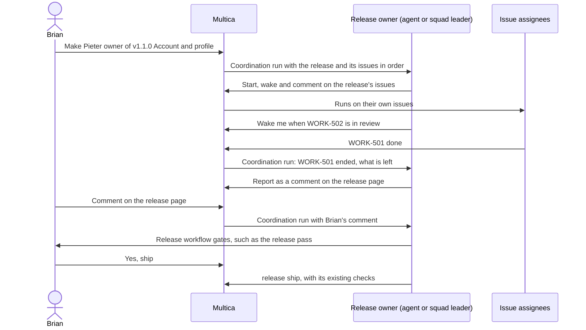

## At a glance

| Kind | Name | Change | Path |
|---|---|---|---|
| Capability | Release owner | added | `specs/openspec/changes/release-owner/specs/release-owner/spec.md` |
| Capability | Release coordination | added | `specs/openspec/changes/release-owner/specs/release-coordination/spec.md` |
| Capability | Release page | added | `specs/openspec/changes/release-owner/specs/release-page/spec.md` |
| Capability | Releases page | modified | `specs/openspec/changes/release-owner/specs/releases-page/spec.md` |

## Why

Brian coordinates every release's issues and their dependencies by hand: which issue starts next, which waits for an open pull request, and when the release is ready for its release workflow. A release cannot be delegated, because only issues have an assignee and only issues get runs and wakeups.

Success: Brian makes Pieter owner of v1.1.0 Account and profile on appboypov/rebl, and without further input from Brian Pieter starts the release's issues in their order, is woken as they end, reports each step on v1.1.0's page, and brings the release to Brian's release pass, while every issue keeps its assignee, parent and worklane and the release ships only through `release ship`.

## What Changes

- A release can have one owner: an agent or a squad. The owner is optional; a release without one works as it does now.
- Plan release, Edit release and the CLI set, change and remove the owner; the Timeline, Releases and `release get`/`list` show it; every worklane's activity records each owner change.
- Making an agent or squad owner starts a coordination run, the same way assigning an issue starts a run. A squad's coordination goes to its leader with the squad's briefing.
- A coordination run receives the release and its issues in their order, with each issue's status, assignee, parent, worklane and linked pull requests, and the reason it woke.
- The platform wakes the owner when an issue of its release ends and when every issue is done. The owner sets further waits on its release with the existing wakeup conditions and schedules.
- Coordination never ships a release: shipping stays `release ship` with its existing checks.
- Removing a release ends its coordination; shipping it ends its wakeups.
- Each release gets a page like an issue page: its version, title, state, description, owner, its issues in order, and its comments with a comment box. A Releases row and a release's title on the Timeline open it.
- Brian's comment on a release page wakes its owner; each coordination run posts its result as a comment there.

## Capabilities

### New Capabilities

- `release-owner`: Brian gives a release an agent or a squad as its optional owner, sees it, and changes or removes it.
- `release-coordination`: a release's owner gets runs on the release itself to coordinate its issues through the release workflow, woken by the platform, by its own waits and by comments on the release page, and reports there.
- `release-page`: Brian opens a release's own page to see its issues and owner, read the owner's reports and answer them.

### Modified Capabilities

- `releases-page`: a release row opens the release's page instead of a worklane's Timeline; the page leads on to the Timeline.

## Impact

- Database: an owner on `release`; comments on a release; release-scoped runs and wakeups in the existing task queue and `issue_wakeup` machinery.
- Backend: release handlers (`server/internal/handler/release.go`), the run trigger and squad-leader routing (`server/internal/service/issue_trigger.go`, `task.go`, `squad_briefing.go`), the wakeup system (`issue_wakeup_system.go`, `issue_wakeup_condition.go`), the daemon prompt (`server/internal/daemon/prompt.go`).
- API: release request and response gain the owner; `packages/core/api/schemas.ts` release schema.
- CLI: `server/cmd/multica/cmd_release.go` gains assignment, release comments and release wakeups.
- Web and desktop: `packages/views/releases/components/` (release dialog, release line, release row), a new release page in `packages/views/releases/`, its web route under `apps/web/app/[workspaceSlug]/(dashboard)/releases/` and its desktop route.
- MadSpec: `madspec-releases` and `madspec-multica` "Releases" learn that a release can have an owner who carries it.

## Constraints

- An owner is optional; a release without one behaves exactly as today.
- An owner is an agent or a squad, never a member.
- Owner permission and readiness follow issue assignment: the same agents and squads, the same refusals.
- No issue stands behind a release, and no second scheduler: coordination uses the existing run, wakeup and squad-leader machinery.
- Coordination keeps Brian's release: its issues, their order, their assignees, parents and worklanes, and its version and place on the line.
- Coordination never marks a release shipped; `release ship` with its checks (ADR 0010) stays the only way.
- Release placement stays under the repository's lock (ADR 0013).
- No foreign keys; every new index is `CREATE INDEX CONCURRENTLY` in its own migration; the release response passes through its zod schema with `parseWithFallback`, the owner defaulting to none.

## Non-goals

- A dependency scheduler or a release-wide queue that starts issues by itself.
- The owner adding, removing or reordering the release's issues, or moving, renumbering or removing the release.
- A member as a release owner.
- Publishing a release automatically or shipping without Brian's yes.
- Moving MadSpec's workflow or gates into the platform: the owner follows them through its skills and instructions.
- Editing, moving, removing or shipping a release, or adding issues to it, from the release page: those stay where they are.
- Release owners and release pages in the mobile app.

## Sources

- WORK-1157 description: Brian's requirements and end goal.
- WORK-1157 comment 01a14513-3fea-7b57-86f1-856a08fc9696 thread: Pieter's discovery and recommendation.
- WORK-1157 comment 01a1451e-1e6a-7f3a-a359-2af8ee74c6c6: Brian's approval, "yes but also the same way as issues so its not mandatory", and what it settles.
- Brian's answer to question 01a14523-323c-7f10-b838-f22e6a658cb2: a release page like an issue page, with the release's issues, its owner, the owner's reports as comments, and a comment box where his comment wakes the owner.
- `adr/0010-the-server-keeps-each-repositorys-release-line.md`, `adr/0013-an-issue-is-placed-in-a-worklane-and-a-release-under-the-repositorys-lock.md`.
- `server/internal/service/issue_trigger.go` (assignment run rules), `server/internal/service/issue_wakeup_system.go` (child_done rule), `server/internal/handler/squad_briefing.go`.
