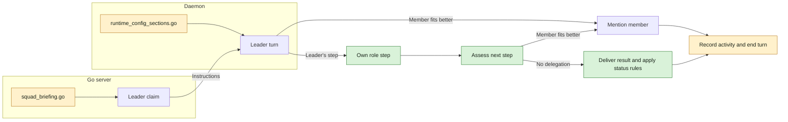

## At a glance

| Kind | Name | Change | Path |
|---|---|---|---|
| Handler protocol | `squadOperatingProtocolHeader`, `squadOperatingProtocolHardRules` | changed | `server/internal/handler/squad_briefing.go` |
| Handler test | Squad Operating Protocol tests | changed | `server/internal/handler/squad_briefing_test.go` |
| Handler test | Parent status contract test | changed | `server/internal/handler/squad_parent_status_contract_test.go` |
| Runtime brief | `writeWorkflowIssue` leader status bullet | changed | `server/internal/daemon/execenv/runtime_config_sections.go` |
| Runtime brief test | Leader issue workflow tests | changed | `server/internal/daemon/execenv/runtime_config_test.go` |
| Daemon test | `TestBuildPromptSquadLeaderOwnWorkRequiresReply` | changed | `server/internal/daemon/prompt_test.go` |
| Builtin reference | Squads reference | changed | `server/internal/service/builtin_skills/multica-platform/references/squads.md` |
| Builtin reference | Issues reference | changed | `server/internal/service/builtin_skills/multica-platform/references/issues.md` |
| Builtin skill test | `TestPlatformSkillCoversPlatformContracts` | changed | `server/internal/service/builtin_skills_test.go` |
| Guide | Squads guide, English | changed | `apps/docs/content/docs/squads.mdx` |
| Guide | Squads guide, Chinese | changed | `apps/docs/content/docs/squads.zh.mdx` |
| Guide | Squads guide, French | changed | `apps/docs/content/docs/squads.fr.mdx` |
| Guide | Squads guide, Japanese | changed | `apps/docs/content/docs/squads.ja.mdx` |
| Guide | Squads guide, Korean | changed | `apps/docs/content/docs/squads.ko.mdx` |
| OpenSpec | Change metadata | new | `specs/openspec/changes/squad-lead-own-steps/.openspec.yaml` |
| OpenSpec | Proposal | new | `specs/openspec/changes/squad-lead-own-steps/proposal.md` |
| OpenSpec | Design | new | `specs/openspec/changes/squad-lead-own-steps/design.md` |
| OpenSpec | Tasks | new | `specs/openspec/changes/squad-lead-own-steps/tasks.md` |
| OpenSpec | `squad-leader-steps` spec delta | new | `specs/openspec/changes/squad-lead-own-steps/specs/squad-leader-steps/spec.md` |

## Context

A claim appends the Squad Operating Protocol to the leader's instructions. The daemon adds issue workflow guidance. These two surfaces must agree. Agent Identity remains the authority for allowed actions. The owning and guest leader status rules remain separate.

## Decisions

### Choose the next step within the leader's identity

The protocol asks the leader to read the issue and its persona skill on every trigger. It handles its own role steps and compares each next step with member skills and roles. There is no mode, setting, or runtime branch for this choice. The [spec delta](specs/squad-leader-steps/spec.md) defines the cases.

### Stop after delegation

The leader can do its own step and then delegate in the same turn. Its single comment carries its result and the short delegation. After recording squad activity, the turn ends. A turn with no delegation delivers a result normally. Activity and the silent `no_action` rule stay in the protocol, not in a second daemon rule.

### Keep status authority separate

Dispatch leaves an owned parent in `in_progress`. The daemon does not require a later member trigger before own work can meet the completion rule. It points to the protocol for status authority. The owned-parent and guest-parent instruction blocks do not change.

### Keep triggers and members unchanged

Member updates, member completion, and mentions keep their current routing. Only leader instructions change. No trigger service, task wire field, squad member instruction, or database field changes.

## Risks

- Prompt text guides a model; unit tests can check the instruction contract, not prove every model follows it.
- The two prompt surfaces could disagree on completion. Composition tests cover both together.
- Open PR 53 (`work-1042`, sub-squads backend) and PR 81 (`work-1157`, release coordination) also touch `squad_briefing.go`. Resolve their shared hunks while keeping both contracts. PR 55 (`work-1042-ui`) does not touch this file.

## Verification

No checks run for this assignment. The [tasks](tasks.md) name the deferred Crabbox checks. No migration or live rollout step is needed.
