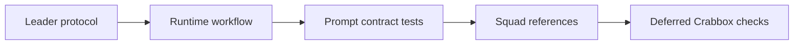

## At a glance

| Kind | Name | Change | Path |
|---|---|---|---|
| Handler protocol | `squadOperatingProtocolHeader`, `squadOperatingProtocolHardRules` | changed | `server/internal/handler/squad_briefing.go` |
| Handler test | Squad Operating Protocol tests | changed | `server/internal/handler/squad_briefing_test.go` |
| Handler test | Parent status contract test | changed | `server/internal/handler/squad_parent_status_contract_test.go` |
| Runtime brief | `writeWorkflowIssue` leader status bullet | changed | `server/internal/daemon/execenv/runtime_config_sections.go` |
| Runtime brief test | Leader issue workflow tests | changed | `server/internal/daemon/execenv/runtime_config_test.go` |
| Daemon test | `TestBuildPromptSquadLeaderOwnWorkRequiresReply` | changed | `server/internal/daemon/prompt_test.go` |
| Builtin reference | Squads reference | changed | `server/internal/service/builtin_skills/multica-platform/references/squads.md` |
| Builtin reference | Issues reference | changed | `server/internal/service/builtin_skills/multica-platform/references/issues.md` |
| Builtin skill test | `TestPlatformSkillCoversPlatformContracts` | changed | `server/internal/service/builtin_skills_test.go` |
| Guide | Squads guide, English | changed | `apps/docs/content/docs/squads.mdx` |
| Guide | Squads guide, Chinese | changed | `apps/docs/content/docs/squads.zh.mdx` |
| Guide | Squads guide, French | changed | `apps/docs/content/docs/squads.fr.mdx` |
| Guide | Squads guide, Japanese | changed | `apps/docs/content/docs/squads.ja.mdx` |
| Guide | Squads guide, Korean | changed | `apps/docs/content/docs/squads.ko.mdx` |
| OpenSpec | Change metadata | new | `specs/openspec/changes/squad-lead-own-steps/.openspec.yaml` |
| OpenSpec | Proposal | new | `specs/openspec/changes/squad-lead-own-steps/proposal.md` |
| OpenSpec | Design | new | `specs/openspec/changes/squad-lead-own-steps/design.md` |
| OpenSpec | Tasks | new | `specs/openspec/changes/squad-lead-own-steps/tasks.md` |
| OpenSpec | `squad-leader-steps` spec delta | new | `specs/openspec/changes/squad-lead-own-steps/specs/squad-leader-steps/spec.md` |

## 1. Implementation

- [x] 1.1 Update `squad_briefing.go` to choose own steps or member delegation on every trigger while keeping activity and status boundaries.
- [x] 1.2 Update the leader bullet in `writeWorkflowIssue` so own delivery can complete without a member re-trigger.
- [x] 1.3 Update handler, daemon, execenv, and builtin skill contract tests, including the composed status contract.
- [x] 1.4 Update builtin `references/squads.md`, `references/issues.md`, and all five `apps/docs/content/docs/squads*.mdx` guides.

## 2. Deferred verification

No checks run in this assignment, as requested. Run these through Crabbox on the PR head:

- [ ] 2.1 Handler tests: `TestSquadOperatingProtocolScopesParentStatusOwnership`, `TestSquadOperatingProtocolAllowsOwnStepsBeforeDelegation`, `TestSquadOperatingProtocolOwnsNoActionRule`, `TestSquadAssignedLeaderCanWrapUpOnCommentTurn`, and `TestGuestLeaderCannotChangeStatusOnCommentTurn`. The handler test package needs its normal migrated test database, including for protocol-only tests.
- [ ] 2.2 Daemon tests: `TestBuildPromptSquadLeaderOwnWorkRequiresReply`, `TestBuildPromptSquadLeaderReplyCarveOutIgnoresTriggerAuthor`, and `TestBuildPromptProtocolHeadingInInstructionsIsNotALeader`.
- [ ] 2.3 Execenv tests: `TestSquadLeaderIssueWorkflowKeepsParentInProgress`, `TestIssueWorkflowHonorsAgentIdentity`, and `TestProtocolHeadingInInstructionsGetsNoLeaderBrief`.
- [ ] 2.4 Check Go formatting for the touched Go files and Markdown formatting for the docs.
- [ ] 2.5 Run `cd specs && npx --yes @fission-ai/openspec@1.13.0 validate squad-lead-own-steps --type change --strict`.
- [ ] 2.6 Builtin skill test: `TestPlatformSkillCoversPlatformContracts`.
