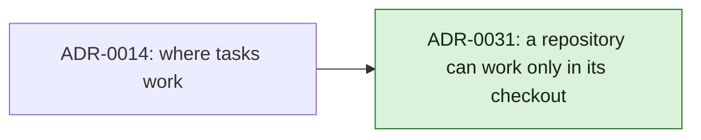

# ADR Review Manifest

- Status: completed
- Review date: 2026-10-17

## At a glance

| Kind | Name | Change | Path |
|---|---|---|---|
| ADR | A repository can work only in its checkout | new | adr/0031-a-repository-can-work-only-in-its-checkout.md |

## Review Summary

The highest ADR number on `main` is 0022, and the open pull request #99 takes 0023 to 0030. The setting changes where tasks work under ADR-0014, a decision that binds every later change to worktrees, so ADR-0031 records it and amends ADR-0014 without superseding it.

## In-Force ADRs Reviewed

- `adr/0006-repositories-hold-worklanes.md`: `main` works in the repository's checkout; the setting reuses it.
- `adr/0007-worktrees-are-made-by-the-daemon-and-recorded-by-the-server.md`: the daemon still owns every git change and path lock.
- `adr/0008-worklane-activity-is-kept-in-the-activity-log.md`: branch switches in the checkout stay `main`'s activity.
- `adr/0009-the-server-keeps-worklane-and-issue-worktree-folders-apart.md`: no folder is made, so nothing new to keep apart.
- `adr/0014-a-worklanes-issues-work-in-its-worktree-on-their-own-branch.md`: amended by ADR-0031.
