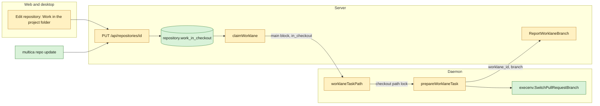
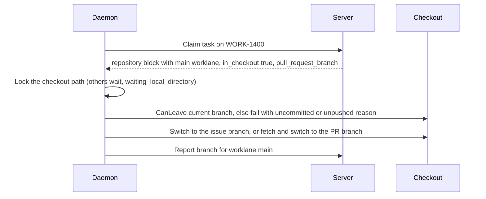

## At a glance

| Kind | Name | Change | Path |
|---|---|---|---|
| Migration | `repository.work_in_checkout BOOLEAN NOT NULL DEFAULT false` | new | `server/migrations/800_repository_work_in_checkout.{up,down}.sql` |
| Query | `UpdateRepositoryWorkInCheckout`, `GetMainWorklane` | new | `server/pkg/db/queries/repository.sql`, `worklane.sql` |
| Handler | Repository response and update request carry `work_in_checkout` | changed | `server/internal/handler/repository.go` |
| Handler | `claimWorklane` routes every issue of such a repository to `main` with `in_checkout` | changed | `server/internal/handler/worklane_branch.go` |
| Handler | `ReportWorklaneBranch` accepts the `main` worklane of such a repository | changed | `server/internal/handler/worklane_branch.go` |
| Protocol | `ClaimWorklane.InCheckout` | changed | `server/pkg/protocol/messages.go` |
| Daemon | In-checkout path and branch switch, PR branch switched in place | changed | `server/internal/daemon/worklane_task.go`, `client.go` |
| Execenv | `SwitchPullRequestBranch` | new | `server/internal/daemon/execenv/pull_request_worktree.go` |
| CLI | `multica repo update <owner/name> --work-in-project-folder` | new | `server/cmd/multica/cmd_repo.go` |
| Core | `work_in_checkout` in schema, type and update request | changed | `packages/core/api/schemas.ts`, `packages/core/types/repository.ts` |
| View | Switch in Edit repository | changed | `packages/views/repositories/components/edit-repository-dialog.tsx` |
| Locales | `edit.work_in_checkout` in five languages | changed | `packages/views/locales/*/repositories.json` |

## Context

- The `main` worklane already does what the setting needs: `prepareWorklaneTask` (`server/internal/daemon/worklane_task.go`) switches the checkout to the issue branch, refuses a branch with uncommitted or unpushed work through `execenv.CanLeave` with the reasons the spec names, and reports the branch. `acquireIssueWorktreeLocks` (`issue_worktree.go`) locks the path `worklaneTaskPath` returns, so every task with the checkout's path waits in `LocalPathLocker` and shows `waiting_local_directory`.
- What sends a task elsewhere: `claimWorklane` (`server/internal/handler/worklane_branch.go`) gives no worklane block to an issue without a worklane, so `prepareIssueWorktrees` makes an issue worktree; it gives a lane's own block to an issue of another lane; and a `PullRequestBranch` makes `worklaneTaskPath` and `prepareWorklaneTask` pick a `.pull-requests/{branch}` worktree.
- `execenv.SwitchBranch` cuts a missing branch from `origin/{default}`, which is wrong for a PR branch that lives only on origin. `PreparePullRequestWorktree` (`execenv/pull_request_worktree.go`) already fetches a PR branch with an explicit refspec; that fetch is reused.
- `ReportWorklaneBranch` reads the worklane from the issue, which fails for an issue in no worklane or another lane.
- Repository fields: `install_command` is the pattern (migration 600, `UpdateRepositoryInstallCommand`, `RepositoryResponse`, zod `RepositorySchema`, Edit repository). `repository:updated` already invalidates the repository queries in `use-realtime-sync.ts`, so the workspace sees the change live.
- The CLI's `repo` command lists workspace repos; project repositories resolve through `GET /api/repositories` as `laneRepositoryID` in `cmd_worklane.go` does.
- Migration numbers up to 790 are taken on open branches, so this change uses 800.
- All groups are built in one pull request by the verifier on Brian's request; by kind they belong to backend (groups 1 to 3), tools (group 4) and frontend (group 5).

## Goals / Non-Goals

- Always: with the setting off, issue tasks work where they work today, except an issue whose branch the checkout still holds.
- Always: a task never switches a checkout that holds uncommitted or unpushed work.
- Never: make, move or remove worktrees or worklanes because of the setting.

## Decisions

- **Route to `main`, not a new mode.** The claim gives the repository's `main` worklane block with `InCheckout: true` to every issue of a repository with the setting on, on the checkout's machine. The daemon then runs the existing `main` path, so locking, branch safety and branch reports need no new machinery.
- **No lane issue fails as elsewhere.** An issue in no worklane on a runtime on another machine gets no block, as today, since it makes no worktree there. An issue of a lane keeps today's `worklane_elsewhere` failure.
- **PR branch switched in place.** With `InCheckout`, `worklaneTaskPath` returns the checkout and `prepareWorklaneTask` switches it to the PR branch through `SwitchPullRequestBranch`: an existing local branch is switched to, else the branch is fetched and created from `origin/{branch}`. A PR branch still held by an older pull-request worktree makes `git switch` fail with git's message; removing old worktrees is a non-goal.
- **Branch report names the worklane.** The daemon sends `worklane_id` with the branch. The server takes it when it is the issue's worklane, or the `main` worklane in the issue's project that has the setting on or already holds the branch; anything else is 409.
- **A held branch stays in the checkout.** git keeps a branch in one place, so after the setting goes off an issue whose branch `main` still records goes on in the checkout with `InCheckout`. Every other issue gets its worktree again.
- **The brief names the checkout.** With `InCheckout` the brief lists the repository's checkout and gives a Checkout Rule instead of the Worktree Rule, which forbids changes in the checkout.
- **Edit repository follows the saved value.** The switch shows the repository's saved value until it is flipped in the dialog, so a change from the CLI or another window shows and is never saved back over.
