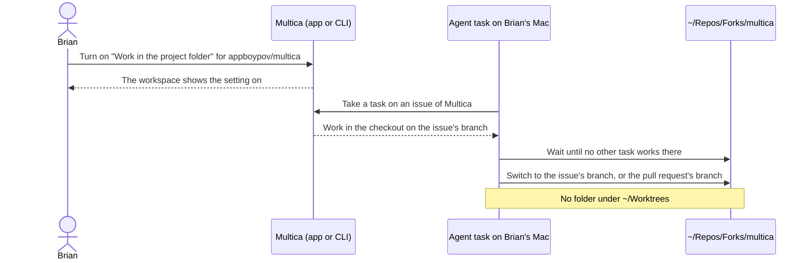

## At a glance

| Kind | Name | Change | Path |
|---|---|---|---|
| Capability | Repository work in checkout | new | specs/openspec/specs/repository-work-in-checkout/spec.md |

## Why

The Multica repository is too big for a worktree per issue, yet every issue in no worklane gets its own issue worktree and every issue with an open pull request gets a pull-request worktree. Nothing lets a repository turn this off since the project worktree mode left. Success means an issue task of appboypov/multica, with and without an open pull request, runs in `~/Repos/Forks/multica` on the issue's branch and makes no folder under `~/Worktrees`.

## What Changes

- A repository setting "Work in the project folder", off by default, that Brian turns on and off in Edit repository and with `multica repo update`.
- With it on, every issue task of the repository works in the repository's checkout on the issue's branch, or on the open pull request's branch, and makes no issue worktree or pull-request worktree.
- Tasks that work in one checkout wait for each other, and a task that would leave uncommitted or unpushed work on the checkout's branch fails with a reason that says which.

## Capabilities

### New Capabilities

- `repository-work-in-checkout`: lets Brian make every issue task of a repository work in its checkout, never in a worktree of the issue or its pull request.

## Impact

The repository table and its API (`GET`/`PUT /api/repositories`), the `repository:updated` event, Edit repository in `packages/views`, the CLI's `repo` command, the task claim's worklane block and the daemon's worktree preparation. One migration adds a column.

## Constraints

- With the setting off, issue tasks keep today's worktrees.
- The checkout's production `.env` stack is never touched by the setting.
- No foreign keys; the column reads and writes like the other repository fields, through the zod schema with `parseWithFallback`.

## Non-goals

- Switching worklanes off or changing their order for a repository with the setting on.
- Turning the setting on from Add repository or from the brain sync.
- Removing issue worktrees or pull-request worktrees that already exist.

## Sources

- WORK-1327, "Work in the project folder: a repository setting with no issue worktrees".
- `specs/openspec/specs/issue-worktrees/spec.md` and `specs/openspec/specs/worklane-agent-worktree/spec.md`.
- `adr/0014-a-worklanes-issues-work-in-its-worktree-on-their-own-branch.md`.
