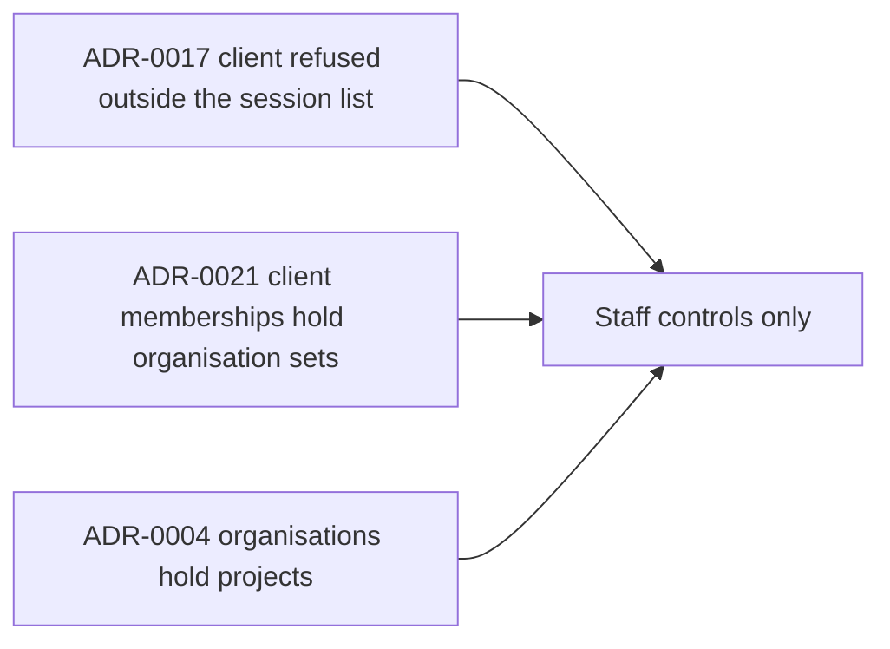

# ADR Review Manifest

- Status: completed
- Review date: 2026-10-18

## At a glance

| Kind | Name | Change | Path |
|---|---|---|---|
| Review | Staff client controls constraints | new | `specs/openspec/changes/staff-client-controls/adr.md` |

## Review Summary

ADR review completed for this change. The change is staff UI on top of the published membership API. It adds no stored model, route or authority rule, so no new ADR is needed.

## In-Force ADRs Reviewed

Constraints directly relevant to the design:

- `adr/0004-organisations-hold-projects.md`: an issue's organisation is the organisation of its project.
- `adr/0017-a-client-account-is-refused-outside-the-session-list.md`: a client session stays read-only, so assigning an issue to a client grants no writes.
- `adr/0021-client-memberships-hold-organisation-sets.md`: a client holds one or more organisations and a write replaces the whole set.

Other in-force records were reviewed and are unaffected; they cover runtimes, questions, worklanes, releases, templates, wakes, workers, personas and client updates.

## New Durable ADRs Created

- None. No major durable architectural decision was introduced.
