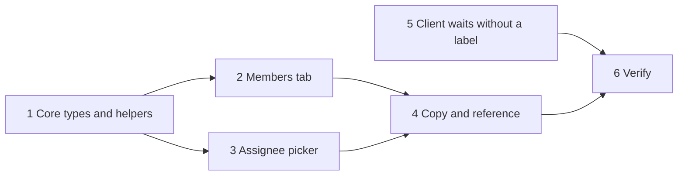

## At a glance

| Kind | Name | Change | Path |
|---|---|---|---|
| Plan | Staff client controls tasks | new | `specs/openspec/changes/staff-client-controls/tasks.md` |

## 1. Core types and helpers

- [x] 1.1 Add `StaffRole`, the `client` role and `organisation_ids` to member, invitation and member request types. Verify: `pnpm typecheck`.
- [x] 1.2 Parse `client` and `organisation_ids` in the member and invitation schemas with fallbacks. Verify: `members-invitations.test.ts`.
- [x] 1.3 Add `issueOrganisationId` and `clientsOfOrganisation`. Verify: `clients.test.ts`.

## 2. Members tab

- [x] 2.1 Add `OrganisationMultiSelect`. Verify: its component test.
- [x] 2.2 Invite member offers Client with Organisations and sends `organisation_ids` only for a client; share links stay staff. Verify: members tab test.
- [x] 2.3 Member and invitation rows show role Client and organisation badges. Verify: members tab test.
- [x] 2.4 A client's row menu holds Organisations and keeps the last organisation. Verify: members tab test.
- [x] 2.5 The member profile badge reads Client. Verify: smoke.
- [x] 2.6 A client's row stays busy until the refreshed members arrive, so a second Organisations edit keeps the first. Verify: members tab test with a pending refresh.
- [x] 2.7 On a client row the current Client role is disabled and sends nothing. Verify: members tab test.
- [x] 2.8 Organisation badges wrap and truncate long names, with the full name as title. Verify: smoke at a narrow width.

## 3. Assignee picker

- [x] 3.1 The picker takes `projectIds`, keeps clients out of Members and lists the issue organisation's clients under Clients. Verify: assignee picker test.
- [x] 3.2 Every caller passes its issues' project ids. Verify: `pnpm typecheck`.

## 4. Copy and reference

- [x] 4.1 Add the new strings in en, fr, ja, ko and zh-Hans. Verify: `parity.test.ts`.
- [x] 4.2 The MadSpec planning reference says how a client wait goes on the client's member. Verify: `multica issue assign --help` matches.

## 5. Client waits without a label

- [x] 5.1 The client wait queries list every open issue assigned to the client in their organisations, of any type and with any labels. Verify: `go test ./internal/handler -run ClientRead` and `go test ./cmd/server -run Client`.
- [x] 5.2 `team_state.py` finds a client wait by its client assignee. Verify: `test_team_state.py`.
- [x] 5.3 The open issues with the `Client wait` label get their client's member as assignee, and the label is then deleted. Verify: every open labelled issue has its client as assignee and the label is gone from `label list`.

## 6. Verify

- [x] 6.1 `pnpm typecheck`, `pnpm lint`, `pnpm test` and `make test` run. They pass except 4 failures that exist on `main` before this change: `instructions-tab.test.tsx` "sends the path the runtime's owner adds", `TestWorkspaceDeletionManifestCoversPublicSchema`, `TestBuiltinSkillsConformToTemplate` and `TestBuiltinSkillPayloadCarriesNoSourceReferences`.
- [x] 6.2 Smoke on web and desktop against the dev stack: invite a test client for A and B, accept, remove B, assign an A issue to the client and check B, C and no-project issues show no such client. The client's waits list the assigned issue.
- [x] 6.3 Update `specs/docs/system-design.md` and the system prototype in `prototypes/system/` for the staff controls and client waits.
