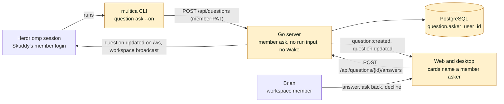
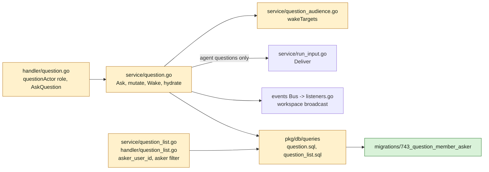
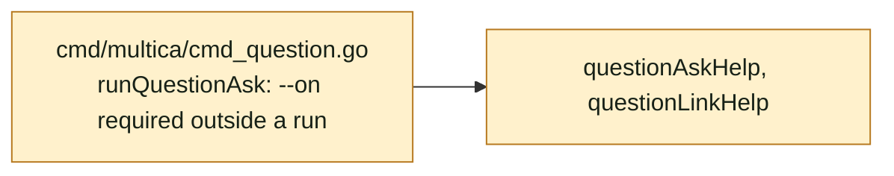
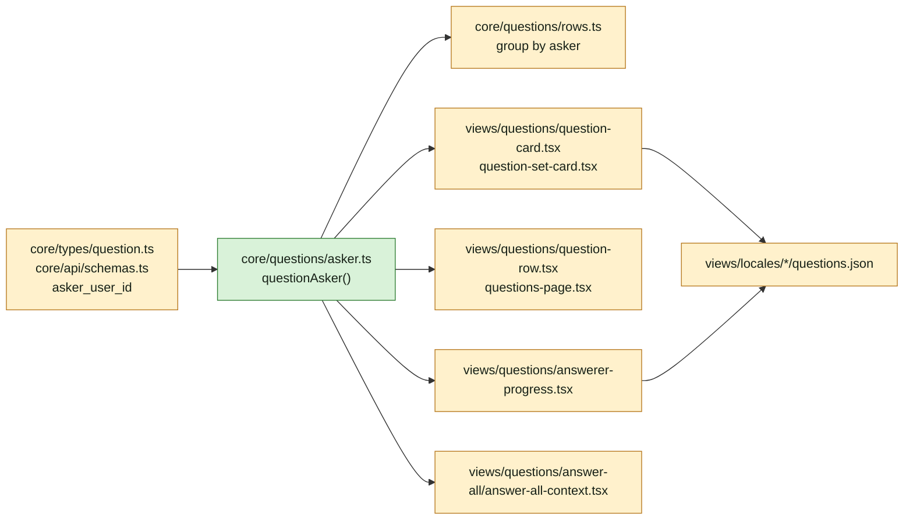
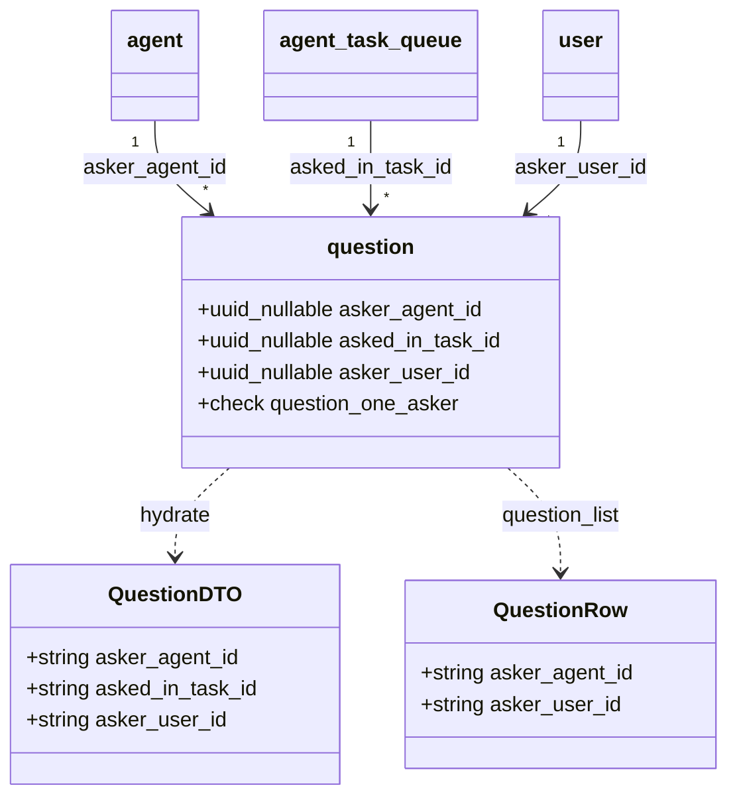
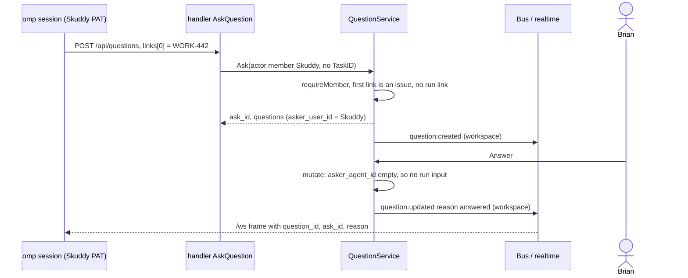

## At a glance

### Containers



### Go server



### CLI



### Web and desktop



### Models



### Sequence



### Data flow

| Input | Path | Output |
|---|---|---|
| Member PAT + ask body with `links[0]` an issue | `AskQuestion` -> `Ask` member branch | `question` row with `asker_user_id`, links without a run link, `asked` event, `question:created` |
| Member PAT + ask body without links, or `links[0]` not an issue | `Ask` member branch | 422 "a question asked outside a run is asked on an issue" |
| `cloud_pat` or task-token agent without task | `questionActor` asker role | 403 |
| Answer, edit, ask back, decline on a member question | `mutate` | event + `question:updated`; no `RunInputs.Deliver` |
| Wake on a member question | `Wake` | 422 "a question a member asked wakes no agent" |
| `multica question ask` without `--on` and no run | `runQuestionAsk` | error, no request |

| Kind | Name | Change | Path |
|---|---|---|---|
| Migration | question member asker | new | `server/migrations/743_question_member_asker.up.sql`, `.down.sql` |
| Queries | question create and list | changed | `server/pkg/db/queries/question.sql`, `server/pkg/db/queries/question_list.sql`, `server/pkg/db/generated/` |
| Handler | question actor and ask | changed | `server/internal/handler/question.go`, `server/internal/handler/question_links.go`, `server/internal/handler/question_list.go` |
| Service | question ask, mutate, Wake, hydrate | changed | `server/internal/service/question.go` |
| Service | wake targets | changed | `server/internal/service/question_audience.go` |
| Service | question list rows | changed | `server/internal/service/question_list.go` |
| CLI | question ask | changed | `server/cmd/multica/cmd_question.go` |
| Type | Question, QuestionRow | changed | `packages/core/types/question.ts`, `packages/core/api/schemas.ts` |
| Helper | questionAsker | new | `packages/core/questions/asker.ts`, `packages/core/questions/index.ts` |
| Helper | asker grouping | changed | `packages/core/questions/rows.ts` |
| View | question card, set card | changed | `packages/views/questions/question-card.tsx`, `packages/views/questions/question-set-card.tsx` |
| View | Questions page row, filter | changed | `packages/views/questions/question-row.tsx`, `packages/views/questions/questions-page.tsx` |
| View | answerer progress | changed | `packages/views/questions/answerer-progress.tsx` |
| View | Answer all context | changed | `packages/views/questions/answer-all/answer-all-context.tsx` |
| Copy | questions locale | changed | `packages/views/locales/{en,fr,ja,ko,zh-Hans}/questions.json` |
| Docs | CLI reference | changed | `apps/docs/content/docs/cli.mdx`, `cli.fr.mdx`, `cli.ja.mdx`, `cli.ko.mdx`, `cli.zh.mdx` |
| Docs | living system design | changed | `specs/docs/system-design.md` |
| ADR | member asks on an issue | new | `adr/0021-a-member-asks-on-an-issue-and-wakes-no-agent.md` |

## Context

Not a journey change: no journey steps. Team Backend (Joeri) owns groups 1 to 4 and 7. Groups 5 and 6 are Team Frontend's kind of work (Thomas); Skuddy's hand-off on WORK-442 keeps them with Joeri in this change, so the change is one pull request.

Code map, from `origin/main` at `c84c10fb3`:

- `server/migrations/566_question.up.sql`: `question.asker_agent_id UUID NOT NULL`, `asked_in_task_id UUID NOT NULL`. Latest migration is `742_*`, so the new one is `743`. AGENTS.md: no foreign keys; dependents cleaned in application code.
- `server/internal/handler/question.go:44` `questionActor(w, r, agentOnly, humanOnly)`: `AskQuestion` (line 101), `CloseQuestion` (245), `WithdrawQuestion` (262) and `question_links.go:23` pass `agentOnly`, which demands `actorType == "agent"` and `X-Actor-Source == "task_token"`, then parses `X-Task-ID`. Answer, ask back, reassign and Wake pass `humanOnly`, which refuses agents and `isMachineCredentialActor` (`actor_guards.go:110`: `task_token`, `cloud_pat`).
- `server/internal/handler/handler.go:881` `resolveActor`: a PAT without `X-Agent-ID`+`X-Task-ID` resolves to `member`. The omp plugin `omp-multica-listen` sends `Authorization: Bearer <mul_ PAT>` and `X-Workspace-ID` (`src/index.ts:101`).
- `server/internal/service/question.go:333` `Ask`: refuses non-agents (334), calls `requireAgentTask` (173), refuses tasks without issue, with `QuestionsEnabled` false, or not started; defaults links to the run's issue (447) and always appends the run link (454-464); writes `CreateQuestion` with `AskerAgentID: actor.ID, AskedInTaskID: task.ID` (475); publishes `question:created` (525).
- `question.go:532` `mutate`: `agentOnly` actions compare `row.AskerAgentID != actor.ID` (551), so a member's question already refuses close, withdraw and link. For `answered`, `answer_edited`, `ask_back` it calls `runInputForQuestion` (597), which loads the asker with `GetAgentInWorkspace(row.AskerAgentID)` (602): on a member's question this fails and rolls back the answer. That is the one path that must branch.
- `question.go:908` `Wake`: defaults `agentID` to `row.AskerAgentID`; with both invalid, `agentID == row.AskerAgentID` is true at 941 and the refusal names an empty agent. It needs an explicit refusal first.
- `question.go:874-904` (in `hydrate`, 820): reads `wakeTargets` and, when the asker is not a target, loads `asked_in_task_id`'s run to count unseen answers. `question_audience.go:99` `wakeTargets` loads the asking run first and returns no targets when it is missing, so a member's question already gets no targets, `wake_available` false and `unseen_answer_count` 0; guard both on `AskedInTaskID.Valid` to skip the dead query.
- `server/internal/service/question_list.go:58,84,112,243` and `server/internal/handler/question_list.go:69,149,305`: list rows carry `asker_agent_id`; the `asker_id` filter maps to `q.asker_agent_id = ANY(sqlc.narg('asker_agent_id'))` in four queries of `server/pkg/db/queries/question_list.sql` (lines 35, 84, 132, 237).
- Realtime: `server/cmd/server/listeners.go:81` lists personal events; question events are not in it, so `question:created` and `question:updated` go to every connection of the workspace (`notification_listeners_test.go` `TestNotificationQuestionRealtimeUsesWorkspaceFanout`). `server/internal/realtime/hub.go:768` authenticates `mul_` PATs on `/ws`. `publish` (`question.go:302`) sends `question_id`, `ask_id`, `issue_id(s)`, `reason`, `event_id`; a decline is an answer whose value is `{"declined": true}` (`server/internal/question/validate.go:75`), so its reason is `answered`. No realtime change is needed; the plugin filters by its own ask ids.
- `server/internal/daemon/prompt.go:103-132` and `server/internal/handler/daemon.go:3780` read unseen answers per asking agent; a member's question has no agent asker and never matches.
- `server/cmd/multica/cmd_question.go:129` `questionsAvailable()` is true outside a daemon task. `runQuestionAsk` (195) sends links from `--on` and `--link` (`questionLinkInputsFromFlags`, 318); `client.TaskID` is empty outside a run. Help text: `questionAskHelp` (26), `questionLinkHelp` (86, "without either the question is asked on the run's issue. The asking run is always linked after them").
- Frontend: `packages/core/types/question.ts:300-301,434` and `packages/core/api/schemas.ts:4663-4664,4742-4743,4844` hold `asker_agent_id`/`asked_in_task_id`. Every view names the asker with `getActorName("agent", …asker_agent_id)` and `<ActorAvatar actorType="agent" …>`: `question-card.tsx:229,255`, `question-set-card.tsx:114,263`, `question-row.tsx:179`, `answer-all/answer-all-context.tsx:63,66`, `answerer-progress.tsx:71`. Run labels: `question-card.tsx:259-260` and `question-set-card.tsx:267-268` use `card.asked_during_run` / `card.asked_during_a_run`. Wake beside Send: `question-card.tsx:140` and `question-set-card.tsx:152` compute `offersWake` from `isLastOpenFor` alone. Folded-card Wake and Answer all's `WakeBars` (`wake-bar.tsx`, `wakeOffers`) read `wake_available` / `wake_targets`, which are empty for a member's question. `core/questions/rows.ts:50-54` groups by `asker_agent_id`; `questions-page.tsx:323` builds the asker filter options from it. `issue-detail.tsx:1835,1864` uses the presence of the `asker_agent_id` key to tell questions from timeline entries, so the key stays on every question. `task-run-labels.ts:159` and `inbox-question-pane.tsx:56` look up runs by `asked_in_task_id`; an empty id finds none.
- Copy: `packages/views/locales/en/questions.json:23-24,64`; same keys in `fr`, `ja`, `ko`, `zh-Hans`.
- Tests to extend: `server/internal/service/question_test.go`, `server/internal/handler/question_test.go`, `server/cmd/multica/cmd_question_test.go`, `packages/views/questions/question-card.test.tsx`.
- In-force ADRs read: 0002 (aggregate), 0005 (questions decided at claim), 0019 (input reaches a running run), 0020 (only Wake turns answers into a run). ADR-0021 records this change's lasting decisions.

## Goals / Non-Goals

**Goals**

- A member login asks one question or a set through `POST /api/questions` and `multica question ask --on <issue>`, outside a run.
- Every view names the member who asked; Brian's answers, edits, ask backs and declines reach the asker's `/ws` connection.

**Always**

- An agent asks only with its task token, and its questions keep their run link, Wake, unseen counts and run input exactly as today.
- A member's question has an issue as its first link and no run link.
- The `asker_agent_id` key stays on every question payload, empty for a member's question.

**Never**

- A `cloud_pat` or any other machine credential asks.
- The app offers a way to ask.
- A member's question queues a run, reaches a running run as input, or offers Wake.
- A member closes, withdraws or links a question; that stays out of this change.
- A new realtime channel or per-user question event.

## Decisions

- **Columns, not a polymorphic asker.** Add nullable `asker_user_id`, drop NOT NULL on `asker_agent_id` and `asked_in_task_id`, add `question_one_asker CHECK ((asker_agent_id IS NOT NULL AND asked_in_task_id IS NOT NULL AND asker_user_id IS NULL) OR (asker_agent_id IS NULL AND asked_in_task_id IS NULL AND asker_user_id IS NOT NULL))`. Every agent-only query keeps comparing `asker_agent_id` and finds nothing for a member's question, so the wake, unseen and daemon paths need no change. An `asker_type`/`asker_id` pair would rename the column in every query and every client file for no behaviour gain. sqlc already maps both columns to `pgtype.UUID`, so Go types stay.
- **Migration.** `SET LOCAL lock_timeout = '2s'` as `566` does; `ALTER TABLE question ALTER COLUMN asker_agent_id DROP NOT NULL, ALTER COLUMN asked_in_task_id DROP NOT NULL, ADD COLUMN IF NOT EXISTS asker_user_id UUID`, then `ADD CONSTRAINT question_one_asker CHECK (...)` inside a `DO` block that skips when the constraint exists, so a rerun is idempotent. No index: the asker filter runs inside the workspace's already-narrowed list. The down migration deletes member-asked questions with their `question_link`, `question_answerer`, `question_answer` and `question_event` rows and the attachments whose `question_id` points at them, drops the constraint and column and restores NOT NULL.
- **Handler roles.** Replace `questionActor`'s two bools with one role: `questionRoleReader` (read, list), `questionRoleAgent` (close, withdraw, link: today's `agentOnly`), `questionRoleMember` (answer, ask back, reassign, Wake: today's `humanOnly`), `questionRoleAsker` (ask). The asker role accepts a task-token agent, parsing `X-Task-ID` as today, or a member whose request is not a machine credential (`isMachineCredentialActor` false); anything else gets 403 "only agents in a run or members ask questions".
- **Service Ask.** Keep the shared validation (questions, policy, due date, answerers, squad, suggestions, link count). Branch on `actor.Type`:

  ```go
  case "agent": task, err := s.requireAgentTask(...) // existing checks, run link appended
  case "member":
      if err := s.requireMember(ctx, q, workspaceID, actor); err != nil { return ..., err }
      if len(resolvedLinks) == 0 || resolvedLinks[0].Type != question.LinkTypeIssue {
          return ..., questionRefusal(422, "a question asked outside a run is asked on an issue")
      }
      params.AskerUserID = actor.ID // AskerAgentID and AskedInTaskID stay invalid
  ```

  The Agent questions setting is not read for a member (ADR-0005 decides it per run).
- **No run input, no Wake.** `mutate` calls `runInputForQuestion` only when `row.AskerAgentID.Valid`. `Wake` refuses with 422 "a question a member asked wakes no agent" right after loading the row when `!row.AskerAgentID.Valid`.
- **DTOs.** `QuestionDTO` and the list row gain `asker_user_id` (`""` for agent questions); `asker_agent_id` and `asked_in_task_id` are `""` for member questions. The list filter `asker_id` matches `q.asker_agent_id = ANY(@asker_ids) OR q.asker_user_id = ANY(@asker_ids)`; the narg is renamed `asker_ids`.
- **CLI.** When `client.TaskID == ""`, `runQuestionAsk` requires `--on` and that its parsed ref is an issue (bare key or `issue:`), else fails before any request with "a question asked outside a run needs --on with an issue". Help adds one line: "Outside a run (a member login), --on names the issue the question is asked on and is required; no run is linked."
- **Client asker.** `packages/core/questions/asker.ts` exports `questionAsker(q: { asker_agent_id: string; asker_user_id: string }): { type: "agent" | "member"; id: string }`. Every view takes name and avatar from it. A member's card reads the new `card.asked` "asked · {{time}}"; its progress line uses the new `each.line_member` "{{name}} sees each answer as it arrives."; `offersWake` is `false` when the asker is a member. Groups in `rows.ts` carry `asker: { type, id }` instead of `agentId`.

## Risks / Trade-offs

- Workspace broadcast means every member's client receives `question:updated` for Skuddy's questions, as it does for every question today; the plugin must filter by its ask ids. A per-user channel would need a second event path; not worth it for one listener.
- A member's question stays `answered` until its asker can close it, since only the asking run closes questions. Closing by the member is a later change.
- The CHECK constraint scans every existing row once under the ALTER's lock; the table is small (questions started 2026-10-12), and the 2s lock timeout lets a busy start retry.

## Migration Plan

Apply `743` with `make migrate-up`; existing rows satisfy the agent half of the CHECK. Rollback with `make migrate-down` deletes member-asked questions first, then restores NOT NULL.
