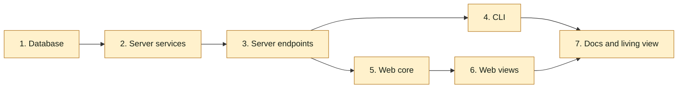

## At a glance

Not a journey change: no journey steps. Team Backend (Joeri) owns groups 1 to 4 and 7; groups 5 and 6 are frontend work that Skuddy's hand-off keeps with Joeri, so the change is one pull request. Group 1 starts first; groups 4 and 5 can run side by side once group 3 is done.

| Kind | Name | Change | Path |
|---|---|---|---|
| Group | Database | changed | `server/migrations/`, `server/pkg/db/queries/`, `server/pkg/db/generated/` |
| Group | Server services | changed | `server/internal/service/` |
| Group | Server endpoints | changed | `server/internal/handler/` |
| Group | CLI | changed | `server/cmd/multica/` |
| Group | Web core | changed | `packages/core/` |
| Group | Web views | changed | `packages/views/` |
| Group | Docs and living view | changed | `apps/docs/content/docs/`, `specs/docs/system-design.md` |

## 1. Database

- [ ] 1.1 `server/migrations/743_question_member_asker.up.sql` -- With `SET LOCAL lock_timeout = '2s'`, drop NOT NULL on `question.asker_agent_id` and `question.asked_in_task_id`, add `asker_user_id UUID` (`IF NOT EXISTS`), and add `question_one_asker` CHECK (exactly one of agent+task or user) in a `DO` block that skips an existing constraint -- design "Columns, not a polymorphic asker" and "Migration".
- [ ] 1.2 `server/migrations/743_question_member_asker.down.sql` -- Delete member-asked questions (`asker_user_id IS NOT NULL`) with their `question_link`, `question_answerer`, `question_answer`, `question_event` rows and attachments whose `question_id` points at them, then drop the constraint and column and restore NOT NULL -- AGENTS.md: dependents cleaned in application code, no foreign keys.
- [ ] 1.3 `server/pkg/db/queries/question.sql` -- `CreateQuestion` inserts `sqlc.narg('asker_agent_id')`, `sqlc.narg('asked_in_task_id')` and `sqlc.narg('asker_user_id')`; its `SELECT *` and `RETURNING *` queries carry `asker_user_id` into `db.Question` through sqlc; the unseen-answer queries keep joining `agent` on `asker_agent_id`, which drops member questions -- the member branch of `Ask` writes the new column.
- [ ] 1.4 `server/pkg/db/queries/question_list.sql` -- Select `q.asker_user_id` next to `q.asker_agent_id` in the four list queries and replace `q.asker_agent_id = ANY(sqlc.narg('asker_agent_id'))` with `(q.asker_agent_id = ANY(sqlc.narg('asker_ids')::uuid[]) OR q.asker_user_id = ANY(sqlc.narg('asker_ids')::uuid[]))` at lines 35, 84, 132, 237 -- spec "Questions page by asker".
- [ ] 1.5 `server/pkg/db/generated/` -- Regenerate with `make sqlc` and commit the output -- generated code tracks 1.3 and 1.4.

## 2. Server services

- [ ] 2.1 `server/internal/service/question.go` -- `Ask`: drop the agent-only refusal at line 334; branch on `actor.Type`: `agent` keeps today's path (`requireAgentTask`, issue, `QuestionsEnabled`, started, default link, run link); `member` calls `requireMember`, refuses 422 "a question asked outside a run is asked on an issue" unless `resolvedLinks[0]` is an issue, appends no run link, ignores Agent questions, and writes `AskerUserID: actor.ID` with invalid agent and task ids; any other actor type gets 403 "only agents in a run or members ask questions" -- design "Service Ask"; ADR-0021.
- [ ] 2.2 `server/internal/service/question.go` -- `mutate`: call `runInputForQuestion` and `RunInputs.Deliver` only when `row.AskerAgentID.Valid` -- today the member branch would fail at `GetAgentInWorkspace` and roll back the answer; spec "Joeri's running run hears nothing".
- [ ] 2.3 `server/internal/service/question.go` -- `Wake`: right after `GetQuestionForUpdate`, refuse 422 "a question a member asked wakes no agent" when `!row.AskerAgentID.Valid` -- spec "A member's question wakes no agent".
- [ ] 2.4 `server/internal/service/question.go` -- `QuestionDTO` gains `AskerUserID string \`json:"asker_user_id"\``, filled in `hydrate`; skip the unseen-answer fallback (lines 890-903) when `!row.AskedInTaskID.Valid` -- views need the member asker; the fallback query has no run to read.
- [ ] 2.5 `server/internal/service/question_audience.go` -- `wakeTargets`: return the empty result before `GetAgentTaskInWorkspace` when `!row.AskedInTaskID.Valid` -- no Wake target for a member's question without a dead query.
- [ ] 2.6 `server/internal/service/question_list.go` -- Row DTO gains `AskerUserID` (`json:"asker_user_id"`); pass `filters.AskerIDs` as the renamed `AskerIds` param at lines 84 and 112 -- list rows name and filter member askers.
- [ ] 2.7 `server/internal/service/question_test.go` -- Add tests: a member asks on an issue (asker_user_id set, links = issue then extra links, no task link, `question:created` published with ask id); member ask refused 422 without links and with a project first; member ask accepted while the issue's Agent questions is off; answer, answer edit, ask back and decline of a member's question succeed, publish `question:updated` with reasons `answered`, `answer_edited`, `ask_back`, `answered`, and call no `RunInputs.Deliver` while an agent run on the issue is running; `Wake` refuses 422; `hydrate` returns no wake targets and `wake_available` false; an agent's ask in a run keeps its run link and still delivers run input -- the business rules of this change, per `madspec-development` test rules.

## 3. Server endpoints

- [ ] 3.1 `server/internal/handler/question.go` -- Replace `questionActor`'s `agentOnly, humanOnly` bools with a `questionRole` (`questionRoleReader`, `questionRoleAgent`, `questionRoleMember`, `questionRoleAsker`); the asker role accepts a task-token agent (parsing `X-Task-ID`) or a member whose request is not a machine credential, else 403 "only agents in a run or members ask questions"; `AskQuestion` uses `questionRoleAsker`; every other caller keeps its current gate through the matching role -- design "Handler roles".
- [ ] 3.2 `server/internal/handler/question_links.go` -- Call `questionActor` with `questionRoleAgent` -- follows 3.1's signature.
- [ ] 3.3 `server/internal/handler/question_list.go` -- Response row gains `asker_user_id` (line 69, filled at 305); the `asker_id` filter (line 149) feeds the renamed `AskerIDs` param unchanged -- list endpoint returns member askers.
- [ ] 3.4 `server/internal/handler/question_test.go` -- Add tests: `POST /api/questions` with a member PAT and `links[0]` an issue returns 201 with `asker_user_id`; with `X-Actor-Source: cloud_pat` returns 403 and posts nothing; a task-token agent's ask still returns 201 with its run link -- spec "A member asks through the API", "A machine credential cannot ask".

## 4. CLI

- [ ] 4.1 `server/cmd/multica/cmd_question.go` -- In `runQuestionAsk`, when `client.TaskID == ""`, fail before any request with "a question asked outside a run needs --on with an issue" unless `--on` is set and its ref is an issue (bare key or ID, or `issue:`) -- spec "No --on".
- [ ] 4.2 `server/cmd/multica/cmd_question.go` -- Add to `questionLinkHelp`: "Outside a run (a member login), --on names the issue the question is asked on and is required; no run is linked." -- spec "The help says how to ask outside a run".
- [ ] 4.3 `server/cmd/multica/cmd_question_test.go` -- Add tests: without a task in context and without `--on`, and with `--on project:<id>`, the command fails with the 4.1 message and sends no request; with `--on WORK-1` it posts `links[0]` as that issue -- the CLI rule of 4.1.

## 5. Web core

- [ ] 5.1 `packages/core/types/question.ts` -- `Question` (line 300) and `QuestionRow` (line 434) gain `asker_user_id: string`; document that `asker_agent_id` and `asked_in_task_id` are `""` for a member's question -- contract of 2.4 and 2.6.
- [ ] 5.2 `packages/core/api/schemas.ts` -- Parse `asker_user_id` with default `""` in the question schema (near 4663), its fallback object (near 4742) and the row schema (near 4844) -- older payloads keep parsing.
- [ ] 5.3 `packages/core/questions/asker.ts`, `packages/core/questions/index.ts` -- New `questionAsker(q)` returning `{ type: "agent", id: asker_agent_id }` when set, else `{ type: "member", id: asker_user_id }`; export it -- one place decides the asker for every view.
- [ ] 5.4 `packages/core/questions/rows.ts` -- Group by `questionAsker(row)`; the asker group carries `asker: { type, id }` instead of `agentId` -- spec "Questions page by asker".

## 6. Web views

- [ ] 6.1 `packages/views/questions/question-card.tsx` -- Name and avatar from `questionAsker` (lines 229, 255); a member's question reads `card.asked` with its time and no run number (259-260); `offersWake` (140) is false for a member's question -- spec "Skuddy's card", "Brian answers Skuddy's last question".
- [ ] 6.2 `packages/views/questions/question-set-card.tsx` -- Same as 6.1 at lines 114, 152, 263, 267-268 -- the set card names the member asker and offers no Wake.
- [ ] 6.3 `packages/views/questions/question-row.tsx`, `packages/views/questions/questions-page.tsx` -- Row avatar (179) and the asker filter options (323) and group header from `questionAsker`, with `ActorAvatar`'s `actorType` from it -- spec "Questions page by asker".
- [ ] 6.4 `packages/views/questions/answerer-progress.tsx` -- Name from `questionAsker`; a member's question uses `each.line_member` (line 71) -- spec "Progress line of Skuddy's question".
- [ ] 6.5 `packages/views/questions/answer-all/answer-all-context.tsx` -- Avatar and name from `questionAsker` (lines 63, 66) -- Answer all names the member asker.
- [ ] 6.6 `packages/views/locales/en/questions.json`, `fr`, `ja`, `ko`, `zh-Hans` -- Add `card.asked` ("asked · {{time}}") and `each.line_member` ("{{name}} sees each answer as it arrives.") in every locale -- copy for 6.1, 6.2 and 6.4.
- [ ] 6.7 `packages/views/questions/question-card.test.tsx` -- Add tests: a member's question shows the member's name with "asked · …" and no run number, shows no Wake checkbox beside Send on the last open question, and its progress line has no closing clause; an agent's question still shows "asked during run #3 · …" and the Wake checkbox -- spec "Every question view names its asker", "A member's question wakes no agent".

## 7. Docs and living view

- [ ] 7.1 `apps/docs/content/docs/cli.mdx`, `cli.fr.mdx`, `cli.ja.mdx`, `cli.ko.mdx`, `cli.zh.mdx` -- The `question` rows (around lines 206 and 297 in `cli.mdx`) say members ask from outside a run with `--on <issue>`, which then is required and links no run -- docs match the CLI.
- [ ] 7.2 `specs/docs/system-design.md` -- In the models diagram, mark `asker_agent_id` and `asked_in_task_id` nullable (lines 616-617), add `+uuid asker_user_id` and `user "1" --> "*" question : asker_user_id` (near 746); in "Question contracts" note `asker_user_id` and that a member's question has no run -- the living view follows the code.

## Implementation Notes

## Plan Change Log
