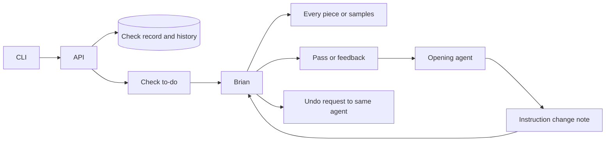

# Work checks and project records

## At a glance

## Checks

`POST /api/todos/checks` accepts `issue_id`, `project_id`, `member_id`, `kind`, `link`, and `title`. The issue belongs to the project and to the authenticated agent's task. The first check binds the project and kind to Brian, its recipient. Later checks cannot choose a different recipient. `GET /api/todos/checks/{id}` reads a check or instruction note for its recipient or opening agent. `POST /api/todos/{id}/answer` takes `pass` or `feedback` and a `note`. Feedback needs a note. Check and instruction notes cannot be dismissed with Mark done.

Kinds are `data_model`, `data_flow`, `design`, `prototype`, `feature`, `improvement`, `agent_tool`, and `release`. The first four are checked before dependent work. Feature, improvement and agent tool are checked on staging after merge. Release is beta or production and is checked before release.

## Record and Brian's choice

`GET /api/projects/{id}/check-trust` returns each kind's human pass count, feedback count, automatic pass count, sampling mode and recipient. `GET /api/projects/{id}/check-trust/{kind}/history` returns answered checks with their links, answers, notes, sample flags and dates. The project page and check detail show the record and history.

`PUT /api/projects/{id}/check-trust/{kind}` takes `sampling`. Only the record's recipient can change it. Switching to samples starts a deterministic counter: every fifth open reaches Brian, while the others are answered as passed and stored in history. A repeated choice leaves the counter unchanged. A switch back to every piece takes effect for later opens. Existing check to-dos stay open. Release cannot use samples. No answer, count, history entry or feedback changes the mode.

`GET` and owner/admin `PUT /api/todos/check-settings` expose `sample_every`, default 5, from 1 to 100. There is no pass-count threshold. The selected sampled check has a one-click action to check every piece, independent of its answer.

## Feedback and instruction notes

The feedback wake tells the opening agent to fix the piece, apply the instruction change itself and run `multica todo instruction-note <check-id> --file <path> --link <commit-URL> --note 
`. That command calls `POST /api/todos/checks/{id}/instruction-note`. Only the opening agent, in a task on the same issue, can report a change for an answered feedback check. The note stays linked to that check and its project. A retry returns the same note.

Brian answers the instruction note with `keep` or `undo` through the answer endpoint. Keep closes it. Undo leaves it open and delivers a request to the same agent to revert the named instruction change, then run `multica todo undo-result <todo-id> --link <commit-URL> --note <result>`. This calls `POST /api/todos/{id}/undo-result`. The report is shown on the same note. Brian closes it with Keep. The server does not edit office files or claim that an instruction was changed or reverted before the agent reports it.

## Transactions and delivery

Check opens lock the workspace, project and record. Each human answer is stored once with its count update. Mode changes lock the record and require its recipient. Answers and Undo requests send a durable run input to an active opening agent or queue that agent with the message in its handoff note. Notifications follow commit. Automatic pass results are returned in the create response without another run.

Project deletion removes its check and instruction notes and record in the same transaction. Workspace deletion removes its settings and records. Parent locks prevent a check open from leaving an orphan during deletion.

## CLI and UI

`multica todo check`, `get`, `answer`, `trust`, `settings`, `instruction-note`, and `undo-result` share the CLI's auth and output patterns. Answer accepts pass, feedback, keep or undo. Settings accepts `--sample-every`.

Reuse `designs/screens/todo-inbox.md`: split detail pane, semantic tokens and pending/error states. A check shows its kind, timing, work link and sample state. Its record has mode controls and answer history. The project page also exposes that record when the inbox is empty. An instruction note shows the changed file, summary and commit link, Keep and Undo, and the agent's undo result when reported.
