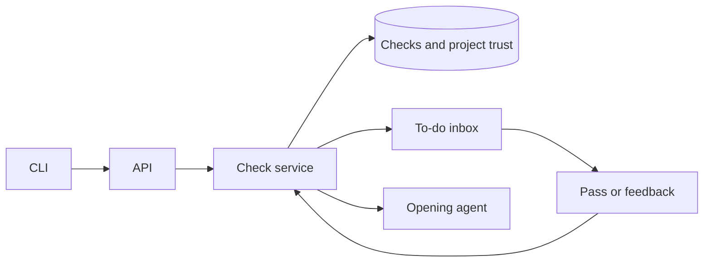

# Check to-dos and earned trust

## At a glance

## Contract

`POST /api/todos/checks` accepts `issue_id`, `project_id`, `member_id`, `kind`, `link`, and `title`. UUID references must belong to the active workspace and the issue must belong to the project. The authenticated task identifies the opening agent. `GET /api/todos/checks/{id}` reads the result. `POST /api/todos/{id}/answer` takes `answer` (`pass`, `feedback`, `yes`, `no`) and `note`. Feedback requires a note. Only the recipient answers. Check and proposal to-dos cannot be dismissed with Mark done.

`GET /api/projects/{id}/check-trust` returns state and counts by kind. `GET` and `PUT /api/todos/check-settings` expose workspace settings `streak_length` (default 5) and `sample_every` (default 5, one in five). Only a workspace owner or admin changes settings.

`multica todo check --issue WORK-1 --project <id> --answerer Brian --kind feature --link <URL> --title <text>`, `multica todo get <id>`, `multica todo answer <id> --answer pass|feedback|yes|no --note <text>`, and `multica todo trust <project-id>` follow the CLI's auth and output conventions.

Kinds are `data_model`, `data_flow`, `design`, `prototype`, `feature`, `improvement`, `agent_tool`, and `release`. First four are checked before dependent work. Feature, improvement and agent tool are checked on staging after merge. Release is beta or production and is always checked before release.

## Storage and transactions

Check rows keep the opening task and agent, recipient, work link, kind, project, answer, note and whether the answer was automatic or sampled. Trust rows are keyed by workspace, project and kind. They keep the recipient, human passes, feedback count, clean streak, automatic state, automatic-open counter and proposal ID. A project and kind keeps one recipient so an agent cannot change who approves its trust. The first check sets that recipient.

Opening and answering lock the trust row. Answering also locks the to-do. Each human answer updates one record once. Automatic passes are stored but do not earn a human streak. Every fifth automatic open is sampled. Feedback resets the streak and automatic state. After five human passes a proposal opens with a snapshot of the track record. Declining resets the streak so another proposal needs a fresh clean streak. Release never opens proposals and cannot become automatic.

A member answer queues the opening agent with its answer in the handoff note, using the task service. An active run receives the answer through run input delivery. The durable result remains readable through the API. Automatic answers are returned in the create response and do not start another run.

## UI

Reuse the inbox row, split detail pane, semantic tokens and pending/error states from `designs/screens/todo-inbox.md`. A check shows its kind, timing, work link, sampled state, project trust counts and Pass / Send feedback. A proposal shows its track record and Yes / No. Project trust is shown beside the selected check. Web and desktop use the same core hooks and views.
