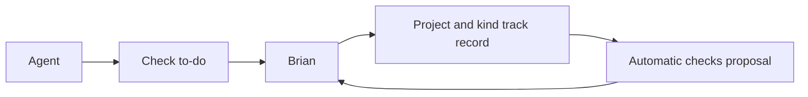

# Check to-dos and earned trust

## At a glance

## Why

Brian checks work in the same inbox as his other actions. A project earns automatic checks for each kind only after Brian agrees, with regular samples to keep that trust grounded.

## What

- Agents open check to-dos with an issue, project, work link and kind through the API and CLI.
- Members answer pass or feedback. Answers wake the opening agent.
- Store each result and the trust state per project and kind. A clean streak opens a proposal with the record. Only its recipient can agree.
- Sample automatic checks. Feedback returns that project and kind to checked work.
- Releases always need a member's check.

## Scope

Backend and CLI on `todo-inbox`. Shared web and desktop inbox UI on `todo-inbox-frontend`, with the backend branch as a dependency. No issue status or live workspace changes.
