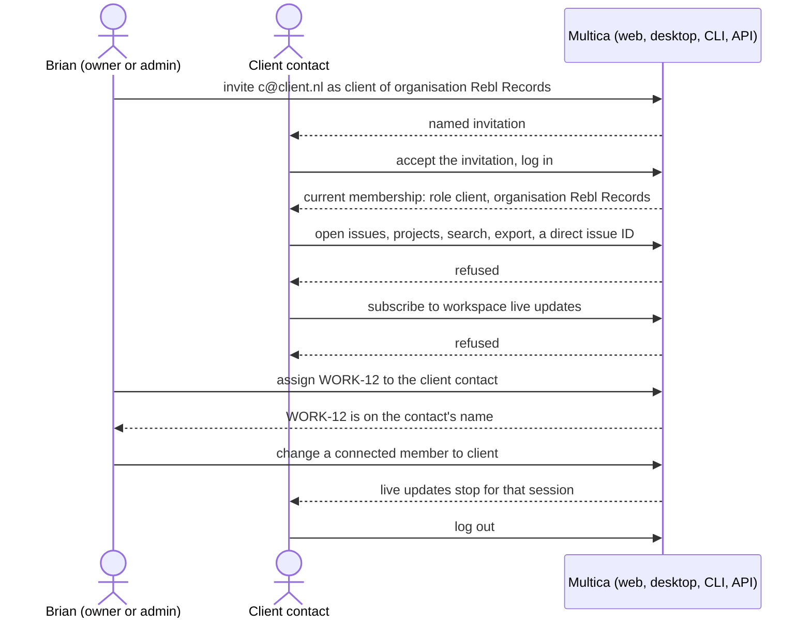

## At a glance

| Kind | Name | Change | Path |
|---|---|---|---|
| Role | `client` workspace role, bound to one organisation of the workspace | new | `server/migrations/`, `server/pkg/db/` |
| Invitation | Named invitation with role `client` and its organisation | changed | `server/internal/handler/invitation.go` |
| Member management | Role and organisation of a client membership | changed | `server/internal/handler/workspace.go` |
| Access rule | Client refused on every entry point outside the session list | new | `server/internal/middleware/workspace.go`, `server/cmd/server/router.go` |
| Session | Current membership with role and organisation | changed | `server/cmd/server/router.go` |
| Live updates | Client excluded from workspace subscriptions | changed | `server/internal/realtime/hub.go` |
| Assignee | Client contact as member assignee | changed | `server/internal/handler/issue.go` |
| CLI | `multica workspace member invite --role client` with an organisation | changed | `server/cmd/multica/cmd_workspace.go` |

## Why

Clients cannot log in to Multica, and the work that waits on a client is not on the client's name: the person is only in the title. Brian approved separate read-only accounts per client contact, each bound to one organisation (WORK-1059, Pit's "Settled" of 15 October 2026). This story opens that server path safely before any client data is shown: a client account exists, logs in, can carry assigned issues, and reaches nothing else. Every route is closed to it by default, so routes that upstream adds later stay closed too.

Success signal: a client contact of Rebl Records accepts a named invitation, logs in, sees the role `client` and the organisation Rebl Records in the current membership, and logs out; with the same credentials every ordinary workspace route, direct resource ID, search, export and workspace live-update subscription is refused and no agent task starts, while Brian assigns an issue to that contact and owners, admins and members keep all their access.

## What Changes

- A workspace membership can have the role `client`, bound to exactly one organisation of the same workspace. Owner, admin and member memberships have no organisation.
- An owner or admin invites a named client contact for one organisation through the existing named invitation, from the app's API and from `multica workspace member invite`. Acceptance and login keep the role and the organisation. A client is never turned into a member as a fallback.
- A client with a missing, deleted or foreign-workspace organisation gets no workspace access.
- A client is refused on every workspace, resource-ID and user-scoped entry point that can expose workspace data, before any ordinary handler runs. Only logging in and out, its own invitation, and a minimal current-membership response stay open.
- A client gets no workspace live updates: a subscription is refused, and a connected session whose member becomes a client stops receiving them.
- An owner or admin manages a client membership and assigns an issue to the contact through the existing member assignee.

## Capabilities

### New Capabilities

- `client-membership`: lets an owner or admin invite a client contact bound to one organisation, manage that membership, and assign issues to the contact, and lets the contact accept, log in, see their role and organisation, and log out.
- `client-default-deny`: refuses a client on every entry point outside the reviewed session list, including direct resource IDs, user-scoped entry points and workspace live updates, while owners, admins and members keep their access.

### Modified Capabilities

None: no existing capability in `specs/openspec/specs/` covers workspace roles, invitations or route access.

## Impact

- Server: the membership and invitation schema and their queries, a new migration, the role checks that accept owner, admin and member, invitation acceptance, member management, the workspace middleware and every authenticated route group in the router, the realtime hub, and the issue assignee check.
- CLI: `multica workspace member invite`.
- API: the role `client` and an organisation appear in membership and invitation responses; the web, desktop and mobile apps parse them, so a member list that holds a client keeps loading for staff.
- Web, desktop and mobile screens: none in this story.

## Constraints

- A client membership is bound to exactly one organisation of its own workspace; without a valid one it has no access.
- The refusal is the default for every route: a route serves a client only when it is on the reviewed session list, so a new upstream route is closed to clients without any change.
- A client is never upgraded to member, admin or owner by login, invitation acceptance, a share link or any fallback.
- Public share links never grant the role `client`.
- Owner, admin and member access stays as it is.
- Ownership of a client's work is the issue's assignee, using the existing member assignee and its user-ID identity.
- AGENTS.md "Database and Migration Rules": no foreign keys or cascades; a new migration, never an edited applied one; any index `CREATE INDEX CONCURRENTLY` in its own migration.
- AGENTS.md "API Compatibility": membership and invitation responses keep parsing in installed clients.

## Non-goals

- Any client data read, such as their own waits or their organisation's planned work: story WORK-1071.
- Client or staff screens: stories WORK-1070, WORK-1072, WORK-1073 and WORK-1074.
- Creating real client accounts.
- Public client share links or a read-only page per client.
- Client writes, comments, Points or agent runs.

## Sources

- WORK-1059 "Read-only Multica accounts for clients to see their outstanding tasks": its Requirements R1, R4 and R5, Boundaries and Done when, and Pit's "Settled" comment of 15 October 2026 with Brian's answers.
- WORK-1069 "Client membership and default-deny access": its description, Verify, Unknown and Packet, with the code locations the technical design reads.
- Brian's approval of the six-story plan on WORK-1059, 15 October 2026.
