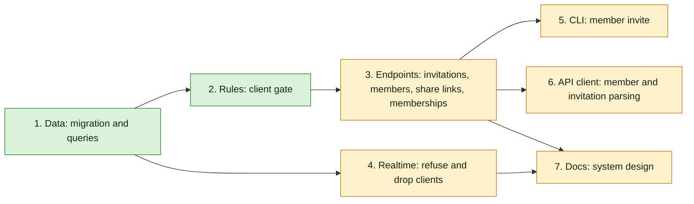

## At a glance

One team, Backend. Groups in dependency order; each is one builder's slice.

| Kind | Name | Change | Path |
|---|---|---|---|
| Migration | `732_client_membership` | new | `server/migrations/` |
| Queries | member and invitation queries | changed | `server/pkg/db/queries/`, `server/pkg/db/generated/` |
| Middleware | `clientGate` in `Auth` and `DaemonAuth` | new | `server/internal/middleware/` |
| Endpoints | invitations, members, share-link join, `GET /api/me/memberships` | changed | `server/internal/handler/`, `server/cmd/server/router.go` |
| Realtime | `IsMember`, `dropDemotedClients` | changed | `server/cmd/server/router.go`, `server/internal/realtime/hub.go` |
| CLI | `member invite --role client --organisation` | changed | `server/cmd/multica/cmd_workspace.go`, `apps/docs/content/docs/cli.mdx` |
| API client | member and invitation schemas | changed | `packages/core/api/` |
| System design | gate, endpoint, model fields | changed | `specs/docs/system-design.md` |

## 1. Data: migration and queries

- [ ] 1.1 `server/migrations/732_client_membership.up.sql` -- add `organisation_id UUID` to `member` and `workspace_invitation`, replace `member_role_check` and `workspace_invitation_role_check` with checks that allow `client`, add `member_client_organisation_check` and `workspace_invitation_client_organisation_check` `CHECK ((role = 'client') = (organisation_id IS NOT NULL))`, under `SET LOCAL lock_timeout = '2s'` -- design Migration Plan; confirm the auto-generated constraint names against the dev database before dropping them.
- [ ] 1.2 `server/migrations/732_client_membership.down.sql` -- delete `client` rows of both tables, drop the new constraints and columns, restore the old role checks -- rollback.
- [ ] 1.3 `server/pkg/db/queries/member.sql` -- `CreateMember` and `UpdateMemberRole` take `organisation_id`; add `IsClientAccount :one`, `CountMembershipsByUser :one` and `ListMyMemberships :many` as design decisions 1, 2 and 6 say -- every membership write carries the organisation.
- [ ] 1.4 `server/pkg/db/queries/invitation.sql` -- `CreateInvitation` takes `organisation_id` -- design decision 3.
- [ ] 1.5 `server/pkg/db/generated/` -- run `make sqlc`; pass `organisation_id` (NULL) at the existing `CreateMember` calls in `internal/handler/workspace.go:279` and `internal/handler/share_link.go:377` -- the build compiles with the new parameters.

## 2. Rules: client gate

- [ ] 2.1 `server/internal/middleware/client_gate.go` -- `clientSessionRoutes` (method plus `path.Match` pattern, the table of design decision 1) and `clientGate(queries, next)`: reads `X-User-ID`, refuses a client account outside the list with 403 `client accounts can only use the session routes`, fails closed with 500 when `IsClientAccount` errors, and logs the refusal with path and user ID -- the one place a route opens to a client.
- [ ] 2.2 `server/internal/middleware/auth.go` -- `Auth` wraps `next` in `clientGate` once when `queries != nil`, before the credential branches -- every `Auth` group and credential is covered.
- [ ] 2.3 `server/internal/middleware/daemon_auth.go` -- same wrap in `DaemonAuth` -- a client's PAT or daemon token reaches no daemon route.
- [ ] 2.4 `server/internal/middleware/client_gate_test.go` -- matcher table (each session row matches; `/api/invitations/x/y`, `/api/me/onboarding` and others do not), refusal status and body for a client account, pass-through for staff and for a user without memberships -- gate rules.

## 3. Endpoints: invitations, members, share links, memberships

- [ ] 3.1 `server/internal/handler/workspace.go` -- `normalizeMemberRole` accepts `client`; `CreateMemberRequest` and `UpdateMemberRequest` gain `organisation_id`; `MemberWithUserResponse` gains `organisation_id` (`*string`); `UpdateMember` follows design decision 4 (organisation checks, one-membership check, staff to client in one tx with `revokeMemberState` then `publishRevocation`, staff role clears the organisation) -- member management.
- [ ] 3.2 `server/internal/handler/workspace_revoke.go` -- extract `revokeMemberState(ctx, qtx, workspaceID, userID, archivedBy)` from `revokeAndRemoveMember`, which keeps its tx, seat release and `DeleteMember` -- one converge path for leaving staff.
- [ ] 3.3 `server/internal/handler/invitation.go` -- `CreateInvitation` and `AcceptInvitation` as design decisions 2 and 3 say; `InvitationResponse` gains `organisation_id` -- client invitation and acceptance.
- [ ] 3.4 `server/internal/handler/share_link.go` -- `JoinByShareLink` refuses with 409 when the user has a pending client invitation for the workspace, before it settles anything -- no upgrade through a share link.
- [ ] 3.5 `server/internal/handler/membership.go` -- `ListMyMemberships` for `GET /api/me/memberships`, response as design decision 6 -- current membership.
- [ ] 3.6 `server/cmd/server/router.go` -- register `GET /api/me/memberships` beside `/api/me` -- the session list's membership route.
- [ ] 3.7 `server/internal/handler/invitation_test.go` -- client invitation with, without and with a foreign organisation; member requester refused; existing-membership and client-account refusals; acceptance keeps role and organisation; acceptance with a missing organisation leaves no member and a pending invitation -- spec `client-membership`.
- [ ] 3.8 `server/internal/handler/workspace_test.go` -- move a client to another organisation; member to client with and without an organisation (staff state revoked, agents archived); client to member clears the organisation; remove a client; assign an issue to a client as member assignee; `GET /api/me/memberships` for a client, a client with a missing organisation and staff -- spec `client-membership`.
- [ ] 3.9 `server/internal/handler/share_link_test.go` -- join with a pending client invitation is refused and settles nothing; creating a share link with role `client` is refused -- no upgrade.
- [ ] 3.10 `server/cmd/server/client_gate_test.go` -- DB-backed: build the router with `NewRouterWithOptions`, walk every route with `chi.Walk` filling URL params with random UUIDs; every route that answers 401 without a credential answers the gate's 403 to a client's JWT and to a client's PAT unless it is on the session list; the session routes answer a client; a staff JWT never gets the gate's 403; `/ws` refuses a client -- spec `client-default-deny`, also for routes added later.

## 4. Realtime: refuse and drop clients

- [ ] 4.1 `server/cmd/server/router.go` -- `membershipChecker.IsMember` returns false for a `client` row -- `/ws` refuses a client.
- [ ] 4.2 `server/internal/realtime/hub.go` -- `dropDemotedClients(scopeType, scopeID, message)` called first in `BroadcastToScopeDedup`, as design decision 5 says, closing the demoted user's clients in that workspace with the `evictSlow` removal path and a log line -- a demoted member's socket gets no later event, on every node.
- [ ] 4.3 `server/internal/realtime/hub_test.go` -- a `member:updated` frame with role `client` closes that user's clients in that workspace only and they receive neither it nor a later frame; role `member` closes nothing; other users and workspaces keep receiving -- live-update rules.

## 5. CLI: member invite

- [ ] 5.1 `server/cmd/multica/cmd_workspace.go` -- `--organisation` flag, role `client` in the role switch and help, flag rules, key-or-ID resolution through `GET /api/organisations`, `organisation_id` in the body and the organisation in the table output, as design decision 7 says -- `multica workspace member invite --role client`.
- [ ] 5.2 `server/cmd/multica/cmd_workspace_test.go` -- `--role client` without `--organisation` fails before any request; an unknown key fails; a key resolves to its ID in the request body -- CLI rules.
- [ ] 5.3 `apps/docs/content/docs/cli.mdx` -- add `multica workspace member invite contact@client.nl --role client --organisation rebl-records` to the invite examples -- the CLI page lists the new form.

## 6. API client: member and invitation parsing

- [ ] 6.1 `packages/core/api/schemas.ts` -- `MemberWithUserSchema`, `MemberListSchema`, `InvitationSchema` and `InvitationListSchema` with `role` falling back to `member` and defaults for the other fields, as `ListOrganisationsResponseSchema` does -- AGENTS.md "API Compatibility".
- [ ] 6.2 `packages/core/api/client.ts` -- `listMembers`, `listWorkspaceInvitations`, `listMyInvitations` and `getInvitation` parse through `parseWithFallback` -- the members tab keeps loading with a client row.
- [ ] 6.3 `packages/core/api/members-invitations.test.ts` -- a list with a `client` member and a client invitation parses with role `member` and keeps every row; a malformed list falls back to empty -- spec "A member list that holds a client".

## 7. Docs: system design

- [ ] 7.1 `specs/docs/system-design.md` -- add the client gate to the Go server component map, `/api/me/memberships`, and `organisation_id` on `member` and `workspace_invitation` with their relation to `organisation` in the class diagram -- the living view matches the code.

## Implementation Notes

## Plan Change Log
