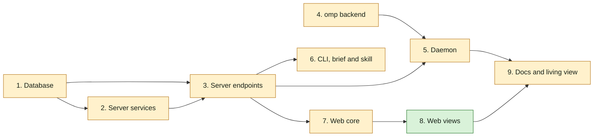

## At a glance

Not a journey change: no journey steps. Team Backend (Joeri) owns groups 1 to 6 and 9; groups 7 and 8 are the frontend part Skuddy's hand-off keeps in this change. Groups 1 and 4 can start at once.

| Kind | Name | Change | Path |
|---|---|---|---|
| Group | Database | changed | `server/migrations/`, `server/pkg/db/queries/` |
| Group | Server services | changed | `server/internal/service/`, `server/cmd/server/activity_listeners.go` |
| Group | Server endpoints | changed | `server/internal/handler/`, `server/cmd/server/router.go`, `server/pkg/protocol/` |
| Group | omp backend | changed | `server/pkg/agent/` |
| Group | Daemon | changed | `server/internal/daemon/` |
| Group | CLI, brief and skill | changed | `server/cmd/multica/`, `server/internal/daemon/execenv/`, `server/internal/service/builtin_skills/multica-platform/` |
| Group | Web core | changed | `packages/core/` |
| Group | Web views | new | `packages/views/` |
| Group | Docs and living view | changed | `apps/docs/content/docs/`, `specs/docs/system-design.md` |

## 1. Database

- [x] 1.1 `server/migrations/720_task_supplement_items.up.sql`, `.down.sql` -- add `item_kind TEXT NOT NULL DEFAULT 'comment' CHECK (item_kind IN ('comment','comment_edit','answer','issue_change'))`, `item_id UUID`, `content TEXT`, `seen_at TIMESTAMPTZ`, `handled_at TIMESTAMPTZ`; backfill `item_id = comment_id`; set `item_id NOT NULL`. Down attaches `task_supplement_comment_task_uidx` (rebuilt by 721 down) as `task_supplement_pkey` with `PRIMARY KEY USING INDEX`, then drops the columns -- design decision 1, Migration Plan.
- [x] 1.2 `server/migrations/721_task_supplement_item_task_index.up.sql`, `.down.sql` -- up: `CREATE UNIQUE INDEX CONCURRENTLY task_supplement_item_task_key ON task_supplement (item_id, task_id)`; down: `CREATE UNIQUE INDEX CONCURRENTLY IF NOT EXISTS task_supplement_comment_task_uidx ON task_supplement (comment_id, task_id)`; add the up entry to `concurrentIndexCleanups` and the down entry to the down-cleanup map beside `548` in `server/cmd/migrate/main.go` -- AGENTS.md index rule, Migration Plan.
- [x] 1.3 `server/migrations/722_task_supplement_item_task_primary_key.up.sql`, `.down.sql` -- up: swap the primary key to `(item_id, task_id)` using the index of 1.2, then `ALTER COLUMN comment_id DROP NOT NULL`; down: delete non-comment rows (`item_kind <> 'comment'`), drop `task_supplement_pkey`, `ALTER COLUMN comment_id SET NOT NULL`. 721 down and 720 down restore the old key -- Migration Plan.
- [x] 1.4 `server/pkg/db/queries/supplement.sql` -- `CreateRunInputSupplement` (kind, item, content, comment id nullable, `client_request_id = item_id`, `ON CONFLICT (item_id, task_id) DO NOTHING`); `ListRunningSupplementTasksForIssues` (running tasks with `task-supplement-v1` on the given issues, minus an agent and a task list); claim returns `item_kind`, `item_id`, `content`; `MarkRunInputSeen` and `MarkRunInputHandled` (`COALESCE`, only `status = 'delivered'`, returning the row); `ListRunInputMarksByItems` for answers and activity rows; switch every `comment_id`-keyed lookup the handlers use to `item_id`.
- [x] 1.5 `server/pkg/db/queries/comment.sql:351-407` (`ListReconcilableCommentsForIssueSince`) -- also take comments with a receipt of the completing task; drop a comment only when its newest `comment`/`comment_edit` receipt for a task of this agent has `handled_at` -- design decision 7.
- [x] 1.6 `server/pkg/db/queries/question.sql:200-223` and the claim-input query behind `loadClaimQuestionAnswers` -- leave out answers whose latest `answered`/`answer_edited` event has a receipt with `handled_at` for a task of the same agent -- ADR-0020.
- [x] 1.7 `server/pkg/db/generated/` -- regenerate with `make sqlc`.
- [x] 1.8 `server/pkg/db/queries/supplement_test.go` (or the package's existing query test file) -- tests: a delivered comment without ✅ replays and one with ✅ does not; a ✅ comment whose newer edit has no ✅ replays; an edit of a comment older than the run replays without ✅; a ✅ answer drops from the unseen count, an answer edited after ✅ counts again; marking twice keeps the first time; a mark on a `pending` receipt changes nothing.

## 2. Server services

- [x] 2.1 `server/internal/service/run_input.go` -- `RunInputService.Deliver(ctx, issueIDs, actor, item, excludeTaskIDs)`: every running task with `task-supplement-v1` on those issues, minus the actor's agent and `excludeTaskIDs`; one `pending` receipt per task in the lock order of `CreateTaskSupplement`; `NotifyTaskSupplementAvailable` per runtime; returns the task ids it reached; logs and breadcrumbs per the project's conventions -- design decision 2.
- [x] 2.2 `server/internal/service/question.go:597-634` and the edit and ask-back paths -- after the `question_event` commits, render the content ("Brian answered Thomas's question "…": …", "Brian changed the answer …", "Brian asks back: …") and call `Deliver` for every issue the question links to -- live-run-input "An answer reaches the running runs on the question's issues".
- [x] 2.3 `server/cmd/server/activity_listeners.go:63-280` -- after each issue-change `activity_log` insert, render "<actor> changed the <field> from <old> to <new>" (the description in full) and call `Deliver` for the issue -- live-run-input "An issue change reaches every running run on the issue".
- [x] 2.4 `server/cmd/server/activity_listeners.go` -- subscribe `issue_labels:changed`, `issue_attachments:changed` (only with `attachment_id`) and the parent changes of `issue:created`/`issue:updated`; record `label_added`, `label_removed`, `attachment_added`, `attachment_removed`, `sub_issue_added`, `sub_issue_removed` (sub-issue rows on the parent, with the child's id, key and title); publish the activity event and call `Deliver` as 2.3 -- design decision 9.
- [x] 2.5 `server/internal/handler/label.go:487`, `559` -- add `label` (id, name) and `change` to the `issue_labels:changed` payload.
- [x] 2.6 `server/internal/handler/file.go:611`, `1499` -- add `attachment_id`, `filename` and `change` to `issue_attachments:changed` when the file is on the issue itself, not on a comment.
- [x] 2.7 `server/internal/handler/issue.go:4144` (`UpdateIssue`) and the batch update publish near `issue.go:4984` -- add `parent_changed` and `prev_parent_issue_id` to `issue:updated`.
- [ ] 2.8 `server/internal/service/run_input_test.go` and `server/cmd/server/activity_listeners_test.go` (or the package's existing listener test) -- tests: the actor's own run gets no receipt; a queued task gets none; a task without `task-supplement-v1` gets none; an excluded task gets none; an answer to Skuddy's question reaches Thomas's running task; an issue change reaches every running task on the issue; adding a label, a file and a sub-issue each writes its activity row and a receipt.

## 3. Server endpoints

- [ ] 3.1 `server/internal/handler/task_supplement.go:140-184` -- `steerCommentAgentTriggers`: call `Deliver` for every running run on the issue; without `steer_task_ids`, every triggered running recipient is steered (taken out of the enqueue list) for any author type; with the list, a triggered running recipient not in it goes in `excludeTaskIDs` and keeps today's handling; files no longer block steering; the content lists the comment's files with their ids -- design decision 3, 5.
- [ ] 3.2 `server/internal/handler/comment.go:1494-1498`, `1774` -- tell a missing `steer_task_ids` from an empty list in the request decode.
- [ ] 3.3 `server/internal/handler/run_input.go` -- `ReactToRunInput` for `POST /api/tasks/{taskId}/inputs/{itemId}/reactions`: agent auth, the token's task is `taskId`, emoji `👀` or `✅` else 400 "react takes 👀 or ✅", no delivered receipt 404 "this run did not receive that item"; publishes `run_input:reacted` -- design decision 6.
- [ ] 3.4 `server/cmd/server/router.go` -- route 3.3 under the agent-auth group.
- [ ] 3.5 `server/pkg/protocol/messages.go`, `events.go` -- claim response `item_kind`, `item_id`, `content`; event `run_input:reacted` with issue, item kind, item id, agent, `seen_at`, `handled_at`.
- [ ] 3.6 `server/internal/handler/task_supplement.go` (`ClaimTaskSupplement`, `CommentSupplementResponse`) -- return the new claim fields; add `item_kind`, `seen_at` and `handled_at` to comment receipts.
- [ ] 3.7 `server/internal/handler/question.go`, `server/internal/handler/activity.go:156-260` (`ListTimeline`, `mergeTimeline`) -- add `run_marks` to answers and to issue-change timeline entries from `ListRunInputMarksByItems` -- design decision 10.
- [ ] 3.8 `server/internal/handler/daemon.go:5129-5156` -- `failTask` calls `reconcileCommentsOnCompletion` after a transition -- design decision 7.
- [ ] 3.9 `server/internal/handler/run_input_test.go` and `server/internal/handler/comment_thread_queue_test.go` -- tests: react from another run 404s; react outside a run 401s; another emoji 400s; a CLI comment by Skuddy steers Thomas's running task; a reply in Skuddy's thread reaches Thomas's running task and queues nothing for him at its end; a composer comment with `steer_task_ids: []` does not reach a triggered recipient; a text-changing edit reaches the running task as a `comment_edit`; a comment for Thomas received without ✅ queues one follow-up at completion and at failure; one with ✅ queues none.
- [ ] 3.10 `server/internal/handler/comment.go:3603-3618` (`retriggerEditedComment`) -- on a text-changing edit, deliver a `comment_edit` item with a new id and the edited text through the same path as 3.1.

## 4. omp backend

- [ ] 4.1 `server/pkg/agent/pi.go:352-755`, `995-1030` -- for the `omp` identity: start `omp --mode rpc --no-ui --session <path>`, send `{"type":"set_interrupt_mode","mode":"wait"}` then the prompt as one `{"type":"prompt"}` frame, keep stdin open, map `agent_start`/`message_*`/`tool_*`/`agent_end` as print mode does, skip `response` and `prompt_result`, close stdin on `session_settled`; `Session.Supplement` writes `{"type":"steer","message":…}` and `SupplementReady` closes after `agent_start` -- design decision 4.
- [ ] 4.2 `server/pkg/agent/version.go:114-134` -- `SupportsTaskSupplement("omp", v)` true from `18.10.1`.
- [ ] 4.3 `server/pkg/agent/pi_test.go` -- tests with a fake omp script: RPC frames produce the same messages and result as print mode; a supplement written after `agent_start` reaches stdin as one `steer` line; stdin closes on `session_settled`; pi still runs print mode.

## 5. Daemon

- [ ] 5.1 `server/internal/daemon/client.go` -- decode the claim fields of 3.5.
- [ ] 5.2 `server/internal/daemon/task_supplement.go:90` -- `formatTaskSupplementInstruction` writes a notice: kind, author, issue key, thread, item id, content, files with download commands, and the two `multica issue react` commands for when it is relevant -- design decision 5.
- [ ] 5.3 `server/internal/daemon/task_supplement_test.go` -- tests: each kind's text names its item id and the react commands; an answer, an edit and an issue change are delivered through the same loop as a comment.

## 6. CLI, brief and skill

- [ ] 6.1 `server/cmd/multica/cmd_issue.go` -- `multica issue react <item> <emoji>`: needs `MULTICA_TASK_ID`, else "react works only inside an agent's run"; posts to 3.3; prints the server's message on failure.
- [ ] 6.2 `server/cmd/multica/cmd_issue_test.go` -- test: no task id fails before any request.
- [ ] 6.3 `server/internal/daemon/execenv/runtime_config_sections.go` -- "While you run" section only for tasks started with `task-supplement-v1`: notices arrive with an id, 👀 when it saw one and handles it, ✅ once handled, leave one that is not relevant, an item for it without ✅ is handled again after the run -- design decision 11.
- [ ] 6.4 `server/internal/daemon/execenv/runtime_config_test.go` -- test: the section is present with the capability and absent without.
- [ ] 6.5 `server/internal/service/builtin_skills/multica-platform/` -- document `multica issue react` in the issues reference.

## 7. Web core

- [ ] 7.1 `packages/core/issues/run-steering.ts` -- `steerByDefault: true` for every running steerable recipient, in every thread; `canSteer` no longer depends on files -- live-run-input "The composer adds a comment to a running run by default".
- [ ] 7.2 `packages/views/issues/components/comment-input.tsx:172-193` -- always send `steer_task_ids`, also empty; drop the files notice (`steer_attachment_notice`).
- [ ] 7.3 `packages/core/types/`, `packages/core/api/schemas.ts` -- `item_kind`, `seen_at`, `handled_at` on comment receipts; `run_marks` on answers and activity entries; the six new activity actions.
- [ ] 7.4 `packages/core/realtime/use-realtime-sync.ts:1088-1345` -- on `run_input:reacted`, invalidate the issue's timeline and question queries.
- [ ] 7.5 `packages/core/issues/run-steering.test.ts` -- update the default-action cases.

## 8. Web views

- [ ] 8.1 `packages/views/issues/components/run-input-marks.tsx` -- `RunInputMarks`: 👀 and ✅ with the agent's name per run, an edit's marks labelled "edit"; `en` and the other locale files under `packages/views/locales/`.
- [ ] 8.2 `packages/views/issues/components/comment-card.tsx:680`, `1063` -- show `RunInputMarks` from the comment's receipts.
- [ ] 8.3 `packages/views/questions/question-card.tsx:134-149` -- show `RunInputMarks` on each answer.
- [ ] 8.4 `packages/views/issues/components/issue-detail.tsx:336-500`, `853` -- `formatActivity` texts for `label_added`, `label_removed`, `attachment_added`, `attachment_removed`, `sub_issue_added`, `sub_issue_removed` with locale strings; show `RunInputMarks` beside the text of issue-change entries.

## 9. Docs and living view

- [ ] 9.1 `apps/docs/content/docs/comments.mdx`, `cli.mdx` -- comments, edits, answers and issue changes reach running agents as notices, the 👀 and ✅ marks, `multica issue react`.
- [ ] 9.2 `specs/docs/system-design.md` -- add `RunInputService`, the react endpoint, the omp RPC path and the receipt columns to the Go server, daemon and models views.

## Implementation Notes

- Database 1.1: added `server/migrations/720_task_supplement_items.up.sql` and `.down.sql`. Existing receipts become `comment` items keyed by their comment id; content and mark timestamps remain nullable. The approved reverse migration attaches the concurrently rebuilt comment/task index before dropping the item columns. Migration execution is left to the main agent's verification.
- Database 1.2: added the single-statement concurrent item-index migration and concurrent comment-index rollback (`721` up/down); registered both invalid-index cleanup hooks in `server/cmd/migrate/main.go`. `IF NOT EXISTS` follows the existing restartable concurrent-index convention.
- Database 1.3: added `722` up/down to attach the prebuilt item/task index and allow receipts without comments. Rollback intentionally discards non-comment items before restoring comment nullability; it restores the old primary key across `722`, `721`, then `720`, as the amended Migration Plan specifies.
- Database 1.4: `server/pkg/db/queries/supplement.sql` now creates and claims all item kinds, lists running capable targets with actor/task exclusions, marks only delivered items idempotently, and lists marks by item. Item-scoped get/ack/retry queries take `item_id`; comment-scoped list/delete/lock operations retain `comment_id` to cover all edits. Existing comment creation paths set `item_id`; capability negotiation now includes omp. Claim content prefers the receipt snapshot and falls back to the comment text for original comments, with member or agent author names.
- Database 1.5: `server/pkg/db/queries/comment.sql` takes the completing `task_id` and includes its received comments across thread/time filters, so an older comment's edit can replay. Only the newest comment/edit receipt for this agent suppresses replay when handled; pending, failed, delivered-but-unhandled, and seen-only receipts do not.
- Database 1.6: `server/pkg/db/queries/question.sql` applies the same handled-event exclusion to both unseen counts and claim-input answers. Latest events are selected per question and answerer, preventing one answerer's handled receipt from hiding another's answer; edits supersede the earlier handled event. Existing claim/retry cutoff semantics and ask-back counting remain unchanged.
- Database 1.7: regenerated `server/pkg/db/generated/{models.go,supplement.sql.go,comment.sql.go,question.sql.go}` with `make sqlc` (successful). As Joeri directed, mechanically updated existing receipt-query callers in `server/internal/handler/task_supplement.go` and its tests to pass item ids, and `daemon.go` to pass the completing task id; endpoint behavior remains assigned to group 3. No language server is configured, so caller discovery used the repository search tools.
- Database 1.8: added `server/pkg/db/queries/supplement_test.go` with real PostgreSQL fixtures covering delivered/seen-only/handled comments, newer edits and older-comment edits, answer count/claim parity before and after handling/editing, separate answerers, idempotent marks, rejection of pending marks, and claim/deduplication for every item kind. The package requires `DATABASE_URL`; an explicitly configured but unreachable database fails rather than silently skipping. Updated the existing handler completion matrix in `task_supplement_test.go` to expect replay unless handled, including merge into an existing queued task. These regression tests are authored but have not been executed by this builder.
- Database verification: `make sqlc` succeeded. After all database code and test edits, Crabbox run `run_dfce3b3a85c848e02d41f4acd910605d` ran `go -C server build ./... && go -C server vet ./...` through `/work/crabbox/bin/slot` and exited 0. No migration or regression-test execution was requested of this builder; the main agent should apply migrations to an isolated database, run the new query tests and the updated handler completion matrix, and exercise the full-batch rollback.
- Server services 2.1: added `server/internal/service/run_input.go`. The shared service snapshots all item kinds, selects only running capable recipients in the workspace, excludes the actor's agent and explicit tasks, and lets the existing SQL own task-row-before-receipt locking against settlement. It notifies only after each committed receipt; repeated delivery returns the existing exact-run receipt without inserting twice. Structured per-receipt debug breadcrumbs and an info summary use the repository's `slog` convention (there is no separate breadcrumb SDK). No checks run by this builder; group 2 regression tests follow in 2.8.
- Server services 2.2: updated `server/internal/service/question.go`, `server/internal/handler/handler.go` and `server/cmd/server/router.go`. Answers, edits and ask-backs snapshot the authenticated member's name, the asking agent, question prompt, rendered answer and note (or ask-back text) under the question transaction, then deliver only after its event commits. Delivery uses all direct issue-bearing links through the existing `CardIssueIDs` projection, not ancestor pages, and never enqueues. The handler shares one service with questions and updates its notifier to the relay-aware daemon notifier at router composition. Post-commit delivery failures are logged without reporting the already-committed answer as failed.
- Server services 2.3: `server/cmd/server/activity_listeners.go` consumes its persisted `activity:created` publications synchronously to deliver each supported field change with that activity id. Descriptions now store both full values; assignees resolve to member, agent or squad names, and status/priority values are readable. Duplicate-mark rows that replace a status row carry the same status change for delivery. `server/cmd/server/main.go` supplies the relay-aware notifier; existing registrations in `activity_listeners_test.go` and `integration_test.go` pass the service explicitly. No tests, builds, formatters or linters were run.
- Server services 2.4: `activity_listeners.go` now records and delivers the six relation actions. Label details are `label_id`/`label_name`; file details are `attachment_id`/`filename`; sub-issue details are `sub_issue_id`/`sub_issue_identifier`/`sub_issue_title`, on the parent. Moves write removal on the previous parent and addition on the next; unparenting only removes. File notices include the download command only for an added file, and snapshot-only attachment events are ignored. `subscriber_listeners.go`'s existing issue-map normalizer now also extracts title, identifier and parent so service/autopilot creates keep the same behavior as HTTP creates. Event producers are completed in tasks 2.5–2.7.
- Server services 2.5: `server/internal/handler/label.go` publishes `label: {id, name}` and `change: added|removed` only when the existing attach/detach write reports a real change. Actor attribution now uses the existing authenticated actor resolver instead of assuming member identity, so an agent's label change is excluded from its own notices.
- Server services 2.6: `server/internal/handler/file.go` adds `attachment_id`, `filename` and `change` to successful issue-file upload/delete events. Existing revision-only events retain their shape for comment files and do not create an issue-change receipt. Deletes resolve the authenticated actor; upload events already use the resolved uploader.
- Server services 2.7: `server/internal/handler/issue.go` publishes the persisted parent comparison and previous parent id in both single and batch update events. The batch payload also carries its previous status, priority and assignee, which the existing activity listener needs to render accurate old/new notices rather than blank old values. No queue, reconciliation or parent-write rules changed.

## Plan Change Log

- 2026-10-15, plan gate: Brian passed the plan with three answers that replace the plan's defaults. Every running agent on the issue gets every comment, answer and change as a notice that does not interrupt it, and 👀 is optional for items not relevant to it (decision 2, 4, 5; live-run-input; ADR-0019). Edited comments reach running runs as `comment_edit` items (decision 1, 7; tasks 3.10, 1.5). Labels, files and sub-issues count as issue changes and get activity rows (decision 9; tasks 2.4 to 2.7, 8.4). Comments with files now join a running run with their file ids (decision 3, 5).
